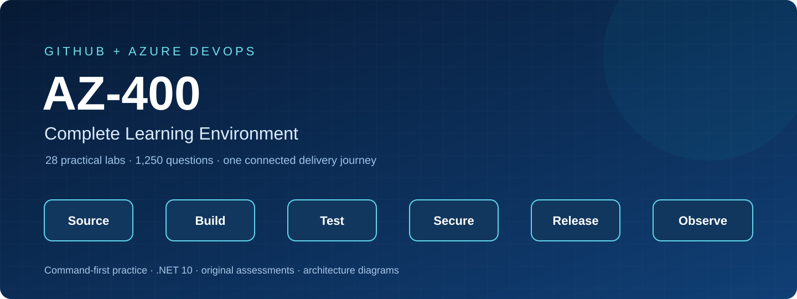

# AZ-400 Complete Learning Environment



A command-first path from source control to reliable delivery, covering **Azure
DevOps and GitHub** with 28 practical labs, 1,250 original assessment questions,
and one tested ASP.NET Core .NET 10 sample application.

Aligned to the **July 27, 2026** English AZ-400 objectives; sources checked
**October 16, 2026**. Every one of the 86 objective bullets has a lab mapping.
This is an independent learning project, not an official Microsoft course.

[Open the searchable course](https://jamonygr.github.io/az400-azure-devops-engineer-labs/)
· [Lab catalog](labs/README.md) · [Objective map](docs/objective-map.md)
· [Assessment dashboard](docs/question-bank-index.md)

## Choose a pathway

| Pathway | Route | Outcome |
|---|---|---|
| Quick start | Readiness → 00 → 04 → 08 → 09 → 10 → 17 → 24 | Follow one change from a branch to an observable deployment |
| Full exam preparation | 00 → 01–25 → assessments → 26–27 | Cover every objective and explain platform tradeoffs |
| Job ready | All labs, break/fix exercises, challenges, and both capstones | Own delivery, security, incidents, rollback, and cleanup |

## Start safely

1. Review [prerequisites](docs/prerequisites.md) and [one-time account setup](docs/account-bootstrap.md).
2. Open PowerShell 7.4+ in the cloned repository and run `./tools/Initialize-LabEnvironment.ps1`.
3. Set your explicit platform context as described in [configuration](docs/configuration.md).
4. Read [cost and cleanup](docs/cost-and-cleanup.md), then complete [Lab 00](labs/00-safe-bootstrap/README.md).
5. Choose a route and retain redacted evidence in the ignored `.state/` folder.

Setup and cleanup **preview by default**. To inspect a run without creating
anything:

```powershell
./labs/00-safe-bootstrap/scripts/cli/Setup.ps1 -RunId first-run
```

Each live lab creates fresh private sandbox repositories/projects and, when
required, a tagged Azure resource group. Use `-ProvisionOnly -Execute` to prepare
owned containers for the guided commands, or `-Execute` for the automated lane.
Cost and identity gates are documented per lab. Use distinct run IDs for the two
lanes. Context changes and unowned objects cause a refusal.

## What every lab provides

- A scenario, engineering role, outcome, concept primer, and five guided checkpoints.
- An accessible architecture diagram with editable Mermaid source.
- Permissions, cost gates, exact-context commands, expected state, positive/negative checks, and evidence guidance.
- Deterministic break/fix, troubleshooting, an optional challenge, and a worked solution.
- `Preflight.ps1`, `Setup.ps1`, `Validate.ps1`, and `Cleanup.ps1` with recoverable ownership journals and residual reporting.
- Fifty original questions in Labs 01–25, each with answer rationales and objective/checkpoint/source traceability.

The shared lifecycle engine is included in this checkout; run lab scripts from
the complete repository. Foundation and capstones are hands-on only.

## Coverage

| Domain | Exam weight | Labs | Questions |
|---|---|---|---:|
| Processes and communications | 10–15% | 01–03 | 150 |
| Source control | 10–15% | 04–06 | 150 |
| Build and release pipelines | 50–55% | 07–19 | 650 |
| Security and compliance | 10–15% | 20–23 | 200 |
| Instrumentation | 5–10% | 24–25 | 100 |
| Foundation and capstones | Supporting practice | 00, 26–27 | Hands-on only |

Lab duration and cross-domain reinforcement keep most study effort on pipelines;
the assessment counts are learning material, not a prediction of exam question
distribution. Questions are original practice material, not recalled exam items.

## Documentation and progress

The Material for MkDocs site includes blue/cyan light and dark themes, search,
domain navigation, a glossary, and browser-local progress with JSON import/export.
Completion requires successful validation and cleanup. Progress exports contain
no account, subscription, resource identifiers, or credentials.

```powershell
python -m pip install -r requirements-dev.txt -r requirements-docs.txt
python tools/build_docs_site.py
python -m mkdocs serve --strict
```

See the [study plan](docs/study-plan.md), [command cheatsheet](docs/command-cheatsheet.md),
[troubleshooting guide](docs/troubleshooting.md), and [validation status](docs/validation-status.md).

## Current-service notes

Workload identity federation/OIDC is the default authentication pattern.
The course distinguishes exam topics from current deployment recommendations;
see [dated service changes](docs/service-lifecycle.md) for retiring services and
supported alternatives. Paid integrations have explicit prerequisites and
skipping them produces a partial result.

Repository CI builds/tests the sample, verifies course contracts, and publishes
documentation. Deployment examples remain in lab artifact folders. Initial
release validation is local and CI-based; live Azure/DevOps paths are **not
live-verified**. Successful static checks do not establish cloud deployment success.

## License and sources

[MIT](LICENSE). The learning framework adapts the author's
[AZ-104 repository](https://github.com/Jamonygr/az104-azure-administrator-labs).
Official objectives: [Microsoft AZ-400 study guide](https://learn.microsoft.com/en-us/credentials/certifications/resources/study-guides/az-400).
