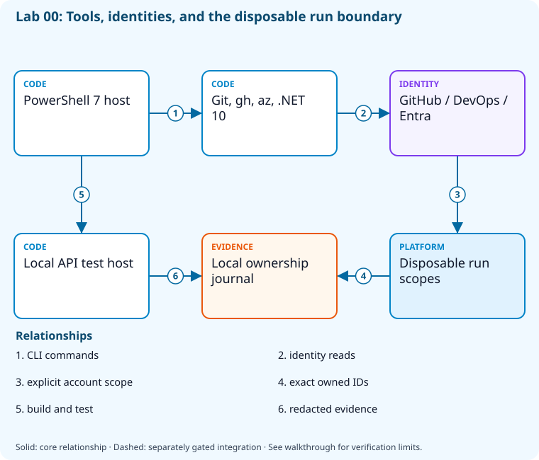

# Lab 00: Safe DevOps sandbox bootstrap

[Catalog](../../docs/lab-catalog.md) · [Next: Lab 01](../01-work-tracking-traceability/README.md)

## Scenario, role, and outcome

You have a new training subscription and two code-hosting accounts. Establish the exact disposable boundary before any delivery automation can change resources.

Learner role: **Platform learner**. Outcome: Safe DevOps sandbox bootstrap.

| Item | Value |
|---|---|
| Time | 60 minutes |
| Domain | foundation |
| Platforms | local, github, azure-devops, azure |
| Cost | none or approved hosted-run allowance — review [current pricing and cleanup](../../docs/cost-and-cleanup.md) before cloud execution |
| Exam blueprint | July 27, 2026; sources reviewed October 16, 2026 |
| Verification status | not-run |
| Verification scope | All checkpoint/fault scripts parse; the named fault lifecycle is independently tested with explicit provider doubles. Full normal provider execution and live cloud delivery have not run. |

Completion requires all five checkpoints, the break/fix repair, successful
independent validation, and a passing residual-resource audit. An unavailable
external prerequisite is a visible gate; it does not become a passing result.

## Architecture and service topology



PowerShell hosts the command-line tools. Read-only account queries identify GitHub, Azure DevOps, and Entra contexts; provisioning is a separate explicit step that records disposable scope IDs in the local ownership journal. The .NET test host runs locally and contributes test evidence, without granting cloud execution approval.

The editable [Mermaid source](diagrams/architecture.mmd) and accessible SVG
render the same authored components and relationships. Dashed connections show
separately gated integrations. Read every boundary before executing commands. Cloud changes
stay inside the exact disposable GitHub repository, Azure DevOps project, and
Azure resource group recorded for this run. Child objects inherit that cleanup
boundary. Account creation, external integrations, and privileged organization
settings belong to [one-time bootstrap](../../docs/account-bootstrap.md).

## Objectives and checkpoints

Coverage levels describe the intended learning evidence: **explained** means reasoned
understanding, **practiced** means an observable isolated skill, and **integrated**
means skills connected across a delivery boundary. These labels are curriculum
claims, not execution status. Verification above records what authors actually ran.

Official objective topic IDs: Foundation or cross-domain capstone; see the objective map.

| Checkpoint | Measurable behavior |
|---|---|
| [CP1](#task-1) | Inspect the local toolchain |
| [CP2](#task-2) | Prove authenticated account context |
| [CP3](#task-3) | Create deterministic local ownership evidence |
| [CP4](#task-4) | Build and test the shared sample |
| [CP5](#task-5) | Establish redacted evidence and cleanup rules |

The [objective map](../../docs/objective-map.md) traces every official topic to
labs. The [Microsoft study guide](https://learn.microsoft.com/en-us/credentials/certifications/resources/study-guides/az-400)
controls authoritative objective wording and domain weighting.

## Inputs, permissions, and read-only preflight

Use PowerShell 7.4+, .NET 10, Git, GitHub CLI, Azure CLI with the Azure DevOps
extension, and the pinned repository validation dependencies. Read the
[permissions matrix](../../docs/permissions-matrix.md) and [evidence policy](../../docs/evidence-handling.md).
Supply only the accounts needed by this lab. Never put a token, connection
string, or private key into a command log, committed YAML, or progress export.

The examples run from the repository root. Choose a fresh lowercase run ID;
`demo01` is an example, not a reusable shared sandbox. Set bootstrap environment
variables for the approved GitHub owner, DevOps organization, subscription, and
region. Do not run both guided and automated lanes with the same run ID.

```powershell
$lab = './labs/00-safe-bootstrap/scripts/cli'
& "$lab/Preflight.ps1" -RunId 'demo01'
& "$lab/Setup.ps1" -RunId 'demo01' -ProvisionOnly
# After reviewing context, permissions, cost, and cleanup:
& "$lab/Setup.ps1" -RunId 'demo01' -ProvisionOnly -Execute -AcknowledgeCost -AcknowledgeTenantChange
. "$lab/Context.ps1" -RunId 'demo01'
```

Preflight performs reads only. Provisioning creates fresh run-owned top-level
sandboxes and records their exact IDs. Context establishes `$RepoRoot`,
`$LabRoot`, `$WorkRoot`, `$RunId`, `$GhRepo`, `$AdoOrganization`, `$AdoProject`,
`$SubscriptionId`, `$Location`, and `$ResourceGroup`. A missing prerequisite or
ownership mismatch must stop execution. Local build commands may restore
packages and write ignored build output.

## Concept primer and design decisions

Tool readiness, authentication, authorization, and permission to mutate are separate gates. A local success cannot authorize cloud execution.

Read version output before authenticating. A successful login establishes identity, while a role assignment establishes a particular permission at a particular scope. Neither authorizes a different subscription or existing repository. The run journal records the boundary that later validators and cleanup must use.

Retain tool versions, exact sandbox object IDs and redacted results. A test report without a source revision is difficult to reproduce; a cleanup report without residual reads is only an intention. Treat a missing external account as an explicit prerequisite and keep local validation distinct from hosted execution.

## Task 1 — Inspect the local toolchain

<a id="task-1"></a>

Checkpoint: `CP1`

Foundation/supporting task; no additional exam-objective coverage is claimed.

```powershell
$toolReport = [ordered]@{ powershell=$PSVersionTable.PSVersion.ToString(); git=(git --version); github=(gh --version | Select-Object -First 1); dotnet=(dotnet --version); azure=(az version --query '"azure-cli"' -o tsv) }
 $toolReport | ConvertTo-Json | Set-Content (Join-Path $WorkRoot 'tools.json')
 $toolReport
```

Expected state: PowerShell 7.4+, Git, GitHub CLI, Azure CLI, and .NET 10 are available.

Positive validation:

```powershell
$t=Get-Content (Join-Path $WorkRoot 'tools.json') -Raw | ConvertFrom-Json
 if ([version]$t.powershell -lt [version]'7.4' -or $t.dotnet -notmatch '^10\.') { throw 'Required PowerShell/.NET major versions missing.' }
```

Negative validation:

```powershell
$t=Get-Content (Join-Path $WorkRoot 'tools.json') -Raw | ConvertFrom-Json
 if (@($t.git,$t.github,$t.azure) -contains '') { throw 'A required CLI reported no version.' }
```

Evidence to retain: tools.json without authentication tokens.

Common failure and safe retry: Install the missing tool outside the lab, reopen PowerShell, and repeat version checks.

Cleanup dependency: retain this checkpoint's evidence until final validation; remove run-owned children before their recorded parent boundary.

## Task 2 — Prove authenticated account context

<a id="task-2"></a>

Checkpoint: `CP2`

Foundation/supporting task; no additional exam-objective coverage is claimed.

```powershell
gh api user --jq '{login:.login,id:.id}' | Set-Content (Join-Path $WorkRoot 'github-context.json')
 az account show --subscription $SubscriptionId --query '{subscription:id,tenant:tenantId,cloud:environmentName}' -o json | Set-Content (Join-Path $WorkRoot 'azure-context.json')
 az devops project list --organization $AdoOrganization --query 'value[].{name:name,id:id}' -o json | Set-Content (Join-Path $WorkRoot 'ado-context.json')
```

Expected state: Read-only identity queries succeed without changing active Azure or DevOps defaults.

Positive validation:

```powershell
$a=Get-Content (Join-Path $WorkRoot 'azure-context.json') -Raw|ConvertFrom-Json
 if ($a.subscription -ne $SubscriptionId) { throw 'Azure context mismatch.' }
```

Negative validation:

```powershell
$g=Get-Content (Join-Path $WorkRoot 'github-context.json') -Raw|ConvertFrom-Json
 if (-not $g.login -or $AdoOrganization -notmatch '^https://dev.azure.com/[^/]+/?$') { throw 'Missing GitHub identity or explicit organization.' }
```

Evidence to retain: Redact user, tenant, and subscription identifiers before sharing context files.

Common failure and safe retry: Authenticate deliberately outside preflight and supply the approved disposable subscription.

Cleanup dependency: retain this checkpoint's evidence until final validation; remove run-owned children before their recorded parent boundary.

## Task 3 — Create deterministic local ownership evidence

<a id="task-3"></a>

Checkpoint: `CP3`

Foundation/supporting task; no additional exam-objective coverage is claimed.

```powershell
$boundary=[ordered]@{ runId=$RunId; localRoot=$WorkRoot; purpose='az400-learning'; cloudExecutionApproved=$false }
 $boundary|ConvertTo-Json|Set-Content (Join-Path $WorkRoot 'boundary.json')
 Get-Content (Join-Path $WorkRoot 'boundary.json')
```

Expected state: A run-specific local boundary is recorded; it grants no cloud approval.

Positive validation:

```powershell
$b=Get-Content (Join-Path $WorkRoot 'boundary.json') -Raw|ConvertFrom-Json
 if ($b.runId -ne $RunId -or $b.purpose -ne 'az400-learning') { throw 'Ownership record mismatch.' }
```

Negative validation:

```powershell
$b=Get-Content (Join-Path $WorkRoot 'boundary.json') -Raw|ConvertFrom-Json
 if ($b.cloudExecutionApproved -ne $false) { throw 'Local readiness must not grant deployment approval.' }
```

Evidence to retain: boundary.json and the selected run ID.

Common failure and safe retry: Choose a fresh lowercase run ID; do not reuse another learner boundary.

Cleanup dependency: retain this checkpoint's evidence until final validation; remove run-owned children before their recorded parent boundary.

## Task 4 — Build and test the shared sample

<a id="task-4"></a>

Checkpoint: `CP4`

Foundation/supporting task; no additional exam-objective coverage is claimed.

```powershell
dotnet restore (Join-Path $RepoRoot 'samples/DevOps.slnx')
 dotnet build (Join-Path $RepoRoot 'samples/DevOps.slnx') --no-restore --configuration Release
 dotnet test (Join-Path $RepoRoot 'samples/DevOps.slnx') --no-build --configuration Release --logger "trx;LogFileName=bootstrap.trx" --results-directory (Join-Path $WorkRoot 'test-results')
 if ($LASTEXITCODE -ne 0) { throw 'Sample verification failed.' }
```

Expected state: The .NET 10 sample builds and its tests pass locally.

Positive validation:

```powershell
$trx=Get-ChildItem (Join-Path $WorkRoot 'test-results') -Filter '*.trx' -Recurse
 if ($trx.Count -lt 1) { throw 'No test result was produced.' }
```

Negative validation:

```powershell
$xml=[xml](Get-Content (Get-ChildItem (Join-Path $WorkRoot 'test-results') -Filter '*.trx' -Recurse|Select-Object -First 1).FullName -Raw)
 if ([int]$xml.TestRun.ResultSummary.Counters.failed -ne 0) { throw 'A sample test failed.' }
```

Evidence to retain: TRX test summary and build exit code.

Common failure and safe retry: Use the repository SDK version and restore packages before repeating the build.

Cleanup dependency: retain this checkpoint's evidence until final validation; remove run-owned children before their recorded parent boundary.

## Task 5 — Establish redacted evidence and cleanup rules

<a id="task-5"></a>

Checkpoint: `CP5`

Foundation/supporting task; no additional exam-objective coverage is claimed.

```powershell
$policy=[ordered]@{ retain=@('checkpoint results','test counts','cleanup status'); exclude=@('tokens','connection strings','private keys'); cleanupOrder=@('workloads','connections','top-level sandbox') }
 $policy|ConvertTo-Json -Depth 5|Set-Content (Join-Path $WorkRoot 'evidence-policy.json')
 Get-Content (Join-Path $WorkRoot 'evidence-policy.json')
```

Expected state: Evidence excludes credentials and declares dependency-aware cleanup.

Positive validation:

```powershell
$p=Get-Content (Join-Path $WorkRoot 'evidence-policy.json') -Raw|ConvertFrom-Json
 if ('tokens' -notin $p.exclude -or $p.cleanupOrder[-1] -ne 'top-level sandbox') { throw 'Evidence policy incomplete.' }
```

Negative validation:

```powershell
$p=Get-Content (Join-Path $WorkRoot 'evidence-policy.json') -Raw|ConvertFrom-Json
 if ('private keys' -in $p.retain) { throw 'Credential retention is forbidden.' }
```

Evidence to retain: evidence-policy.json; never include CLI token stores.

Common failure and safe retry: Remove confidential fields from exports, retain local manifests for cleanup, and rerun validation.

Cleanup dependency: retain this checkpoint's evidence until final validation; remove run-owned children before their recorded parent boundary.

## Deterministic break/fix

Run the journaled operation after all five checkpoints. It proves the healthy assertion, injects the named fault, requires its rejection, repairs it, and proves health again. Provider doubles used in author tests are not live enforcement evidence.

```powershell
& './labs/00-safe-bootstrap/scripts/cli/BreakFix.ps1' -RunId 'demo01' -Execute
```

Expected rejection marker: `AZ400-L00-FAULT`. The assertion must catch the changed behavior, not merely an exception from an unavailable CLI.

Inspect the independent assertion:

```powershell
$b=Get-Content (Join-Path $WorkRoot 'boundary.json') -Raw|ConvertFrom-Json
if($b.runId -ne $RunId){throw 'AZ400-L00-FAULT'}
```

Fault trigger (executed by BreakFix):

```powershell
$b=Get-Content (Join-Path $WorkRoot 'boundary.json') -Raw|ConvertFrom-Json
 $b.runId='wrong-run';$b|ConvertTo-Json|Set-Content (Join-Path $WorkRoot 'boundary.json')
```

Diagnose the precise difference:

```powershell
Get-Content (Join-Path $WorkRoot 'boundary.json')
 'Compare runId with the explicitly selected $RunId.'
```

Repair (executed by BreakFix):

```powershell
$b=Get-Content (Join-Path $WorkRoot 'boundary.json') -Raw|ConvertFrom-Json
 $b.runId=$RunId;$b|ConvertTo-Json|Set-Content (Join-Path $WorkRoot 'boundary.json')
```

## Optional job-style challenge

Run readiness from a second terminal and demonstrate that no authentication context or cloud resource changes.

## Final validation and result interpretation

```powershell
& './labs/00-safe-bootstrap/scripts/cli/Validate.ps1' -RunId 'demo01'
```

A complete result requires five passing read-only checkpoint assertions, a journaled repaired fault, and any required integration evidence. Pending hosted runs, missing licensed features, and unexecuted integration lanes remain visible. Review `validation.json`; successful command exit alone does not establish the asserted behavior.

## Troubleshooting

- **401/403:** inspect the explicit account/project/repository scope and required role; do not broaden a token reflexively.
- **Resource or artifact missing:** confirm the exact run ID and prerequisite checkpoint; retry reads after eventual consistency.
- **Unsupported SKU/runtime/tool:** consult the specific current source, record the gate, and obtain approval before changing cost or architecture.
- **Validation mismatch:** inspect the positive and negative assertions separately, repair the named fault, and rerun validation.
- **Ownership refusal:** stop; never edit a manifest to claim an unrelated resource.

## Cleanup and residual checks

```powershell
& './labs/00-safe-bootstrap/scripts/cli/Cleanup.ps1' -RunId 'demo01'
# Review the exact owned-object deletion plan first.
& './labs/00-safe-bootstrap/scripts/cli/Cleanup.ps1' -RunId 'demo01' -Execute
```

Cleanup must verify ownership, delete only recorded sandbox objects in dependency order, and prove parent/child absence. Retain `run.json`, `validation.json`, and `cleanup.json` locally until the audit passes. Soft-deleted or deliberately retained items must remain reported. Never purge a shared vault or delete an account, organization, or pre-existing service connection to finish a lab.

## Exam debrief and assessment

Explain why each checkpoint's denied path matters, which scope authorizes it, what evidence proves it, and how it is reversed. This foundation/capstone is hands-on only; use its validation and recovery evidence for assessment.

## Microsoft and platform sources

- [Primary source 1](https://learn.microsoft.com/en-us/cli/azure/authenticate-azure-cli) — reviewed 2026-10-16.
- [Primary source 2](https://cli.github.com/manual/gh_auth_status) — reviewed 2026-10-16.
- [Primary source 3](https://learn.microsoft.com/en-us/dotnet/core/tools/dotnet-test) — reviewed 2026-10-16.

## Lifecycle scripts and worked solution

Use `scripts/cli/Preflight.ps1`, `Setup.ps1`, `BreakFix.ps1`, `Integration.ps1` (capstones), `Validate.ps1`, `Cleanup.ps1`, and `Context.ps1` from this lab folder. Setup and cleanup preview until `-Execute`; `-ProvisionOnly` creates only fresh ownership-tracked containers. The [worked solution](solution/README.md) lists expected results and repair reasoning.
