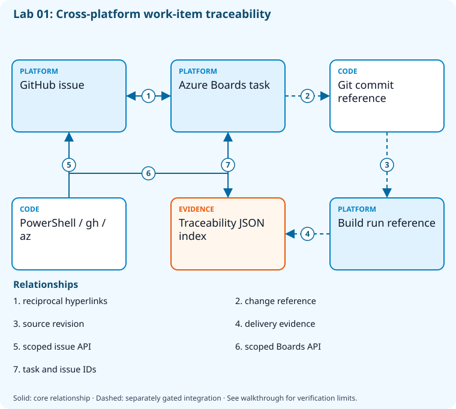

# Lab 01: Connect work items to source and delivery

[Previous: Lab 00](../00-safe-bootstrap/README.md) · [Catalog](../../docs/lab-catalog.md) · [Next: Lab 02](../02-devops-metrics/README.md)

## Scenario, role, and outcome

A product change is tracked in GitHub while the delivery team plans in Azure Boards. Build reciprocal traceability without relying on screenshots or an opaque connector.

Learner role: **Delivery engineer**. Outcome: Connect work items to source and delivery.

| Item | Value |
|---|---|
| Time | 120 minutes |
| Domain | process |
| Platforms | local, github, azure-devops |
| Cost | none — review [current pricing and cleanup](../../docs/cost-and-cleanup.md) before cloud execution |
| Exam blueprint | July 27, 2026; sources reviewed October 16, 2026 |
| Verification status | not-run |
| Verification scope | All checkpoint/fault scripts parse; the named fault lifecycle is independently tested with explicit provider doubles. Full normal provider execution and live cloud delivery have not run. |

Completion requires all five checkpoints, the break/fix repair, successful
independent validation, and a passing residual-resource audit. An unavailable
external prerequisite is a visible gate; it does not become a passing result.

## Architecture and service topology



GitHub issues and Azure Boards tasks contain reciprocal links inside the owned repository and project. PowerShell queries both APIs and writes a local traceability index. Commit and build references are the next evidence layer added by the job challenge; the hyperlinks alone do not prove delivery.

The editable [Mermaid source](diagrams/architecture.mmd) and accessible SVG
render the same authored components and relationships. Dashed connections show
separately gated integrations. Read every boundary before executing commands. Cloud changes
stay inside the exact disposable GitHub repository, Azure DevOps project, and
Azure resource group recorded for this run. Child objects inherit that cleanup
boundary. Account creation, external integrations, and privileged organization
settings belong to [one-time bootstrap](../../docs/account-bootstrap.md).

## Objectives and checkpoints

Coverage levels describe the intended learning evidence: **explained** means reasoned
understanding, **practiced** means an observable isolated skill, and **integrated**
means skills connected across a delivery boundary. These labels are curriculum
claims, not execution status. Verification above records what authors actually ran.

Official objective topic IDs: `D1.1.1`, `D1.1.2`, `D1.1.3`, `D1.1.4`, `D1.3.5`

| Checkpoint | Measurable behavior |
|---|---|
| [CP1](#task-1) | Create a GitHub work item with acceptance criteria |
| [CP2](#task-2) | Create the matching Azure Boards task |
| [CP3](#task-3) | Link Boards to the GitHub issue |
| [CP4](#task-4) | Add reciprocal traceability to the issue |
| [CP5](#task-5) | Query the work queue and produce a traceability index |

The [objective map](../../docs/objective-map.md) traces every official topic to
labs. The [Microsoft study guide](https://learn.microsoft.com/en-us/credentials/certifications/resources/study-guides/az-400)
controls authoritative objective wording and domain weighting.

## Inputs, permissions, and read-only preflight

Use PowerShell 7.4+, .NET 10, Git, GitHub CLI, Azure CLI with the Azure DevOps
extension, and the pinned repository validation dependencies. Read the
[permissions matrix](../../docs/permissions-matrix.md) and [evidence policy](../../docs/evidence-handling.md).
Supply only the accounts needed by this lab. Never put a token, connection
string, or private key into a command log, committed YAML, or progress export.

The examples run from the repository root. Choose a fresh lowercase run ID;
`demo01` is an example, not a reusable shared sandbox. Set bootstrap environment
variables for the approved GitHub owner, DevOps organization, subscription, and
region. Do not run both guided and automated lanes with the same run ID.

```powershell
$lab = './labs/01-work-tracking-traceability/scripts/cli'
& "$lab/Preflight.ps1" -RunId 'demo01'
& "$lab/Setup.ps1" -RunId 'demo01' -ProvisionOnly
# After reviewing context, permissions, cost, and cleanup:
& "$lab/Setup.ps1" -RunId 'demo01' -ProvisionOnly -Execute -AcknowledgeCost -AcknowledgeTenantChange
. "$lab/Context.ps1" -RunId 'demo01'
```

Preflight performs reads only. Provisioning creates fresh run-owned top-level
sandboxes and records their exact IDs. Context establishes `$RepoRoot`,
`$LabRoot`, `$WorkRoot`, `$RunId`, `$GhRepo`, `$AdoOrganization`, `$AdoProject`,
`$SubscriptionId`, `$Location`, and `$ResourceGroup`. A missing prerequisite or
ownership mismatch must stop execution. Local build commands may restore
packages and write ignored build output.

## Concept primer and design decisions

Acceptance criteria express observable value. A work-item link proves navigability; it does not itself prove a tested change reached an environment.

Model a requirement as an observable acceptance statement rather than a task title. The GitHub issue and Boards task are two independently stored work items; reciprocal hyperlinks establish navigation, not automatic synchronization of state or delivery evidence.

CP5 deliberately produces a work-item index. It does not prove the health endpoint was implemented or deployed. To establish quality traceability, extend the index with the actual reviewed commit, test run, immutable artifact and environment result in a capstone. Feedback should change acceptance or priority through an explicit review loop.

## Task 1 — Create a GitHub work item with acceptance criteria

<a id="task-1"></a>

Checkpoint: `CP1`

| Objective | Evidence level | Observation and limits |
|---|---|---|
| `D1.1.1` | explained | Acceptance fields distinguish planning, implementation, review, and release states; the fixture is not a configured organization-wide process. |

```powershell
$issueTitle="[$RunId] Add release health endpoint"
$existing=@(gh issue list --repo $GhRepo --state all --limit 100 --json number,title,url|ConvertFrom-Json|Where-Object title -eq $issueTitle)
if($existing.Count -gt 1){throw 'Duplicate run-owned issue titles; inspect before retrying.'}
$issueUrl=if($existing.Count -eq 1){$existing[0].url}else{gh issue create --repo $GhRepo --title $issueTitle --body "Acceptance: health returns HTTP 200; unit test passes; release evidence links this issue. Run:$RunId"}
 $issueUrl|Set-Content (Join-Path $WorkRoot 'issue-url.txt')
 $issueNumber=($issueUrl -split '/')[-1];$issueNumber|Set-Content (Join-Path $WorkRoot 'issue-number.txt')
```

Expected state: A sandbox issue describes a measurable delivery outcome.

Positive validation:

```powershell
$n=Get-Content (Join-Path $WorkRoot 'issue-number.txt')
 $i=gh issue view $n --repo $GhRepo --json title,body,state|ConvertFrom-Json
 if ($i.body -notmatch 'Acceptance:' -or $i.state -ne 'OPEN') { throw 'Issue lacks open acceptance criteria.' }
```

Negative validation:

```powershell
$n=Get-Content (Join-Path $WorkRoot 'issue-number.txt')
 $i=gh issue view $n --repo $GhRepo --json title|ConvertFrom-Json
 if ($i.title -notlike "*[$RunId]*" -and $i.title -notmatch [regex]::Escape($RunId)) { throw 'Issue escaped run boundary.' }
```

Evidence to retain: Issue number and redacted acceptance text.

Common failure and safe retry: Confirm issues are enabled in the fresh sandbox repository and use its exact owner/repo.

Cleanup dependency: retain this checkpoint's evidence until final validation; remove run-owned children before their recorded parent boundary.

## Task 2 — Create the matching Azure Boards task

<a id="task-2"></a>

Checkpoint: `CP2`

Foundation/supporting task; no additional exam-objective coverage is claimed.

```powershell
$wi=az boards work-item create --organization $AdoOrganization --project $AdoProject --type Task --title "[$RunId] Deliver health endpoint" --description "Acceptance: health endpoint, passing test, and linked GitHub issue." -o json|ConvertFrom-Json
 $wi.id|Set-Content (Join-Path $WorkRoot 'work-item-id.txt')
```

Expected state: A task exists in the disposable Azure DevOps project.

Positive validation:

```powershell
$id=Get-Content (Join-Path $WorkRoot 'work-item-id.txt')
 $w=az boards work-item show --organization $AdoOrganization --id $id -o json|ConvertFrom-Json
 if ($w.fields.'System.TeamProject' -ne $AdoProject) { throw 'Work item belongs to another project.' }
```

Negative validation:

```powershell
$id=Get-Content (Join-Path $WorkRoot 'work-item-id.txt')
 $w=az boards work-item show --organization $AdoOrganization --id $id -o json|ConvertFrom-Json
 if ($w.fields.'System.WorkItemType' -ne 'Task') { throw 'Wrong tracking artifact type.' }
```

Evidence to retain: Task ID, type, state, and project name.

Common failure and safe retry: Use a Task supported by the sandbox process and verify project permissions.

Cleanup dependency: retain this checkpoint's evidence until final validation; remove run-owned children before their recorded parent boundary.

## Task 3 — Link Boards to the GitHub issue

<a id="task-3"></a>

Checkpoint: `CP3`

| Objective | Evidence level | Observation and limits |
|---|---|---|
| `D1.1.3` | integrated | Link the GitHub issue and the Azure Boards work item and query both identifiers. |
| `D1.3.5` | integrated | Read back the reciprocal issue/work-item URL relationship inside both disposable sandboxes. |

```powershell
$id=Get-Content (Join-Path $WorkRoot 'work-item-id.txt')
 $issueUrl=Get-Content (Join-Path $WorkRoot 'issue-url.txt')
 az boards work-item relation add --organization $AdoOrganization --id $id --relation-type Hyperlink --target-url $issueUrl -o json | Set-Content (Join-Path $WorkRoot 'linked-task.json')
```

Expected state: The task exposes a hyperlink to the corresponding issue.

Positive validation:

```powershell
$id=Get-Content (Join-Path $WorkRoot 'work-item-id.txt')
 $w=az boards work-item show --organization $AdoOrganization --id $id --expand relations -o json|ConvertFrom-Json
 if (@($w.relations|Where-Object url -eq (Get-Content (Join-Path $WorkRoot 'issue-url.txt'))).Count -ne 1) { throw 'Issue link absent or duplicated.' }
```

Negative validation:

```powershell
$w=Get-Content (Join-Path $WorkRoot 'linked-task.json') -Raw|ConvertFrom-Json
 if (@($w.relations|Where-Object { $_.rel -ne 'Hyperlink' }).Count -gt 0) { throw 'Unexpected relation in fresh task.' }
```

Evidence to retain: Relation type and redacted target URL.

Common failure and safe retry: Remove only the duplicate sandbox hyperlink and retry the exact target.

Cleanup dependency: retain this checkpoint's evidence until final validation; remove run-owned children before their recorded parent boundary.

## Task 4 — Add reciprocal traceability to the issue

<a id="task-4"></a>

Checkpoint: `CP4`

| Objective | Evidence level | Observation and limits |
|---|---|---|
| `D1.1.2` | practiced | Update the run-owned issue after feedback and read the revised acceptance text. |

```powershell
$id=Get-Content (Join-Path $WorkRoot 'work-item-id.txt')
 $n=Get-Content (Join-Path $WorkRoot 'issue-number.txt')
 $boardUrl="$AdoOrganization/$([uri]::EscapeDataString($AdoProject))/_workitems/edit/$id"
 gh issue edit $n --repo $GhRepo --body "Acceptance: health returns HTTP 200; tests pass. Azure Boards: $boardUrl. Run:$RunId"
 $boardUrl|Set-Content (Join-Path $WorkRoot 'board-url.txt')
```

Expected state: GitHub issue and Boards task form a navigable traceability pair.

Positive validation:

```powershell
$n=Get-Content (Join-Path $WorkRoot 'issue-number.txt')
 $i=gh issue view $n --repo $GhRepo --json body|ConvertFrom-Json
 if (-not $i.body.Contains((Get-Content (Join-Path $WorkRoot 'board-url.txt')))) { throw 'Reciprocal link missing.' }
```

Negative validation:

```powershell
$n=Get-Content (Join-Path $WorkRoot 'issue-number.txt')
 $i=gh issue view $n --repo $GhRepo --json body|ConvertFrom-Json
 if ($i.body -match 'TODO|TBD') { throw 'Incomplete acceptance text.' }
```

Evidence to retain: Issue body with reciprocal task link.

Common failure and safe retry: Edit only the run-owned issue and retain its acceptance criteria.

Cleanup dependency: retain this checkpoint's evidence until final validation; remove run-owned children before their recorded parent boundary.

## Task 5 — Query the work queue and produce a traceability index

<a id="task-5"></a>

Checkpoint: `CP5`

| Objective | Evidence level | Observation and limits |
|---|---|---|
| `D1.1.4` | explained | The work-item index explains requirement-to-quality traceability; exact source/test/artifact/environment linkage is implemented in the capstones. |

```powershell
$q="SELECT [System.Id], [System.Title], [System.State] FROM WorkItems WHERE [System.TeamProject] = '$($AdoProject.Replace("'","''"))' AND [System.WorkItemType] = 'Task'"
 az boards query --organization $AdoOrganization --project $AdoProject --wiql $q -o json|Set-Content (Join-Path $WorkRoot 'queue.json')
 [ordered]@{issue=(Get-Content (Join-Path $WorkRoot 'issue-url.txt'));workItem=(Get-Content (Join-Path $WorkRoot 'work-item-id.txt'));acceptance='HTTP200 and passing tests'}|ConvertTo-Json|Set-Content (Join-Path $WorkRoot 'traceability.json')
```

Expected state: The project query includes the owned task and an index retains both tracking IDs.

Positive validation:

```powershell
$q=@(Get-Content (Join-Path $WorkRoot 'queue.json') -Raw|ConvertFrom-Json)
 $id=[int](Get-Content (Join-Path $WorkRoot 'work-item-id.txt'))
 if ($id -notin @($q.id)) { throw 'Owned task absent from project query.' }
```

Negative validation:

```powershell
$t=Get-Content (Join-Path $WorkRoot 'traceability.json') -Raw|ConvertFrom-Json
 if (-not $t.issue -or -not $t.workItem -or $t.acceptance -notmatch 'passing tests') { throw 'Traceability index incomplete.' }
```

Evidence to retain: Queue count and traceability.json with private URLs redacted.

Common failure and safe retry: Correct WIQL quoting and ensure the same disposable project is used for creation and query.

Cleanup dependency: retain this checkpoint's evidence until final validation; remove run-owned children before their recorded parent boundary.

## Deterministic break/fix

Run the journaled operation after all five checkpoints. It proves the healthy assertion, injects the named fault, requires its rejection, repairs it, and proves health again. Provider doubles used in author tests are not live enforcement evidence.

```powershell
& './labs/01-work-tracking-traceability/scripts/cli/BreakFix.ps1' -RunId 'demo01' -Execute
```

Expected rejection marker: `AZ400-L01-FAULT`. The assertion must catch the changed behavior, not merely an exception from an unavailable CLI.

Inspect the independent assertion:

```powershell
$n=Get-Content (Join-Path $WorkRoot 'issue-number.txt');$i=gh issue view $n --repo $GhRepo --json body|ConvertFrom-Json
$url=Get-Content (Join-Path $WorkRoot 'board-url.txt')
if(-not $i.body.Contains($url) -or $i.body -notmatch 'Acceptance:'){throw 'AZ400-L01-FAULT'}
```

Fault trigger (executed by BreakFix):

```powershell
$n=Get-Content (Join-Path $WorkRoot 'issue-number.txt')
 gh issue edit $n --repo $GhRepo --body "Run:$RunId; link intentionally removed"
```

Diagnose the precise difference:

```powershell
$n=Get-Content (Join-Path $WorkRoot 'issue-number.txt');gh issue view $n --repo $GhRepo --json body
```

Repair (executed by BreakFix):

```powershell
$n=Get-Content (Join-Path $WorkRoot 'issue-number.txt')
 $url=Get-Content (Join-Path $WorkRoot 'board-url.txt')
 gh issue edit $n --repo $GhRepo --body "Acceptance: health returns HTTP 200; tests pass. Azure Boards: $url. Run:$RunId"
```

## Optional job-style challenge

Extend the index with a real sandbox pull request and a release artifact digest; explain which links prove delivery rather than merely activity.

## Final validation and result interpretation

```powershell
& './labs/01-work-tracking-traceability/scripts/cli/Validate.ps1' -RunId 'demo01'
```

A complete result requires five passing read-only checkpoint assertions, a journaled repaired fault, and any required integration evidence. Pending hosted runs, missing licensed features, and unexecuted integration lanes remain visible. Review `validation.json`; successful command exit alone does not establish the asserted behavior.

## Troubleshooting

- **401/403:** inspect the explicit account/project/repository scope and required role; do not broaden a token reflexively.
- **Resource or artifact missing:** confirm the exact run ID and prerequisite checkpoint; retry reads after eventual consistency.
- **Unsupported SKU/runtime/tool:** consult the specific current source, record the gate, and obtain approval before changing cost or architecture.
- **Validation mismatch:** inspect the positive and negative assertions separately, repair the named fault, and rerun validation.
- **Ownership refusal:** stop; never edit a manifest to claim an unrelated resource.

## Cleanup and residual checks

```powershell
& './labs/01-work-tracking-traceability/scripts/cli/Cleanup.ps1' -RunId 'demo01'
# Review the exact owned-object deletion plan first.
& './labs/01-work-tracking-traceability/scripts/cli/Cleanup.ps1' -RunId 'demo01' -Execute
```

Cleanup must verify ownership, delete only recorded sandbox objects in dependency order, and prove parent/child absence. Retain `run.json`, `validation.json`, and `cleanup.json` locally until the audit passes. Soft-deleted or deliberately retained items must remain reported. Never purge a shared vault or delete an account, organization, or pre-existing service connection to finish a lab.

## Exam debrief and assessment

Explain why each checkpoint's denied path matters, which scope authorizes it, what evidence proves it, and how it is reversed. Complete the [50-question assessment](QUESTIONS.md), then review [rationales](ANSWERS.md) and repeat weak checkpoints.

## Microsoft and platform sources

- [Primary source 1](https://learn.microsoft.com/en-us/azure/devops/boards/work-items/manage-work-items) — reviewed 2026-10-16.
- [Primary source 2](https://learn.microsoft.com/en-us/cli/azure/boards/work-item/relation) — reviewed 2026-10-16.
- [Primary source 3](https://docs.github.com/en/issues/tracking-your-work-with-issues) — reviewed 2026-10-16.

## Lifecycle scripts and worked solution

Use `scripts/cli/Preflight.ps1`, `Setup.ps1`, `BreakFix.ps1`, `Integration.ps1` (capstones), `Validate.ps1`, `Cleanup.ps1`, and `Context.ps1` from this lab folder. Setup and cleanup preview until `-Execute`; `-ProvisionOnly` creates only fresh ownership-tracked containers. The [worked solution](solution/README.md) lists expected results and repair reasoning.
