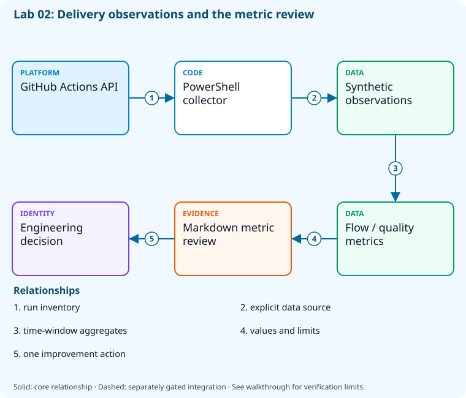

# Lab 02: Measure flow, quality, security, and delivery

[Previous: Lab 01](../01-work-tracking-traceability/README.md) · [Catalog](../../docs/lab-catalog.md) · [Next: Lab 03](../03-collaboration-documentation/README.md)

## Scenario, role, and outcome

The team reports activity counts but cannot explain slow delivery or unstable releases. Derive flow and quality measures from a small transparent dataset.

Learner role: **Engineering lead**. Outcome: Measure flow, quality, security, and delivery.

| Item | Value |
|---|---|
| Time | 120 minutes |
| Domain | process |
| Platforms | local, github |
| Cost | none — review [current pricing and cleanup](../../docs/cost-and-cleanup.md) before cloud execution |
| Exam blueprint | July 27, 2026; sources reviewed October 16, 2026 |
| Verification | Authored and checked offline; no live Azure deployment is claimed |

Completion requires all five checkpoints, the break/fix repair, successful
independent validation, and a passing residual-resource audit. An unavailable
external prerequisite is a visible gate; it does not become a passing result.

## Architecture and service topology



The collector reads the sandbox Actions run inventory while the exercise computes flow and quality measures from an explicitly synthetic JSON dataset. PowerShell produces a Markdown review with denominators and sample-size limits. The engineering decision follows the measurements; no synthetic value is presented as production telemetry.

The editable [Mermaid source](diagrams/architecture.mmd) and accessible SVG
render the same authored components and relationships. Dashed connections show
separately gated integrations. Read every boundary before executing commands. Cloud changes
stay inside the exact disposable GitHub repository, Azure DevOps project, and
Azure resource group recorded for this run. Child objects inherit that cleanup
boundary. Account creation, external integrations, and privileged organization
settings belong to [one-time bootstrap](../../docs/account-bootstrap.md).

## Objectives and checkpoints

Official objective topic IDs: `D1.2.1`, `D1.2.2`, `D1.2.3`, `D1.2.4`, `D1.2.5`, `D1.2.6`, `D1.2.7`

| Checkpoint | Measurable behavior |
|---|---|
| [CP1](#task-1) | Normalize delivery observations |
| [CP2](#task-2) | Calculate flow and recovery measures |
| [CP3](#task-3) | Report testing and security independently |
| [CP4](#task-4) | Inspect workflow durations from the sandbox |
| [CP5](#task-5) | Publish a decision-oriented metric review |

The [objective map](../../docs/objective-map.md) traces every official topic to
labs. The [Microsoft study guide](https://learn.microsoft.com/en-us/credentials/certifications/resources/study-guides/az-400)
controls authoritative objective wording and domain weighting.

## Inputs, permissions, and read-only preflight

Use PowerShell 7.4+, .NET 10, Git, GitHub CLI, Azure CLI with the Azure DevOps
extension, and the pinned repository validation dependencies. Read the
[permissions matrix](../../docs/permissions-matrix.md) and [evidence policy](../../docs/evidence-handling.md).
Supply only the accounts needed by this lab. Never put a token, connection
string, or private key into a command log, committed YAML, or progress export.

The examples run from the repository root. Choose a fresh lowercase run ID;
`demo01` is an example, not a reusable shared sandbox. Set bootstrap environment
variables for the approved GitHub owner, DevOps organization, subscription, and
region. Do not run both guided and automated lanes with the same run ID.

```powershell
$lab = './labs/02-devops-metrics/scripts/cli'
& "$lab/Preflight.ps1" -RunId 'demo01'
& "$lab/Setup.ps1" -RunId 'demo01' -ProvisionOnly
# After reviewing context, permissions, cost, and cleanup:
& "$lab/Setup.ps1" -RunId 'demo01' -ProvisionOnly -Execute -AcknowledgeCost -AcknowledgeTenantChange
. "$lab/Context.ps1" -RunId 'demo01'
```

Preflight performs reads only. Provisioning creates fresh run-owned top-level
sandboxes and records their exact IDs. Context establishes `$RepoRoot`,
`$LabRoot`, `$WorkRoot`, `$RunId`, `$GhRepo`, `$AdoOrganization`, `$AdoProject`,
`$SubscriptionId`, `$Location`, and `$ResourceGroup`. A missing prerequisite or
ownership mismatch must stop execution. Local build commands may restore
packages and write ignored build output.

## Concept primer and design decisions

Lead time includes waiting; cycle time covers active work. Recovery time, change-failure rate, test failures, and security findings have different denominators.

## Task 1 — Normalize delivery observations

<a id="task-1"></a>

Checkpoint: `CP1`

```powershell
$events=@(
 [pscustomobject]@{change='a';leadMinutes=120;cycleMinutes=70;recoveryMinutes=0;failed=$false;tests=50;failedTests=0;criticalFindings=0},
 [pscustomobject]@{change='b';leadMinutes=240;cycleMinutes=100;recoveryMinutes=30;failed=$true;tests=60;failedTests=1;criticalFindings=2},
 [pscustomobject]@{change='c';leadMinutes=90;cycleMinutes=40;recoveryMinutes=0;failed=$false;tests=55;failedTests=0;criticalFindings=0})
 $events|ConvertTo-Json|Set-Content (Join-Path $WorkRoot 'observations.json')
```

Expected state: Three explicitly fictional observations separate flow, tests, and findings.

Positive validation:

```powershell
$e=@(Get-Content (Join-Path $WorkRoot 'observations.json') -Raw|ConvertFrom-Json)
 if ($e.Count -ne 3 -or ($e|Measure-Object leadMinutes -Minimum).Minimum -lt 0) { throw 'Invalid observation data.' }
```

Negative validation:

```powershell
$e=@(Get-Content (Join-Path $WorkRoot 'observations.json') -Raw|ConvertFrom-Json)
 if (@($e|Where-Object { $_.cycleMinutes -gt $_.leadMinutes }).Count) { throw 'Cycle time exceeds lead time.' }
```

Evidence to retain: observations.json marked synthetic.

Common failure and safe retry: Use one time unit and keep observation windows consistent.

Cleanup dependency: retain this checkpoint's evidence until final validation; remove run-owned children before their recorded parent boundary.

## Task 2 — Calculate flow and recovery measures

<a id="task-2"></a>

Checkpoint: `CP2`

```powershell
$e=@(Get-Content (Join-Path $WorkRoot 'observations.json') -Raw|ConvertFrom-Json)
 $m=[ordered]@{meanLeadMinutes=($e|Measure-Object leadMinutes -Average).Average;meanCycleMinutes=($e|Measure-Object cycleMinutes -Average).Average;changeFailureRate=@($e|Where-Object failed).Count/$e.Count;meanRecoveryMinutes=($e|Where-Object failed|Measure-Object recoveryMinutes -Average).Average}
 $m|ConvertTo-Json|Set-Content (Join-Path $WorkRoot 'flow.json')
```

Expected state: Mean lead time150min, cycle70min, failure rate1/3, recovery30min.

Positive validation:

```powershell
$m=Get-Content (Join-Path $WorkRoot 'flow.json') -Raw|ConvertFrom-Json
 if ($m.meanLeadMinutes -ne 150 -or $m.meanRecoveryMinutes -ne 30) { throw 'Flow aggregation incorrect.' }
```

Negative validation:

```powershell
$m=Get-Content (Join-Path $WorkRoot 'flow.json') -Raw|ConvertFrom-Json
 if ($m.changeFailureRate -lt 0 -or $m.changeFailureRate -gt 1) { throw 'Failure rate outside fraction range.' }
```

Evidence to retain: flow.json with the denominator and observation window.

Common failure and safe retry: Count failed deployments, not failed unit tests, in the change-failure numerator.

Cleanup dependency: retain this checkpoint's evidence until final validation; remove run-owned children before their recorded parent boundary.

## Task 3 — Report testing and security independently

<a id="task-3"></a>

Checkpoint: `CP3`

```powershell
$e=@(Get-Content (Join-Path $WorkRoot 'observations.json') -Raw|ConvertFrom-Json)
 $q=[ordered]@{tests=($e|Measure-Object tests -Sum).Sum;failedTests=($e|Measure-Object failedTests -Sum).Sum;criticalFindings=($e|Measure-Object criticalFindings -Sum).Sum}
 $q|ConvertTo-Json|Set-Content (Join-Path $WorkRoot 'quality.json')
```

Expected state: The quality report records165tests,1failed test,2critical findings.

Positive validation:

```powershell
$q=Get-Content (Join-Path $WorkRoot 'quality.json') -Raw|ConvertFrom-Json
 if ($q.tests -ne 165 -or $q.failedTests -ne 1 -or $q.criticalFindings -ne 2) { throw 'Quality aggregation mismatch.' }
```

Negative validation:

```powershell
$q=Get-Content (Join-Path $WorkRoot 'quality.json') -Raw|ConvertFrom-Json
 if ($q.failedTests -gt $q.tests) { throw 'Test failure count exceeds executed tests.' }
```

Evidence to retain: Separate test and security counters, without person rankings.

Common failure and safe retry: Avoid interpreting scan count as vulnerability count; deduplicate by stable alert identity.

Cleanup dependency: retain this checkpoint's evidence until final validation; remove run-owned children before their recorded parent boundary.

## Task 4 — Inspect workflow durations from the sandbox

<a id="task-4"></a>

Checkpoint: `CP4`

```powershell
$runs=gh run list --repo $GhRepo --limit 20 --json databaseId,status,conclusion,createdAt,updatedAt,workflowName
 $runs|Set-Content (Join-Path $WorkRoot 'workflow-runs.json')
 $r=@($runs|ConvertFrom-Json);[pscustomobject]@{observedRuns=$r.Count;completed=@($r|Where-Object status -eq 'completed').Count}
```

Expected state: A real run inventory is collected; a new sandbox may correctly contain zero runs.

Positive validation:

```powershell
$r=Get-Content (Join-Path $WorkRoot 'workflow-runs.json') -Raw|ConvertFrom-Json -NoEnumerate
 if ($null -eq $r) { throw 'Workflow API did not return a JSON collection.' }
```

Negative validation:

```powershell
$r=@(Get-Content (Join-Path $WorkRoot 'workflow-runs.json') -Raw|ConvertFrom-Json)
 if (@($r|Where-Object { $_.status -eq 'completed' -and -not $_.conclusion }).Count) { throw 'Completed runs require conclusions.' }
```

Evidence to retain: Observed inventory and explicit zero-data status.

Common failure and safe retry: A zero-run sandbox is missing telemetry, not a successful pipeline.

Cleanup dependency: retain this checkpoint's evidence until final validation; remove run-owned children before their recorded parent boundary.

## Task 5 — Publish a decision-oriented metric review

<a id="task-5"></a>

Checkpoint: `CP5`

```powershell
$flow=Get-Content (Join-Path $WorkRoot 'flow.json') -Raw|ConvertFrom-Json
 $review=@("# Synthetic delivery review","Mean lead time: $($flow.meanLeadMinutes) minutes","Observed change failure rate: $($flow.changeFailureRate)","Action: investigate change b; improve failing test and critical findings before increasing release frequency.","Limit: three synthetic changes; no production SLO claim.")
 $review|Set-Content (Join-Path $WorkRoot 'review.md')
```

Expected state: A review ties a metric to one concrete improvement and its sample-size limit.

Positive validation:

```powershell
$r=Get-Content (Join-Path $WorkRoot 'review.md') -Raw
 if ($r -notmatch 'Action:' -or $r -notmatch 'Limit:') { throw 'Review lacks action or uncertainty.' }
```

Negative validation:

```powershell
$r=Get-Content (Join-Path $WorkRoot 'review.md') -Raw
 if ($r -match '100% production reliability') { throw 'Unsupported reliability claim.' }
```

Evidence to retain: review.md and the raw synthetic observation set.

Common failure and safe retry: Report the sample size and distinguish delivery metrics from service SLO measurements.

Cleanup dependency: retain this checkpoint's evidence until final validation; remove run-owned children before their recorded parent boundary.

## Deterministic break/fix

Inject this fault only in the recorded sandbox or local run directory.

```powershell
$e=Get-Content (Join-Path $WorkRoot 'observations.json') -Raw|ConvertFrom-Json;$e[0].cycleMinutes=999;$e|ConvertTo-Json|Set-Content (Join-Path $WorkRoot 'observations.json')
```

Diagnose the precise difference:

```powershell
Get-Content (Join-Path $WorkRoot 'observations.json') -Raw|ConvertFrom-Json|Where-Object { $_.cycleMinutes -gt $_.leadMinutes }
```

Repair, then repeat the affected checkpoint validation:

```powershell
$e=Get-Content (Join-Path $WorkRoot 'observations.json') -Raw|ConvertFrom-Json;$e[0].cycleMinutes=70;$e|ConvertTo-Json|Set-Content (Join-Path $WorkRoot 'observations.json')
```

## Optional job-style challenge

Replace synthetic changes with a redacted dataset and preserve denominators, time zones, null values, and statistical limitations.

## Final validation and result interpretation

```powershell
& './labs/02-devops-metrics/scripts/cli/Validate.ps1' -RunId 'demo01'
```

A complete result requires five passing read-only assertions. Pending hosted runs, missing licensed features, and unexecuted integration challenges remain visible. Review `validation.json`; a command exiting successfully is not enough if the asserted behavior is absent.

## Troubleshooting

- **401/403:** inspect the explicit account/project/repository scope and required role; do not broaden a token reflexively.
- **Resource or artifact missing:** confirm the exact run ID and prerequisite checkpoint; retry reads after eventual consistency.
- **Unsupported SKU/runtime/tool:** consult the specific current source, record the gate, and obtain approval before changing cost or architecture.
- **Validation mismatch:** inspect the positive and negative assertions separately, repair the named fault, and rerun validation.
- **Ownership refusal:** stop; never edit a manifest to claim an unrelated resource.

## Cleanup and residual checks

```powershell
& './labs/02-devops-metrics/scripts/cli/Cleanup.ps1' -RunId 'demo01'
# Review the exact owned-object deletion plan first.
& './labs/02-devops-metrics/scripts/cli/Cleanup.ps1' -RunId 'demo01' -Execute
```

Cleanup must verify ownership, delete only recorded sandbox objects in dependency order, and prove parent/child absence. Retain `run.json`, `validation.json`, and `cleanup.json` locally until the audit passes. Soft-deleted or deliberately retained items must remain reported. Never purge a shared vault or delete an account, organization, or pre-existing service connection to finish a lab.

## Exam debrief and assessment

Explain why each checkpoint's denied path matters, which scope authorizes it, what evidence proves it, and how it is reversed. Complete the [50-question assessment](QUESTIONS.md), then review [rationales](ANSWERS.md) and repeat weak checkpoints.

## Microsoft and platform sources

- [Primary source 1](https://learn.microsoft.com/en-us/azure/devops/report/dashboards/overview) — reviewed 2026-10-16.
- [Primary source 2](https://cli.github.com/manual/gh_run_list) — reviewed 2026-10-16.

## Lifecycle scripts and worked solution

Use `scripts/cli/Preflight.ps1`, `Setup.ps1`, `Validate.ps1`, `Cleanup.ps1`, and `Context.ps1` from this lab folder. Setup and cleanup preview until `-Execute`; `-ProvisionOnly` creates only fresh ownership-tracked containers. The [worked solution](solution/README.md) lists expected results and repair reasoning.
