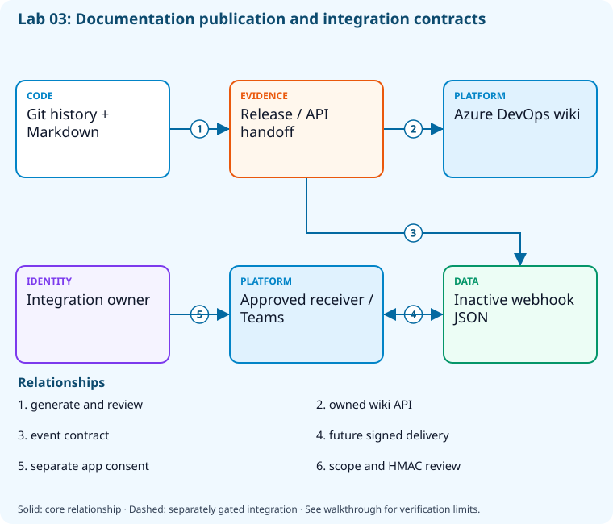

# Lab 03: Publish documentation and configure integrations

[Previous: Lab 02](../02-devops-metrics/README.md) · [Catalog](../../docs/lab-catalog.md) · [Next: Lab 04](../04-branching-pull-requests/README.md)

## Scenario, role, and outcome

A change is ready for review but operational handoff and external integration ownership are unclear. Generate a reproducible release handoff and a bounded integration proposal.

Learner role: **Release coordinator**. Outcome: Publish documentation and configure integrations.

| Item | Value |
|---|---|
| Time | 120 minutes |
| Domain | process |
| Platforms | local, azure-devops |
| Cost | none — review [current pricing and cleanup](../../docs/cost-and-cleanup.md) before cloud execution |
| Exam blueprint | July 27, 2026; sources reviewed October 16, 2026 |
| Verification | Authored and checked offline; no live Azure deployment is claimed |

Completion requires all five checkpoints, the break/fix repair, successful
independent validation, and a passing residual-resource audit. An unavailable
external prerequisite is a visible gate; it does not become a passing result.

## Architecture and service topology



Git history and Markdown become a versioned release/API handoff published to the disposable Azure DevOps wiki. An inactive webhook payload defines a separate notification contract. Activating a signed receiver or Teams integration requires its owner and separate bootstrap consent; this lab sends no external messages.

The editable [Mermaid source](diagrams/architecture.mmd) and accessible SVG
render the same authored components and relationships. Dashed connections show
separately gated integrations. Read every boundary before executing commands. Cloud changes
stay inside the exact disposable GitHub repository, Azure DevOps project, and
Azure resource group recorded for this run. Child objects inherit that cleanup
boundary. Account creation, external integrations, and privileged organization
settings belong to [one-time bootstrap](../../docs/account-bootstrap.md).

## Objectives and checkpoints

Official objective topic IDs: `D1.3.1`, `D1.3.2`, `D1.3.3`, `D1.3.4`, `D1.3.5`, `D1.3.6`

| Checkpoint | Measurable behavior |
|---|---|
| [CP1](#task-1) | Generate release notes from Git history |
| [CP2](#task-2) | Author a process diagram and API handoff |
| [CP3](#task-3) | Prepare a least-privilege webhook subscription |
| [CP4](#task-4) | Create a sandbox project wiki from Markdown |
| [CP5](#task-5) | Review Teams and Boards integration before authorization |

The [objective map](../../docs/objective-map.md) traces every official topic to
labs. The [Microsoft study guide](https://learn.microsoft.com/en-us/credentials/certifications/resources/study-guides/az-400)
controls authoritative objective wording and domain weighting.

## Inputs, permissions, and read-only preflight

Use PowerShell 7.4+, .NET 10, Git, GitHub CLI, Azure CLI with the Azure DevOps
extension, and the pinned repository validation dependencies. Read the
[permissions matrix](../../docs/permissions-matrix.md) and [evidence policy](../../docs/evidence-handling.md).
Supply only the accounts needed by this lab. Never put a token, connection
string, or private key into a command log, committed YAML, or progress export.

The examples run from the repository root. Choose a fresh lowercase run ID;
`demo01` is an example, not a reusable shared sandbox. Set bootstrap environment
variables for the approved GitHub owner, DevOps organization, subscription, and
region. Do not run both guided and automated lanes with the same run ID.

```powershell
$lab = './labs/03-collaboration-documentation/scripts/cli'
& "$lab/Preflight.ps1" -RunId 'demo01'
& "$lab/Setup.ps1" -RunId 'demo01' -ProvisionOnly
# After reviewing context, permissions, cost, and cleanup:
& "$lab/Setup.ps1" -RunId 'demo01' -ProvisionOnly -Execute -AcknowledgeCost -AcknowledgeTenantChange
. "$lab/Context.ps1" -RunId 'demo01'
```

Preflight performs reads only. Provisioning creates fresh run-owned top-level
sandboxes and records their exact IDs. Context establishes `$RepoRoot`,
`$LabRoot`, `$WorkRoot`, `$RunId`, `$GhRepo`, `$AdoOrganization`, `$AdoProject`,
`$SubscriptionId`, `$Location`, and `$ResourceGroup`. A missing prerequisite or
ownership mismatch must stop execution. Local build commands may restore
packages and write ignored build output.

## Concept primer and design decisions

Documentation is a versioned delivery artifact. Webhooks need authenticated receivers and narrow event subscriptions; external app authorization is a separate privileged action.

## Task 1 — Generate release notes from Git history

<a id="task-1"></a>

Checkpoint: `CP1`

```powershell
git -C $RepoRoot log -10 --pretty=format:'- %h %s' | Set-Content (Join-Path $WorkRoot 'release-notes.md')
 Get-Content (Join-Path $WorkRoot 'release-notes.md')
```

Expected state: Recent committed changes become a reproducible release-note draft.

Positive validation:

```powershell
$n=Get-Content (Join-Path $WorkRoot 'release-notes.md') -Raw
 if ($n -notmatch '[0-9a-f]{7}') { throw 'No commit identities in release notes.' }
```

Negative validation:

```powershell
$n=Get-Content (Join-Path $WorkRoot 'release-notes.md') -Raw
 if ($n -match '(?i)ghp_[a-z0-9]{20}') { throw 'Credential-like value in release draft.' }
```

Evidence to retain: Draft notes and exact source commit range.

Common failure and safe retry: Create notes from committed sandbox changes and review text before publication.

Cleanup dependency: retain this checkpoint's evidence until final validation; remove run-owned children before their recorded parent boundary.

## Task 2 — Author a process diagram and API handoff

<a id="task-2"></a>

Checkpoint: `CP2`

```powershell
@('# Release handoff','```mermaid','flowchart LR','  Commit --> Build','  Build --> Test','  Test --> Approval','  Approval --> Deploy','```','API: GET /health/ready returns readiness status.')|Set-Content (Join-Path $WorkRoot 'handoff.md')
```

Expected state: Markdown captures both release sequence and a concrete API contract.

Positive validation:

```powershell
$d=Get-Content (Join-Path $WorkRoot 'handoff.md') -Raw
 if ($d -notmatch 'flowchart LR' -or $d -notmatch '/health/ready') { throw 'Handoff lacks process/API contract.' }
```

Negative validation:

```powershell
$d=Get-Content (Join-Path $WorkRoot 'handoff.md') -Raw
 if ($d -match 'password=|client_secret=') { throw 'Sensitive configuration in documentation.' }
```

Evidence to retain: handoff.md and an explanation of approval ownership.

Common failure and safe retry: Keep Mermaid syntax supported by your renderer and document status codes, not screenshots.

Cleanup dependency: retain this checkpoint's evidence until final validation; remove run-owned children before their recorded parent boundary.

## Task 3 — Prepare a least-privilege webhook subscription

<a id="task-3"></a>

Checkpoint: `CP3`

```powershell
$hook=[ordered]@{name='web';active=$false;events=@('workflow_run');config=@{url='https://receiver.example.invalid/az400';content_type='json';insecure_ssl='0'}}
 $hook|ConvertTo-Json -Depth 5|Set-Content (Join-Path $WorkRoot 'webhook-proposal.json')
```

Expected state: An inactive webhook proposal uses HTTPS and one delivery event; no request is sent.

Positive validation:

```powershell
$h=Get-Content (Join-Path $WorkRoot 'webhook-proposal.json') -Raw|ConvertFrom-Json
 if ($h.active -or $h.config.content_type -ne 'json' -or $h.events[0] -ne 'workflow_run') { throw 'Webhook review contract violated.' }
```

Negative validation:

```powershell
$h=Get-Content (Join-Path $WorkRoot 'webhook-proposal.json') -Raw|ConvertFrom-Json
 if ($h.config.insecure_ssl -ne '0' -or '*' -in $h.events) { throw 'Unbounded or TLS-insecure webhook.' }
```

Evidence to retain: Inactive payload and HMAC-secret storage plan, excluding the secret.

Common failure and safe retry: Use an approved receiver with HMAC verification before activating a separately authorized hook.

Cleanup dependency: retain this checkpoint's evidence until final validation; remove run-owned children before their recorded parent boundary.

## Task 4 — Create a sandbox project wiki from Markdown

<a id="task-4"></a>

Checkpoint: `CP4`

```powershell
$page=Join-Path $WorkRoot 'handoff.md'
 $wiki=az devops wiki create --organization $AdoOrganization --project $AdoProject --name "handoff-$RunId" --type projectWiki -o json|ConvertFrom-Json
 $wiki.id|Set-Content (Join-Path $WorkRoot 'wiki-id.txt')
 az devops wiki page create --organization $AdoOrganization --project $AdoProject --wiki $wiki.id --path '/Release handoff' --file-path $page -o json|Set-Content (Join-Path $WorkRoot 'wiki-page.json')
```

Expected state: A sandbox wiki contains the process handoff.

Positive validation:

```powershell
$id=Get-Content (Join-Path $WorkRoot 'wiki-id.txt')
 $p=az devops wiki page show --organization $AdoOrganization --project $AdoProject --wiki $id --path '/Release handoff' --include-content -o json|ConvertFrom-Json
 if ($p.page.content -notmatch 'flowchart LR') { throw 'Wiki omitted process diagram.' }
```

Negative validation:

```powershell
$w=Get-Content (Join-Path $WorkRoot 'wiki-page.json') -Raw|ConvertFrom-Json
 if (-not $w.page.path -or $w.page.path -notmatch 'Release handoff') { throw 'Wrong wiki page boundary.' }
```

Evidence to retain: Wiki ID/path and content digest.

Common failure and safe retry: Use the fresh project wiki; do not replace an organization knowledge base.

Cleanup dependency: retain this checkpoint's evidence until final validation; remove run-owned children before their recorded parent boundary.

## Task 5 — Review Teams and Boards integration before authorization

<a id="task-5"></a>

Checkpoint: `CP5`

```powershell
$review=[ordered]@{boardsProject=$AdoProject;githubRepository=$GhRepo;teamsChannel='UNCONFIGURED';notifications=@('release failure');externalAuthorizationRequired=$true;messagesSent=0}
 $review|ConvertTo-Json|Set-Content (Join-Path $WorkRoot 'integration-review.json')
```

Expected state: An explicit integration contract identifies authorization and filters; no Teams message is sent.

Positive validation:

```powershell
$r=Get-Content (Join-Path $WorkRoot 'integration-review.json') -Raw|ConvertFrom-Json
 if (-not $r.externalAuthorizationRequired -or $r.notifications[0] -ne 'release failure') { throw 'Integration needs explicit authorization and event selection.' }
```

Negative validation:

```powershell
$r=Get-Content (Join-Path $WorkRoot 'integration-review.json') -Raw|ConvertFrom-Json
 if ($r.messagesSent -ne 0) { throw 'This review must not send external notifications.' }
```

Evidence to retain: integration-review.json plus the bootstrap authorization checklist.

Common failure and safe retry: Authorize external applications only through the separate account-bootstrap procedure, then test with approved recipients.

Cleanup dependency: retain this checkpoint's evidence until final validation; remove run-owned children before their recorded parent boundary.

## Deterministic break/fix

Inject this fault only in the recorded sandbox or local run directory.

```powershell
$h=Get-Content (Join-Path $WorkRoot 'webhook-proposal.json') -Raw|ConvertFrom-Json;$h.config.insecure_ssl='1';$h|ConvertTo-Json -Depth 5|Set-Content (Join-Path $WorkRoot 'webhook-proposal.json')
```

Diagnose the precise difference:

```powershell
Get-Content (Join-Path $WorkRoot 'webhook-proposal.json') -Raw|ConvertFrom-Json|Select-Object -ExpandProperty config
```

Repair, then repeat the affected checkpoint validation:

```powershell
$h=Get-Content (Join-Path $WorkRoot 'webhook-proposal.json') -Raw|ConvertFrom-Json;$h.config.insecure_ssl='0';$h|ConvertTo-Json -Depth 5|Set-Content (Join-Path $WorkRoot 'webhook-proposal.json')
```

## Optional job-style challenge

Produce release notes with changes, migration requirements, rollback, and links to accepted work without exposing internal identifiers.

## Final validation and result interpretation

```powershell
& './labs/03-collaboration-documentation/scripts/cli/Validate.ps1' -RunId 'demo01'
```

A complete result requires five passing read-only assertions. Pending hosted runs, missing licensed features, and unexecuted integration challenges remain visible. Review `validation.json`; a command exiting successfully is not enough if the asserted behavior is absent.

## Troubleshooting

- **401/403:** inspect the explicit account/project/repository scope and required role; do not broaden a token reflexively.
- **Resource or artifact missing:** confirm the exact run ID and prerequisite checkpoint; retry reads after eventual consistency.
- **Unsupported SKU/runtime/tool:** consult the specific current source, record the gate, and obtain approval before changing cost or architecture.
- **Validation mismatch:** inspect the positive and negative assertions separately, repair the named fault, and rerun validation.
- **Ownership refusal:** stop; never edit a manifest to claim an unrelated resource.

## Cleanup and residual checks

```powershell
& './labs/03-collaboration-documentation/scripts/cli/Cleanup.ps1' -RunId 'demo01'
# Review the exact owned-object deletion plan first.
& './labs/03-collaboration-documentation/scripts/cli/Cleanup.ps1' -RunId 'demo01' -Execute
```

Cleanup must verify ownership, delete only recorded sandbox objects in dependency order, and prove parent/child absence. Retain `run.json`, `validation.json`, and `cleanup.json` locally until the audit passes. Soft-deleted or deliberately retained items must remain reported. Never purge a shared vault or delete an account, organization, or pre-existing service connection to finish a lab.

## Exam debrief and assessment

Explain why each checkpoint's denied path matters, which scope authorizes it, what evidence proves it, and how it is reversed. Complete the [50-question assessment](QUESTIONS.md), then review [rationales](ANSWERS.md) and repeat weak checkpoints.

## Microsoft and platform sources

- [Primary source 1](https://learn.microsoft.com/en-us/azure/devops/project/wiki/wiki-create-repo) — reviewed 2026-10-16.
- [Primary source 2](https://docs.github.com/en/webhooks/using-webhooks/best-practices-for-using-webhooks) — reviewed 2026-10-16.
- [Primary source 3](https://learn.microsoft.com/en-us/azure/devops/boards/github/connect-to-github) — reviewed 2026-10-16.

## Lifecycle scripts and worked solution

Use `scripts/cli/Preflight.ps1`, `Setup.ps1`, `Validate.ps1`, `Cleanup.ps1`, and `Context.ps1` from this lab folder. Setup and cleanup preview until `-Execute`; `-ProvisionOnly` creates only fresh ownership-tracked containers. The [worked solution](solution/README.md) lists expected results and repair reasoning.
