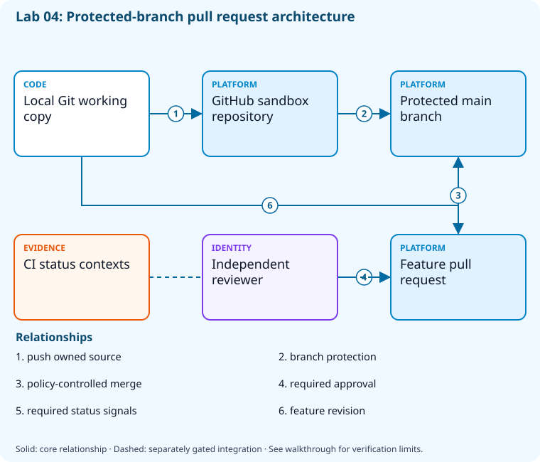

# Lab 04: Protect branches and review pull requests

[Previous: Lab 03](../03-collaboration-documentation/README.md) · [Catalog](../../docs/lab-catalog.md) · [Next: Lab 05](../05-repository-administration/README.md)

## Scenario, role, and outcome

Direct updates to main bypass review. Create a feature workflow and enforce the smallest meaningful branch protection in a disposable repository.

Learner role: **Repository maintainer**. Outcome: Protect branches and review pull requests.

| Item | Value |
|---|---|
| Time | 120 minutes |
| Domain | source |
| Platforms | local, github |
| Cost | none — review [current pricing and cleanup](../../docs/cost-and-cleanup.md) before cloud execution |
| Exam blueprint | July 27, 2026; sources reviewed October 16, 2026 |
| Verification status | not-run |
| Verification scope | All checkpoint/fault scripts parse; the named fault lifecycle is independently tested with explicit provider doubles. Full normal provider execution and live cloud delivery have not run. |

Completion requires all five checkpoints, the break/fix repair, successful
independent validation, and a passing residual-resource audit. An unavailable
external prerequisite is a visible gate; it does not become a passing result.

## Architecture and service topology



A local feature branch is pushed only to the run-owned GitHub repository. Main is protected against force pushes and deletion and requires independent pull-request review. CI status contexts can be added after their real workflow names exist; an author cannot supply their own independent approval or infer checks from a pushed commit.

The editable [Mermaid source](diagrams/architecture.mmd) and accessible SVG
render the same authored components and relationships. Dashed connections show
separately gated integrations. Read every boundary before executing commands. Cloud changes
stay inside the exact disposable GitHub repository, Azure DevOps project, and
Azure resource group recorded for this run. Child objects inherit that cleanup
boundary. Account creation, external integrations, and privileged organization
settings belong to [one-time bootstrap](../../docs/account-bootstrap.md).

## Objectives and checkpoints

Coverage levels describe the intended learning evidence: **explained** means reasoned
understanding, **practiced** means an observable isolated skill, and **integrated**
means skills connected across a delivery boundary. These labels are curriculum
claims, not execution status. Verification above records what authors actually ran.

Official objective topic IDs: `D2.1.1`, `D2.1.2`, `D2.1.3`

| Checkpoint | Measurable behavior |
|---|---|
| [CP1](#task-1) | Create a local trunk and short-lived feature branch |
| [CP2](#task-2) | Push one reviewable feature to the disposable GitHub repo |
| [CP3](#task-3) | Open a pull request with a test plan |
| [CP4](#task-4) | Require review and block force pushes on main |
| [CP5](#task-5) | Inspect merge readiness without bypassing review |

The [objective map](../../docs/objective-map.md) traces every official topic to
labs. The [Microsoft study guide](https://learn.microsoft.com/en-us/credentials/certifications/resources/study-guides/az-400)
controls authoritative objective wording and domain weighting.

## Inputs, permissions, and read-only preflight

This lab includes repository protection features that can require a paid GitHub entitlement, especially for private repositories. Without an authorized `-AllowPaidFeatures` opt-in, the gated checkpoints remain partial. Review the current account entitlement and billing owner approval before adding that switch to setup.

Use PowerShell 7.4+, .NET 10, Git, GitHub CLI, Azure CLI with the Azure DevOps
extension, and the pinned repository validation dependencies. Read the
[permissions matrix](../../docs/permissions-matrix.md) and [evidence policy](../../docs/evidence-handling.md).
Supply only the accounts needed by this lab. Never put a token, connection
string, or private key into a command log, committed YAML, or progress export.

The examples run from the repository root. Choose a fresh lowercase run ID;
`demo01` is an example, not a reusable shared sandbox. Set bootstrap environment
variables for the approved GitHub owner, DevOps organization, subscription, and
region. Do not run both guided and automated lanes with the same run ID.

```powershell
$lab = './labs/04-branching-pull-requests/scripts/cli'
& "$lab/Preflight.ps1" -RunId 'demo01'
& "$lab/Setup.ps1" -RunId 'demo01' -ProvisionOnly
# After reviewing context, permissions, cost, and cleanup:
& "$lab/Setup.ps1" -RunId 'demo01' -ProvisionOnly -Execute -AcknowledgeCost -AcknowledgeTenantChange
. "$lab/Context.ps1" -RunId 'demo01'
```

Preflight performs reads only. Provisioning creates fresh run-owned top-level
sandboxes and records their exact IDs. Context establishes `$RepoRoot`,
`$LabRoot`, `$WorkRoot`, `$RunId`, `$GhRepo`, `$AdoOrganization`, `$AdoProject`,
`$SubscriptionId`, `$Location`, and `$ResourceGroup`. A missing prerequisite or
ownership mismatch must stop execution. Local build commands may restore
packages and write ignored build output.

## Concept primer and design decisions

Short-lived branches reduce integration distance. Required reviews and force-push restrictions protect shared history; the author cannot supply independent approval.

Choose a branch model around integration frequency, review requirements and supported release lines. A short-lived feature branch reduces divergence, while a maintained release branch can isolate a supported version. The pull request connects the proposed diff with an independently reviewable test plan.

Protection is a provider-enforced policy, not prose in a README. Required reviews, expected checks and force-push restrictions should be queried after creation. The author cannot manufacture an independent reviewer; if the account plan or second reviewer is unavailable, the affected checkpoint remains gated. The exercise inspects readiness without bypassing the policy.

## Task 1 — Create a local trunk and short-lived feature branch

<a id="task-1"></a>

Checkpoint: `CP1`

| Objective | Evidence level | Observation and limits |
|---|---|---|
| `D2.1.1` | practiced | Create a feature branch in the disposable GitHub working copy. |

```powershell
$gitRoot=Join-Path $WorkRoot 'branching';New-Item -ItemType Directory -Force $gitRoot|Out-Null
 git init --initial-branch=main $gitRoot
 git -C $gitRoot config user.name 'AZ400 Learner';git -C $gitRoot config user.email 'learner@example.invalid'
 'release-health'|Set-Content (Join-Path $gitRoot 'README.md');git -C $gitRoot add README.md;git -C $gitRoot commit -m 'Initialize protected trunk'
 git -C $gitRoot switch -c "feature/$RunId"
```

Expected state: An isolated Git repository has main and a named feature branch.

Positive validation:

```powershell
$p=Join-Path $WorkRoot 'branching'
 if ((git -C $p branch --show-current) -ne "feature/$RunId") { throw 'Expected feature branch.' }
```

Negative validation:

```powershell
$p=Join-Path $WorkRoot 'branching'
 if (@(git -C $p status --porcelain).Count -gt 0) { throw 'Unexpected uncommitted changes.' }
```

Evidence to retain: Branch names and commit graph.

Common failure and safe retry: Set identity only in the sandbox repository; never change global Git settings.

Cleanup dependency: retain this checkpoint's evidence until final validation; remove run-owned children before their recorded parent boundary.

## Task 2 — Push one reviewable feature to the disposable GitHub repo

<a id="task-2"></a>

Checkpoint: `CP2`

Foundation/supporting task; no additional exam-objective coverage is claimed.

```powershell
$p=Join-Path $WorkRoot 'branching'
 git -C $p remote add origin "https://github.com/$GhRepo.git"
 git -C $p push -u origin main
 'GET /health/ready -> 200'|Set-Content (Join-Path $p 'health-contract.md');git -C $p add health-contract.md;git -C $p commit -m "Add health contract for $RunId";git -C $p push -u origin "feature/$RunId"
```

Expected state: Only the disposable repository receives main and the feature branch.

Positive validation:

```powershell
$b=gh api "repos/$GhRepo/branches/feature%2F$RunId"|ConvertFrom-Json
 if ($b.name -ne "feature/$RunId") { throw 'Remote feature branch absent.' }
```

Negative validation:

```powershell
$p=Join-Path $WorkRoot 'branching'
 if ((git -C $p remote get-url origin) -ne "https://github.com/$GhRepo.git") { throw 'Remote ownership mismatch.' }
```

Evidence to retain: Commit SHA and sandbox remote.

Common failure and safe retry: Check the derived sandbox owner/name before pushing; retry only after ownership matches.

Cleanup dependency: retain this checkpoint's evidence until final validation; remove run-owned children before their recorded parent boundary.

## Task 3 — Open a pull request with a test plan

<a id="task-3"></a>

Checkpoint: `CP3`

| Objective | Evidence level | Observation and limits |
|---|---|---|
| `D2.1.2` | integrated | Open the run-owned pull request and correlate its branch and exact source commit. |

```powershell
$url=gh pr create --repo $GhRepo --base main --head "feature/$RunId" --title "[$RunId] Add health contract" --body 'Acceptance: contract states readiness status. Test: review contract and run dotnet test. Rollback: revert merge commit.'
 $url|Set-Content (Join-Path $WorkRoot 'pull-request-url.txt')
```

Expected state: The feature is represented by an open PR targeting main.

Positive validation:

```powershell
$url=Get-Content (Join-Path $WorkRoot 'pull-request-url.txt');$p=gh pr view $url --repo $GhRepo --json state,baseRefName,body|ConvertFrom-Json
 if ($p.state -ne 'OPEN' -or $p.baseRefName -ne 'main' -or $p.body -notmatch 'Test:') { throw 'Review contract incomplete.' }
```

Negative validation:

```powershell
$url=Get-Content (Join-Path $WorkRoot 'pull-request-url.txt');$p=gh pr view $url --repo $GhRepo --json headRefName|ConvertFrom-Json
 if ($p.headRefName -eq 'main') { throw 'PR must not review main against itself.' }
```

Evidence to retain: PR URL, changed-file count, and test plan.

Common failure and safe retry: A second authorized reviewer is needed to satisfy an approval; the author cannot approve their own PR.

Cleanup dependency: retain this checkpoint's evidence until final validation; remove run-owned children before their recorded parent boundary.

## Task 4 — Require review and block force pushes on main

<a id="task-4"></a>

Checkpoint: `CP4`

| Objective | Evidence level | Observation and limits |
|---|---|---|
| `D2.1.3` | practiced | Configure and query main-branch required-review/status-check protection; entitlement is a visible gate. |

```powershell
$policy=@{required_status_checks=$null;enforce_admins=$true;required_pull_request_reviews=@{required_approving_review_count=1;dismiss_stale_reviews=$true};restrictions=$null;allow_force_pushes=$false;allow_deletions=$false}
 $file=Join-Path $WorkRoot 'branch-policy.json';$policy|ConvertTo-Json -Depth 8|Set-Content $file
 gh api --method PUT "repos/$GhRepo/branches/main/protection" --input $file|Set-Content (Join-Path $WorkRoot 'branch-protection.json')
```

Expected state: Main requires one approval and disallows force pushes and deletion.

Positive validation:

```powershell
$p=gh api "repos/$GhRepo/branches/main/protection"|ConvertFrom-Json
 if ($p.required_pull_request_reviews.required_approving_review_count -lt 1) { throw 'Approval requirement absent.' }
```

Negative validation:

```powershell
$p=gh api "repos/$GhRepo/branches/main/protection"|ConvertFrom-Json
 if ($p.allow_force_pushes.enabled -or $p.allow_deletions.enabled) { throw 'Destructive branch updates remain enabled.' }
```

Evidence to retain: Protection settings; do not attempt destructive force pushes to test denial.

Common failure and safe retry: Use the sandbox public repository; plan/license availability may gate equivalent controls in private repos.

Cleanup dependency: retain this checkpoint's evidence until final validation; remove run-owned children before their recorded parent boundary.

## Task 5 — Inspect merge readiness without bypassing review

<a id="task-5"></a>

Checkpoint: `CP5`

Foundation/supporting task; no additional exam-objective coverage is claimed.

```powershell
$url=Get-Content (Join-Path $WorkRoot 'pull-request-url.txt')
 gh pr view $url --repo $GhRepo --json mergeStateStatus,reviewDecision,statusCheckRollup|Set-Content (Join-Path $WorkRoot 'merge-readiness.json')
 Get-Content (Join-Path $WorkRoot 'merge-readiness.json')
```

Expected state: The pending review remains visible and no administrative bypass is used.

Positive validation:

```powershell
$p=Get-Content (Join-Path $WorkRoot 'merge-readiness.json') -Raw|ConvertFrom-Json
 if (-not $p.mergeStateStatus) { throw 'Merge readiness was not reported.' }
```

Negative validation:

```powershell
$url=Get-Content (Join-Path $WorkRoot 'pull-request-url.txt');$p=gh pr view $url --repo $GhRepo --json mergedAt|ConvertFrom-Json
 if ($p.mergedAt) { throw 'This exercise should retain the unapproved PR.' }
```

Evidence to retain: Review decision and branch protection result.

Common failure and safe retry: Request an authorized second reviewer rather than using --admin or lowering policy.

Cleanup dependency: retain this checkpoint's evidence until final validation; remove run-owned children before their recorded parent boundary.

## Deterministic break/fix

Run the journaled operation after all five checkpoints. It proves the healthy assertion, injects the named fault, requires its rejection, repairs it, and proves health again. Provider doubles used in author tests are not live enforcement evidence.

```powershell
& './labs/04-branching-pull-requests/scripts/cli/BreakFix.ps1' -RunId 'demo01' -Execute
```

Expected rejection marker: `AZ400-L04-BRANCH-APPROVAL`. The assertion must catch the changed behavior, not merely an exception from an unavailable CLI.

Inspect the independent assertion:

```powershell
$p=gh api "repos/$GhRepo/branches/main/protection/required_pull_request_reviews"|ConvertFrom-Json
if($p.required_approving_review_count -lt 1){throw 'AZ400-L04-BRANCH-APPROVAL'}
```

Fault trigger (executed by BreakFix):

```powershell
gh api --method PATCH "repos/$GhRepo/branches/main/protection/required_pull_request_reviews" -F required_approving_review_count=0
```

Diagnose the precise difference:

```powershell
gh api "repos/$GhRepo/branches/main/protection/required_pull_request_reviews"
```

Repair (executed by BreakFix):

```powershell
gh api --method PATCH "repos/$GhRepo/branches/main/protection/required_pull_request_reviews" -F required_approving_review_count=1
```

## Optional job-style challenge

Add a required CI status context after a real successful run, then show how stale approvals and failed checks affect merge readiness.

## Final validation and result interpretation

```powershell
& './labs/04-branching-pull-requests/scripts/cli/Validate.ps1' -RunId 'demo01'
```

A complete result requires five passing read-only checkpoint assertions, a journaled repaired fault, and any required integration evidence. Pending hosted runs, missing licensed features, and unexecuted integration lanes remain visible. Review `validation.json`; successful command exit alone does not establish the asserted behavior.

## Troubleshooting

- **401/403:** inspect the explicit account/project/repository scope and required role; do not broaden a token reflexively.
- **Resource or artifact missing:** confirm the exact run ID and prerequisite checkpoint; retry reads after eventual consistency.
- **Unsupported SKU/runtime/tool:** consult the specific current source, record the gate, and obtain approval before changing cost or architecture.
- **Validation mismatch:** inspect the positive and negative assertions separately, repair the named fault, and rerun validation.
- **Ownership refusal:** stop; never edit a manifest to claim an unrelated resource.

## Cleanup and residual checks

```powershell
& './labs/04-branching-pull-requests/scripts/cli/Cleanup.ps1' -RunId 'demo01'
# Review the exact owned-object deletion plan first.
& './labs/04-branching-pull-requests/scripts/cli/Cleanup.ps1' -RunId 'demo01' -Execute
```

Cleanup must verify ownership, delete only recorded sandbox objects in dependency order, and prove parent/child absence. Retain `run.json`, `validation.json`, and `cleanup.json` locally until the audit passes. Soft-deleted or deliberately retained items must remain reported. Never purge a shared vault or delete an account, organization, or pre-existing service connection to finish a lab.

## Exam debrief and assessment

Explain why each checkpoint's denied path matters, which scope authorizes it, what evidence proves it, and how it is reversed. Complete the [50-question assessment](QUESTIONS.md), then review [rationales](ANSWERS.md) and repeat weak checkpoints.

## Microsoft and platform sources

- [Primary source 1](https://docs.github.com/en/repositories/configuring-branches-and-merges-in-your-repository/managing-protected-branches/about-protected-branches) — reviewed 2026-10-16.
- [Primary source 2](https://learn.microsoft.com/en-us/azure/devops/repos/git/branch-policies) — reviewed 2026-10-16.
- [Primary source 3](https://git-scm.com/docs/git-switch) — reviewed 2026-10-16.

## Lifecycle scripts and worked solution

Use `scripts/cli/Preflight.ps1`, `Setup.ps1`, `BreakFix.ps1`, `Integration.ps1` (capstones), `Validate.ps1`, `Cleanup.ps1`, and `Context.ps1` from this lab folder. Setup and cleanup preview until `-Execute`; `-ProvisionOnly` creates only fresh ownership-tracked containers. The [worked solution](solution/README.md) lists expected results and repair reasoning.
