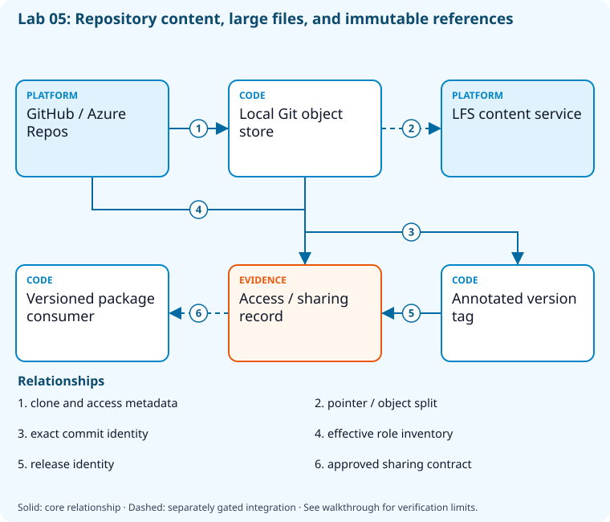

# Lab 05: Administer repositories, large files, and access

[Previous: Lab 04](../04-branching-pull-requests/README.md) · [Catalog](../../docs/lab-catalog.md) · [Next: Lab 06](../06-git-recovery-history/README.md)

## Scenario, role, and outcome

A repository is growing while release tags and contributor access are inconsistent. Separate large-file storage, immutable versions, optimization, and least privilege.

Learner role: **Source platform engineer**. Outcome: Administer repositories, large files, and access.

| Item | Value |
|---|---|
| Time | 120 minutes |
| Domain | source |
| Platforms | local, github, azure-devops |
| Cost | none — review [current pricing and cleanup](../../docs/cost-and-cleanup.md) before cloud execution |
| Exam blueprint | July 27, 2026; sources reviewed October 16, 2026 |
| Verification status | offline-tested |
| Verification scope | The complete five-checkpoint sequence, final-state revalidation, fault detection and repair run with real local Git/.NET/package/file operations and fail-closed synthetic GitHub/Azure DevOps responses. Provider operations remain unverified live. |

Completion requires all five checkpoints, the break/fix repair, successful
independent validation, and a passing residual-resource audit. An unavailable
external prerequisite is a visible gate; it does not become a passing result.

## Architecture and service topology



Hosted repository APIs supply visibility and effective-access metadata; the local Git store holds source and annotated tags. The attributes file defines the LFS pointer/content split, while using a real LFS content service remains a separate integration. The sharing decision recommends immutable packages for consumers rather than untracked source copies.

The editable [Mermaid source](diagrams/architecture.mmd) and accessible SVG
render the same authored components and relationships. Dashed connections show
separately gated integrations. Read every boundary before executing commands. Cloud changes
stay inside the exact disposable GitHub repository, Azure DevOps project, and
Azure resource group recorded for this run. Child objects inherit that cleanup
boundary. Account creation, external integrations, and privileged organization
settings belong to [one-time bootstrap](../../docs/account-bootstrap.md).

## Objectives and checkpoints

Coverage levels describe the intended learning evidence: **explained** means reasoned
understanding, **practiced** means an observable isolated skill, and **integrated**
means skills connected across a delivery boundary. These labels are curriculum
claims, not execution status. Verification above records what authors actually ran.

Official objective topic IDs: `D2.2.1`, `D2.2.2`, `D2.2.3`, `D2.2.4`

| Checkpoint | Measurable behavior |
|---|---|
| [CP1](#task-1) | Inspect repository capabilities and effective permissions |
| [CP2](#task-2) | Create an LFS-aware local repository |
| [CP3](#task-3) | Tag an immutable release candidate |
| [CP4](#task-4) | Measure object storage and enable local maintenance |
| [CP5](#task-5) | Produce an access and sharing decision record |

The [objective map](../../docs/objective-map.md) traces every official topic to
labs. The [Microsoft study guide](https://learn.microsoft.com/en-us/credentials/certifications/resources/study-guides/az-400)
controls authoritative objective wording and domain weighting.

## Inputs, permissions, and read-only preflight

Use PowerShell 7.4+, .NET 10, Git, GitHub CLI, Azure CLI with the Azure DevOps
extension, and the pinned repository validation dependencies. Read the
[permissions matrix](../../docs/permissions-matrix.md) and [evidence policy](../../docs/evidence-handling.md).
Supply only the accounts needed by this lab. Never put a token, connection
string, or private key into a command log, committed YAML, or progress export.

The examples run from the repository root. Choose a fresh lowercase run ID;
`demo01` is an example, not a reusable shared sandbox. Set bootstrap environment
variables for the approved GitHub owner, DevOps organization, subscription, and
region. Do not run both guided and automated lanes with the same run ID.

```powershell
$lab = './labs/05-repository-administration/scripts/cli'
& "$lab/Preflight.ps1" -RunId 'demo01'
& "$lab/Setup.ps1" -RunId 'demo01' -ProvisionOnly
# After reviewing context, permissions, cost, and cleanup:
& "$lab/Setup.ps1" -RunId 'demo01' -ProvisionOnly -Execute -AcknowledgeCost -AcknowledgeTenantChange
. "$lab/Context.ps1" -RunId 'demo01'
```

Preflight performs reads only. Provisioning creates fresh run-owned top-level
sandboxes and records their exact IDs. Context establishes `$RepoRoot`,
`$LabRoot`, `$WorkRoot`, `$RunId`, `$GhRepo`, `$AdoOrganization`, `$AdoProject`,
`$SubscriptionId`, `$Location`, and `$ResourceGroup`. A missing prerequisite or
ownership mismatch must stop execution. Local build commands may restore
packages and write ignored build output.

## Concept primer and design decisions

LFS stores pointers in Git and content separately. Artifact/package sharing is often more stable than copied source; annotated tags identify exact release commits.

Large binaries amplify Git clone and history costs. LFS stores a pointer in the Git tree and a separate object in an LFS service; an attributes rule alone proves routing intent, not successful object transfer. Compare package or artifact sharing when consumers need built outputs rather than editable source.

Annotated tags preserve a human-readable release reference and an exact commit identity. A tag can still be moved by a privileged actor, so protect publication rights separately. Repository maintenance can compact objects without changing commits; inspect object statistics and preserved tags before and after maintenance rather than claiming a universal speedup.

## Task 1 — Inspect repository capabilities and effective permissions

<a id="task-1"></a>

Checkpoint: `CP1`

| Objective | Evidence level | Observation and limits |
|---|---|---|
| `D2.2.3` | explained | Inspect repository scope and discuss role boundaries; this task does not grant organization roles. |

```powershell
gh repo view $GhRepo --json nameWithOwner,visibility,viewerPermission,isArchived,hasIssuesEnabled|Set-Content (Join-Path $WorkRoot 'repository.json')
 az repos list --organization $AdoOrganization --project $AdoProject --query '[].{id:id,name:name,isDisabled:isDisabled}' -o json|Set-Content (Join-Path $WorkRoot 'ado-repositories.json')
```

Expected state: The fresh GitHub repository and project repository inventory are identified.

Positive validation:

```powershell
$r=Get-Content (Join-Path $WorkRoot 'repository.json') -Raw|ConvertFrom-Json
 if ($r.nameWithOwner -ne $GhRepo -or $r.viewerPermission -notin @('ADMIN','MAINTAIN','WRITE')) { throw 'Insufficient sandbox repository access.' }
```

Negative validation:

```powershell
$r=Get-Content (Join-Path $WorkRoot 'repository.json') -Raw|ConvertFrom-Json
 if ($r.isArchived) { throw 'Sandbox must not be archived.' }
```

Evidence to retain: Effective permission, visibility, and repository IDs.

Common failure and safe retry: Use the sandbox repository; repository administration requires a suitable role.

Cleanup dependency: retain this checkpoint's evidence until final validation; remove run-owned children before their recorded parent boundary.

## Task 2 — Create an LFS-aware local repository

<a id="task-2"></a>

Checkpoint: `CP2`

| Objective | Evidence level | Observation and limits |
|---|---|---|
| `D2.2.1` | practiced | Set and inspect Git large-file attributes on a fixture; transferring LFS objects is not claimed. |

```powershell
$p=Join-Path $WorkRoot 'repository-admin';git init --initial-branch=main $p
 git -C $p config user.name 'AZ400 Learner';git -C $p config user.email 'learner@example.invalid'
 '*.bin filter=lfs diff=lfs merge=lfs -text'|Set-Content (Join-Path $p '.gitattributes')
 'artifacts/'|Set-Content (Join-Path $p '.gitignore')
 git -C $p add .gitattributes .gitignore;git -C $p commit -m 'Define large-file and artifact policies'
```

Expected state: Attributes assign binary files to LFS and exclude transient build artifacts.

Positive validation:

```powershell
$p=Join-Path $WorkRoot 'repository-admin'
 $a=git -C $p check-attr filter -- model.bin
 if ($a -notmatch 'lfs$') { throw 'Binary tracking policy missing.' }
```

Negative validation:

```powershell
$p=Join-Path $WorkRoot 'repository-admin'
 if ((git -C $p ls-files) -match '^artifacts/') { throw 'Transient build artifacts were committed.' }
```

Evidence to retain: Attributes and tracked file list; Git LFS installation is a separate tool prerequisite.

Common failure and safe retry: Install Git LFS before storing real large files. git-fat is syllabus context; compare support and security before adoption.

Cleanup dependency: retain this checkpoint's evidence until final validation; remove run-owned children before their recorded parent boundary.

## Task 3 — Tag an immutable release candidate

<a id="task-3"></a>

Checkpoint: `CP3`

| Objective | Evidence level | Observation and limits |
|---|---|---|
| `D2.2.4` | practiced | Create and resolve an annotated version tag to its intended commit. |

```powershell
$p=Join-Path $WorkRoot 'repository-admin'
 git -C $p tag -a 'v0.1.0-rc.1' -m "Run $RunId release candidate"
 git -C $p show --no-patch 'v0.1.0-rc.1'|Set-Content (Join-Path $WorkRoot 'tag.txt')
```

Expected state: An annotated semantic-version tag resolves to an exact commit.

Positive validation:

```powershell
$p=Join-Path $WorkRoot 'repository-admin'
 if ((git -C $p cat-file -t 'v0.1.0-rc.1') -ne 'tag') { throw 'Release tag must be annotated.' }
```

Negative validation:

```powershell
$p=Join-Path $WorkRoot 'repository-admin'
 if ((git -C $p rev-parse 'v0.1.0-rc.1^{}') -ne (git -C $p rev-parse HEAD)) { throw 'Tag does not identify selected commit.' }
```

Evidence to retain: Tag name, target SHA, and annotation.

Common failure and safe retry: Use a new version for a changed artifact; avoid moving published release tags.

Cleanup dependency: retain this checkpoint's evidence until final validation; remove run-owned children before their recorded parent boundary.

## Task 4 — Measure object storage and enable local maintenance

<a id="task-4"></a>

Checkpoint: `CP4`

| Objective | Evidence level | Observation and limits |
|---|---|---|
| `D2.2.2` | practiced | Run Git maintenance and inspect the retained repository objects. |

```powershell
$p=Join-Path $WorkRoot 'repository-admin'
 git -C $p count-objects -v|Set-Content (Join-Path $WorkRoot 'git-size.txt')
 git -C $p config maintenance.strategy incremental
 git -C $p config core.untrackedCache true
 git -C $p config --local --list|Set-Content (Join-Path $WorkRoot 'local-git-config.txt')
```

Expected state: Local settings and object counters support repository scale analysis.

Positive validation:

```powershell
$p=Join-Path $WorkRoot 'repository-admin'
 if ((git -C $p config --local --get maintenance.strategy) -ne 'incremental') { throw 'Maintenance strategy missing.' }
```

Negative validation:

```powershell
$p=Join-Path $WorkRoot 'repository-admin'
 if ((git -C $p config --local --get core.untrackedCache) -ne 'true') { throw 'Untracked cache was not enabled locally.' }
```

Evidence to retain: Object count and local configuration; compare Scalar when a real monorepo justifies it.

Common failure and safe retry: Keep optimization repository-local; test sparse checkout and Scalar on a separate copy.

Cleanup dependency: retain this checkpoint's evidence until final validation; remove run-owned children before their recorded parent boundary.

## Task 5 — Produce an access and sharing decision record

<a id="task-5"></a>

Checkpoint: `CP5`

Foundation/supporting task; no additional exam-objective coverage is claimed.

```powershell
$decision=[ordered]@{repository=$GhRepo;humanRole='write';automationRole='contents:read';largeFiles='LFS';sharing='versioned package';tag='v0.1.0-rc.1';reason='Consumers receive immutable versions instead of copied source.'}
 $decision|ConvertTo-Json|Set-Content (Join-Path $WorkRoot 'repository-decisions.json')
```

Expected state: Access and cross-repository sharing choices are explicit.

Positive validation:

```powershell
$d=Get-Content (Join-Path $WorkRoot 'repository-decisions.json') -Raw|ConvertFrom-Json
 if ($d.automationRole -ne 'contents:read' -or $d.sharing -ne 'versioned package') { throw 'Least-privilege/sharing decision changed.' }
```

Negative validation:

```powershell
$d=Get-Content (Join-Path $WorkRoot 'repository-decisions.json') -Raw|ConvertFrom-Json
 if ($d.humanRole -eq 'organization owner') { throw 'Repository contribution does not need organization ownership.' }
```

Evidence to retain: Decision record linked to observed repository capabilities.

Common failure and safe retry: Grant narrow repository permissions; evaluate outside collaborators separately from organization membership.

Cleanup dependency: retain this checkpoint's evidence until final validation; remove run-owned children before their recorded parent boundary.

## Deterministic break/fix

Run the journaled operation after all five checkpoints. It proves the healthy assertion, injects the named fault, requires its rejection, repairs it, and proves health again. Provider doubles used in author tests are not live enforcement evidence.

```powershell
& './labs/05-repository-administration/scripts/cli/BreakFix.ps1' -RunId 'demo01' -Execute
```

Expected rejection marker: `AZ400-L05-FAULT`. The assertion must catch the changed behavior, not merely an exception from an unavailable CLI.

Inspect the independent assertion:

```powershell
$p=Join-Path $WorkRoot 'repository-admin'
if((git -C $p check-attr filter -- model.bin) -notmatch 'lfs$'){throw 'AZ400-L05-FAULT'}
```

Fault trigger (executed by BreakFix):

```powershell
$p=Join-Path $WorkRoot 'repository-admin';'*.bin -filter'|Set-Content (Join-Path $p '.gitattributes')
```

Diagnose the precise difference:

```powershell
$p=Join-Path $WorkRoot 'repository-admin';git -C $p check-attr filter -- model.bin
```

Repair (executed by BreakFix):

```powershell
$p=Join-Path $WorkRoot 'repository-admin';git -C $p restore .gitattributes
```

## Optional job-style challenge

Compare LFS, package feeds, submodules, and source vendoring for a real binary dependency; quantify clone cost and access implications.

## Final validation and result interpretation

```powershell
& './labs/05-repository-administration/scripts/cli/Validate.ps1' -RunId 'demo01'
```

A complete result requires five passing read-only checkpoint assertions, a journaled repaired fault, and any required integration evidence. Pending hosted runs, missing licensed features, and unexecuted integration lanes remain visible. Review `validation.json`; successful command exit alone does not establish the asserted behavior.

## Troubleshooting

- **401/403:** inspect the explicit account/project/repository scope and required role; do not broaden a token reflexively.
- **Resource or artifact missing:** confirm the exact run ID and prerequisite checkpoint; retry reads after eventual consistency.
- **Unsupported SKU/runtime/tool:** consult the specific current source, record the gate, and obtain approval before changing cost or architecture.
- **Validation mismatch:** inspect the positive and negative assertions separately, repair the named fault, and rerun validation.
- **Ownership refusal:** stop; never edit a manifest to claim an unrelated resource.

## Cleanup and residual checks

```powershell
& './labs/05-repository-administration/scripts/cli/Cleanup.ps1' -RunId 'demo01'
# Review the exact owned-object deletion plan first.
& './labs/05-repository-administration/scripts/cli/Cleanup.ps1' -RunId 'demo01' -Execute
```

Cleanup must verify ownership, delete only recorded sandbox objects in dependency order, and prove parent/child absence. Retain `run.json`, `validation.json`, and `cleanup.json` locally until the audit passes. Soft-deleted or deliberately retained items must remain reported. Never purge a shared vault or delete an account, organization, or pre-existing service connection to finish a lab.

## Exam debrief and assessment

Explain why each checkpoint's denied path matters, which scope authorizes it, what evidence proves it, and how it is reversed. Complete the [50-question assessment](QUESTIONS.md), then review [rationales](ANSWERS.md) and repeat weak checkpoints.

## Microsoft and platform sources

- [Primary source 1](https://git-scm.com/docs/gitattributes) — reviewed 2026-10-16.
- [Primary source 2](https://git-scm.com/docs/git-maintenance) — reviewed 2026-10-16.
- [Primary source 3](https://docs.github.com/en/repositories/working-with-files/managing-large-files/about-git-large-file-storage) — reviewed 2026-10-16.

## Lifecycle scripts and worked solution

Use `scripts/cli/Preflight.ps1`, `Setup.ps1`, `BreakFix.ps1`, `Integration.ps1` (capstones), `Validate.ps1`, `Cleanup.ps1`, and `Context.ps1` from this lab folder. Setup and cleanup preview until `-Execute`; `-ProvisionOnly` creates only fresh ownership-tracked containers. The [worked solution](solution/README.md) lists expected results and repair reasoning.
