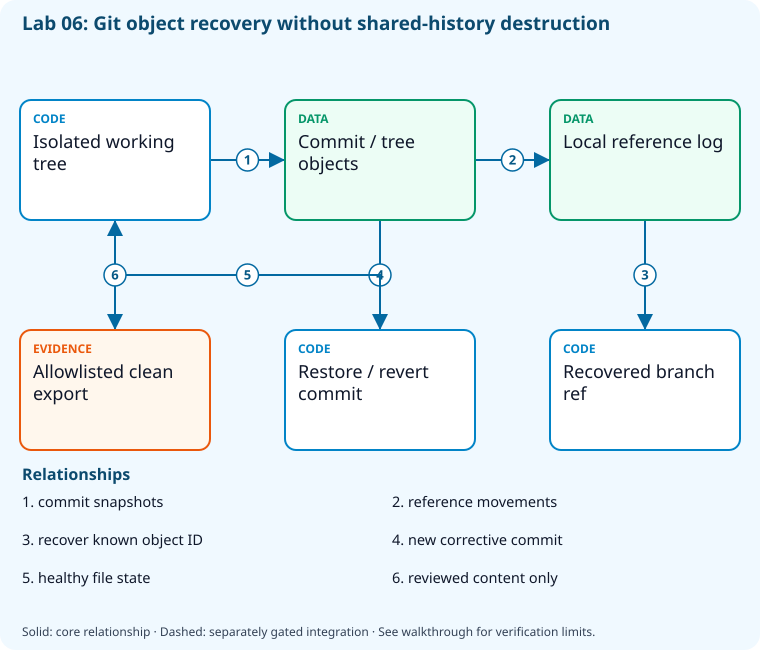

# Lab 06: Recover commits and remove unwanted history

[Previous: Lab 05](../05-repository-administration/README.md) · [Catalog](../../docs/lab-catalog.md) · [Next: Lab 07](../07-packages-versioning/README.md)

## Scenario, role, and outcome

A regression reached shared history and a local branch was accidentally deleted. Practise reversible recovery before touching any real project.

Learner role: **Incident responder**. Outcome: Recover commits and remove unwanted history.

| Item | Value |
|---|---|
| Time | 120 minutes |
| Domain | source |
| Platforms | local |
| Cost | none — review [current pricing and cleanup](../../docs/cost-and-cleanup.md) before cloud execution |
| Exam blueprint | July 27, 2026; sources reviewed October 16, 2026 |
| Verification status | offline-tested |
| Verification scope | All five real Git checkpoints, final validators, named fault rejection/repair and final revalidation passed in an isolated temporary repository with pinned git-filter-repo. No remote publication. |

Completion requires all five checkpoints, the break/fix repair, successful
independent validation, and a passing residual-resource audit. An unavailable
external prerequisite is a visible gate; it does not become a passing result.

## Architecture and service topology



All history exercises stay in an isolated local repository. Commit objects retain snapshots, reflog entries identify moved or deleted references, and restore/revert create reviewed recovery state. A separate clean export demonstrates allowlisting without rewriting any shared remote; genuine secret exposure still requires revocation and coordinated history cleanup.

The editable [Mermaid source](diagrams/architecture.mmd) and accessible SVG
render the same authored components and relationships. Dashed connections show
separately gated integrations. Read every boundary before executing commands. Cloud changes
stay inside the exact disposable GitHub repository, Azure DevOps project, and
Azure resource group recorded for this run. Child objects inherit that cleanup
boundary. Account creation, external integrations, and privileged organization
settings belong to [one-time bootstrap](../../docs/account-bootstrap.md).

## Objectives and checkpoints

Coverage levels describe the intended learning evidence: **explained** means reasoned
understanding, **practiced** means an observable isolated skill, and **integrated**
means skills connected across a delivery boundary. These labels are curriculum
claims, not execution status. Verification above records what authors actually ran.

Official objective topic IDs: `D2.2.5`, `D2.2.6`

| Checkpoint | Measurable behavior |
|---|---|
| [CP1](#task-1) | Create recoverable committed history |
| [CP2](#task-2) | Recover a file without rewriting history |
| [CP3](#task-3) | Revert a published-style change safely |
| [CP4](#task-4) | Recover an accidentally deleted branch through reflog |
| [CP5](#task-5) | Remove a synthetic unwanted file from all reachable history |

The [objective map](../../docs/objective-map.md) traces every official topic to
labs. The [Microsoft study guide](https://learn.microsoft.com/en-us/credentials/certifications/resources/study-guides/az-400)
controls authoritative objective wording and domain weighting.

## Inputs, permissions, and read-only preflight

Use PowerShell 7.4+, .NET 10, Git, GitHub CLI, Azure CLI with the Azure DevOps
extension, and the pinned repository validation dependencies. Read the
[permissions matrix](../../docs/permissions-matrix.md) and [evidence policy](../../docs/evidence-handling.md).
Supply only the accounts needed by this lab. Never put a token, connection
string, or private key into a command log, committed YAML, or progress export.

The examples run from the repository root. Choose a fresh lowercase run ID;
`demo01` is an example, not a reusable shared sandbox. Set bootstrap environment
variables for the approved GitHub owner, DevOps organization, subscription, and
region. Do not run both guided and automated lanes with the same run ID.

```powershell
$lab = './labs/06-git-recovery-history/scripts/cli'
& "$lab/Preflight.ps1" -RunId 'demo01'
& "$lab/Setup.ps1" -RunId 'demo01' -ProvisionOnly
# After reviewing context, permissions, cost, and cleanup:
& "$lab/Setup.ps1" -RunId 'demo01' -ProvisionOnly -Execute -AcknowledgeCost -AcknowledgeTenantChange
. "$lab/Context.ps1" -RunId 'demo01'
```

Preflight performs reads only. Provisioning creates fresh run-owned top-level
sandboxes and records their exact IDs. Context establishes `$RepoRoot`,
`$LabRoot`, `$WorkRoot`, `$RunId`, `$GhRepo`, `$AdoOrganization`, `$AdoProject`,
`$SubscriptionId`, `$Location`, and `$ResourceGroup`. A missing prerequisite or
ownership mismatch must stop execution. Local build commands may restore
packages and write ignored build output.

## Concept primer and design decisions

Restore repairs file content, revert adds an inverse commit, and reflog can recover local references. Rewriting shared history requires coordination; exposed credentials need revocation first.

A safe correction preserves other contributors' history. Restore retrieves a file version; revert records an inverse change; reflog helps recover local reference movements and is not a durable remote backup. The original fixture retains the regression so every correction remains auditable.

The history-removal task uses git-filter-repo 2.47.0 in a fresh, non-local clone. It removes a synthetic unwanted file from every reachable tree while preserving useful commits. Commit IDs change because parent/tree content changes, and filter-repo removes the origin remote to reduce accidental publication. Real remediation starts by revoking exposed credentials and coordinating replacement of shared refs, caches, forks and artifacts.

## Task 1 — Create recoverable committed history

<a id="task-1"></a>

Checkpoint: `CP1`

Foundation/supporting task; no additional exam-objective coverage is claimed.

```powershell
$p=Join-Path $WorkRoot 'recovery'
if(Test-Path (Join-Path $p '.git')){throw 'Existing recovery fixture: use the journaled resume command or a fresh run ID; do not reset a working copy.'}
git init --initial-branch=main $p
git -C $p config user.name 'AZ400 Learner';git -C $p config user.email 'learner@example.invalid'
'healthy'|Set-Content (Join-Path $p 'service.txt');git -C $p add .;git -C $p commit -m 'Known good service'
(git -C $p rev-parse HEAD)|Set-Content (Join-Path $WorkRoot 'good-commit.txt')
'broken'|Set-Content (Join-Path $p 'service.txt')
'AZ400_SYNTHETIC_UNWANTED_HISTORY_NO_CREDENTIAL'|Set-Content (Join-Path $p 'unwanted.txt')
git -C $p add .;git -C $p commit -m 'Introduce deterministic regression and unwanted history'
```

Expected state: A disposable repository contains known-good and broken commits.

Positive validation:

```powershell
$p=Join-Path $WorkRoot 'recovery';$good=(Get-Content (Join-Path $WorkRoot 'good-commit.txt')).Trim()
if([int](git -C $p rev-list --count HEAD) -lt 2 -or (git -C $p cat-file -t $good) -ne 'commit'){throw 'Known-good history is not retained.'}
```

Negative validation:

```powershell
$p=Join-Path $WorkRoot 'recovery'
 if ((git -C $p rev-parse HEAD) -eq (Get-Content (Join-Path $WorkRoot 'good-commit.txt'))) { throw 'Regression fixture missing.' }
```

Evidence to retain: Commit graph and good commit SHA.

Common failure and safe retry: Run destructive history exercises only in this isolated local repository.

Cleanup dependency: retain this checkpoint's evidence until final validation; remove run-owned children before their recorded parent boundary.

## Task 2 — Recover a file without rewriting history

<a id="task-2"></a>

Checkpoint: `CP2`

| Objective | Evidence level | Observation and limits |
|---|---|---|
| `D2.2.5` | practiced | Restore healthy content while preserving the regression and correction commits; later tasks exercise revert and reflog recovery. |

```powershell
$p=Join-Path $WorkRoot 'recovery';$good=Get-Content (Join-Path $WorkRoot 'good-commit.txt')
 git -C $p restore --source $good -- service.txt
 git -C $p add service.txt;git -C $p commit -m 'Restore known-good service content'
```

Expected state: A new commit restores the good file while retaining the regression history.

Positive validation:

```powershell
if ((Get-Content (Join-Path $WorkRoot 'recovery/service.txt')) -ne 'healthy') { throw 'File recovery failed.' }
```

Negative validation:

```powershell
$p=Join-Path $WorkRoot 'recovery'
if([int](git -C $p rev-list --count HEAD) -lt 3){throw 'Recovery must preserve history and add a correction.'}
$restored=@(git -C $p log --all --format=%s --grep='Restore known-good service content')
if($restored.Count -lt 1){throw 'Recovery correction commit is absent.'}
```

Evidence to retain: Recovered file digest and new commit SHA.

Common failure and safe retry: Use restore with a known source; avoid reset --hard for shared history.

Cleanup dependency: retain this checkpoint's evidence until final validation; remove run-owned children before their recorded parent boundary.

## Task 3 — Revert a published-style change safely

<a id="task-3"></a>

Checkpoint: `CP3`

Foundation/supporting task; no additional exam-objective coverage is claimed.

```powershell
$p=Join-Path $WorkRoot 'recovery'
 'temporary-option'|Set-Content (Join-Path $p 'option.txt');git -C $p add option.txt;git -C $p commit -m 'Enable temporary option'
 $target=git -C $p rev-parse HEAD;git -C $p revert --no-edit $target
 $target|Set-Content (Join-Path $WorkRoot 'reverted-commit.txt')
```

Expected state: Revert records an inverse commit and removes the temporary option.

Positive validation:

```powershell
$p=Join-Path $WorkRoot 'recovery'
 if ((git -C $p log -1 --format=%s) -notmatch '^Revert') { throw 'Expected explicit revert commit.' }
```

Negative validation:

```powershell
if (Test-Path (Join-Path $WorkRoot 'recovery/option.txt')) { throw 'Reverted file still present.' }
```

Evidence to retain: Original SHA, inverse SHA, and final tree.

Common failure and safe retry: Resolve any conflict explicitly; do not force-push a rewritten shared branch.

Cleanup dependency: retain this checkpoint's evidence until final validation; remove run-owned children before their recorded parent boundary.

## Task 4 — Recover an accidentally deleted branch through reflog

<a id="task-4"></a>

Checkpoint: `CP4`

Foundation/supporting task; no additional exam-objective coverage is claimed.

```powershell
$p=Join-Path $WorkRoot 'recovery';git -C $p branch recover-me
 $lost=git -C $p rev-parse recover-me;git -C $p branch -D recover-me
 git -C $p reflog --format='%h %gs'|Set-Content (Join-Path $WorkRoot 'reflog.txt')
 git -C $p branch recovered $lost
```

Expected state: The branch is recovered from its retained commit identity.

Positive validation:

```powershell
$p=Join-Path $WorkRoot 'recovery'
 if ((git -C $p rev-parse recovered) -ne (git -C $p rev-parse HEAD)) { throw 'Recovered branch points at wrong commit.' }
```

Negative validation:

```powershell
$p=Join-Path $WorkRoot 'recovery'
 if ('recover-me' -in @((git -C $p branch --format='%(refname:short)'))) { throw 'Deletion fixture did not occur.' }
```

Evidence to retain: Reflog entry and recovered branch SHA.

Common failure and safe retry: Reflog is local and expires; preserve a backup before garbage collection.

Cleanup dependency: retain this checkpoint's evidence until final validation; remove run-owned children before their recorded parent boundary.

## Task 5 — Remove a synthetic unwanted file from all reachable history

<a id="task-5"></a>

Checkpoint: `CP5`

| Objective | Evidence level | Observation and limits |
|---|---|---|
| `D2.2.6` | practiced | Run pinned git-filter-repo in a fresh clone and inspect every reachable tree for the removed synthetic file. |

```powershell
$p=Join-Path $WorkRoot 'recovery';$clean=Join-Path $WorkRoot 'sanitized'
if(Test-Path $clean){throw 'History-rewrite destination already exists; inspect it or select a fresh run ID. Never force-rewrite the original fixture.'}
git clone --no-local $p $clean
$before=git -C $clean rev-parse HEAD
$before|Set-Content (Join-Path $WorkRoot 'rewrite-before.txt')
Push-Location $clean
try{
 python -m git_filter_repo --path unwanted.txt --invert-paths
 if($LASTEXITCODE -ne 0){throw 'git-filter-repo did not complete. Install the pinned development dependencies.'}
}finally{Pop-Location}
$after=git -C $clean rev-parse HEAD
$after|Set-Content (Join-Path $WorkRoot 'rewrite-after.txt')
git -C $clean log --all --format='%H %s'|Set-Content (Join-Path $WorkRoot 'rewritten-history.txt')
```

Expected state: The fresh disposable clone retains useful commit history and healthy content, but every reachable tree excludes unwanted.txt and rewritten commit IDs differ.

Positive validation:

```powershell
$p=Join-Path $WorkRoot 'sanitized'
if([int](git -C $p rev-list --count --all) -lt 3 -or (Get-Content (Join-Path $p 'service.txt')).Trim() -ne 'healthy'){throw 'Useful recovery history or healthy content was lost.'}
if((Get-Content (Join-Path $WorkRoot 'rewrite-before.txt')).Trim() -eq (Get-Content (Join-Path $WorkRoot 'rewrite-after.txt')).Trim()){throw 'History was not rewritten.'}
```

Negative validation:

```powershell
$p=Join-Path $WorkRoot 'sanitized'
foreach($commit in @(git -C $p rev-list --all)){
 if('unwanted.txt' -in @(git -C $p ls-tree -r --name-only $commit)){throw 'Unwanted path survives in a reachable historical tree.'}
}
$original=Join-Path $WorkRoot 'recovery'
if(-not (Test-Path (Join-Path $original 'unwanted.txt'))){throw 'Original evidence fixture was unexpectedly modified.'}
if(@(git -C $p remote).Count -ne 0){throw 'Rewritten clone should not retain a pushable origin.'}
```

Evidence to retain: rewrite-before.txt, rewrite-after.txt, rewritten-history.txt and the disposable sanitized clone. The original fixture remains available for comparison.

Common failure and safe retry: Install git-filter-repo 2.47.0 from the pinned dependencies; run only in a fresh clone. A real leaked credential must be revoked separately; rewriting history cannot recall existing clones or published artifacts.

Cleanup dependency: retain this checkpoint's evidence until final validation; remove run-owned children before their recorded parent boundary.

## Deterministic break/fix

Run the journaled operation after all five checkpoints. It proves the healthy assertion, injects the named fault, requires its rejection, repairs it, and proves health again. Provider doubles used in author tests are not live enforcement evidence.

```powershell
& './labs/06-git-recovery-history/scripts/cli/BreakFix.ps1' -RunId 'demo01' -Execute
```

Expected rejection marker: `AZ400-L06-FAULT`. The assertion must catch the changed behavior, not merely an exception from an unavailable CLI.

Inspect the independent assertion:

```powershell
if((Get-Content (Join-Path $WorkRoot 'recovery/service.txt')) -ne 'healthy'){throw 'AZ400-L06-FAULT'}
```

Fault trigger (executed by BreakFix):

```powershell
Set-Content (Join-Path $WorkRoot 'recovery/service.txt') 'broken-again'
```

Diagnose the precise difference:

```powershell
$p=Join-Path $WorkRoot 'recovery';git -C $p diff -- service.txt
```

Repair (executed by BreakFix):

```powershell
$p=Join-Path $WorkRoot 'recovery';git -C $p restore --source HEAD -- service.txt
```

## Optional job-style challenge

On a separate throwaway clone, use git-filter-repo to remove a synthetic nonsecret file across all refs; document revocation and coordination needed for real incidents.

## Final validation and result interpretation

```powershell
& './labs/06-git-recovery-history/scripts/cli/Validate.ps1' -RunId 'demo01'
```

A complete result requires five passing read-only checkpoint assertions, a journaled repaired fault, and any required integration evidence. Pending hosted runs, missing licensed features, and unexecuted integration lanes remain visible. Review `validation.json`; successful command exit alone does not establish the asserted behavior.

## Troubleshooting

- **401/403:** inspect the explicit account/project/repository scope and required role; do not broaden a token reflexively.
- **Resource or artifact missing:** confirm the exact run ID and prerequisite checkpoint; retry reads after eventual consistency.
- **Unsupported SKU/runtime/tool:** consult the specific current source, record the gate, and obtain approval before changing cost or architecture.
- **Validation mismatch:** inspect the positive and negative assertions separately, repair the named fault, and rerun validation.
- **Ownership refusal:** stop; never edit a manifest to claim an unrelated resource.

## Cleanup and residual checks

```powershell
& './labs/06-git-recovery-history/scripts/cli/Cleanup.ps1' -RunId 'demo01'
# Review the exact owned-object deletion plan first.
& './labs/06-git-recovery-history/scripts/cli/Cleanup.ps1' -RunId 'demo01' -Execute
```

Cleanup must verify ownership, delete only recorded sandbox objects in dependency order, and prove parent/child absence. Retain `run.json`, `validation.json`, and `cleanup.json` locally until the audit passes. Soft-deleted or deliberately retained items must remain reported. Never purge a shared vault or delete an account, organization, or pre-existing service connection to finish a lab.

## Exam debrief and assessment

Explain why each checkpoint's denied path matters, which scope authorizes it, what evidence proves it, and how it is reversed. Complete the [50-question assessment](QUESTIONS.md), then review [rationales](ANSWERS.md) and repeat weak checkpoints.

## Microsoft and platform sources

- [Primary source 1](https://git-scm.com/docs/git-restore) — reviewed 2026-10-16.
- [Primary source 2](https://git-scm.com/docs/git-revert) — reviewed 2026-10-16.
- [Primary source 3](https://docs.github.com/en/authentication/keeping-your-account-and-data-secure/removing-sensitive-data-from-a-repository) — reviewed 2026-10-16.

## Lifecycle scripts and worked solution

Use `scripts/cli/Preflight.ps1`, `Setup.ps1`, `BreakFix.ps1`, `Integration.ps1` (capstones), `Validate.ps1`, `Cleanup.ps1`, and `Context.ps1` from this lab folder. Setup and cleanup preview until `-Execute`; `-ProvisionOnly` creates only fresh ownership-tracked containers. The [worked solution](solution/README.md) lists expected results and repair reasoning.
