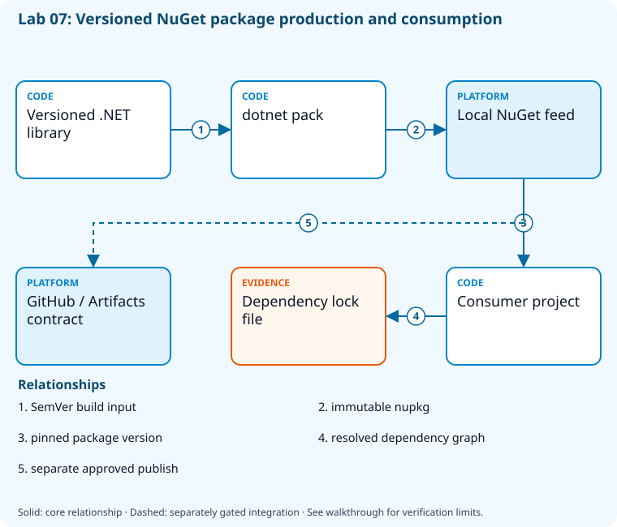

# Lab 07: Version packages and manage feeds

[Previous: Lab 06](../06-git-recovery-history/README.md) · [Catalog](../../docs/lab-catalog.md) · [Next: Lab 08](../08-tests-coverage-gates/README.md)

## Scenario, role, and outcome

Consumers receive mutable zip files and dependency versions drift. Produce stable and prerelease NuGet packages and consume a pinned version from a local feed.

Learner role: **Build engineer**. Outcome: Version packages and manage feeds.

| Item | Value |
|---|---|
| Time | 120 minutes |
| Domain | pipelines |
| Platforms | local |
| Cost | none — review [current pricing and cleanup](../../docs/cost-and-cleanup.md) before cloud execution |
| Exam blueprint | July 27, 2026; sources reviewed October 16, 2026 |
| Verification | Authored and checked offline; no live Azure deployment is claimed |

Completion requires all five checkpoints, the break/fix repair, successful
independent validation, and a passing residual-resource audit. An unavailable
external prerequisite is a visible gate; it does not become a passing result.

## Architecture and service topology



dotnet pack builds immutable stable and prerelease nupkg files into a local feed. The consumer restores an explicit version and records its dependency graph in a lock file. GitHub Packages and Azure Artifacts are publication contracts reviewed separately; the core does not upload a package or grant registry credentials.

The editable [Mermaid source](diagrams/architecture.mmd) and accessible SVG
render the same authored components and relationships. Dashed connections show
separately gated integrations. Read every boundary before executing commands. Cloud changes
stay inside the exact disposable GitHub repository, Azure DevOps project, and
Azure resource group recorded for this run. Child objects inherit that cleanup
boundary. Account creation, external integrations, and privileged organization
settings belong to [one-time bootstrap](../../docs/account-bootstrap.md).

## Objectives and checkpoints

Official objective topic IDs: `D2.2.4`, `D3.1.1`, `D3.1.2`, `D3.1.3`, `D3.1.4`

| Checkpoint | Measurable behavior |
|---|---|
| [CP1](#task-1) | Create a versioned local package |
| [CP2](#task-2) | Inspect package metadata without executing package code |
| [CP3](#task-3) | Consume the local feed with a pinned dependency |
| [CP4](#task-4) | Produce a distinct prerelease artifact |
| [CP5](#task-5) | Compare GitHub Packages and Azure Artifacts publication contracts |

The [objective map](../../docs/objective-map.md) traces every official topic to
labs. The [Microsoft study guide](https://learn.microsoft.com/en-us/credentials/certifications/resources/study-guides/az-400)
controls authoritative objective wording and domain weighting.

## Inputs, permissions, and read-only preflight

Use PowerShell 7.4+, .NET 10, Git, GitHub CLI, Azure CLI with the Azure DevOps
extension, and the pinned repository validation dependencies. Read the
[permissions matrix](../../docs/permissions-matrix.md) and [evidence policy](../../docs/evidence-handling.md).
Supply only the accounts needed by this lab. Never put a token, connection
string, or private key into a command log, committed YAML, or progress export.

The examples run from the repository root. Choose a fresh lowercase run ID;
`demo01` is an example, not a reusable shared sandbox. Set bootstrap environment
variables for the approved GitHub owner, DevOps organization, subscription, and
region. Do not run both guided and automated lanes with the same run ID.

```powershell
$lab = './labs/07-packages-versioning/scripts/cli'
& "$lab/Preflight.ps1" -RunId 'demo01'
& "$lab/Setup.ps1" -RunId 'demo01' -ProvisionOnly
# After reviewing context, permissions, cost, and cleanup:
& "$lab/Setup.ps1" -RunId 'demo01' -ProvisionOnly -Execute -AcknowledgeCost -AcknowledgeTenantChange
. "$lab/Context.ps1" -RunId 'demo01'
```

Preflight performs reads only. Provisioning creates fresh run-owned top-level
sandboxes and records their exact IDs. Context establishes `$RepoRoot`,
`$LabRoot`, `$WorkRoot`, `$RunId`, `$GhRepo`, `$AdoOrganization`, `$AdoProject`,
`$SubscriptionId`, `$Location`, and `$ResourceGroup`. A missing prerequisite or
ownership mismatch must stop execution. Local build commands may restore
packages and write ignored build output.

## Concept primer and design decisions

SemVer communicates compatibility; CalVer communicates release dates. Feed promotion preserves bytes, upstream feeds add trust boundaries, and lock files constrain resolution.

## Task 1 — Create a versioned local package

<a id="task-1"></a>

Checkpoint: `CP1`

```powershell
$p=Join-Path $WorkRoot 'Versioned.Library'
$projectFile=Join-Path $p 'Versioned.Library.csproj'
if(Test-Path $projectFile){
 $projectXml=[xml](Get-Content $projectFile -Raw)
 if('net10.0' -notin @($projectXml.SelectNodes('/Project/PropertyGroup/TargetFramework')|ForEach-Object InnerText)){throw 'Existing package project targets another framework; refusing to overwrite it.'}
}else{dotnet new classlib --framework net10.0 --output $p}

 dotnet pack $p --configuration Release -p:PackageVersion=1.2.0 -o (Join-Path $WorkRoot 'feed')
 if ($LASTEXITCODE -ne 0) { throw 'Package build failed.' }
```

Expected state: A reproducible local feed receives Versioned.Library1.2.0.

Positive validation:

```powershell
if (-not (Test-Path (Join-Path $WorkRoot 'feed/Versioned.Library.1.2.0.nupkg'))) { throw 'Expected package absent.' }
```

Negative validation:

```powershell
if (Get-ChildItem (Join-Path $WorkRoot 'feed') -Filter '*SNAPSHOT*') { throw 'Mutable snapshot naming in immutable release feed.' }
```

Evidence to retain: Package name/version and SHA256.

Common failure and safe retry: Use semantic versions for compatibility; reserve new versions for changed bytes.

Cleanup dependency: retain this checkpoint's evidence until final validation; remove run-owned children before their recorded parent boundary.

## Task 2 — Inspect package metadata without executing package code

<a id="task-2"></a>

Checkpoint: `CP2`

```powershell
$pkg=Join-Path $WorkRoot 'feed/Versioned.Library.1.2.0.nupkg'
 Add-Type -AssemblyName System.IO.Compression.FileSystem
 $zip=[IO.Compression.ZipFile]::OpenRead($pkg);try { $names=@($zip.Entries.FullName);$names|Set-Content (Join-Path $WorkRoot 'package-files.txt') } finally { $zip.Dispose() }
 Get-FileHash $pkg -Algorithm SHA256|ConvertTo-Json|Set-Content (Join-Path $WorkRoot 'package-hash.json')
```

Expected state: The package contains its nuspec and net10.0 library, and receives a digest.

Positive validation:

```powershell
$n=Get-Content (Join-Path $WorkRoot 'package-files.txt')
 if ($n -notmatch '\.nuspec$' -or $n -notmatch 'lib/net10.0/') { throw 'Package metadata/framework missing.' }
```

Negative validation:

```powershell
$n=Get-Content (Join-Path $WorkRoot 'package-files.txt')
 if ($n -match '\.(pfx|pem)$') { throw 'Private key material must not enter package.' }
```

Evidence to retain: nuspec file list and SHA256 digest.

Common failure and safe retry: Correct package inclusion rules before publishing; do not publish signing keys.

Cleanup dependency: retain this checkpoint's evidence until final validation; remove run-owned children before their recorded parent boundary.

## Task 3 — Consume the local feed with a pinned dependency

<a id="task-3"></a>

Checkpoint: `CP3`

```powershell
$p=Join-Path $WorkRoot 'Package.Consumer'
$projectFile=Join-Path $p 'Package.Consumer.csproj'
if(Test-Path $projectFile){
 $projectXml=[xml](Get-Content $projectFile -Raw)
 if('net10.0' -notin @($projectXml.SelectNodes('/Project/PropertyGroup/TargetFramework')|ForEach-Object InnerText)){throw 'Existing package project targets another framework; refusing to overwrite it.'}
}else{dotnet new classlib --framework net10.0 --output $p}

 dotnet add $p package Versioned.Library --version 1.2.0 --source (Join-Path $WorkRoot 'feed')
 dotnet restore $p --use-lock-file
 if ($LASTEXITCODE -ne 0) { throw 'Pinned package restore failed.' }
```

Expected state: A consumer pins1.2.0 and records a dependency lock file.

Positive validation:

```powershell
$p=Join-Path $WorkRoot 'Package.Consumer'
 if (-not (Test-Path (Join-Path $p 'packages.lock.json'))) { throw 'Dependency lock absent.' }
```

Negative validation:

```powershell
$text=Get-Content (Join-Path $WorkRoot 'Package.Consumer/Package.Consumer.csproj') -Raw
 if ($text -match 'Version="\*"') { throw 'Floating dependency version is not reproducible.' }
```

Evidence to retain: Consumer project and packages.lock.json.

Common failure and safe retry: Use an explicit feed and version; investigate feed precedence rather than accepting a similarly named upstream package.

Cleanup dependency: retain this checkpoint's evidence until final validation; remove run-owned children before their recorded parent boundary.

## Task 4 — Produce a distinct prerelease artifact

<a id="task-4"></a>

Checkpoint: `CP4`

```powershell
$p=Join-Path $WorkRoot 'Versioned.Library'
 dotnet pack $p --configuration Release -p:PackageVersion=1.3.0-beta.1 -o (Join-Path $WorkRoot 'feed')
 Get-ChildItem (Join-Path $WorkRoot 'feed') -Filter '*.nupkg'|Select-Object Name,Length
```

Expected state: Stable and prerelease packages coexist under distinct immutable versions.

Positive validation:

```powershell
if (-not (Test-Path (Join-Path $WorkRoot 'feed/Versioned.Library.1.3.0-beta.1.nupkg'))) { throw 'Prerelease artifact absent.' }
```

Negative validation:

```powershell
$old=Get-Content (Join-Path $WorkRoot 'package-hash.json') -Raw|ConvertFrom-Json
 if ((Get-FileHash (Join-Path $WorkRoot 'feed/Versioned.Library.1.2.0.nupkg')).Hash -ne $old.Hash) { throw 'Published stable artifact changed.' }
```

Evidence to retain: Both versions and stable digest preservation.

Common failure and safe retry: Promote the same package to a feed view; avoid rebuilding after approval.

Cleanup dependency: retain this checkpoint's evidence until final validation; remove run-owned children before their recorded parent boundary.

## Task 5 — Compare GitHub Packages and Azure Artifacts publication contracts

<a id="task-5"></a>

Checkpoint: `CP5`

```powershell
$plan=[ordered]@{github=@{registry='https://nuget.pkg.github.com/OWNER/index.json';permission='packages:write'};azureArtifacts=@{feed='az400-disposable';views=@('@Local','@Prerelease','@Release');upstreamPolicy='approved-only'};releaseVersion='1.2.0';published=$false}
 $plan|ConvertTo-Json -Depth 6|Set-Content (Join-Path $WorkRoot 'feed-plan.json')
```

Expected state: A publish contract separates registries, scopes, views, and upstream trust; it sends no package.

Positive validation:

```powershell
$p=Get-Content (Join-Path $WorkRoot 'feed-plan.json') -Raw|ConvertFrom-Json
 if ($p.github.permission -ne 'packages:write' -or '@Release' -notin $p.azureArtifacts.views) { throw 'Feed contract incomplete.' }
```

Negative validation:

```powershell
$p=Get-Content (Join-Path $WorkRoot 'feed-plan.json') -Raw|ConvertFrom-Json
 if ($p.published -or $p.azureArtifacts.upstreamPolicy -ne 'approved-only') { throw 'Publication/upstream gate violated.' }
```

Evidence to retain: Feed plan; registry credentials remain outside Git.

Common failure and safe retry: Complete feed creation/permissions bootstrap before an explicitly authorized publication.

Cleanup dependency: retain this checkpoint's evidence until final validation; remove run-owned children before their recorded parent boundary.

## Deterministic break/fix

Inject this fault only in the recorded sandbox or local run directory.

```powershell
$p=Join-Path $WorkRoot 'Package.Consumer/Package.Consumer.csproj';(Get-Content $p -Raw).Replace('Version="1.2.0"','Version="9.9.9"')|Set-Content $p
```

Diagnose the precise difference:

```powershell
dotnet restore (Join-Path $WorkRoot 'Package.Consumer') --source (Join-Path $WorkRoot 'feed');'Expected: package version not found.'
```

Repair, then repeat the affected checkpoint validation:

```powershell
$p=Join-Path $WorkRoot 'Package.Consumer/Package.Consumer.csproj';(Get-Content $p -Raw).Replace('Version="9.9.9"','Version="1.2.0"')|Set-Content $p
dotnet restore (Join-Path $WorkRoot 'Package.Consumer')
```

## Optional job-style challenge

Create an approved upstream-feed policy and promotion strategy that preserves the package digest; compare SemVer with a dated CalVer release.

## Final validation and result interpretation

```powershell
& './labs/07-packages-versioning/scripts/cli/Validate.ps1' -RunId 'demo01'
```

A complete result requires five passing read-only assertions. Pending hosted runs, missing licensed features, and unexecuted integration challenges remain visible. Review `validation.json`; a command exiting successfully is not enough if the asserted behavior is absent.

## Troubleshooting

- **401/403:** inspect the explicit account/project/repository scope and required role; do not broaden a token reflexively.
- **Resource or artifact missing:** confirm the exact run ID and prerequisite checkpoint; retry reads after eventual consistency.
- **Unsupported SKU/runtime/tool:** consult the specific current source, record the gate, and obtain approval before changing cost or architecture.
- **Validation mismatch:** inspect the positive and negative assertions separately, repair the named fault, and rerun validation.
- **Ownership refusal:** stop; never edit a manifest to claim an unrelated resource.

## Cleanup and residual checks

```powershell
& './labs/07-packages-versioning/scripts/cli/Cleanup.ps1' -RunId 'demo01'
# Review the exact owned-object deletion plan first.
& './labs/07-packages-versioning/scripts/cli/Cleanup.ps1' -RunId 'demo01' -Execute
```

Cleanup must verify ownership, delete only recorded sandbox objects in dependency order, and prove parent/child absence. Retain `run.json`, `validation.json`, and `cleanup.json` locally until the audit passes. Soft-deleted or deliberately retained items must remain reported. Never purge a shared vault or delete an account, organization, or pre-existing service connection to finish a lab.

## Exam debrief and assessment

Explain why each checkpoint's denied path matters, which scope authorizes it, what evidence proves it, and how it is reversed. Complete the [50-question assessment](QUESTIONS.md), then review [rationales](ANSWERS.md) and repeat weak checkpoints.

## Microsoft and platform sources

- [Primary source 1](https://learn.microsoft.com/en-us/nuget/create-packages/creating-a-package-dotnet-cli) — reviewed 2026-10-16.
- [Primary source 2](https://learn.microsoft.com/en-us/azure/devops/artifacts/concepts/views) — reviewed 2026-10-16.
- [Primary source 3](https://docs.github.com/en/packages/working-with-a-github-packages-registry/working-with-the-nuget-registry) — reviewed 2026-10-16.

## Lifecycle scripts and worked solution

Use `scripts/cli/Preflight.ps1`, `Setup.ps1`, `Validate.ps1`, `Cleanup.ps1`, and `Context.ps1` from this lab folder. Setup and cleanup preview until `-Execute`; `-ProvisionOnly` creates only fresh ownership-tracked containers. The [worked solution](solution/README.md) lists expected results and repair reasoning.
