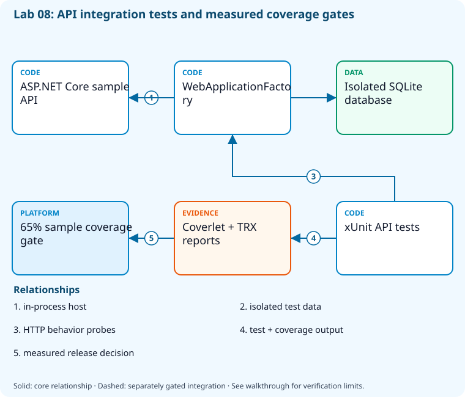

# Lab 08: Run tests, collect coverage, and enforce quality

[Previous: Lab 07](../07-packages-versioning/README.md) · [Catalog](../../docs/lab-catalog.md) · [Next: Lab 09](../09-github-actions-ci/README.md)

## Scenario, role, and outcome

The team has a green build but cannot show which API behaviors or code paths were tested. Produce test results, coverage, and an explicit release decision.

Learner role: **Quality engineer**. Outcome: Run tests, collect coverage, and enforce quality.

| Item | Value |
|---|---|
| Time | 120 minutes |
| Domain | pipelines |
| Platforms | local |
| Cost | none — review [current pricing and cleanup](../../docs/cost-and-cleanup.md) before cloud execution |
| Exam blueprint | July 27, 2026; sources reviewed October 16, 2026 |
| Verification status | offline-tested |
| Verification scope | The complete five-checkpoint sequence, final-state revalidation, fault detection and repair run with real local Git/.NET/package/file operations and fail-closed synthetic GitHub/Azure DevOps responses. Provider operations remain unverified live. |

Completion requires all five checkpoints, the break/fix repair, successful
independent validation, and a passing residual-resource audit. An unavailable
external prerequisite is a visible gate; it does not become a passing result.

## Architecture and service topology



WebApplicationFactory hosts the sample API in process, with an isolated SQLite database for integration behavior. xUnit exercises HTTP boundaries and Coverlet/TRX provide independent coverage and test results. The sample release gate evaluates measured coverage and passing tests; external load testing requires a separately approved target and budget.

The editable [Mermaid source](diagrams/architecture.mmd) and accessible SVG
render the same authored components and relationships. Dashed connections show
separately gated integrations. Read every boundary before executing commands. Cloud changes
stay inside the exact disposable GitHub repository, Azure DevOps project, and
Azure resource group recorded for this run. Child objects inherit that cleanup
boundary. Account creation, external integrations, and privileged organization
settings belong to [one-time bootstrap](../../docs/account-bootstrap.md).

## Objectives and checkpoints

Coverage levels describe the intended learning evidence: **explained** means reasoned
understanding, **practiced** means an observable isolated skill, and **integrated**
means skills connected across a delivery boundary. These labels are curriculum
claims, not execution status. Verification above records what authors actually ran.

Official objective topic IDs: `D1.2.4`, `D3.2.1`, `D3.2.2`, `D3.2.3`, `D3.2.4`

| Checkpoint | Measurable behavior |
|---|---|
| [CP1](#task-1) | Restore locked sample dependencies |
| [CP2](#task-2) | Run tests and retain machine-readable results |
| [CP3](#task-3) | Collect coverage independently of test count |
| [CP4](#task-4) | Evaluate a documented release quality threshold |
| [CP5](#task-5) | Execute release gate decisions across test layers |

The [objective map](../../docs/objective-map.md) traces every official topic to
labs. The [Microsoft study guide](https://learn.microsoft.com/en-us/credentials/certifications/resources/study-guides/az-400)
controls authoritative objective wording and domain weighting.

## Inputs, permissions, and read-only preflight

Use PowerShell 7.4+, .NET 10, Git, GitHub CLI, Azure CLI with the Azure DevOps
extension, and the pinned repository validation dependencies. Read the
[permissions matrix](../../docs/permissions-matrix.md) and [evidence policy](../../docs/evidence-handling.md).
Supply only the accounts needed by this lab. Never put a token, connection
string, or private key into a command log, committed YAML, or progress export.

The examples run from the repository root. Choose a fresh lowercase run ID;
`demo01` is an example, not a reusable shared sandbox. Set bootstrap environment
variables for the approved GitHub owner, DevOps organization, subscription, and
region. Do not run both guided and automated lanes with the same run ID.

```powershell
$lab = './labs/08-tests-coverage-gates/scripts/cli'
& "$lab/Preflight.ps1" -RunId 'demo01'
& "$lab/Setup.ps1" -RunId 'demo01' -ProvisionOnly
# After reviewing context, permissions, cost, and cleanup:
& "$lab/Setup.ps1" -RunId 'demo01' -ProvisionOnly -Execute -AcknowledgeCost -AcknowledgeTenantChange
. "$lab/Context.ps1" -RunId 'demo01'
```

Preflight performs reads only. Provisioning creates fresh run-owned top-level
sandboxes and records their exact IDs. Context establishes `$RepoRoot`,
`$LabRoot`, `$WorkRoot`, `$RunId`, `$GhRepo`, `$AdoOrganization`, `$AdoProject`,
`$SubscriptionId`, `$Location`, and `$ResourceGroup`. A missing prerequisite or
ownership mismatch must stop execution. Local build commands may restore
packages and write ignored build output.

## Concept primer and design decisions

Passing tests, line coverage, security checks, and approval solve different risks. This course uses a 65% measured-line threshold for the sample; it is not a universal quality target.

The sample has unit and API integration tests. They exercise fast logic and an in-process application boundary; production routing, browser behavior and sustained load need additional layers. Preserve a TRX report so passed, failed and skipped tests can be distinguished from an empty successful invocation.

Coverage measures executed lines, not assertion quality or every possible branch. The course's 65% minimum is a sample gate, not a recommendation for every system. Collect coverage with the checked-in runsettings, inspect the measured denominator, and apply the threshold to the generated report. An approval or security scan cannot replace test execution.

## Task 1 — Restore locked sample dependencies

<a id="task-1"></a>

Checkpoint: `CP1`

Foundation/supporting task; no additional exam-objective coverage is claimed.

```powershell
dotnet restore (Join-Path $RepoRoot 'samples/DevOps.slnx') --locked-mode
 if ($LASTEXITCODE -ne 0) { throw 'Locked restore failed.' }
 Get-ChildItem (Join-Path $RepoRoot 'samples') -Filter packages.lock.json -Recurse|Select-Object FullName
```

Expected state: The lock files resolve without implicit dependency changes.

Positive validation:

```powershell
$locks=Get-ChildItem (Join-Path $RepoRoot 'samples') -Filter packages.lock.json -Recurse
 if ($locks.Count -lt 2) { throw 'Both API and test dependency locks are required.' }
```

Negative validation:

```powershell
$locks=Get-ChildItem (Join-Path $RepoRoot 'samples') -Filter packages.lock.json -Recurse
 if (@($locks|Where-Object Length -eq 0).Count) { throw 'Empty dependency lock.' }
```

Evidence to retain: Lock hashes and restore result.

Common failure and safe retry: Update lock files in a reviewed source change; never relax locked-mode silently.

Cleanup dependency: retain this checkpoint's evidence until final validation; remove run-owned children before their recorded parent boundary.

## Task 2 — Run tests and retain machine-readable results

<a id="task-2"></a>

Checkpoint: `CP2`

| Objective | Evidence level | Observation and limits |
|---|---|---|
| `D1.2.4` | practiced | Read TRX counters from an executed test run. |
| `D3.2.3` | practiced | Execute the test command and preserve machine-readable TRX results. |

```powershell
dotnet test (Join-Path $RepoRoot 'samples/DevOps.slnx') --configuration Release --logger "trx;LogFileName=quality.trx" --results-directory (Join-Path $WorkRoot 'results')
 if ($LASTEXITCODE -ne 0) { throw 'Test gate failed.' }
```

Expected state: The result summary contains passing API tests.

Positive validation:

```powershell
$t=Get-ChildItem (Join-Path $WorkRoot 'results') -Filter '*.trx' -Recurse|Select-Object -First 1
 $x=[xml](Get-Content $t.FullName -Raw);if ([int]$x.TestRun.ResultSummary.Counters.passed -lt 1) { throw 'No passing tests.' }
```

Negative validation:

```powershell
$t=Get-ChildItem (Join-Path $WorkRoot 'results') -Filter '*.trx' -Recurse|Select-Object -First 1
 $x=[xml](Get-Content $t.FullName -Raw);if ([int]$x.TestRun.ResultSummary.Counters.failed -gt 0) { throw 'Failed tests cannot pass release gate.' }
```

Evidence to retain: TRX counts and failure messages with sensitive payloads removed.

Common failure and safe retry: Repair the failing behavior or test fixture; do not mark a failing test run successful.

Cleanup dependency: retain this checkpoint's evidence until final validation; remove run-owned children before their recorded parent boundary.

## Task 3 — Collect coverage independently of test count

<a id="task-3"></a>

Checkpoint: `CP3`

| Objective | Evidence level | Observation and limits |
|---|---|---|
| `D3.2.4` | practiced | Collect real coverage with the checked-in runsettings and inspect measured rates. |

```powershell
dotnet test (Join-Path $RepoRoot 'samples/DevOps.slnx') --configuration Release --settings (Join-Path $RepoRoot 'samples/coverage.runsettings') --collect 'XPlat Code Coverage' --results-directory (Join-Path $WorkRoot 'coverage')
 if ($LASTEXITCODE -ne 0) { throw 'Coverage test run failed.' }
 Get-ChildItem (Join-Path $WorkRoot 'coverage') -Filter coverage.cobertura.xml -Recurse|Select-Object FullName
```

Expected state: Cobertura reports include measured line and branch coverage.

Positive validation:

```powershell
$f=Get-ChildItem (Join-Path $WorkRoot 'coverage') -Filter coverage.cobertura.xml -Recurse|Select-Object -First 1
 $c=[xml](Get-Content $f.FullName -Raw);if ([double]$c.coverage.'line-rate' -le 0) { throw 'No measured line coverage.' }
```

Negative validation:

```powershell
$f=Get-ChildItem (Join-Path $WorkRoot 'coverage') -Filter coverage.cobertura.xml -Recurse|Select-Object -First 1
 $c=[xml](Get-Content $f.FullName -Raw);if ([double]$c.coverage.'line-rate' -gt 1) { throw 'Coverage fraction out of range.' }
```

Evidence to retain: Cobertura summary and instrumentation scope.

Common failure and safe retry: Confirm coverlet collector is installed and the tested assembly is included.

Cleanup dependency: retain this checkpoint's evidence until final validation; remove run-owned children before their recorded parent boundary.

## Task 4 — Evaluate a documented release quality threshold

<a id="task-4"></a>

Checkpoint: `CP4`

| Objective | Evidence level | Observation and limits |
|---|---|---|
| `D3.2.1` | practiced | Apply a numerical coverage threshold to measured Cobertura coverage. |

```powershell
$f=Get-ChildItem (Join-Path $WorkRoot 'coverage') -Filter coverage.cobertura.xml -Recurse|Select-Object -First 1
 $c=[xml](Get-Content $f.FullName -Raw);$lineRate=[double]$c.coverage.'line-rate'
 [ordered]@{minimum=0.65;actual=$lineRate;passed=($lineRate -ge 0.65);scope='sample API lines'}|ConvertTo-Json|Set-Content (Join-Path $WorkRoot 'coverage-gate.json')
 if ($lineRate -lt 0.65) { throw 'Line coverage below documented 65% learning threshold.' }
```

Expected state: The threshold is explicit and fails when measured coverage is inadequate.

Positive validation:

```powershell
$g=Get-Content (Join-Path $WorkRoot 'coverage-gate.json') -Raw|ConvertFrom-Json
 if (-not $g.passed -or $g.actual -lt $g.minimum) { throw 'Coverage release gate failed.' }
```

Negative validation:

```powershell
$g=Get-Content (Join-Path $WorkRoot 'coverage-gate.json') -Raw|ConvertFrom-Json
 if ($g.minimum -le 0) { throw 'Disabled coverage gate.' }
```

Evidence to retain: Actual value, threshold, tested scope, and gate decision.

Common failure and safe retry: Improve exercised behavior; threshold changes require reviewed justification.

Cleanup dependency: retain this checkpoint's evidence until final validation; remove run-owned children before their recorded parent boundary.

## Task 5 — Execute release gate decisions across test layers

<a id="task-5"></a>

Checkpoint: `CP5`

| Objective | Evidence level | Observation and limits |
|---|---|---|
| `D3.2.2` | explained | Compare unit/integration/end-to-end responsibilities using the sample test strategy. |

```powershell
$strategy=[ordered]@{unit='pure behavior checks';integration='WebApplicationFactory with isolated SQLite';load='separate approved endpoint and budget';release=@('tests pass','coverage>=0.65','security checks clear');productionTrafficAllowed=$false}
 $strategy|ConvertTo-Json|Set-Content (Join-Path $WorkRoot 'test-strategy.json')
$cases=@(@{id='healthy';tests=$true;coverage=0.80;security=$true;expected=$true},@{id='failed-test';tests=$false;coverage=0.90;security=$true;expected=$false},@{id='low-coverage';tests=$true;coverage=0.64;security=$true;expected=$false},@{id='security-block';tests=$true;coverage=0.90;security=$false;expected=$false})
$results=foreach($case in $cases){
 $allowed=$case.tests -and $case.coverage -ge 0.65 -and $case.security
 if($allowed -ne $case.expected){throw "Release gate decision failed: $($case.id)"}
 @{id=$case.id;allowed=$allowed}
}
@{fixtureOnly=$true;results=@($results);loadTrafficSent=$false}|ConvertTo-Json -Depth 5|Set-Content (Join-Path $WorkRoot 'gate-decisions.json')
```

Expected state: A four-case local gate accepts healthy evidence and independently blocks failed tests, low coverage and a security finding. No load traffic is sent.

Positive validation:

```powershell
$s=Get-Content (Join-Path $WorkRoot 'test-strategy.json') -Raw|ConvertFrom-Json
 if ($s.integration -notmatch 'isolated SQLite' -or $s.release.Count -ne 3) { throw 'Test layers/gates incomplete.' }
$g=Get-Content (Join-Path $WorkRoot 'gate-decisions.json') -Raw|ConvertFrom-Json
if(@($g.results).Count -ne 4 -or @($g.results|Where-Object allowed).Count -ne 1 -or -not ($g.results|Where-Object id -eq 'healthy').allowed){throw 'Release gate truth table is incomplete.'}
```

Negative validation:

```powershell
$s=Get-Content (Join-Path $WorkRoot 'test-strategy.json') -Raw|ConvertFrom-Json
 if ($s.productionTrafficAllowed) { throw 'This exercise cannot send production load.' }
$g=Get-Content (Join-Path $WorkRoot 'gate-decisions.json') -Raw|ConvertFrom-Json
if($g.loadTrafficSent -or @($g.results|Where-Object {$_.id -ne 'healthy' -and $_.allowed}).Count){throw 'A negative gate case was accepted or load was sent.'}
```

Evidence to retain: Four computed decisions, the executed unit/HTTP tests from earlier tasks, and the separately authorized load-test boundary.

Common failure and safe retry: Keep load generation outside ordinary PR CI and bound concurrency, duration, and cost.

Cleanup dependency: retain this checkpoint's evidence until final validation; remove run-owned children before their recorded parent boundary.

## Deterministic break/fix

Run the journaled operation after all five checkpoints. It proves the healthy assertion, injects the named fault, requires its rejection, repairs it, and proves health again. Provider doubles used in author tests are not live enforcement evidence.

```powershell
& './labs/08-tests-coverage-gates/scripts/cli/BreakFix.ps1' -RunId 'demo01' -Execute
```

Expected rejection marker: `AZ400-L08-FAULT`. The assertion must catch the changed behavior, not merely an exception from an unavailable CLI.

Inspect the independent assertion:

```powershell
$g=Get-Content (Join-Path $WorkRoot 'coverage-gate.json') -Raw|ConvertFrom-Json
if($g.minimum -ne 0.65 -or $g.actual -lt $g.minimum -or -not $g.passed){throw 'AZ400-L08-FAULT'}
```

Fault trigger (executed by BreakFix):

```powershell
$g=Get-Content (Join-Path $WorkRoot 'coverage-gate.json') -Raw|ConvertFrom-Json;$g.minimum=1.01;$g.passed=$false;$g|ConvertTo-Json|Set-Content (Join-Path $WorkRoot 'coverage-gate.json')
```

Diagnose the precise difference:

```powershell
Get-Content (Join-Path $WorkRoot 'coverage-gate.json')
```

Repair (executed by BreakFix):

```powershell
$g=Get-Content (Join-Path $WorkRoot 'coverage-gate.json') -Raw|ConvertFrom-Json;$g.minimum=0.65;$g.passed=$g.actual -ge $g.minimum;$g|ConvertTo-Json|Set-Content (Join-Path $WorkRoot 'coverage-gate.json')
```

## Optional job-style challenge

Add tests for a missing API validation boundary, show the coverage delta, and explain why high coverage alone does not prove security or resilience.

## Final validation and result interpretation

```powershell
& './labs/08-tests-coverage-gates/scripts/cli/Validate.ps1' -RunId 'demo01'
```

A complete result requires five passing read-only checkpoint assertions, a journaled repaired fault, and any required integration evidence. Pending hosted runs, missing licensed features, and unexecuted integration lanes remain visible. Review `validation.json`; successful command exit alone does not establish the asserted behavior.

## Troubleshooting

- **401/403:** inspect the explicit account/project/repository scope and required role; do not broaden a token reflexively.
- **Resource or artifact missing:** confirm the exact run ID and prerequisite checkpoint; retry reads after eventual consistency.
- **Unsupported SKU/runtime/tool:** consult the specific current source, record the gate, and obtain approval before changing cost or architecture.
- **Validation mismatch:** inspect the positive and negative assertions separately, repair the named fault, and rerun validation.
- **Ownership refusal:** stop; never edit a manifest to claim an unrelated resource.

## Cleanup and residual checks

```powershell
& './labs/08-tests-coverage-gates/scripts/cli/Cleanup.ps1' -RunId 'demo01'
# Review the exact owned-object deletion plan first.
& './labs/08-tests-coverage-gates/scripts/cli/Cleanup.ps1' -RunId 'demo01' -Execute
```

Cleanup must verify ownership, delete only recorded sandbox objects in dependency order, and prove parent/child absence. Retain `run.json`, `validation.json`, and `cleanup.json` locally until the audit passes. Soft-deleted or deliberately retained items must remain reported. Never purge a shared vault or delete an account, organization, or pre-existing service connection to finish a lab.

## Exam debrief and assessment

Explain why each checkpoint's denied path matters, which scope authorizes it, what evidence proves it, and how it is reversed. Complete the [50-question assessment](QUESTIONS.md), then review [rationales](ANSWERS.md) and repeat weak checkpoints.

## Microsoft and platform sources

- [Primary source 1](https://learn.microsoft.com/en-us/dotnet/core/testing/unit-testing-code-coverage) — reviewed 2026-10-16.
- [Primary source 2](https://learn.microsoft.com/en-us/aspnet/core/test/integration-tests) — reviewed 2026-10-16.
- [Primary source 3](https://learn.microsoft.com/en-us/azure/devops/pipelines/test/review-continuous-test-results-after-build) — reviewed 2026-10-16.

## Lifecycle scripts and worked solution

Use `scripts/cli/Preflight.ps1`, `Setup.ps1`, `BreakFix.ps1`, `Integration.ps1` (capstones), `Validate.ps1`, `Cleanup.ps1`, and `Context.ps1` from this lab folder. Setup and cleanup preview until `-Execute`; `-ProvisionOnly` creates only fresh ownership-tracked containers. The [worked solution](solution/README.md) lists expected results and repair reasoning.
