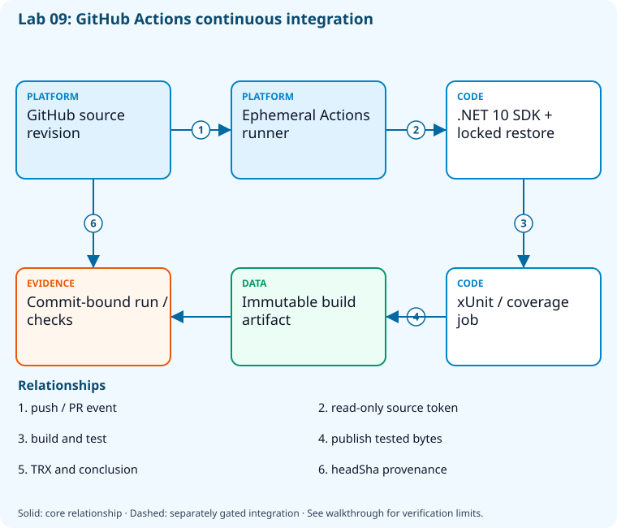

# Lab 09: Build the sample with GitHub Actions

[Previous: Lab 08](../08-tests-coverage-gates/README.md) · [Catalog](../../docs/lab-catalog.md) · [Next: Lab 10](../10-azure-pipelines-ci/README.md)

## Scenario, role, and outcome

A developer can run tests locally but the repository has no repeatable CI evidence. Publish one build-only GitHub workflow to a fresh sandbox.

Learner role: **GitHub automation engineer**. Outcome: Build the sample with GitHub Actions.

| Item | Value |
|---|---|
| Time | 120 minutes |
| Domain | pipelines |
| Platforms | local, github |
| Cost | none — review [current pricing and cleanup](../../docs/cost-and-cleanup.md) before cloud execution |
| Exam blueprint | July 27, 2026; sources reviewed October 16, 2026 |
| Verification status | not-run |
| Verification scope | All checkpoint/fault scripts parse; the named fault lifecycle is independently tested with explicit provider doubles. Full normal provider execution and live cloud delivery have not run. |

Completion requires all five checkpoints, the break/fix repair, successful
independent validation, and a passing residual-resource audit. An unavailable
external prerequisite is a visible gate; it does not become a passing result.

## Architecture and service topology



A sandbox source revision triggers an ephemeral GitHub Actions runner with read-only repository permission. The pinned .NET SDK restores locked dependencies, builds, tests, and produces coverage/artifact evidence. The final run/check result is tied to headSha. This active CI workflow has no Azure login or deployment action.

The editable [Mermaid source](diagrams/architecture.mmd) and accessible SVG
render the same authored components and relationships. Dashed connections show
separately gated integrations. Read every boundary before executing commands. Cloud changes
stay inside the exact disposable GitHub repository, Azure DevOps project, and
Azure resource group recorded for this run. Child objects inherit that cleanup
boundary. Account creation, external integrations, and privileged organization
settings belong to [one-time bootstrap](../../docs/account-bootstrap.md).

## Objectives and checkpoints

Coverage levels describe the intended learning evidence: **explained** means reasoned
understanding, **practiced** means an observable isolated skill, and **integrated**
means skills connected across a delivery boundary. These labels are curriculum
claims, not execution status. Verification above records what authors actually ran.

Official objective topic IDs: `D3.1.4`, `D3.2.3`, `D3.3.1`, `D3.3.4`, `D3.3.5`

| Checkpoint | Measurable behavior |
|---|---|
| [CP1](#task-1) | Prepare the isolated GitHub CI working copy |
| [CP2](#task-2) | Install the CI-only workflow |
| [CP3](#task-3) | Verify locally before publishing the CI change |
| [CP4](#task-4) | Publish the sandbox CI workflow |
| [CP5](#task-5) | Inspect run provenance and test artifact availability |

The [objective map](../../docs/objective-map.md) traces every official topic to
labs. The [Microsoft study guide](https://learn.microsoft.com/en-us/credentials/certifications/resources/study-guides/az-400)
controls authoritative objective wording and domain weighting.

## Inputs, permissions, and read-only preflight

Use PowerShell 7.4+, .NET 10, Git, GitHub CLI, Azure CLI with the Azure DevOps
extension, and the pinned repository validation dependencies. Read the
[permissions matrix](../../docs/permissions-matrix.md) and [evidence policy](../../docs/evidence-handling.md).
Supply only the accounts needed by this lab. Never put a token, connection
string, or private key into a command log, committed YAML, or progress export.

The examples run from the repository root. Choose a fresh lowercase run ID;
`demo01` is an example, not a reusable shared sandbox. Set bootstrap environment
variables for the approved GitHub owner, DevOps organization, subscription, and
region. Do not run both guided and automated lanes with the same run ID.

```powershell
$lab = './labs/09-github-actions-ci/scripts/cli'
& "$lab/Preflight.ps1" -RunId 'demo01'
& "$lab/Setup.ps1" -RunId 'demo01' -ProvisionOnly
# After reviewing context, permissions, cost, and cleanup:
& "$lab/Setup.ps1" -RunId 'demo01' -ProvisionOnly -Execute -AcknowledgeCost -AcknowledgeTenantChange
. "$lab/Context.ps1" -RunId 'demo01'
```

Preflight performs reads only. Provisioning creates fresh run-owned top-level
sandboxes and records their exact IDs. Context establishes `$RepoRoot`,
`$LabRoot`, `$WorkRoot`, `$RunId`, `$GhRepo`, `$AdoOrganization`, `$AdoProject`,
`$SubscriptionId`, `$Location`, and `$ResourceGroup`. A missing prerequisite or
ownership mismatch must stop execution. Local build commands may restore
packages and write ignored build output.

## Concept primer and design decisions

Triggers choose when jobs exist, permissions choose what a token may do, and headSha ties results to source. Hosted success must be observed rather than inferred from a push.

A GitHub Actions workflow has three related contracts: events create runs, jobs execute under a runner identity, and token permissions constrain access. A successful local test does not establish hosted-run success, and a push does not prove the intended workflow ran.

CI restores locked dependencies, tests and packages the same source revision. Inspect headSha, conclusion and artifact presence together. An artifact name alone is mutable context; the run ID, revision and digest provide a reproducible promotion input. Keep untrusted pull requests away from privileged deployment identities and use a separate protected release workflow.

## Task 1 — Prepare the isolated GitHub CI working copy

<a id="task-1"></a>

Checkpoint: `CP1`

Foundation/supporting task; no additional exam-objective coverage is claimed.

```powershell
$p=Join-Path $WorkRoot 'github-ci'
if(Test-Path (Join-Path $p '.git')){
 $origin=git -C $p remote get-url origin
 $expected='^(https://github\.com/|git@github\.com:)'+[regex]::Escape($GhRepo)+'(?:\.git)?$'
 if($origin -notmatch $expected){throw 'Existing working copy points to a different GitHub repository; refusing to reuse it.'}
}else{gh repo clone $GhRepo $p}

 git -C $p config user.name 'AZ400 Learner';git -C $p config user.email 'learner@example.invalid'
 $source=Join-Path $RepoRoot 'samples'
 Get-ChildItem $source -File -Recurse|Where-Object FullName -NotMatch '[\/](bin|obj)[\/]'|ForEach-Object { $rel=[IO.Path]::GetRelativePath($RepoRoot,$_.FullName);$dest=Join-Path $p $rel;New-Item -ItemType Directory -Force (Split-Path $dest)|Out-Null;Copy-Item $_.FullName $dest }
 foreach ($name in @('global.json','Directory.Build.props')) { if (Test-Path (Join-Path $RepoRoot $name)) { Copy-Item (Join-Path $RepoRoot $name) $p } }
 @('**/bin/','**/obj/','.state/')|Set-Content (Join-Path $p '.gitignore')
```

Expected state: Only the sample and build configuration enter a fresh sandbox working copy.

Positive validation:

```powershell
$p=Join-Path $WorkRoot 'github-ci'
 if (-not (Test-Path (Join-Path $p 'samples/DevOps.slnx'))) { throw 'Sample was not copied.' }
```

Negative validation:

```powershell
$p=Join-Path $WorkRoot 'github-ci'
 if ((git -C $p remote get-url origin) -notmatch [regex]::Escape($GhRepo)) { throw 'Wrong GitHub sandbox remote.' }
```

Evidence to retain: Working-copy remote and allowlisted copied paths.

Common failure and safe retry: Authenticate Git through the separate bootstrap; copy source files without bin/obj or credentials.

Cleanup dependency: retain this checkpoint's evidence until final validation; remove run-owned children before their recorded parent boundary.

## Task 2 — Install the CI-only workflow

<a id="task-2"></a>

Checkpoint: `CP2`

| Objective | Evidence level | Observation and limits |
|---|---|---|
| `D3.3.1` | practiced | Stage and parse an event-driven GitHub Actions CI workflow. |
| `D3.3.5` | practiced | Inspect jobs, steps, permissions, locked restore, tests, and package output in authored YAML. |

```powershell
$p=Join-Path $WorkRoot 'github-ci';$wf=Join-Path $p '.github/workflows';New-Item -ItemType Directory -Force $wf|Out-Null
 Copy-Item (Join-Path $LabRoot 'artifacts/github-ci.yml') (Join-Path $wf 'ci.yml')
 Get-Content (Join-Path $wf 'ci.yml')
```

Expected state: A YAML workflow builds/tests the sample without Azure deployment.

Positive validation:

```powershell
$text=Get-Content (Join-Path $WorkRoot 'github-ci/.github/workflows/ci.yml') -Raw
 if ($text -notmatch 'dotnet' -or $text -notmatch 'pull_request') { throw 'CI build/PR trigger absent.' }
```

Negative validation:

```powershell
$text=Get-Content (Join-Path $WorkRoot 'github-ci/.github/workflows/ci.yml') -Raw
 if ($text -match 'azure/login|az deployment|pull_request_target') { throw 'CI-only workflow contains an unsafe deployment trigger.' }
```

Evidence to retain: Workflow digest and event/permissions review.

Common failure and safe retry: Keep deployment workflows dormant in the course; sandbox CI uses read-only repository permission.

Cleanup dependency: retain this checkpoint's evidence until final validation; remove run-owned children before their recorded parent boundary.

## Task 3 — Verify locally before publishing the CI change

<a id="task-3"></a>

Checkpoint: `CP3`

Foundation/supporting task; no additional exam-objective coverage is claimed.

```powershell
$p=Join-Path $WorkRoot 'github-ci'
 dotnet test (Join-Path $p 'samples/DevOps.slnx') --configuration Release --logger "trx;LogFileName=before-push.trx" --results-directory (Join-Path $WorkRoot 'local-ci')
 if ($LASTEXITCODE -ne 0) { throw 'Do not push a known failing baseline.' }
```

Expected state: The same sample test command passes locally.

Positive validation:

```powershell
if (-not (Get-ChildItem (Join-Path $WorkRoot 'local-ci') -Filter '*.trx' -Recurse)) { throw 'Local CI result missing.' }
```

Negative validation:

```powershell
$x=[xml](Get-Content (Get-ChildItem (Join-Path $WorkRoot 'local-ci') -Filter '*.trx' -Recurse|Select-Object -First 1).FullName -Raw)
 if ([int]$x.TestRun.ResultSummary.Counters.failed -gt 0) { throw 'Local baseline failed.' }
```

Evidence to retain: Local TRX and selected SDK.

Common failure and safe retry: Match the SDK pin and restore sources used by hosted CI.

Cleanup dependency: retain this checkpoint's evidence until final validation; remove run-owned children before their recorded parent boundary.

## Task 4 — Publish the sandbox CI workflow

<a id="task-4"></a>

Checkpoint: `CP4`

| Objective | Evidence level | Observation and limits |
|---|---|---|
| `D3.3.4` | practiced | Push the owned main branch and observe the matching trigger/run. |

```powershell
$p=Join-Path $WorkRoot 'github-ci';git -C $p add .;$staged=@(git -C $p diff --cached --name-only)
if($staged.Count -gt 0){git -C $p commit -m "[$RunId] Add sample CI"}else{Write-Output 'Reviewed files already committed; reusing the current source revision.'}
 git -C $p branch -M main;git -C $p push -u origin main
 (git -C $p rev-parse HEAD)|Set-Content (Join-Path $WorkRoot 'ci-commit.txt')
```

Expected state: A fresh main commit triggers only the sandbox CI workflow.

Positive validation:

```powershell
$sha=Get-Content (Join-Path $WorkRoot 'ci-commit.txt')
 $head=gh api "repos/$GhRepo/commits/main" --jq .sha
 if ($head -ne $sha) { throw 'Remote main differs from reviewed CI commit.' }
```

Negative validation:

```powershell
$p=Join-Path $WorkRoot 'github-ci'
 if ((git -C $p ls-files) -match '(^|/)bin/|(^|/)obj/') { throw 'Build output was committed.' }
```

Evidence to retain: Pushed SHA and workflow name.

Common failure and safe retry: Review staged files before push; the destination must be the derived disposable repo.

Cleanup dependency: retain this checkpoint's evidence until final validation; remove run-owned children before their recorded parent boundary.

## Task 5 — Inspect run provenance and test artifact availability

<a id="task-5"></a>

Checkpoint: `CP5`

| Objective | Evidence level | Observation and limits |
|---|---|---|
| `D3.1.4` | integrated | Correlate the immutable hosted build artifact with the exact source SHA. |
| `D3.2.3` | integrated | Read the exact GitHub Actions run result for the tested source commit. |

```powershell
$sha=Get-Content (Join-Path $WorkRoot 'ci-commit.txt')
 $runs=gh run list --repo $GhRepo --commit $sha --limit 5 --json databaseId,headSha,status,conclusion
 $runs|Set-Content (Join-Path $WorkRoot 'ci-runs.json')
 $r=@($runs|ConvertFrom-Json)|Select-Object -First 1;if (-not $r) { throw 'CI run not yet visible; retry this read-only checkpoint.' }
 gh run watch $r.databaseId --repo $GhRepo --exit-status
 if ($LASTEXITCODE -ne 0) { throw 'Hosted CI failed.' }
```

Expected state: The committed revision receives a successful hosted run; transient API lag needs retry.

Positive validation:

```powershell
$sha=Get-Content (Join-Path $WorkRoot 'ci-commit.txt')
 $r=@(gh run list --repo $GhRepo --commit $sha --json headSha,status,conclusion|ConvertFrom-Json)
 if (@($r|Where-Object { $_.status -eq 'completed' -and $_.conclusion -eq 'success' }).Count -lt 1) { throw 'Successful CI run absent.' }
```

Negative validation:

```powershell
$sha=Get-Content (Join-Path $WorkRoot 'ci-commit.txt')
 $r=@(gh run list --repo $GhRepo --commit $sha --json headSha|ConvertFrom-Json)
 if (@($r|Where-Object headSha -ne $sha).Count) { throw 'Run provenance mismatch.' }
```

Evidence to retain: Run URL/SHA/conclusion and artifact inventory.

Common failure and safe retry: Check hosted minutes and Actions permissions; never treat queued or skipped runs as success.

Cleanup dependency: retain this checkpoint's evidence until final validation; remove run-owned children before their recorded parent boundary.

## Deterministic break/fix

Run the journaled operation after all five checkpoints. It proves the healthy assertion, injects the named fault, requires its rejection, repairs it, and proves health again. Provider doubles used in author tests are not live enforcement evidence.

```powershell
& './labs/09-github-actions-ci/scripts/cli/BreakFix.ps1' -RunId 'demo01' -Execute
```

Expected rejection marker: `AZ400-L09-FAULT`. The assertion must catch the changed behavior, not merely an exception from an unavailable CLI.

Inspect the independent assertion:

```powershell
$saved=$PSNativeCommandUseErrorActionPreference
try{$PSNativeCommandUseErrorActionPreference=$false;dotnet build (Join-Path $WorkRoot 'github-ci/samples/DevOps.slnx') --configuration Release --no-restore|Out-Null;$code=$LASTEXITCODE}finally{$PSNativeCommandUseErrorActionPreference=$saved}
if($code -ne 0){throw 'AZ400-L09-FAULT'}
```

Fault trigger (executed by BreakFix):

```powershell
$p=Join-Path $WorkRoot 'github-ci';'fault'|Set-Content (Join-Path $p 'samples/DevOps.Api/Broken.cs')
```

Diagnose the precise difference:

```powershell
dotnet build (Join-Path $WorkRoot 'github-ci/samples/DevOps.slnx');'Expected: compiler error names Broken.cs.'
```

Repair (executed by BreakFix):

```powershell
Remove-Item -LiteralPath (Join-Path $WorkRoot 'github-ci/samples/DevOps.Api/Broken.cs')
dotnet build (Join-Path $WorkRoot 'github-ci/samples/DevOps.slnx')
```

## Optional job-style challenge

Add a branch-only CI trigger and path filter; prove the selected commit, test artifacts, permissions, and concurrency cancellation remain correct.

## Final validation and result interpretation

```powershell
& './labs/09-github-actions-ci/scripts/cli/Validate.ps1' -RunId 'demo01'
```

A complete result requires five passing read-only checkpoint assertions, a journaled repaired fault, and any required integration evidence. Pending hosted runs, missing licensed features, and unexecuted integration lanes remain visible. Review `validation.json`; successful command exit alone does not establish the asserted behavior.

## Troubleshooting

- **401/403:** inspect the explicit account/project/repository scope and required role; do not broaden a token reflexively.
- **Resource or artifact missing:** confirm the exact run ID and prerequisite checkpoint; retry reads after eventual consistency.
- **Unsupported SKU/runtime/tool:** consult the specific current source, record the gate, and obtain approval before changing cost or architecture.
- **Validation mismatch:** inspect the positive and negative assertions separately, repair the named fault, and rerun validation.
- **Ownership refusal:** stop; never edit a manifest to claim an unrelated resource.

## Cleanup and residual checks

```powershell
& './labs/09-github-actions-ci/scripts/cli/Cleanup.ps1' -RunId 'demo01'
# Review the exact owned-object deletion plan first.
& './labs/09-github-actions-ci/scripts/cli/Cleanup.ps1' -RunId 'demo01' -Execute
```

Cleanup must verify ownership, delete only recorded sandbox objects in dependency order, and prove parent/child absence. Retain `run.json`, `validation.json`, and `cleanup.json` locally until the audit passes. Soft-deleted or deliberately retained items must remain reported. Never purge a shared vault or delete an account, organization, or pre-existing service connection to finish a lab.

## Exam debrief and assessment

Explain why each checkpoint's denied path matters, which scope authorizes it, what evidence proves it, and how it is reversed. Complete the [50-question assessment](QUESTIONS.md), then review [rationales](ANSWERS.md) and repeat weak checkpoints.

## Microsoft and platform sources

- [Primary source 1](https://docs.github.com/en/actions/automating-builds-and-tests/building-and-testing-net) — reviewed 2026-10-16.
- [Primary source 2](https://cli.github.com/manual/gh_run_watch) — reviewed 2026-10-16.

## Lifecycle scripts and worked solution

Use `scripts/cli/Preflight.ps1`, `Setup.ps1`, `BreakFix.ps1`, `Integration.ps1` (capstones), `Validate.ps1`, `Cleanup.ps1`, and `Context.ps1` from this lab folder. Setup and cleanup preview until `-Execute`; `-ProvisionOnly` creates only fresh ownership-tracked containers. The [worked solution](solution/README.md) lists expected results and repair reasoning.
