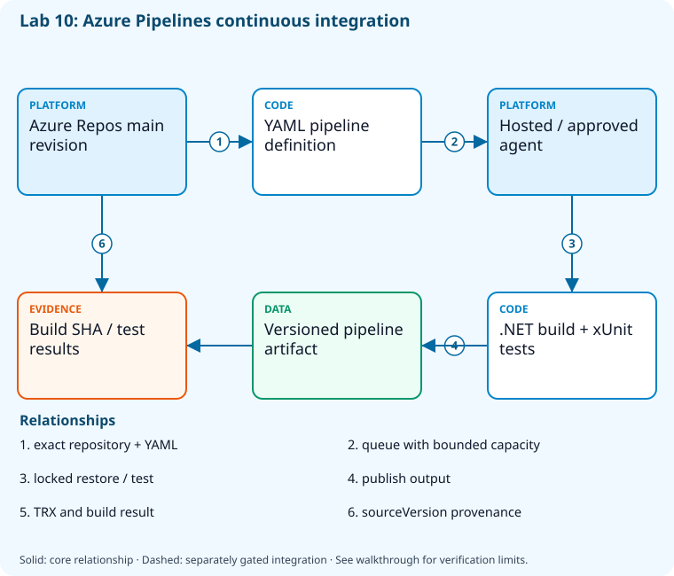

# Lab 10: Build the sample with Azure Pipelines

[Previous: Lab 09](../09-github-actions-ci/README.md) · [Catalog](../../docs/lab-catalog.md) · [Next: Lab 11](../11-reusable-yaml/README.md)

## Scenario, role, and outcome

A project needs a YAML CI definition and retained test evidence. Register a pipeline against the exact disposable Azure Repos repository.

Learner role: **Azure Pipelines engineer**. Outcome: Build the sample with Azure Pipelines.

| Item | Value |
|---|---|
| Time | 120 minutes |
| Domain | pipelines |
| Platforms | local, azure-devops |
| Cost | none — review [current pricing and cleanup](../../docs/cost-and-cleanup.md) before cloud execution |
| Exam blueprint | July 27, 2026; sources reviewed October 16, 2026 |
| Verification status | not-run |
| Verification scope | All checkpoint/fault scripts parse; the named fault lifecycle is independently tested with explicit provider doubles. Full normal provider execution and live cloud delivery have not run. |

Completion requires all five checkpoints, the break/fix repair, successful
independent validation, and a passing residual-resource audit. An unavailable
external prerequisite is a visible gate; it does not become a passing result.

## Architecture and service topology



An exact Azure Repos repository and YAML path define the sandbox pipeline. An available hosted or explicitly approved agent executes the .NET build/test workload and publishes results/artifacts. Build sourceVersion must match the reviewed revision; pipeline registration, queued capacity, and successful completion are separate states.

The editable [Mermaid source](diagrams/architecture.mmd) and accessible SVG
render the same authored components and relationships. Dashed connections show
separately gated integrations. Read every boundary before executing commands. Cloud changes
stay inside the exact disposable GitHub repository, Azure DevOps project, and
Azure resource group recorded for this run. Child objects inherit that cleanup
boundary. Account creation, external integrations, and privileged organization
settings belong to [one-time bootstrap](../../docs/account-bootstrap.md).

## Objectives and checkpoints

Coverage levels describe the intended learning evidence: **explained** means reasoned
understanding, **practiced** means an observable isolated skill, and **integrated**
means skills connected across a delivery boundary. These labels are curriculum
claims, not execution status. Verification above records what authors actually ran.

Official objective topic IDs: `D3.1.4`, `D3.2.3`, `D3.3.1`, `D3.3.3`, `D3.3.4`, `D3.3.5`

| Checkpoint | Measurable behavior |
|---|---|
| [CP1](#task-1) | Resolve the disposable Azure Repos repository |
| [CP2](#task-2) | Stage the sample and YAML definition |
| [CP3](#task-3) | Commit and push the pipeline definition |
| [CP4](#task-4) | Register the YAML pipeline without an automatic first run |
| [CP5](#task-5) | Queue and inspect the CI build |

The [objective map](../../docs/objective-map.md) traces every official topic to
labs. The [Microsoft study guide](https://learn.microsoft.com/en-us/credentials/certifications/resources/study-guides/az-400)
controls authoritative objective wording and domain weighting.

## Inputs, permissions, and read-only preflight

Use PowerShell 7.4+, .NET 10, Git, GitHub CLI, Azure CLI with the Azure DevOps
extension, and the pinned repository validation dependencies. Read the
[permissions matrix](../../docs/permissions-matrix.md) and [evidence policy](../../docs/evidence-handling.md).
Supply only the accounts needed by this lab. Never put a token, connection
string, or private key into a command log, committed YAML, or progress export.

The examples run from the repository root. Choose a fresh lowercase run ID;
`demo01` is an example, not a reusable shared sandbox. Set bootstrap environment
variables for the approved GitHub owner, DevOps organization, subscription, and
region. Do not run both guided and automated lanes with the same run ID.

```powershell
$lab = './labs/10-azure-pipelines-ci/scripts/cli'
& "$lab/Preflight.ps1" -RunId 'demo01'
& "$lab/Setup.ps1" -RunId 'demo01' -ProvisionOnly
# After reviewing context, permissions, cost, and cleanup:
& "$lab/Setup.ps1" -RunId 'demo01' -ProvisionOnly -Execute -AcknowledgeCost -AcknowledgeTenantChange
. "$lab/Context.ps1" -RunId 'demo01'
```

Preflight performs reads only. Provisioning creates fresh run-owned top-level
sandboxes and records their exact IDs. Context establishes `$RepoRoot`,
`$LabRoot`, `$WorkRoot`, `$RunId`, `$GhRepo`, `$AdoOrganization`, `$AdoProject`,
`$SubscriptionId`, `$Location`, and `$ResourceGroup`. A missing prerequisite or
ownership mismatch must stop execution. Local build commands may restore
packages and write ignored build output.

## Concept primer and design decisions

A pipeline definition names a YAML source; a queued run is not a successful build. Hosted parallelism and agent permission are external capacity gates.

Azure Pipelines separates the registered definition from its YAML source and the queued build. A definition ID is stable provider state; the YAML path and repository ID must match the owned project before reuse. Authorization and hosted parallelism can block an otherwise valid definition.

Use explicit organization and project arguments and avoid changing global CLI defaults. Capture the queued build ID, then read its final result and sourceVersion. Connecting a GitHub repository requires a separately authorized provider service connection; this core uses Azure Repos and does not claim that additional integration.

## Task 1 — Resolve the disposable Azure Repos repository

<a id="task-1"></a>

Checkpoint: `CP1`

| Objective | Evidence level | Observation and limits |
|---|---|---|
| `D3.3.3` | explained | Use Azure Repos as the concrete source; connecting GitHub/Bitbucket service resources remains a separately authorized bootstrap. |

```powershell
$r=@(az repos list --organization $AdoOrganization --project $AdoProject -o json|ConvertFrom-Json)|Select-Object -First 1
 if (-not $r.id) { throw 'No repository in sandbox project.' }
 $r|ConvertTo-Json -Depth 8|Set-Content (Join-Path $WorkRoot 'ado-repo.json')
 $p=Join-Path $WorkRoot 'azure-ci'
if(Test-Path (Join-Path $p '.git')){
 $origin=git -C $p remote get-url origin
 if($origin.TrimEnd('/') -cne ([string]$r.remoteUrl).TrimEnd('/')){throw 'Existing working copy points to a different Azure Repos repository; refusing to reuse it.'}
}else{git clone $r.remoteUrl $p}

 git -C $p config user.name 'AZ400 Learner';git -C $p config user.email 'learner@example.invalid'
```

Expected state: The project default repository is resolved by exact ID and cloned through approved credentials.

Positive validation:

```powershell
$r=Get-Content (Join-Path $WorkRoot 'ado-repo.json') -Raw|ConvertFrom-Json
 if ($r.project.name -ne $AdoProject) { throw 'Repository project mismatch.' }
```

Negative validation:

```powershell
$r=Get-Content (Join-Path $WorkRoot 'ado-repo.json') -Raw|ConvertFrom-Json
 if ($r.isDisabled) { throw 'Repository is disabled.' }
```

Evidence to retain: Repository ID/project and remote URL redacted.

Common failure and safe retry: Configure Git Credential Manager through bootstrap instead of putting a PAT in a command or URL.

Cleanup dependency: retain this checkpoint's evidence until final validation; remove run-owned children before their recorded parent boundary.

## Task 2 — Stage the sample and YAML definition

<a id="task-2"></a>

Checkpoint: `CP2`

| Objective | Evidence level | Observation and limits |
|---|---|---|
| `D3.3.1` | practiced | Stage the Azure Pipelines CI definition. |
| `D3.3.5` | practiced | Parse build/test/coverage/artifact tasks in the checked-in pipeline YAML. |

```powershell
$p=Join-Path $WorkRoot 'azure-ci'
 $source=Join-Path $RepoRoot 'samples'
 Get-ChildItem $source -File -Recurse|Where-Object FullName -NotMatch '[\/](bin|obj)[\/]'|ForEach-Object { $rel=[IO.Path]::GetRelativePath($RepoRoot,$_.FullName);$dest=Join-Path $p $rel;New-Item -ItemType Directory -Force (Split-Path $dest)|Out-Null;Copy-Item $_.FullName $dest }
 foreach ($name in @('global.json','Directory.Build.props')) { if (Test-Path (Join-Path $RepoRoot $name)) { Copy-Item (Join-Path $RepoRoot $name) $p } }
 Copy-Item (Join-Path $LabRoot 'artifacts/azure-pipelines.yml') (Join-Path $p 'azure-pipelines.yml')
 @('**/bin/','**/obj/')|Set-Content (Join-Path $p '.gitignore')
```

Expected state: The sample and Azure Pipelines YAML exist in the sandbox clone.

Positive validation:

```powershell
$p=Join-Path $WorkRoot 'azure-ci'
 if (-not (Test-Path (Join-Path $p 'samples/DevOps.slnx'))) { throw 'Sample source missing.' }
```

Negative validation:

```powershell
$t=Get-Content (Join-Path $WorkRoot 'azure-ci/azure-pipelines.yml') -Raw
 if ($t -match 'AzureCLI@|az deployment|clientSecret') { throw 'CI definition unexpectedly deploys or embeds credentials.' }
```

Evidence to retain: Pipeline YAML and sample source allowlist.

Common failure and safe retry: Keep service connections out of a build-only definition.

Cleanup dependency: retain this checkpoint's evidence until final validation; remove run-owned children before their recorded parent boundary.

## Task 3 — Commit and push the pipeline definition

<a id="task-3"></a>

Checkpoint: `CP3`

| Objective | Evidence level | Observation and limits |
|---|---|---|
| `D3.3.4` | practiced | Commit and push the owned main-branch definition and inspect its trigger. |

```powershell
$p=Join-Path $WorkRoot 'azure-ci';git -C $p add .;$staged=@(git -C $p diff --cached --name-only)
if($staged.Count -gt 0){git -C $p commit -m "[$RunId] Add Azure Pipelines sample CI"}else{Write-Output 'Reviewed files already committed; reusing the current source revision.'}
 git -C $p branch -M main;git -C $p push -u origin main
 (git -C $p rev-parse HEAD)|Set-Content (Join-Path $WorkRoot 'ado-ci-commit.txt')
```

Expected state: Main contains one reviewed CI source revision.

Positive validation:

```powershell
$p=Join-Path $WorkRoot 'azure-ci'
 if ((git -C $p rev-parse HEAD) -ne (Get-Content (Join-Path $WorkRoot 'ado-ci-commit.txt'))) { throw 'Committed revision mismatch.' }
```

Negative validation:

```powershell
$p=Join-Path $WorkRoot 'azure-ci'
 if ((git -C $p ls-files) -match '(^|/)(bin|obj)/') { throw 'Build output was staged.' }
```

Evidence to retain: Commit SHA and changed files.

Common failure and safe retry: Resolve credential/bootstrap failures before retrying the push; never switch projects implicitly.

Cleanup dependency: retain this checkpoint's evidence until final validation; remove run-owned children before their recorded parent boundary.

## Task 4 — Register the YAML pipeline without an automatic first run

<a id="task-4"></a>

Checkpoint: `CP4`

Foundation/supporting task; no additional exam-objective coverage is claimed.

```powershell
$r=Get-Content (Join-Path $WorkRoot 'ado-repo.json') -Raw|ConvertFrom-Json
$pipelineName="ci-$RunId";$idPath=Join-Path $WorkRoot 'pipeline-id.txt'
if(Test-Path $idPath){
 $savedId=(Get-Content $idPath -Raw).Trim()
 if($savedId -notmatch '^\d+$'){throw 'Saved pipeline ID is invalid.'}
 $p=az pipelines show --organization $AdoOrganization --project $AdoProject --id $savedId -o json|ConvertFrom-Json
}else{
 $candidates=@(az pipelines list --organization $AdoOrganization --project $AdoProject --name $pipelineName --repository $r.id --repository-type tfsgit -o json|ConvertFrom-Json|Where-Object name -eq $pipelineName)
 $matchingPipelines=@(foreach($candidate in $candidates){
  $definition=az pipelines show --organization $AdoOrganization --project $AdoProject --id $candidate.id -o json|ConvertFrom-Json
  if($definition.name -eq $pipelineName -and $definition.repository.id -eq $r.id){$definition}
 })
 if($matchingPipelines.Count -gt 1){throw 'Multiple matching pipelines; resolve the ambiguous owned boundary before retrying.'}
 if($matchingPipelines.Count -eq 1){$p=$matchingPipelines[0]}else{
  $p=az pipelines create --organization $AdoOrganization --project $AdoProject --name $pipelineName --repository $r.id --repository-type tfsgit --branch main --yml-path azure-pipelines.yml --skip-first-run true -o json|ConvertFrom-Json
 }
}
if($p.name -ne $pipelineName -or $p.repository.id -ne $r.id -or $p.project.name -ne $AdoProject -or $p.process.yamlFilename -ne 'azure-pipelines.yml'){throw 'Existing pipeline identity/source differs from this run; refusing to reuse it.'}
$p.id|Set-Content $idPath
```

Expected state: A pipeline definition references the exact sandbox repository and YAML path.

Positive validation:

```powershell
$id=Get-Content (Join-Path $WorkRoot 'pipeline-id.txt')
 $p=az pipelines show --organization $AdoOrganization --project $AdoProject --id $id -o json|ConvertFrom-Json
 if ($p.process.yamlFilename -ne 'azure-pipelines.yml') { throw 'Wrong YAML source path.' }
```

Negative validation:

```powershell
$id=Get-Content (Join-Path $WorkRoot 'pipeline-id.txt')
 $p=az pipelines show --organization $AdoOrganization --project $AdoProject --id $id -o json|ConvertFrom-Json
 if ($p.project.name -ne $AdoProject) { throw 'Pipeline escaped project boundary.' }
```

Evidence to retain: Pipeline ID and source path.

Common failure and safe retry: Hosted parallelism may require an Azure DevOps grant or an approved self-hosted agent; record this external gate.

Cleanup dependency: retain this checkpoint's evidence until final validation; remove run-owned children before their recorded parent boundary.

## Task 5 — Queue and inspect the CI build

<a id="task-5"></a>

Checkpoint: `CP5`

| Objective | Evidence level | Observation and limits |
|---|---|---|
| `D3.1.4` | integrated | Correlate the Azure Pipelines build and artifact with the exact source SHA. |
| `D3.2.3` | integrated | Read the exact Azure Pipelines build result for the source commit. |

```powershell
$id=Get-Content (Join-Path $WorkRoot 'pipeline-id.txt')
 $r=az pipelines run --organization $AdoOrganization --project $AdoProject --id $id --branch main -o json|ConvertFrom-Json
 $r.id|Set-Content (Join-Path $WorkRoot 'build-id.txt')
 az pipelines runs show --organization $AdoOrganization --project $AdoProject --id $r.id -o json|Set-Content (Join-Path $WorkRoot 'build.json')
```

Expected state: One build is queued; validation remains partial until the build actually succeeds.

Positive validation:

```powershell
$id=Get-Content (Join-Path $WorkRoot 'build-id.txt')
 $r=az pipelines runs show --organization $AdoOrganization --project $AdoProject --id $id -o json|ConvertFrom-Json
 if ($r.status -ne 'completed' -or $r.result -ne 'succeeded') { throw 'Build still queued/running or failed; retry validation after completion.' }
```

Negative validation:

```powershell
$id=Get-Content (Join-Path $WorkRoot 'build-id.txt');$r=az pipelines runs show --organization $AdoOrganization --project $AdoProject --id $id -o json|ConvertFrom-Json
 if ($r.sourceVersion -ne (Get-Content (Join-Path $WorkRoot 'ado-ci-commit.txt'))) { throw 'Build source revision mismatch.' }
```

Evidence to retain: Build ID, final result, source SHA, and test summary.

Common failure and safe retry: Inspect agent availability and task logs; queued, canceled, and partially succeeded results do not satisfy completion.

Cleanup dependency: retain this checkpoint's evidence until final validation; remove run-owned children before their recorded parent boundary.

## Deterministic break/fix

Run the journaled operation after all five checkpoints. It proves the healthy assertion, injects the named fault, requires its rejection, repairs it, and proves health again. Provider doubles used in author tests are not live enforcement evidence.

```powershell
& './labs/10-azure-pipelines-ci/scripts/cli/BreakFix.ps1' -RunId 'demo01' -Execute
```

Expected rejection marker: `AZ400-L10-FAULT`. The assertion must catch the changed behavior, not merely an exception from an unavailable CLI.

Inspect the independent assertion:

```powershell
$p=Join-Path $WorkRoot 'azure-ci';$t=Get-Content (Join-Path $p 'azure-pipelines.yml') -Raw
$paths=@([regex]::Matches($t,'samples/[A-Za-z0-9._/-]+\.slnx')|ForEach-Object Value)
if($paths.Count -lt 1 -or @($paths|Where-Object {-not (Test-Path (Join-Path $p $_))}).Count){throw 'AZ400-L10-FAULT'}
```

Fault trigger (executed by BreakFix):

```powershell
$p=Join-Path $WorkRoot 'azure-ci/azure-pipelines.yml';(Get-Content $p -Raw).Replace('samples/DevOps.slnx','samples/Missing.slnx')|Set-Content $p
```

Diagnose the precise difference:

```powershell
Select-String -Path (Join-Path $WorkRoot 'azure-ci/azure-pipelines.yml') -Pattern 'Missing.slnx'
```

Repair (executed by BreakFix):

```powershell
$p=Join-Path $WorkRoot 'azure-ci';git -C $p restore azure-pipelines.yml
```

## Optional job-style challenge

Connect a disposable GitHub repository as the source through an explicitly approved GitHub App/service connection, and compare provenance and permissions.

## Final validation and result interpretation

```powershell
& './labs/10-azure-pipelines-ci/scripts/cli/Validate.ps1' -RunId 'demo01'
```

A complete result requires five passing read-only checkpoint assertions, a journaled repaired fault, and any required integration evidence. Pending hosted runs, missing licensed features, and unexecuted integration lanes remain visible. Review `validation.json`; successful command exit alone does not establish the asserted behavior.

## Troubleshooting

- **401/403:** inspect the explicit account/project/repository scope and required role; do not broaden a token reflexively.
- **Resource or artifact missing:** confirm the exact run ID and prerequisite checkpoint; retry reads after eventual consistency.
- **Unsupported SKU/runtime/tool:** consult the specific current source, record the gate, and obtain approval before changing cost or architecture.
- **Validation mismatch:** inspect the positive and negative assertions separately, repair the named fault, and rerun validation.
- **Ownership refusal:** stop; never edit a manifest to claim an unrelated resource.

## Cleanup and residual checks

```powershell
& './labs/10-azure-pipelines-ci/scripts/cli/Cleanup.ps1' -RunId 'demo01'
# Review the exact owned-object deletion plan first.
& './labs/10-azure-pipelines-ci/scripts/cli/Cleanup.ps1' -RunId 'demo01' -Execute
```

Cleanup must verify ownership, delete only recorded sandbox objects in dependency order, and prove parent/child absence. Retain `run.json`, `validation.json`, and `cleanup.json` locally until the audit passes. Soft-deleted or deliberately retained items must remain reported. Never purge a shared vault or delete an account, organization, or pre-existing service connection to finish a lab.

## Exam debrief and assessment

Explain why each checkpoint's denied path matters, which scope authorizes it, what evidence proves it, and how it is reversed. Complete the [50-question assessment](QUESTIONS.md), then review [rationales](ANSWERS.md) and repeat weak checkpoints.

## Microsoft and platform sources

- [Primary source 1](https://learn.microsoft.com/en-us/azure/devops/pipelines/ecosystems/dotnet-core) — reviewed 2026-10-16.
- [Primary source 2](https://learn.microsoft.com/en-us/cli/azure/pipelines) — reviewed 2026-10-16.
- [Primary source 3](https://learn.microsoft.com/en-us/azure/devops/pipelines/licensing/concurrent-jobs) — reviewed 2026-10-16.

## Lifecycle scripts and worked solution

Use `scripts/cli/Preflight.ps1`, `Setup.ps1`, `BreakFix.ps1`, `Integration.ps1` (capstones), `Validate.ps1`, `Cleanup.ps1`, and `Context.ps1` from this lab folder. Setup and cleanup preview until `-Execute`; `-ProvisionOnly` creates only fresh ownership-tracked containers. The [worked solution](solution/README.md) lists expected results and repair reasoning.
