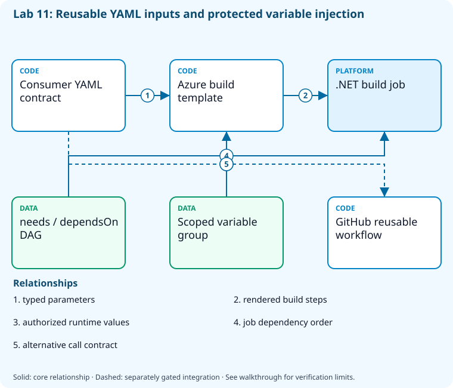

# Lab 11: Reuse YAML templates and variables

[Previous: Lab 10](../10-azure-pipelines-ci/README.md) · [Catalog](../../docs/lab-catalog.md) · [Next: Lab 12](../12-runners-agents/README.md)

## Scenario, role, and outcome

Build logic is diverging between teams. Define reusable YAML interfaces, typed inputs, variable groups, and explicit job dependencies.

Learner role: **Pipeline framework maintainer**. Outcome: Reuse YAML templates and variables.

| Item | Value |
|---|---|
| Time | 120 minutes |
| Domain | pipelines |
| Platforms | local, azure-devops |
| Cost | none — review [current pricing and cleanup](../../docs/cost-and-cleanup.md) before cloud execution |
| Exam blueprint | July 27, 2026; sources reviewed October 16, 2026 |
| Verification status | offline-tested |
| Verification scope | All five checkpoint commands, final validators and named DAG fault/repair passed. Actual Python YAML consumers and .NET tests/build executed; Azure DevOps variable-group operations use fail-closed doubles. Hosted template expansion has not run. |

Completion requires all five checkpoints, the break/fix repair, successful
independent validation, and a passing residual-resource audit. An unavailable
external prerequisite is a visible gate; it does not become a passing result.

## Architecture and service topology



The consumer YAML supplies typed template parameters while a scoped Azure DevOps variable group supplies authorized runtime values. Explicit needs/dependsOn edges order jobs. The GitHub reusable workflow is a parallel reviewed contract; its existence does not grant inherited secrets or activate a remote workflow.

The editable [Mermaid source](diagrams/architecture.mmd) and accessible SVG
render the same authored components and relationships. Dashed connections show
separately gated integrations. Read every boundary before executing commands. Cloud changes
stay inside the exact disposable GitHub repository, Azure DevOps project, and
Azure resource group recorded for this run. Child objects inherit that cleanup
boundary. Account creation, external integrations, and privileged organization
settings belong to [one-time bootstrap](../../docs/account-bootstrap.md).

## Objectives and checkpoints

Coverage levels describe the intended learning evidence: **explained** means reasoned
understanding, **practiced** means an observable isolated skill, and **integrated**
means skills connected across a delivery boundary. These labels are curriculum
claims, not execution status. Verification above records what authors actually ran.

Official objective topic IDs: `D3.3.5`, `D3.3.6`, `D3.3.8`

| Checkpoint | Measurable behavior |
|---|---|
| [CP1](#task-1) | Exercise the reusable workflow input contract |
| [CP2](#task-2) | Reject an invalid parameter and execute valid build behavior |
| [CP3](#task-3) | Create an explicitly nonsecret variable group |
| [CP4](#task-4) | Model build-test-package ordering as a DAG |
| [CP5](#task-5) | Exercise the shared template build command locally |

The [objective map](../../docs/objective-map.md) traces every official topic to
labs. The [Microsoft study guide](https://learn.microsoft.com/en-us/credentials/certifications/resources/study-guides/az-400)
controls authoritative objective wording and domain weighting.

## Inputs, permissions, and read-only preflight

Use PowerShell 7.4+, .NET 10, Git, GitHub CLI, Azure CLI with the Azure DevOps
extension, and the pinned repository validation dependencies. Read the
[permissions matrix](../../docs/permissions-matrix.md) and [evidence policy](../../docs/evidence-handling.md).
Supply only the accounts needed by this lab. Never put a token, connection
string, or private key into a command log, committed YAML, or progress export.

The examples run from the repository root. Choose a fresh lowercase run ID;
`demo01` is an example, not a reusable shared sandbox. Set bootstrap environment
variables for the approved GitHub owner, DevOps organization, subscription, and
region. Do not run both guided and automated lanes with the same run ID.

```powershell
$lab = './labs/11-reusable-yaml/scripts/cli'
& "$lab/Preflight.ps1" -RunId 'demo01'
& "$lab/Setup.ps1" -RunId 'demo01' -ProvisionOnly
# After reviewing context, permissions, cost, and cleanup:
& "$lab/Setup.ps1" -RunId 'demo01' -ProvisionOnly -Execute -AcknowledgeCost -AcknowledgeTenantChange
. "$lab/Context.ps1" -RunId 'demo01'
```

Preflight performs reads only. Provisioning creates fresh run-owned top-level
sandboxes and records their exact IDs. Context establishes `$RepoRoot`,
`$LabRoot`, `$WorkRoot`, `$RunId`, `$GhRepo`, `$AdoOrganization`, `$AdoProject`,
`$SubscriptionId`, `$Location`, and `$ResourceGroup`. A missing prerequisite or
ownership mismatch must stop execution. Local build commands may restore
packages and write ignored build output.

## Concept primer and design decisions

Template parameters shape compile-time structure; variables carry runtime values. Reuse must preserve least privilege, immutable references, and a tested compatibility contract.

Reusable YAML is an API. Parameters define accepted compile-time choices, variables carry runtime values, and secrets remain a separate privileged channel. Pin reusable sources and reject broad inherited secrets unless that trust decision has been reviewed.

The local consumer resolves the declared Release input and executes the same selected .NET behavior. It proves the parameter/command contract, not a hosted template expansion on every provider. A directed acyclic graph must reject indirect cycles as well as self-dependencies; use topological sorting rather than a simple string check. The nonsecret variable group is an actual owned Azure DevOps object.

## Task 1 — Exercise the reusable workflow input contract

<a id="task-1"></a>

Checkpoint: `CP1`

| Objective | Evidence level | Observation and limits |
|---|---|---|
| `D3.3.8` | practiced | Parse a reusable workflow consumer and resolve its declared inputs and minimum permissions locally. |

```powershell
Copy-Item (Join-Path $LabRoot 'artifacts/templates/reusable-dotnet.yml') (Join-Path $WorkRoot 'reusable-dotnet.yml')
Copy-Item (Join-Path $LabRoot 'artifacts/consumer-github.yml') (Join-Path $WorkRoot 'consumer-github.yml')
@'
import json,sys,yaml
from pathlib import Path
r=Path(sys.argv[1]); raw=yaml.safe_load((r/'reusable-dotnet.yml').read_text());on=raw.get('on',raw.get(True,{}));call=on['workflow_call']
assert call['inputs'] and raw['permissions'].get('contents')=='read'
consumer=yaml.safe_load((r/'consumer-github.yml').read_text());jobs=consumer['jobs']
assert any('reusable-dotnet.yml' in v.get('uses','') for v in jobs.values())
assert 'secrets: inherit' not in (r/'consumer-github.yml').read_text()
print(json.dumps({'inputs':list(call['inputs']),'consumerJobs':list(jobs),'explicitContract':True}))
'@|python - $WorkRoot|Set-Content (Join-Path $WorkRoot 'github-template-contract.json')
if($LASTEXITCODE -ne 0){throw 'Reusable workflow contract failed.'}
```

Expected state: The consumer references the reusable workflow, typed inputs exist, and repository permission stays read-only.

Positive validation:

```powershell
$r=Get-Content (Join-Path $WorkRoot 'github-template-contract.json') -Raw|ConvertFrom-Json
if(-not $r.explicitContract -or @($r.inputs).Count -lt 1){throw 'Reusable input contract absent.'}
```

Negative validation:

```powershell
$t=Get-Content (Join-Path $WorkRoot 'consumer-github.yml') -Raw
if($t -match 'secrets: inherit|write-all'){throw 'Consumer broadened the reusable contract.'}
```

Evidence to retain: Parsed interface and consumer job names; explicitly offline contract practice, not a hosted run.

Common failure and safe retry: Reusable workflows are called as jobs. Offline parsing verifies the authored interface; separately activated provider execution is needed to prove service compilation.

Cleanup dependency: retain this checkpoint's evidence until final validation; remove run-owned children before their recorded parent boundary.

## Task 2 — Reject an invalid parameter and execute valid build behavior

<a id="task-2"></a>

Checkpoint: `CP2`

| Objective | Evidence level | Observation and limits |
|---|---|---|
| `D3.3.5` | practiced | Consume the typed Release parameter and execute the selected .NET test configuration. |

```powershell
Copy-Item (Join-Path $LabRoot 'artifacts/templates/dotnet-build.yml') (Join-Path $WorkRoot 'dotnet-build.yml')
Copy-Item (Join-Path $LabRoot 'artifacts/consumer-azure-pipelines.yml') (Join-Path $WorkRoot 'consumer-azure-pipelines.yml')
@'
import json,sys,yaml
from pathlib import Path
r=Path(sys.argv[1]);t=yaml.safe_load((r/'dotnet-build.yml').read_text());p=next(x for x in t['parameters'] if x['name']=='configuration')
assert p['type']=='string' and 'Release' in p['values'] and 'Production' not in p['values']
assert any('Build-Release.ps1' in x.get('pwsh','') for x in t['steps'])
print(json.dumps({'selected':'Release','rejected':'Production','allowed':p['values']}))
'@|python - $WorkRoot|Set-Content (Join-Path $WorkRoot 'template-parameters.json')
if($LASTEXITCODE -ne 0){throw 'Typed template parameter contract failed.'}
$config=(Get-Content (Join-Path $WorkRoot 'template-parameters.json') -Raw|ConvertFrom-Json).selected
dotnet test (Join-Path $RepoRoot 'samples/DevOps.slnx') --configuration $config --logger 'trx;LogFileName=reusable.trx' --results-directory (Join-Path $WorkRoot 'template-tests')
if($LASTEXITCODE -ne 0){throw 'Selected reusable build behavior failed.'}
```

Expected state: Release is accepted, Production is rejected, and selected test behavior passes locally.

Positive validation:

```powershell
$p=Get-Content (Join-Path $WorkRoot 'template-parameters.json') -Raw|ConvertFrom-Json
$f=Get-ChildItem (Join-Path $WorkRoot 'template-tests') -Filter '*.trx' -Recurse|Select-Object -First 1;$x=[xml](Get-Content $f.FullName -Raw)
if($p.selected -ne 'Release' -or [int]$x.TestRun.ResultSummary.Counters.passed -lt 1){throw 'Valid template behavior unproven.'}
```

Negative validation:

```powershell
$p=Get-Content (Join-Path $WorkRoot 'template-parameters.json') -Raw|ConvertFrom-Json
if($p.rejected -in $p.allowed){throw 'Invalid template value accepted.'}
```

Evidence to retain: Allowed/rejected parameter decisions and passing TRX; local validation is not provider template expansion.

Common failure and safe retry: Use parameters for compile-time structure, variables for runtime data, and valid enum values rather than arbitrary substitution.

Cleanup dependency: retain this checkpoint's evidence until final validation; remove run-owned children before their recorded parent boundary.

## Task 3 — Create an explicitly nonsecret variable group

<a id="task-3"></a>

Checkpoint: `CP3`

Foundation/supporting task; no additional exam-objective coverage is claimed.

```powershell
$g=az pipelines variable-group create --organization $AdoOrganization --project $AdoProject --name "build-$RunId" --variables BuildConfiguration=Release TargetFramework=net10.0 --authorize false -o json|ConvertFrom-Json
 $g.id|Set-Content (Join-Path $WorkRoot 'variable-group-id.txt')
```

Expected state: A sandbox variable group exists without blanket pipeline authorization.

Positive validation:

```powershell
$id=Get-Content (Join-Path $WorkRoot 'variable-group-id.txt')
 $g=az pipelines variable-group show --organization $AdoOrganization --project $AdoProject --group-id $id -o json|ConvertFrom-Json
 if ($g.variables.BuildConfiguration.value -ne 'Release') { throw 'Build variable mismatch.' }
```

Negative validation:

```powershell
$id=Get-Content (Join-Path $WorkRoot 'variable-group-id.txt')
 $g=az pipelines variable-group show --organization $AdoOrganization --project $AdoProject --group-id $id -o json|ConvertFrom-Json
 if ($g.authorized) { throw 'Variable group must not be authorized for every pipeline.' }
```

Evidence to retain: Variable group ID and nonsecret values.

Common failure and safe retry: Authorize only a designated sandbox pipeline; store secrets through protected secret facilities.

Cleanup dependency: retain this checkpoint's evidence until final validation; remove run-owned children before their recorded parent boundary.

## Task 4 — Model build-test-package ordering as a DAG

<a id="task-4"></a>

Checkpoint: `CP4`

| Objective | Evidence level | Observation and limits |
|---|---|---|
| `D3.3.6` | practiced | Topologically sort the dependency graph and reject an indirect build/package cycle. |

```powershell
$dag=@([ordered]@{job='build';needs=@()},[ordered]@{job='test';needs=@('build')},[ordered]@{job='package';needs=@('test')})
 $dag|ConvertTo-Json -Depth 5|Set-Content (Join-Path $WorkRoot 'job-graph.json')
 $done=@();foreach($j in $dag){foreach($d in $j.needs){if($d -notin $done){throw "Unresolved dependency $d"}};$done+=$j.job}
 $done|Set-Content (Join-Path $WorkRoot 'execution-order.txt')
```

Expected state: Each job depends only on completed prerequisites; package follows successful tests.

Positive validation:

```powershell
$o=@(Get-Content (Join-Path $WorkRoot 'execution-order.txt'))
 if (($o -join ',') -ne 'build,test,package') { throw 'Invalid topological execution order.' }
```

Negative validation:

```powershell
$jobs=@(Get-Content (Join-Path $WorkRoot 'job-graph.json') -Raw|ConvertFrom-Json);$names=@($jobs.job);$done=@()
if(@($jobs|ForEach-Object needs|Where-Object {$_ -notin $names}).Count){throw 'AZ400-L11-FAULT'}
while($done.Count -lt $jobs.Count){$ready=@($jobs|Where-Object {$_.job -notin $done -and @($_.needs|Where-Object {$_ -notin $done}).Count -eq 0});if($ready.Count -eq 0){throw 'AZ400-L11-FAULT'};$done+=@($ready.job)}
```

Evidence to retain: DAG and successful execution order.

Common failure and safe retry: Fix dependsOn/needs references; do not serialize independent tests unless resource contention requires it.

Cleanup dependency: retain this checkpoint's evidence until final validation; remove run-owned children before their recorded parent boundary.

## Task 5 — Exercise the shared template build command locally

<a id="task-5"></a>

Checkpoint: `CP5`

Foundation/supporting task; no additional exam-objective coverage is claimed.

```powershell
dotnet build (Join-Path $RepoRoot 'samples/DevOps.slnx') --configuration Release
 if($LASTEXITCODE -ne 0){throw 'Reusable build baseline failed.'}
 Get-FileHash (Join-Path $WorkRoot 'dotnet-build.yml')|ConvertTo-Json|Set-Content (Join-Path $WorkRoot 'template-digest.json')
```

Expected state: The reusable build command succeeds and the reviewed template is fingerprinted.

Positive validation:

```powershell
$h=Get-Content (Join-Path $WorkRoot 'template-digest.json') -Raw|ConvertFrom-Json
 if((Get-FileHash (Join-Path $WorkRoot 'dotnet-build.yml')).Hash -ne $h.Hash){throw 'Template drift detected.'}
```

Negative validation:

```powershell
$h=Get-Content (Join-Path $WorkRoot 'template-digest.json') -Raw|ConvertFrom-Json
 if($h.Algorithm -ne 'SHA256'){throw 'Unexpected template digest algorithm.'}
```

Evidence to retain: Build result and template SHA256.

Common failure and safe retry: Match local command arguments with the template, and review breaking input changes before reuse.

Cleanup dependency: retain this checkpoint's evidence until final validation; remove run-owned children before their recorded parent boundary.

## Deterministic break/fix

Run the journaled operation after all five checkpoints. It proves the healthy assertion, injects the named fault, requires its rejection, repairs it, and proves health again. Provider doubles used in author tests are not live enforcement evidence.

```powershell
& './labs/11-reusable-yaml/scripts/cli/BreakFix.ps1' -RunId 'demo01' -Execute
```

Expected rejection marker: `AZ400-L11-FAULT`. The assertion must catch the changed behavior, not merely an exception from an unavailable CLI.

Inspect the independent assertion:

```powershell
$jobs=@(Get-Content (Join-Path $WorkRoot 'job-graph.json') -Raw|ConvertFrom-Json);$names=@($jobs.job);$done=@()
if(@($jobs|ForEach-Object needs|Where-Object {$_ -notin $names}).Count){throw 'AZ400-L11-FAULT'}
while($done.Count -lt $jobs.Count){$ready=@($jobs|Where-Object {$_.job -notin $done -and @($_.needs|Where-Object {$_ -notin $done}).Count -eq 0});if($ready.Count -eq 0){throw 'AZ400-L11-FAULT'};$done+=@($ready.job)}
```

Fault trigger (executed by BreakFix):

```powershell
$d=Get-Content (Join-Path $WorkRoot 'job-graph.json') -Raw|ConvertFrom-Json;$d[0].needs=@('package');$d|ConvertTo-Json -Depth 5|Set-Content (Join-Path $WorkRoot 'job-graph.json')
```

Diagnose the precise difference:

```powershell
$d=Get-Content (Join-Path $WorkRoot 'job-graph.json') -Raw|ConvertFrom-Json;$d|Format-Table job,needs
```

Repair (executed by BreakFix):

```powershell
$d=Get-Content (Join-Path $WorkRoot 'job-graph.json') -Raw|ConvertFrom-Json;$d[0].needs=@();$d|ConvertTo-Json -Depth 5|Set-Content (Join-Path $WorkRoot 'job-graph.json')
```

## Optional job-style challenge

Call the templates from a separate disposable consumer repository using a pinned revision and demonstrate one deliberate input validation failure.

## Final validation and result interpretation

```powershell
& './labs/11-reusable-yaml/scripts/cli/Validate.ps1' -RunId 'demo01'
```

A complete result requires five passing read-only checkpoint assertions, a journaled repaired fault, and any required integration evidence. Pending hosted runs, missing licensed features, and unexecuted integration lanes remain visible. Review `validation.json`; successful command exit alone does not establish the asserted behavior.

## Troubleshooting

- **401/403:** inspect the explicit account/project/repository scope and required role; do not broaden a token reflexively.
- **Resource or artifact missing:** confirm the exact run ID and prerequisite checkpoint; retry reads after eventual consistency.
- **Unsupported SKU/runtime/tool:** consult the specific current source, record the gate, and obtain approval before changing cost or architecture.
- **Validation mismatch:** inspect the positive and negative assertions separately, repair the named fault, and rerun validation.
- **Ownership refusal:** stop; never edit a manifest to claim an unrelated resource.

## Cleanup and residual checks

```powershell
& './labs/11-reusable-yaml/scripts/cli/Cleanup.ps1' -RunId 'demo01'
# Review the exact owned-object deletion plan first.
& './labs/11-reusable-yaml/scripts/cli/Cleanup.ps1' -RunId 'demo01' -Execute
```

Cleanup must verify ownership, delete only recorded sandbox objects in dependency order, and prove parent/child absence. Retain `run.json`, `validation.json`, and `cleanup.json` locally until the audit passes. Soft-deleted or deliberately retained items must remain reported. Never purge a shared vault or delete an account, organization, or pre-existing service connection to finish a lab.

## Exam debrief and assessment

Explain why each checkpoint's denied path matters, which scope authorizes it, what evidence proves it, and how it is reversed. Complete the [50-question assessment](QUESTIONS.md), then review [rationales](ANSWERS.md) and repeat weak checkpoints.

## Microsoft and platform sources

- [Primary source 1](https://docs.github.com/en/actions/sharing-automations/reusing-workflows) — reviewed 2026-10-16.
- [Primary source 2](https://learn.microsoft.com/en-us/azure/devops/pipelines/process/templates) — reviewed 2026-10-16.
- [Primary source 3](https://learn.microsoft.com/en-us/azure/devops/pipelines/library/variable-groups) — reviewed 2026-10-16.

## Lifecycle scripts and worked solution

Use `scripts/cli/Preflight.ps1`, `Setup.ps1`, `BreakFix.ps1`, `Integration.ps1` (capstones), `Validate.ps1`, `Cleanup.ps1`, and `Context.ps1` from this lab folder. Setup and cleanup preview until `-Execute`; `-ProvisionOnly` creates only fresh ownership-tracked containers. The [worked solution](solution/README.md) lists expected results and repair reasoning.
