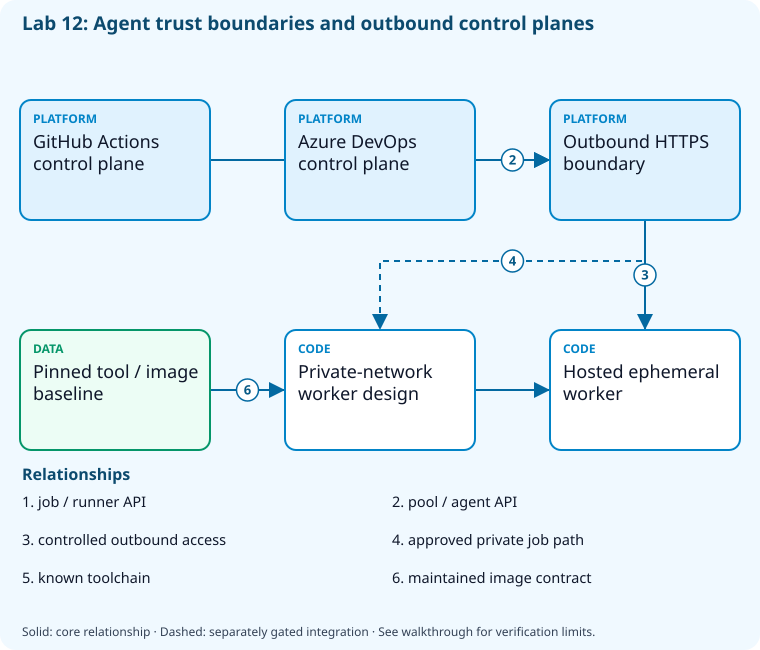

# Lab 12: Select and operate runners and agents

[Previous: Lab 11](../11-reusable-yaml/README.md) · [Catalog](../../docs/lab-catalog.md) · [Next: Lab 13](../13-environments-approvals/README.md)

## Scenario, role, and outcome

Some jobs need public hosted workers while others need private network access. Assess capabilities, outbound access, isolation, maintenance, and compute cost.

Learner role: **Agent platform engineer**. Outcome: Select and operate runners and agents.

| Item | Value |
|---|---|
| Time | 120 minutes |
| Domain | pipelines |
| Platforms | local, github, azure-devops |
| Cost | none — review [current pricing and cleanup](../../docs/cost-and-cleanup.md) before cloud execution |
| Exam blueprint | July 27, 2026; sources reviewed October 16, 2026 |
| Verification status | offline-tested |
| Verification scope | All five checkpoint commands, final validators and named policy fault/repair passed. Actual tool inventory and healthy/failed ephemeral worker fixtures executed; provider inventory and HTTPS responses use explicit doubles. No runner/agent registration or hostile-code isolation is claimed. |

Completion requires all five checkpoints, the break/fix repair, successful
independent validation, and a passing residual-resource audit. An unavailable
external prerequisite is a visible gate; it does not become a passing result.

## Architecture and service topology



GitHub and Azure DevOps control planes communicate through explicit outbound HTTPS boundaries. Hosted ephemeral workers handle untrusted code; a separately designed private-network worker handles approved private jobs. Both depend on a maintained pinned tool/image baseline. Inventory and TCP reachability checks do not register a machine or prove hosted parallelism availability.

The editable [Mermaid source](diagrams/architecture.mmd) and accessible SVG
render the same authored components and relationships. Dashed connections show
separately gated integrations. Read every boundary before executing commands. Cloud changes
stay inside the exact disposable GitHub repository, Azure DevOps project, and
Azure resource group recorded for this run. Child objects inherit that cleanup
boundary. Account creation, external integrations, and privileged organization
settings belong to [one-time bootstrap](../../docs/account-bootstrap.md).

## Objectives and checkpoints

Coverage levels describe the intended learning evidence: **explained** means reasoned
understanding, **practiced** means an observable isolated skill, and **integrated**
means skills connected across a delivery boundary. These labels are curriculum
claims, not execution status. Verification above records what authors actually ran.

Official objective topic IDs: `D3.3.2`, `D3.3.7`

| Checkpoint | Measurable behavior |
|---|---|
| [CP1](#task-1) | Inventory the local runner capability baseline |
| [CP2](#task-2) | Read GitHub runner inventory without registering a machine |
| [CP3](#task-3) | Read Azure DevOps agent pools and hosted availability |
| [CP4](#task-4) | Test outbound control-plane reachability |
| [CP5](#task-5) | Execute and clean up an ephemeral worker fixture |

The [objective map](../../docs/objective-map.md) traces every official topic to
labs. The [Microsoft study guide](https://learn.microsoft.com/en-us/credentials/certifications/resources/study-guides/az-400)
controls authoritative objective wording and domain weighting.

## Inputs, permissions, and read-only preflight

Use PowerShell 7.4+, .NET 10, Git, GitHub CLI, Azure CLI with the Azure DevOps
extension, and the pinned repository validation dependencies. Read the
[permissions matrix](../../docs/permissions-matrix.md) and [evidence policy](../../docs/evidence-handling.md).
Supply only the accounts needed by this lab. Never put a token, connection
string, or private key into a command log, committed YAML, or progress export.

The examples run from the repository root. Choose a fresh lowercase run ID;
`demo01` is an example, not a reusable shared sandbox. Set bootstrap environment
variables for the approved GitHub owner, DevOps organization, subscription, and
region. Do not run both guided and automated lanes with the same run ID.

```powershell
$lab = './labs/12-runners-agents/scripts/cli'
& "$lab/Preflight.ps1" -RunId 'demo01'
& "$lab/Setup.ps1" -RunId 'demo01' -ProvisionOnly
# After reviewing context, permissions, cost, and cleanup:
& "$lab/Setup.ps1" -RunId 'demo01' -ProvisionOnly -Execute -AcknowledgeCost -AcknowledgeTenantChange
. "$lab/Context.ps1" -RunId 'demo01'
```

Preflight performs reads only. Provisioning creates fresh run-owned top-level
sandboxes and records their exact IDs. Context establishes `$RepoRoot`,
`$LabRoot`, `$WorkRoot`, `$RunId`, `$GhRepo`, `$AdoOrganization`, `$AdoProject`,
`$SubscriptionId`, `$Location`, and `$ResourceGroup`. A missing prerequisite or
ownership mismatch must stop execution. Local build commands may restore
packages and write ignored build output.

## Concept primer and design decisions

A runner is a trust boundary with code execution and credentials. Untrusted pull requests should use ephemeral isolated workers; pool inventory does not establish available parallelism.

A self-hosted runner executes arbitrary repository code near its filesystem, network and credentials. Ephemeral registration limits reuse but is not OS isolation; a disposable VM/container and restricted routing may still be needed. Hosted concurrency entitlements are distinct from the number of registered runners.

The local worker fixture demonstrates one-job workspace creation, artifact hashing, credential-like environment filtering and cleanup after both success and failure. It does not register a GitHub runner or Azure agent, establish private-network access, or prove hostile-code containment. Use separate ephemeral private workers only after account bootstrap and never route untrusted fork code to the SQL-capable pool.

## Task 1 — Inventory the local runner capability baseline

<a id="task-1"></a>

Checkpoint: `CP1`

Foundation/supporting task; no additional exam-objective coverage is claimed.

```powershell
$caps=[ordered]@{os=[System.Runtime.InteropServices.RuntimeInformation]::OSDescription;architecture=[System.Runtime.InteropServices.RuntimeInformation]::OSArchitecture.ToString();dotnet=(dotnet --version);git=(git --version);ephemeralRequired=$true}
 $caps|ConvertTo-Json|Set-Content (Join-Path $WorkRoot 'agent-capabilities.json')
```

Expected state: The selected host architecture and required tool versions are explicit.

Positive validation:

```powershell
$c=Get-Content (Join-Path $WorkRoot 'agent-capabilities.json') -Raw|ConvertFrom-Json
 if($c.dotnet -notmatch '^10\.' -or -not $c.architecture){throw 'Runner lacks selected runtime/architecture.'}
```

Negative validation:

```powershell
$c=Get-Content (Join-Path $WorkRoot 'agent-capabilities.json') -Raw|ConvertFrom-Json
 if(-not $c.ephemeralRequired){throw 'Untrusted work must not reuse persistent credentials.'}
```

Evidence to retain: OS/architecture and tool versions, excluding machine/user identity.

Common failure and safe retry: Select a hosted image or ephemeral self-hosted image with the required SDK; pin important tools.

Cleanup dependency: retain this checkpoint's evidence until final validation; remove run-owned children before their recorded parent boundary.

## Task 2 — Read GitHub runner inventory without registering a machine

<a id="task-2"></a>

Checkpoint: `CP2`

Foundation/supporting task; no additional exam-objective coverage is claimed.

```powershell
gh api "repos/$GhRepo/actions/runners"|Set-Content (Join-Path $WorkRoot 'github-runners.json')
 Get-Content (Join-Path $WorkRoot 'github-runners.json')
```

Expected state: The repository runner inventory is known; zero self-hosted runners is valid.

Positive validation:

```powershell
$r=Get-Content (Join-Path $WorkRoot 'github-runners.json') -Raw|ConvertFrom-Json
 if($null -eq $r.total_count){throw 'Runner inventory did not return total_count.'}
```

Negative validation:

```powershell
$r=Get-Content (Join-Path $WorkRoot 'github-runners.json') -Raw|ConvertFrom-Json
 if(@($r.runners|Where-Object { $_.status -notin @('online','offline') }).Count){throw 'Unknown self-hosted runner status.'}
```

Evidence to retain: Runner count/status with names and IDs redacted.

Common failure and safe retry: Repository admin/read access is needed; hosted runners do not appear in this endpoint.

Cleanup dependency: retain this checkpoint's evidence until final validation; remove run-owned children before their recorded parent boundary.

## Task 3 — Read Azure DevOps agent pools and hosted availability

<a id="task-3"></a>

Checkpoint: `CP3`

Foundation/supporting task; no additional exam-objective coverage is claimed.

```powershell
az pipelines pool list --organization $AdoOrganization --query '[].{id:id,name:name,isHosted:isHosted}' -o json|Set-Content (Join-Path $WorkRoot 'agent-pools.json')
 Get-Content (Join-Path $WorkRoot 'agent-pools.json')
```

Expected state: Organization pool inventory distinguishes hosted and self-hosted execution.

Positive validation:

```powershell
$p=@(Get-Content (Join-Path $WorkRoot 'agent-pools.json') -Raw|ConvertFrom-Json)
 if($p.Count -lt 1){throw 'No readable agent pool; external authorization required.'}
```

Negative validation:

```powershell
$p=@(Get-Content (Join-Path $WorkRoot 'agent-pools.json') -Raw|ConvertFrom-Json)
 if(@($p|Where-Object { -not $_.name }).Count){throw 'Pool inventory contains unnamed entries.'}
```

Evidence to retain: Pool types and the separate hosted-parallelism gate.

Common failure and safe retry: Pool visibility does not prove available parallel jobs; verify the grant or use an approved disposable agent.

Cleanup dependency: retain this checkpoint's evidence until final validation; remove run-owned children before their recorded parent boundary.

## Task 4 — Test outbound control-plane reachability

<a id="task-4"></a>

Checkpoint: `CP4`

Foundation/supporting task; no additional exam-objective coverage is claimed.

```powershell
$r=@()
foreach($hostName in @('api.github.com','dev.azure.com')){
 $response=Invoke-WebRequest -Uri "https://$hostName/" -Method Head -TimeoutSec 10 -SkipHttpErrorCheck
 $r+=[ordered]@{host=$hostName;port=443;reachable=($response.StatusCode -ge 200 -and $response.StatusCode -lt 500);statusCode=[int]$response.StatusCode}
}
$r|ConvertTo-Json|Set-Content (Join-Path $WorkRoot 'connectivity.json')
```

Expected state: Both exact HTTPS control-plane endpoints respond within the bounded timeout; this does not prove registration, private SQL routing or available parallelism.

Positive validation:

```powershell
$r=@(Get-Content (Join-Path $WorkRoot 'connectivity.json') -Raw|ConvertFrom-Json)
 if($r.Count -ne 2 -or @($r|Where-Object reachable -ne $true).Count){throw 'Required control plane unavailable.'}
```

Negative validation:

```powershell
$r=Get-Content (Join-Path $WorkRoot 'connectivity.json') -Raw|ConvertFrom-Json
 if(@($r|Where-Object port -ne 443).Count){throw 'Unexpected outbound port.'}
```

Evidence to retain: Host/port success only; no bearer tokens or proxy credentials.

Common failure and safe retry: Ask the sandbox network owner to permit required endpoints; do not disable certificate validation.

Cleanup dependency: retain this checkpoint's evidence until final validation; remove run-owned children before their recorded parent boundary.

## Task 5 — Execute and clean up an ephemeral worker fixture

<a id="task-5"></a>

Checkpoint: `CP5`

| Objective | Evidence level | Observation and limits |
|---|---|---|
| `D3.3.2` | practiced | Execute a local one-job worker fixture and observe artifact hash, credential filtering, failed-job cleanup, and workspace removal. |
| `D3.3.7` | explained | Explain private-network/hybrid runner routing from the runner design; provider registration and network isolation are not exercised by this fixture. |

```powershell
$design=[ordered]@{untrustedPR='hosted ephemeral';privateNetworkBuild='ephemeral self-hosted in isolated subnet';credentialLifetime='job';parallelJobs=1;estimatedIdleHours=0;persistentRegistration=$false}
 $design|ConvertTo-Json|Set-Content (Join-Path $WorkRoot 'runner-design.json')

python (Join-Path $LabRoot 'artifacts/ephemeral_runner.py') --evidence (Join-Path $WorkRoot 'ephemeral.json')
if($LASTEXITCODE -ne 0){throw 'Healthy ephemeral fixture failed.'}
$saved=$PSNativeCommandUseErrorActionPreference
try{$PSNativeCommandUseErrorActionPreference=$false;python (Join-Path $LabRoot 'artifacts/ephemeral_runner.py') --fail-job --evidence (Join-Path $WorkRoot 'ephemeral-failed.json');$failedExit=$LASTEXITCODE}finally{$PSNativeCommandUseErrorActionPreference=$saved}
if($failedExit -ne 1){throw 'Failed worker did not propagate failure.'}
```

Expected state: A real temporary job process writes an artifact; success and failure both remove the workspace and omit credential-like environment values.

Positive validation:

```powershell
$e=Get-Content (Join-Path $WorkRoot 'ephemeral.json') -Raw|ConvertFrom-Json
if($e.jobExitCode -ne 0 -or -not $e.workspaceRemoved -or $e.outputSha256.Length -ne 64){throw 'Healthy ephemeral lifecycle failed.'}
```

Negative validation:

```powershell
$e=Get-Content (Join-Path $WorkRoot 'ephemeral-failed.json') -Raw|ConvertFrom-Json
if($e.jobExitCode -eq 0 -or -not $e.workspaceRemoved -or $e.credentialEnvironmentPresent){throw 'Failure cleanup/credential filtering failed.'}
```

Evidence to retain: Process exit, artifact digest, workspace removal and credential filtering; no provider registration or OS isolation is claimed.

Common failure and safe retry: This process fixture teaches lifetime and failure cleanup. Real private workers additionally need approved registration, hardened images, network boundaries and job isolation.

Cleanup dependency: retain this checkpoint's evidence until final validation; remove run-owned children before their recorded parent boundary.

## Deterministic break/fix

Run the journaled operation after all five checkpoints. It proves the healthy assertion, injects the named fault, requires its rejection, repairs it, and proves health again. Provider doubles used in author tests are not live enforcement evidence.

```powershell
& './labs/12-runners-agents/scripts/cli/BreakFix.ps1' -RunId 'demo01' -Execute
```

Expected rejection marker: `AZ400-L12-FAULT`. The assertion must catch the changed behavior, not merely an exception from an unavailable CLI.

Inspect the independent assertion:

```powershell
$r=Get-Content (Join-Path $WorkRoot 'runner-design.json') -Raw|ConvertFrom-Json
if($r.untrustedPR -ne 'hosted ephemeral' -or $r.credentialLifetime -ne 'job'){throw 'AZ400-L12-FAULT'}
```

Fault trigger (executed by BreakFix):

```powershell
$d=Get-Content (Join-Path $WorkRoot 'runner-design.json') -Raw|ConvertFrom-Json;$d.untrustedPR='persistent privileged host';$d|ConvertTo-Json|Set-Content (Join-Path $WorkRoot 'runner-design.json')
```

Diagnose the precise difference:

```powershell
Get-Content (Join-Path $WorkRoot 'runner-design.json')
```

Repair (executed by BreakFix):

```powershell
$d=Get-Content (Join-Path $WorkRoot 'runner-design.json') -Raw|ConvertFrom-Json;$d.untrustedPR='hosted ephemeral';$d|ConvertTo-Json|Set-Content (Join-Path $WorkRoot 'runner-design.json')
```

## Optional job-style challenge

Design a hybrid pipeline with a public test job and a private deployment job, explicitly separating credentials, networks, image maintenance, and cost.

## Final validation and result interpretation

```powershell
& './labs/12-runners-agents/scripts/cli/Validate.ps1' -RunId 'demo01'
```

A complete result requires five passing read-only checkpoint assertions, a journaled repaired fault, and any required integration evidence. Pending hosted runs, missing licensed features, and unexecuted integration lanes remain visible. Review `validation.json`; successful command exit alone does not establish the asserted behavior.

## Troubleshooting

- **401/403:** inspect the explicit account/project/repository scope and required role; do not broaden a token reflexively.
- **Resource or artifact missing:** confirm the exact run ID and prerequisite checkpoint; retry reads after eventual consistency.
- **Unsupported SKU/runtime/tool:** consult the specific current source, record the gate, and obtain approval before changing cost or architecture.
- **Validation mismatch:** inspect the positive and negative assertions separately, repair the named fault, and rerun validation.
- **Ownership refusal:** stop; never edit a manifest to claim an unrelated resource.

## Cleanup and residual checks

```powershell
& './labs/12-runners-agents/scripts/cli/Cleanup.ps1' -RunId 'demo01'
# Review the exact owned-object deletion plan first.
& './labs/12-runners-agents/scripts/cli/Cleanup.ps1' -RunId 'demo01' -Execute
```

Cleanup must verify ownership, delete only recorded sandbox objects in dependency order, and prove parent/child absence. Retain `run.json`, `validation.json`, and `cleanup.json` locally until the audit passes. Soft-deleted or deliberately retained items must remain reported. Never purge a shared vault or delete an account, organization, or pre-existing service connection to finish a lab.

## Exam debrief and assessment

Explain why each checkpoint's denied path matters, which scope authorizes it, what evidence proves it, and how it is reversed. Complete the [50-question assessment](QUESTIONS.md), then review [rationales](ANSWERS.md) and repeat weak checkpoints.

## Microsoft and platform sources

- [Primary source 1](https://docs.github.com/en/actions/hosting-your-own-runners/managing-self-hosted-runners/about-self-hosted-runners) — reviewed 2026-10-16.
- [Primary source 2](https://learn.microsoft.com/en-us/azure/devops/pipelines/agents/agents) — reviewed 2026-10-16.
- [Primary source 3](https://learn.microsoft.com/en-us/azure/devops/pipelines/licensing/concurrent-jobs) — reviewed 2026-10-16.

## Lifecycle scripts and worked solution

Use `scripts/cli/Preflight.ps1`, `Setup.ps1`, `BreakFix.ps1`, `Integration.ps1` (capstones), `Validate.ps1`, `Cleanup.ps1`, and `Context.ps1` from this lab folder. Setup and cleanup preview until `-Execute`; `-ProvisionOnly` creates only fresh ownership-tracked containers. The [worked solution](solution/README.md) lists expected results and repair reasoning.
