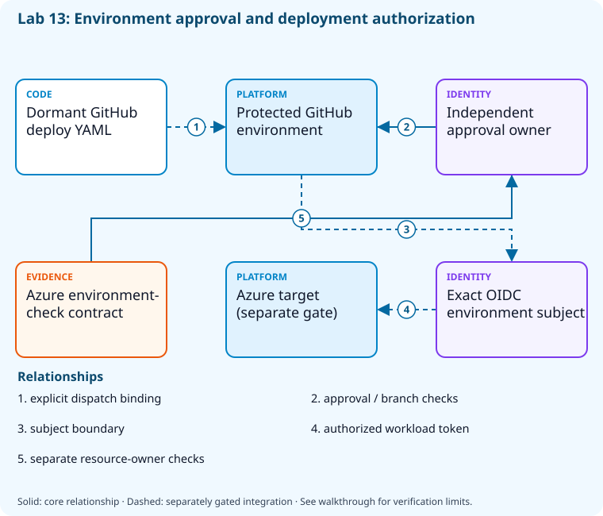

# Lab 13: Gate environments with approvals and checks

[Previous: Lab 12](../12-runners-agents/README.md) · [Catalog](../../docs/lab-catalog.md) · [Next: Lab 14](../14-ordered-releases-databases/README.md)

## Scenario, role, and outcome

A passing build can currently deploy from any branch. Define protected environment checks that a YAML author cannot bypass.

Learner role: **Release approver**. Outcome: Gate environments with approvals and checks.

| Item | Value |
|---|---|
| Time | 120 minutes |
| Domain | pipelines |
| Platforms | local, github |
| Cost | none — review [current pricing and cleanup](../../docs/cost-and-cleanup.md) before cloud execution |
| Exam blueprint | July 27, 2026; sources reviewed October 16, 2026 |
| Verification status | offline-tested |
| Verification scope | All five checkpoint commands, final validators and named fault/repair passed in CourseReleaseSequences.Tests.ps1. Local .NET publishing/tests, EF SQL generation and Bicep compilation are real; GitHub, Azure and readiness HTTP responses are explicit fail-closed doubles. Live release, SQL authentication and traffic routing have not run. |

Completion requires all five checkpoints, the break/fix repair, successful
independent validation, and a passing residual-resource audit. An unavailable
external prerequisite is a visible gate; it does not become a passing result.

## Architecture and service topology



The GitHub environment contains review and protected-branch controls; the dormant workflow must bind its exact environment name before activation. That environment name also forms the federation subject used for a separately approved Azure target. Azure Pipelines resource checks are reviewed as an independent owner-controlled contract outside editable YAML.

The editable [Mermaid source](diagrams/architecture.mmd) and accessible SVG
render the same authored components and relationships. Dashed connections show
separately gated integrations. Read every boundary before executing commands. Cloud changes
stay inside the exact disposable GitHub repository, Azure DevOps project, and
Azure resource group recorded for this run. Child objects inherit that cleanup
boundary. Account creation, external integrations, and privileged organization
settings belong to [one-time bootstrap](../../docs/account-bootstrap.md).

## Objectives and checkpoints

Coverage levels describe the intended learning evidence: **explained** means reasoned
understanding, **practiced** means an observable isolated skill, and **integrated**
means skills connected across a delivery boundary. These labels are curriculum
claims, not execution status. Verification above records what authors actually ran.

Official objective topic IDs: `D3.2.1`, `D3.3.9`

| Checkpoint | Measurable behavior |
|---|---|
| [CP1](#task-1) | Prepare an environment approval policy |
| [CP2](#task-2) | Create the sandbox GitHub environment |
| [CP3](#task-3) | Stage the dormant deployment workflow |
| [CP4](#task-4) | Exercise owner-controlled approval and exclusive-lock decisions |
| [CP5](#task-5) | Evaluate an explicit denied release request |

The [objective map](../../docs/objective-map.md) traces every official topic to
labs. The [Microsoft study guide](https://learn.microsoft.com/en-us/credentials/certifications/resources/study-guides/az-400)
controls authoritative objective wording and domain weighting.

## Inputs, permissions, and read-only preflight

This lab includes repository protection features that can require a paid GitHub entitlement, especially for private repositories. Without an authorized `-AllowPaidFeatures` opt-in, the gated checkpoints remain partial. Review the current account entitlement and billing owner approval before adding that switch to setup.

Use PowerShell 7.4+, .NET 10, Git, GitHub CLI, Azure CLI with the Azure DevOps
extension, and the pinned repository validation dependencies. Read the
[permissions matrix](../../docs/permissions-matrix.md) and [evidence policy](../../docs/evidence-handling.md).
Supply only the accounts needed by this lab. Never put a token, connection
string, or private key into a command log, committed YAML, or progress export.

The examples run from the repository root. Choose a fresh lowercase run ID;
`demo01` is an example, not a reusable shared sandbox. Set bootstrap environment
variables for the approved GitHub owner, DevOps organization, subscription, and
region. Do not run both guided and automated lanes with the same run ID.

```powershell
$lab = './labs/13-environments-approvals/scripts/cli'
& "$lab/Preflight.ps1" -RunId 'demo01'
& "$lab/Setup.ps1" -RunId 'demo01' -ProvisionOnly
# After reviewing context, permissions, cost, and cleanup:
& "$lab/Setup.ps1" -RunId 'demo01' -ProvisionOnly -Execute -AcknowledgeCost -AcknowledgeTenantChange
. "$lab/Context.ps1" -RunId 'demo01'
```

Preflight performs reads only. Provisioning creates fresh run-owned top-level
sandboxes and records their exact IDs. Context establishes `$RepoRoot`,
`$LabRoot`, `$WorkRoot`, `$RunId`, `$GhRepo`, `$AdoOrganization`, `$AdoProject`,
`$SubscriptionId`, `$Location`, and `$ResourceGroup`. A missing prerequisite or
ownership mismatch must stop execution. Local build commands may restore
packages and write ignored build output.

## Concept primer and design decisions

Approval authorizes an environment transition, not a code review. GitHub environment subjects must match federation exactly; Azure resource checks live outside editable YAML.

A code review authorizes a source change; an environment approval authorizes its promotion. Keep both boundaries. GitHub environment reviewers, branch restrictions and prevent-self-review are provider settings. Azure DevOps approvals and checks also live on protected resources outside author-editable YAML.

The local denied-request fixture models why an author cannot approve their own release. The actual GitHub environment read confirms configured protection, but enforcement is demonstrated only when a protected job runs. Review plan entitlements before enabling required reviewers on private repositories; absence of a licensed capability remains a visible gate.

## Task 1 — Prepare an environment approval policy

<a id="task-1"></a>

Checkpoint: `CP1`

Foundation/supporting task; no additional exam-objective coverage is claimed.

```powershell
$u=gh api user|ConvertFrom-Json
 $policy=[ordered]@{wait_timer=1;prevent_self_review=$true;reviewers=@(@{type='User';id=$u.id});deployment_branch_policy=@{protected_branches=$true;custom_branch_policies=$false}}
 $policy|ConvertTo-Json -Depth 7|Set-Content (Join-Path $WorkRoot 'environment-policy.json')
```

Expected state: An environment contract requires review and protected deployment branches.

Positive validation:

```powershell
$p=Get-Content (Join-Path $WorkRoot 'environment-policy.json') -Raw|ConvertFrom-Json
 if(-not $p.prevent_self_review -or $p.reviewers.Count -ne 1){throw 'Approval policy missing.'}
```

Negative validation:

```powershell
$p=Get-Content (Join-Path $WorkRoot 'environment-policy.json') -Raw|ConvertFrom-Json
 if($p.deployment_branch_policy.custom_branch_policies){throw 'This exercise selects protected-branches policy only.'}
```

Evidence to retain: Reviewer type/ID redacted and selected branch rule.

Common failure and safe retry: Use a separate authorized reviewer for actual deployment; never self-approve by lowering protection.

Cleanup dependency: retain this checkpoint's evidence until final validation; remove run-owned children before their recorded parent boundary.

## Task 2 — Create the sandbox GitHub environment

<a id="task-2"></a>

Checkpoint: `CP2`

| Objective | Evidence level | Observation and limits |
|---|---|---|
| `D3.2.1` | practiced | Configure and query the GitHub environment review and self-review policy. |
| `D3.3.9` | practiced | Query the owned GitHub environment protection; compare Azure DevOps checks separately without claiming its provider enforcement. |

```powershell
$name="release-$RunId";$file=Join-Path $WorkRoot 'environment-policy.json'
 gh api --method PUT "repos/$GhRepo/environments/$name" --input $file|Set-Content (Join-Path $WorkRoot 'environment.json')
```

Expected state: The sandbox environment persists the reviewed policy.

Positive validation:

```powershell
$e=gh api "repos/$GhRepo/environments/release-$RunId"|ConvertFrom-Json
 if($e.name -ne "release-$RunId" -or @($e.protection_rules).Count -lt 1){throw 'Protected environment absent.'}
```

Negative validation:

```powershell
$e=gh api "repos/$GhRepo/environments/release-$RunId"|ConvertFrom-Json
 if(-not $e.deployment_branch_policy.protected_branches){throw 'Unprotected deployment branches allowed.'}
```

Evidence to retain: Environment name and active protection rule types.

Common failure and safe retry: Environment protection availability depends on plan/visibility; record an unavailable feature as a gate, not a pass.

Cleanup dependency: retain this checkpoint's evidence until final validation; remove run-owned children before their recorded parent boundary.

## Task 3 — Stage the dormant deployment workflow

<a id="task-3"></a>

Checkpoint: `CP3`

Foundation/supporting task; no additional exam-objective coverage is claimed.

```powershell
$text=Get-Content (Join-Path $LabRoot 'artifacts/github-deploy.yml') -Raw
 $text|Set-Content (Join-Path $WorkRoot 'github-deploy.yml')
 Select-String -InputObject $text -Pattern 'workflow_dispatch|environment:|id-token|permissions' -AllMatches
```

Expected state: The deployment example remains a local artifact with explicit invocation and environment binding.

Positive validation:

```powershell
$t=Get-Content (Join-Path $WorkRoot 'github-deploy.yml') -Raw
 if($t -notmatch 'workflow_dispatch' -or $t -notmatch 'environment:'){throw 'Deployment invocation/environment gate absent.'}
```

Negative validation:

```powershell
$t=Get-Content (Join-Path $WorkRoot 'github-deploy.yml') -Raw
 if($t -match 'pull_request_target|write-all'){throw 'Unsafe deployment permission/trigger.'}
```

Evidence to retain: Workflow event, environment name, and minimum permissions.

Common failure and safe retry: Replace the dormant template environment name with release-$RunId before any separately authorized activation; bind its exact name to the federation subject and use a distinct reviewer.

Cleanup dependency: retain this checkpoint's evidence until final validation; remove run-owned children before their recorded parent boundary.

## Task 4 — Exercise owner-controlled approval and exclusive-lock decisions

<a id="task-4"></a>

Checkpoint: `CP4`

Foundation/supporting task; no additional exam-objective coverage is claimed.

```powershell
$checks=[ordered]@{resource='environment';project=$AdoProject;approver='separate-owner';branchControl='refs/heads/main';exclusiveLock=$true;definitionSource='resource-owner configuration';yamlCanBypass=$false}
 $checks|ConvertTo-Json|Set-Content (Join-Path $WorkRoot 'ado-checks.json')
$requests=@(@{id='healthy';branch='refs/heads/main';requester='author';approver='separate-owner';approved=$true;lockAvailable=$true;expected=$true},@{id='self-approval';branch='refs/heads/main';requester='separate-owner';approver='separate-owner';approved=$true;lockAvailable=$true;expected=$false},@{id='wrong-branch';branch='refs/heads/feature';requester='author';approver='separate-owner';approved=$true;lockAvailable=$true;expected=$false},@{id='locked';branch='refs/heads/main';requester='author';approver='separate-owner';approved=$true;lockAvailable=$false;expected=$false},@{id='unapproved';branch='refs/heads/main';requester='author';approver='separate-owner';approved=$false;lockAvailable=$true;expected=$false})
$evaluated=foreach($request in $requests){
 $allowed=$request.branch -ceq $checks.branchControl -and $request.approved -and $request.approver -ceq $checks.approver -and $request.requester -cne $request.approver -and $request.lockAvailable
 if($allowed -ne $request.expected){throw "Protected resource model failed: $($request.id)"}
 @{id=$request.id;allowed=$allowed}
}
@{fixtureOnly=$true;results=@($evaluated);providerChecksConfigured=$false}|ConvertTo-Json -Depth 5|Set-Content (Join-Path $WorkRoot 'resource-check-decisions.json')
```

Expected state: A local five-case resource policy model accepts an independently approved main release and rejects self-approval, a feature branch, an unavailable lock and missing approval. Real Azure DevOps resource checks still require bootstrap.

Positive validation:

```powershell
$c=Get-Content (Join-Path $WorkRoot 'ado-checks.json') -Raw|ConvertFrom-Json
 if(-not $c.exclusiveLock -or $c.approver -ne 'separate-owner'){throw 'Environment checks incomplete.'}
$r=Get-Content (Join-Path $WorkRoot 'resource-check-decisions.json') -Raw|ConvertFrom-Json
if(@($r.results).Count -ne 5 -or @($r.results|Where-Object allowed).Count -ne 1 -or -not ($r.results|Where-Object id -eq 'healthy').allowed){throw 'Approval/branch/lock decisions failed.'}
```

Negative validation:

```powershell
$c=Get-Content (Join-Path $WorkRoot 'ado-checks.json') -Raw|ConvertFrom-Json
 if($c.yamlCanBypass){throw 'YAML author cannot own bypassable release approval.'}
$r=Get-Content (Join-Path $WorkRoot 'resource-check-decisions.json') -Raw|ConvertFrom-Json
if($r.providerChecksConfigured -or @($r.results|Where-Object {$_.id -ne 'healthy' -and $_.allowed}).Count){throw 'Local model cannot claim provider enforcement or allow a negative case.'}
```

Evidence to retain: Computed decisions for all five requests, policy owner and explicit provider verification limitation.

Common failure and safe retry: Configure real checks through the separate privileged resource bootstrap; reading a YAML environment name alone does not prove approval enforcement.

Cleanup dependency: retain this checkpoint's evidence until final validation; remove run-owned children before their recorded parent boundary.

## Task 5 — Evaluate an explicit denied release request

<a id="task-5"></a>

Checkpoint: `CP5`

Foundation/supporting task; no additional exam-objective coverage is claimed.

```powershell
$request=[ordered]@{branch='refs/heads/feature';reviewerApproved=$false;testsPassed=$true}
 $allowed=$request.branch -eq 'refs/heads/main' -and $request.reviewerApproved -and $request.testsPassed
 [ordered]@{request=$request;allowed=$allowed;reason='branch and approval gates unsatisfied'}|ConvertTo-Json -Depth 5|Set-Content (Join-Path $WorkRoot 'approval-evaluation.json')
```

Expected state: A feature-branch request without approval is denied despite passing tests.

Positive validation:

```powershell
$d=Get-Content (Join-Path $WorkRoot 'approval-evaluation.json') -Raw|ConvertFrom-Json
 if($d.allowed -ne $false -or $d.request.testsPassed -ne $true){throw 'Denial simulation incorrect.'}
```

Negative validation:

```powershell
$d=Get-Content (Join-Path $WorkRoot 'approval-evaluation.json') -Raw|ConvertFrom-Json
 if($d.request.reviewerApproved){throw 'Denial fixture unexpectedly approved.'}
```

Evidence to retain: Denied request and precise gate reasons.

Common failure and safe retry: Fix the branch and obtain independent approval; do not infer approval from a green build.

Cleanup dependency: retain this checkpoint's evidence until final validation; remove run-owned children before their recorded parent boundary.

## Deterministic break/fix

Run the journaled operation after all five checkpoints. It proves the healthy assertion, injects the named fault, requires its rejection, repairs it, and proves health again. Provider doubles used in author tests are not live enforcement evidence.

```powershell
& './labs/13-environments-approvals/scripts/cli/BreakFix.ps1' -RunId 'demo01' -Execute
```

Expected rejection marker: `AZ400-L13-FAULT`. The assertion must catch the changed behavior, not merely an exception from an unavailable CLI.

Inspect the independent assertion:

```powershell
$p=Get-Content (Join-Path $WorkRoot 'environment-policy.json') -Raw|ConvertFrom-Json
if(-not $p.prevent_self_review -or @($p.reviewers).Count -lt 1){throw 'AZ400-L13-FAULT'}
```

Fault trigger (executed by BreakFix):

```powershell
$p=Get-Content (Join-Path $WorkRoot 'environment-policy.json') -Raw|ConvertFrom-Json;$p.prevent_self_review=$false;$p|ConvertTo-Json -Depth 7|Set-Content (Join-Path $WorkRoot 'environment-policy.json')
```

Diagnose the precise difference:

```powershell
Get-Content (Join-Path $WorkRoot 'environment-policy.json')
```

Repair (executed by BreakFix):

```powershell
$p=Get-Content (Join-Path $WorkRoot 'environment-policy.json') -Raw|ConvertFrom-Json;$p.prevent_self_review=$true;$p|ConvertTo-Json -Depth 7|Set-Content (Join-Path $WorkRoot 'environment-policy.json')
```

## Optional job-style challenge

With an authorized second reviewer, demonstrate a denied request and a successful approval without adding cloud deployment to ordinary repository CI.

## Final validation and result interpretation

```powershell
& './labs/13-environments-approvals/scripts/cli/Validate.ps1' -RunId 'demo01'
```

A complete result requires five passing read-only checkpoint assertions, a journaled repaired fault, and any required integration evidence. Pending hosted runs, missing licensed features, and unexecuted integration lanes remain visible. Review `validation.json`; successful command exit alone does not establish the asserted behavior.

## Troubleshooting

- **401/403:** inspect the explicit account/project/repository scope and required role; do not broaden a token reflexively.
- **Resource or artifact missing:** confirm the exact run ID and prerequisite checkpoint; retry reads after eventual consistency.
- **Unsupported SKU/runtime/tool:** consult the specific current source, record the gate, and obtain approval before changing cost or architecture.
- **Validation mismatch:** inspect the positive and negative assertions separately, repair the named fault, and rerun validation.
- **Ownership refusal:** stop; never edit a manifest to claim an unrelated resource.

## Cleanup and residual checks

```powershell
& './labs/13-environments-approvals/scripts/cli/Cleanup.ps1' -RunId 'demo01'
# Review the exact owned-object deletion plan first.
& './labs/13-environments-approvals/scripts/cli/Cleanup.ps1' -RunId 'demo01' -Execute
```

Cleanup must verify ownership, delete only recorded sandbox objects in dependency order, and prove parent/child absence. Retain `run.json`, `validation.json`, and `cleanup.json` locally until the audit passes. Soft-deleted or deliberately retained items must remain reported. Never purge a shared vault or delete an account, organization, or pre-existing service connection to finish a lab.

## Exam debrief and assessment

Explain why each checkpoint's denied path matters, which scope authorizes it, what evidence proves it, and how it is reversed. Complete the [50-question assessment](QUESTIONS.md), then review [rationales](ANSWERS.md) and repeat weak checkpoints.

## Microsoft and platform sources

- [Primary source 1](https://docs.github.com/en/actions/managing-workflow-runs-and-deployments/managing-deployments/managing-environments-for-deployment) — reviewed 2026-10-16.
- [Primary source 2](https://learn.microsoft.com/en-us/azure/devops/pipelines/process/approvals) — reviewed 2026-10-16.

## Lifecycle scripts and worked solution

Use `scripts/cli/Preflight.ps1`, `Setup.ps1`, `BreakFix.ps1`, `Integration.ps1` (capstones), `Validate.ps1`, `Cleanup.ps1`, and `Context.ps1` from this lab folder. Setup and cleanup preview until `-Execute`; `-ProvisionOnly` creates only fresh ownership-tracked containers. The [worked solution](solution/README.md) lists expected results and repair reasoning.
