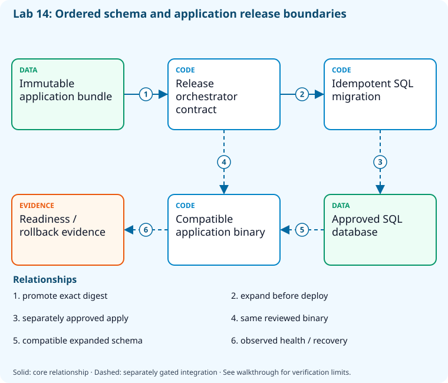

# Lab 14: Order application and database releases

[Previous: Lab 13](../13-environments-approvals/README.md) · [Catalog](../../docs/lab-catalog.md) · [Next: Lab 15](../15-deployment-strategies/README.md)

## Scenario, role, and outcome

An application and database must evolve together without data loss. Package once, review idempotent SQL, and order compatible schema expansion before code.

Learner role: **Application release engineer**. Outcome: Order application and database releases.

| Item | Value |
|---|---|
| Time | 120 minutes |
| Domain | pipelines |
| Platforms | local |
| Cost | none — review [current pricing and cleanup](../../docs/cost-and-cleanup.md) before cloud execution |
| Exam blueprint | July 27, 2026; sources reviewed October 16, 2026 |
| Verification | Authored and checked offline; no live Azure deployment is claimed |

Completion requires all five checkpoints, the break/fix repair, successful
independent validation, and a passing residual-resource audit. An unavailable
external prerequisite is a visible gate; it does not become a passing result.

## Architecture and service topology



The release contract promotes one immutable application bundle and orders idempotent schema expansion before application deployment. The SQL script is generated locally; applying it requires a separately approved database identity and network path. Old and new binaries must tolerate the expanded schema so recovery can route to compatible code without destructive data rollback.

The editable [Mermaid source](diagrams/architecture.mmd) and accessible SVG
render the same authored components and relationships. Dashed connections show
separately gated integrations. Read every boundary before executing commands. Cloud changes
stay inside the exact disposable GitHub repository, Azure DevOps project, and
Azure resource group recorded for this run. Child objects inherit that cleanup
boundary. Account creation, external integrations, and privileged organization
settings belong to [one-time bootstrap](../../docs/account-bootstrap.md).

## Objectives and checkpoints

Official objective topic IDs: `D3.3.6`, `D3.4.2`, `D3.4.7`, `D3.4.8`

| Checkpoint | Measurable behavior |
|---|---|
| [CP1](#task-1) | Publish a single immutable application bundle |
| [CP2](#task-2) | Generate an idempotent SQL Server migration script |
| [CP3](#task-3) | Preview the protected database execution lane |
| [CP4](#task-4) | Validate expand-database-application ordering |
| [CP5](#task-5) | Record binary/database recovery compatibility |

The [objective map](../../docs/objective-map.md) traces every official topic to
labs. The [Microsoft study guide](https://learn.microsoft.com/en-us/credentials/certifications/resources/study-guides/az-400)
controls authoritative objective wording and domain weighting.

## Inputs, permissions, and read-only preflight

Use PowerShell 7.4+, .NET 10, Git, GitHub CLI, Azure CLI with the Azure DevOps
extension, and the pinned repository validation dependencies. Read the
[permissions matrix](../../docs/permissions-matrix.md) and [evidence policy](../../docs/evidence-handling.md).
Supply only the accounts needed by this lab. Never put a token, connection
string, or private key into a command log, committed YAML, or progress export.

The examples run from the repository root. Choose a fresh lowercase run ID;
`demo01` is an example, not a reusable shared sandbox. Set bootstrap environment
variables for the approved GitHub owner, DevOps organization, subscription, and
region. Do not run both guided and automated lanes with the same run ID.

```powershell
$lab = './labs/14-ordered-releases-databases/scripts/cli'
& "$lab/Preflight.ps1" -RunId 'demo01'
& "$lab/Setup.ps1" -RunId 'demo01' -ProvisionOnly
# After reviewing context, permissions, cost, and cleanup:
& "$lab/Setup.ps1" -RunId 'demo01' -ProvisionOnly -Execute -AcknowledgeCost -AcknowledgeTenantChange
. "$lab/Context.ps1" -RunId 'demo01'
```

Preflight performs reads only. Provisioning creates fresh run-owned top-level
sandboxes and records their exact IDs. Context establishes `$RepoRoot`,
`$LabRoot`, `$WorkRoot`, `$RunId`, `$GhRepo`, `$AdoOrganization`, `$AdoProject`,
`$SubscriptionId`, `$Location`, and `$ResourceGroup`. A missing prerequisite or
ownership mismatch must stop execution. Local build commands may restore
packages and write ignored build output.

## Concept primer and design decisions

Expand/contract preserves compatibility during rollout. Binary rollback does not automatically reverse data or schema; destructive database reversal needs separate recovery design.

## Task 1 — Publish a single immutable application bundle

<a id="task-1"></a>

Checkpoint: `CP1`

```powershell
$dest=Join-Path $WorkRoot 'publish';dotnet publish (Join-Path $RepoRoot 'samples/DevOps.Api/DevOps.Api.csproj') --configuration Release --output $dest
 if($LASTEXITCODE -ne 0){throw 'Application publish failed.'}
 Get-FileHash (Join-Path $dest 'DevOps.Api.dll')|ConvertTo-Json|Set-Content (Join-Path $WorkRoot 'application-hash.json')
```

Expected state: A release bundle and exact application digest are produced before deployment.

Positive validation:

```powershell
if(-not (Test-Path (Join-Path $WorkRoot 'publish/DevOps.Api.dll'))){throw 'Release binary missing.'}
```

Negative validation:

```powershell
$h=Get-Content (Join-Path $WorkRoot 'application-hash.json') -Raw|ConvertFrom-Json
 if((Get-FileHash (Join-Path $WorkRoot 'publish/DevOps.Api.dll')).Hash -ne $h.Hash){throw 'Release binary drift.'}
```

Evidence to retain: Application SHA256 and build revision.

Common failure and safe retry: Promote these exact bytes through environments; avoid rebuilding after approval.

Cleanup dependency: retain this checkpoint's evidence until final validation; remove run-owned children before their recorded parent boundary.

## Task 2 — Generate an idempotent SQL Server migration script

<a id="task-2"></a>

Checkpoint: `CP2`

```powershell
Push-Location (Join-Path $RepoRoot 'samples')
 try{dotnet tool restore;dotnet ef migrations script --idempotent --context SqlServerTodoDbContext --project DevOps.Api --output (Join-Path $WorkRoot 'migration.sql');if($LASTEXITCODE -ne 0){throw 'Migration script generation failed.'}}finally{Pop-Location}
```

Expected state: The database change is a reviewable script; no database connection is opened.

Positive validation:

```powershell
$s=Get-Content (Join-Path $WorkRoot 'migration.sql') -Raw
 if($s -notmatch '__EFMigrationsHistory'){throw 'Migration history guard absent.'}
```

Negative validation:

```powershell
$s=Get-Content (Join-Path $WorkRoot 'migration.sql') -Raw
 if($s -match '(?i)DROP DATABASE'){throw 'Database-destroying release step.'}
```

Evidence to retain: Migration script digest and schema compatibility review.

Common failure and safe retry: Select the SQL Server context; SQLite migration syntax is not interchangeable.

Cleanup dependency: retain this checkpoint's evidence until final validation; remove run-owned children before their recorded parent boundary.

## Task 3 — Preview the protected database execution lane

<a id="task-3"></a>

Checkpoint: `CP3`

```powershell
& (Join-Path $LabRoot 'artifacts/migrate.ps1') -ConnectionString 'Server=approved-sandbox;Database=az400;Authentication=Active Directory Default;Encrypt=True'
 [ordered]@{reviewed=$true;applied=$false;credentialMode='Entra';rollback='roll forward compatible schema'}|ConvertTo-Json|Set-Content (Join-Path $WorkRoot 'database-review.json')
```

Expected state: Migration preview names the protected database lane without applying SQL.

Positive validation:

```powershell
$r=Get-Content (Join-Path $WorkRoot 'database-review.json') -Raw|ConvertFrom-Json
 if(-not $r.reviewed -or $r.credentialMode -ne 'Entra'){throw 'Migration review missing.'}
```

Negative validation:

```powershell
$r=Get-Content (Join-Path $WorkRoot 'database-review.json') -Raw|ConvertFrom-Json
 if($r.applied){throw 'Preview exercise unexpectedly applied SQL.'}
```

Evidence to retain: Preview output without connection credentials.

Common failure and safe retry: Supply an authorized disposable database and separate approval before -Apply; a placeholder host is never executed.

Cleanup dependency: retain this checkpoint's evidence until final validation; remove run-owned children before their recorded parent boundary.

## Task 4 — Validate expand-database-application ordering

<a id="task-4"></a>

Checkpoint: `CP4`

```powershell
$steps=@('schema-expand','application-deploy','readiness-check','schema-contract-later')
 $steps|Set-Content (Join-Path $WorkRoot 'release-order.txt')
 Copy-Item (Join-Path $LabRoot 'artifacts/deploy-ordered.yml') (Join-Path $WorkRoot 'deploy-ordered.yml')
```

Expected state: Backward-compatible expansion precedes application rollout; destructive contraction is deferred.

Positive validation:

```powershell
$s=@(Get-Content (Join-Path $WorkRoot 'release-order.txt'))
 if($s[0] -ne 'schema-expand' -or $s[1] -ne 'application-deploy'){throw 'Database/application dependencies reversed.'}
```

Negative validation:

```powershell
$s=@(Get-Content (Join-Path $WorkRoot 'release-order.txt'))
 if($s[0] -eq 'schema-contract-later'){throw 'Destructive contraction cannot precede rollout.'}
```

Evidence to retain: Release DAG and the generated SQL digest.

Common failure and safe retry: Use dependsOn/needs and a success condition; job naming alone does not impose ordering.

Cleanup dependency: retain this checkpoint's evidence until final validation; remove run-owned children before their recorded parent boundary.

## Task 5 — Record binary/database recovery compatibility

<a id="task-5"></a>

Checkpoint: `CP5`

```powershell
$compat=[ordered]@{binaryDigest=(Get-Content (Join-Path $WorkRoot 'application-hash.json') -Raw|ConvertFrom-Json).Hash;oldBinarySupportsExpandedSchema=$true;destructiveRollbackAllowed=$false;recovery='route back to previous compatible binary'}
 $compat|ConvertTo-Json|Set-Content (Join-Path $WorkRoot 'rollback-contract.json')
```

Expected state: Rollback routes traffic to a compatible binary rather than dropping newly written data.

Positive validation:

```powershell
$c=Get-Content (Join-Path $WorkRoot 'rollback-contract.json') -Raw|ConvertFrom-Json
 if(-not $c.oldBinarySupportsExpandedSchema -or $c.binaryDigest.Length -ne 64){throw 'Rollback compatibility/digest missing.'}
```

Negative validation:

```powershell
$c=Get-Content (Join-Path $WorkRoot 'rollback-contract.json') -Raw|ConvertFrom-Json
 if($c.destructiveRollbackAllowed){throw 'Automatic destructive database rollback is prohibited.'}
```

Evidence to retain: Compatibility assumptions, recovery procedure, and SQL/application hashes.

Common failure and safe retry: Test old and new binaries against the expanded schema before rollout.

Cleanup dependency: retain this checkpoint's evidence until final validation; remove run-owned children before their recorded parent boundary.

## Deterministic break/fix

Inject this fault only in the recorded sandbox or local run directory.

```powershell
@('application-deploy','schema-expand','readiness-check','schema-contract-later')|Set-Content (Join-Path $WorkRoot 'release-order.txt')
```

Diagnose the precise difference:

```powershell
Get-Content (Join-Path $WorkRoot 'release-order.txt')
```

Repair, then repeat the affected checkpoint validation:

```powershell
@('schema-expand','application-deploy','readiness-check','schema-contract-later')|Set-Content (Join-Path $WorkRoot 'release-order.txt')
```

## Optional job-style challenge

Against a separately approved disposable SQL database, prove forward-compatible migration and old-binary rollback using the same application artifact.

## Final validation and result interpretation

```powershell
& './labs/14-ordered-releases-databases/scripts/cli/Validate.ps1' -RunId 'demo01'
```

A complete result requires five passing read-only assertions. Pending hosted runs, missing licensed features, and unexecuted integration challenges remain visible. Review `validation.json`; a command exiting successfully is not enough if the asserted behavior is absent.

## Troubleshooting

- **401/403:** inspect the explicit account/project/repository scope and required role; do not broaden a token reflexively.
- **Resource or artifact missing:** confirm the exact run ID and prerequisite checkpoint; retry reads after eventual consistency.
- **Unsupported SKU/runtime/tool:** consult the specific current source, record the gate, and obtain approval before changing cost or architecture.
- **Validation mismatch:** inspect the positive and negative assertions separately, repair the named fault, and rerun validation.
- **Ownership refusal:** stop; never edit a manifest to claim an unrelated resource.

## Cleanup and residual checks

```powershell
& './labs/14-ordered-releases-databases/scripts/cli/Cleanup.ps1' -RunId 'demo01'
# Review the exact owned-object deletion plan first.
& './labs/14-ordered-releases-databases/scripts/cli/Cleanup.ps1' -RunId 'demo01' -Execute
```

Cleanup must verify ownership, delete only recorded sandbox objects in dependency order, and prove parent/child absence. Retain `run.json`, `validation.json`, and `cleanup.json` locally until the audit passes. Soft-deleted or deliberately retained items must remain reported. Never purge a shared vault or delete an account, organization, or pre-existing service connection to finish a lab.

## Exam debrief and assessment

Explain why each checkpoint's denied path matters, which scope authorizes it, what evidence proves it, and how it is reversed. Complete the [50-question assessment](QUESTIONS.md), then review [rationales](ANSWERS.md) and repeat weak checkpoints.

## Microsoft and platform sources

- [Primary source 1](https://learn.microsoft.com/en-us/ef/core/managing-schemas/migrations/applying) — reviewed 2026-10-16.
- [Primary source 2](https://learn.microsoft.com/en-us/azure/devops/pipelines/process/stages) — reviewed 2026-10-16.

## Lifecycle scripts and worked solution

Use `scripts/cli/Preflight.ps1`, `Setup.ps1`, `Validate.ps1`, `Cleanup.ps1`, and `Context.ps1` from this lab folder. Setup and cleanup preview until `-Execute`; `-ProvisionOnly` creates only fresh ownership-tracked containers. The [worked solution](solution/README.md) lists expected results and repair reasoning.
