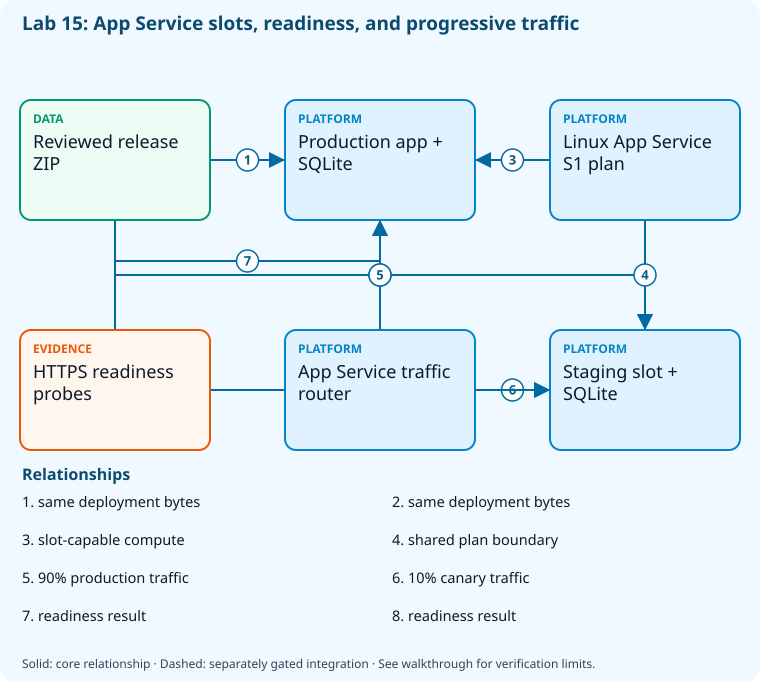

# Lab 15: Practice progressive deployment and rollback

[Previous: Lab 14](../14-ordered-releases-databases/README.md) · [Catalog](../../docs/lab-catalog.md) · [Next: Lab 16](../16-feature-flags-resilience/README.md)

## Scenario, role, and outcome

A release needs staged exposure and a rapid return to known-good service. Use isolated App Service slots and observe readiness before routing a canary.

Learner role: **Progressive delivery engineer**. Outcome: Practice progressive deployment and rollback.

| Item | Value |
|---|---|
| Time | 120 minutes |
| Domain | pipelines |
| Platforms | local, azure |
| Cost | billable; explicit acknowledgement — review [current pricing and cleanup](../../docs/cost-and-cleanup.md) before cloud execution |
| Exam blueprint | July 27, 2026; sources reviewed October 16, 2026 |
| Verification status | not-run |
| Verification scope | All checkpoint/fault scripts parse; the named fault lifecycle is independently tested with explicit provider doubles. Full normal provider execution and live cloud delivery have not run. |

Completion requires all five checkpoints, the break/fix repair, successful
independent validation, and a passing residual-resource audit. An unavailable
external prerequisite is a visible gate; it does not become a passing result.

## Architecture and service topology



One reviewed ZIP is deployed to production and staging in the same S1 Linux App Service plan. The router sends90%to production and10%to staging, while separate HTTPS probes establish readiness before promotion. Each synthetic training slot uses its own temporary SQLite database in Development; the advanced production-style lane uses separately protected SQL and identity prerequisites.

The editable [Mermaid source](diagrams/architecture.mmd) and accessible SVG
render the same authored components and relationships. Dashed connections show
separately gated integrations. Read every boundary before executing commands. Cloud changes
stay inside the exact disposable GitHub repository, Azure DevOps project, and
Azure resource group recorded for this run. Child objects inherit that cleanup
boundary. Account creation, external integrations, and privileged organization
settings belong to [one-time bootstrap](../../docs/account-bootstrap.md).

## Objectives and checkpoints

Coverage levels describe the intended learning evidence: **explained** means reasoned
understanding, **practiced** means an observable isolated skill, and **integrated**
means skills connected across a delivery boundary. These labels are curriculum
claims, not execution status. Verification above records what authors actually ran.

Official objective topic IDs: `D3.4.1`, `D3.4.3`, `D3.4.4`, `D3.4.7`

| Checkpoint | Measurable behavior |
|---|---|
| [CP1](#task-1) | Create a slot-capable App Service sandbox |
| [CP2](#task-2) | Publish and package the application once |
| [CP3](#task-3) | Deploy identical bytes to production and staging |
| [CP4](#task-4) | Verify readiness before changing exposure |
| [CP5](#task-5) | Route ten percent and preview controlled promotion |

The [objective map](../../docs/objective-map.md) traces every official topic to
labs. The [Microsoft study guide](https://learn.microsoft.com/en-us/credentials/certifications/resources/study-guides/az-400)
controls authoritative objective wording and domain weighting.

## Inputs, permissions, and read-only preflight

Use PowerShell 7.4+, .NET 10, Git, GitHub CLI, Azure CLI with the Azure DevOps
extension, and the pinned repository validation dependencies. Read the
[permissions matrix](../../docs/permissions-matrix.md) and [evidence policy](../../docs/evidence-handling.md).
Supply only the accounts needed by this lab. Never put a token, connection
string, or private key into a command log, committed YAML, or progress export.

The examples run from the repository root. Choose a fresh lowercase run ID;
`demo01` is an example, not a reusable shared sandbox. Set bootstrap environment
variables for the approved GitHub owner, DevOps organization, subscription, and
region. Do not run both guided and automated lanes with the same run ID.

```powershell
$lab = './labs/15-deployment-strategies/scripts/cli'
& "$lab/Preflight.ps1" -RunId 'demo01'
& "$lab/Setup.ps1" -RunId 'demo01' -ProvisionOnly
# After reviewing context, permissions, cost, and cleanup:
& "$lab/Setup.ps1" -RunId 'demo01' -ProvisionOnly -Execute -AcknowledgeCost -AcknowledgeTenantChange
. "$lab/Context.ps1" -RunId 'demo01'
```

Preflight performs reads only. Provisioning creates fresh run-owned top-level
sandboxes and records their exact IDs. Context establishes `$RepoRoot`,
`$LabRoot`, `$WorkRoot`, `$RunId`, `$GhRepo`, `$AdoOrganization`, `$AdoProject`,
`$SubscriptionId`, `$Location`, and `$ResourceGroup`. A missing prerequisite or
ownership mismatch must stop execution. Local build commands may restore
packages and write ignored build output.

## Concept primer and design decisions

A canary controls risk through limited exposure; A/B testing measures experiment outcomes. This synthetic core uses Development plus per-slot SQLite in /tmp only; real deployments use the protected SQL and identity lane.

Progressive exposure needs both a healthy candidate and a measurable stop condition. A canary changes traffic percentage; a slot swap changes which deployment serves production; A/B experimentation asks a different product question. Neither technique automatically supplies database compatibility.

This standalone exercise deliberately configures Development and per-slot SQLite in /tmp to avoid an external SQL dependency. It is training-only state and can disappear on recycle. Production-style SQL, runtime identities and private migration routing belong to the protected capstone lane. Compare the exact same package on production/staging, inspect readiness and then query the actual ten-percent routing state.

## Task 1 — Create a slot-capable App Service sandbox

<a id="task-1"></a>

Checkpoint: `CP1`

Foundation/supporting task; no additional exam-objective coverage is claimed.

```powershell
$app="az400-l15-$RunId";$app|Set-Content (Join-Path $WorkRoot 'app-name.txt')
 $runtimes=az webapp list-runtimes --os linux -o tsv;if($runtimes -notmatch 'DOTNETCORE:10.0'){throw 'Selected region/platform lacks the .NET10 runtime; do not downgrade silently.'}
 az appservice plan create --subscription $SubscriptionId --resource-group $ResourceGroup --name "plan-$RunId" --location $Location --is-linux --sku S1 -o json|Set-Content (Join-Path $WorkRoot 'plan.json')
 az webapp create --subscription $SubscriptionId --resource-group $ResourceGroup --plan "plan-$RunId" --name $app --runtime 'DOTNETCORE:10.0' -o json|Set-Content (Join-Path $WorkRoot 'webapp.json')
```

Expected state: A billable S1 Linux plan supports a .NET10 app and deployment slots.

Positive validation:

```powershell
$app=Get-Content (Join-Path $WorkRoot 'app-name.txt')
 $w=az webapp show --subscription $SubscriptionId --resource-group $ResourceGroup --name $app -o json|ConvertFrom-Json
 if($w.state -ne 'Running'){throw 'Web app is not running.'}
```

Negative validation:

```powershell
$p=Get-Content (Join-Path $WorkRoot 'plan.json') -Raw|ConvertFrom-Json
 if($p.sku.name -ne 'S1'){throw 'Unexpected billable SKU; do not accept silent tier changes.'}
```

Evidence to retain: Plan SKU, app ID, and reviewed same-session cleanup cost.

Common failure and safe retry: Review current pricing/quotas before -Execute; never silently replace S1 with a larger SKU.

Cleanup dependency: retain this checkpoint's evidence until final validation; remove run-owned children before their recorded parent boundary.

## Task 2 — Publish and package the application once

<a id="task-2"></a>

Checkpoint: `CP2`

Foundation/supporting task; no additional exam-objective coverage is claimed.

```powershell
$p=Join-Path $WorkRoot 'publish';dotnet publish (Join-Path $RepoRoot 'samples/DevOps.Api/DevOps.Api.csproj') --configuration Release --output $p
 if($LASTEXITCODE -ne 0){throw 'Publish failed.'}
 Compress-Archive -Path (Join-Path $p '*') -DestinationPath (Join-Path $WorkRoot 'release.zip')
 Get-FileHash (Join-Path $WorkRoot 'release.zip')|ConvertTo-Json|Set-Content (Join-Path $WorkRoot 'release-hash.json')
```

Expected state: An immutable ZIP contains the app at its root.

Positive validation:

```powershell
if(-not (Test-Path (Join-Path $WorkRoot 'release.zip'))){throw 'Deployment ZIP missing.'}
```

Negative validation:

```powershell
$h=Get-Content (Join-Path $WorkRoot 'release-hash.json') -Raw|ConvertFrom-Json
 if((Get-FileHash (Join-Path $WorkRoot 'release.zip')).Hash -ne $h.Hash){throw 'Release ZIP changed.'}
```

Evidence to retain: ZIP digest and app revision.

Common failure and safe retry: Zip the published file contents, not their enclosing directory.

Cleanup dependency: retain this checkpoint's evidence until final validation; remove run-owned children before their recorded parent boundary.

## Task 3 — Deploy identical bytes to production and staging

<a id="task-3"></a>

Checkpoint: `CP3`

| Objective | Evidence level | Observation and limits |
|---|---|---|
| `D3.4.3` | practiced | Deploy and probe a staging slot separately from production. |

```powershell
$app=Get-Content (Join-Path $WorkRoot 'app-name.txt')
 az webapp deployment slot create --subscription $SubscriptionId --resource-group $ResourceGroup --name $app --slot staging -o json|Set-Content (Join-Path $WorkRoot 'slot.json')
 az webapp deploy --subscription $SubscriptionId --resource-group $ResourceGroup --name $app --src-path (Join-Path $WorkRoot 'release.zip') --type zip -o json
 az webapp deploy --subscription $SubscriptionId --resource-group $ResourceGroup --name $app --slot staging --src-path (Join-Path $WorkRoot 'release.zip') --type zip -o json

az webapp config appsettings set --subscription $SubscriptionId --resource-group $ResourceGroup --name $app --settings ASPNETCORE_ENVIRONMENT=Development Database__Provider=Sqlite 'ConnectionStrings__Todos=Data Source=/tmp/todos.db' -o none
az webapp config appsettings set --subscription $SubscriptionId --resource-group $ResourceGroup --name $app --slot staging --settings ASPNETCORE_ENVIRONMENT=Development Database__Provider=Sqlite 'ConnectionStrings__Todos=Data Source=/tmp/todos.db' -o none
```

Expected state: Both slots receive the same reviewed artifact before progressive routing.

Positive validation:

```powershell
$app=Get-Content (Join-Path $WorkRoot 'app-name.txt')
 $s=@(az webapp deployment slot list --subscription $SubscriptionId --resource-group $ResourceGroup --name $app -o json|ConvertFrom-Json)
 if(@($s|Where-Object name -like '*/staging').Count -ne 1){throw 'Staging slot absent.'}
```

Negative validation:

```powershell
$app=Get-Content (Join-Path $WorkRoot 'app-name.txt')
 $s=@(az webapp deployment slot list --subscription $SubscriptionId --resource-group $ResourceGroup --name $app -o json|ConvertFrom-Json)
 if(@($s|Where-Object name -like '*/production').Count){throw 'Production is not an independently created slot.'}
```

Evidence to retain: Deployment IDs and slot list.

Common failure and safe retry: Wait for deployment completion and review startup logs before routing traffic.

Cleanup dependency: retain this checkpoint's evidence until final validation; remove run-owned children before their recorded parent boundary.

## Task 4 — Verify readiness before changing exposure

<a id="task-4"></a>

Checkpoint: `CP4`

| Objective | Evidence level | Observation and limits |
|---|---|---|
| `D3.4.7` | practiced | Compare healthy slot probes and inspect the run-owned deployment contract. |

```powershell
$app=Get-Content (Join-Path $WorkRoot 'app-name.txt')
 $checks=@();foreach($hostName in @("$app.azurewebsites.net","$app-staging.azurewebsites.net")){$r=Invoke-WebRequest "https://$hostName/health/ready";$checks+=[ordered]@{host=$hostName;status=[int]$r.StatusCode}}
 $checks|ConvertTo-Json|Set-Content (Join-Path $WorkRoot 'readiness.json')
```

Expected state: Production and staging return HTTP200 for readiness.

Positive validation:

```powershell
$c=@(Get-Content (Join-Path $WorkRoot 'readiness.json') -Raw|ConvertFrom-Json)
 if($c.Count -ne 2 -or @($c|Where-Object status -ne 200).Count){throw 'Readiness gate failed.'}
```

Negative validation:

```powershell
$c=@(Get-Content (Join-Path $WorkRoot 'readiness.json') -Raw|ConvertFrom-Json)
 if(@($c.host|Select-Object -Unique).Count -ne 2){throw 'Both checks accidentally targeted the same slot.'}
```

Evidence to retain: Two hostname/status pairs without cookies or authorization headers.

Common failure and safe retry: Retry the read-only readiness request after warmup; a running process alone is not readiness.

Cleanup dependency: retain this checkpoint's evidence until final validation; remove run-owned children before their recorded parent boundary.

## Task 5 — Route ten percent and preview controlled promotion

<a id="task-5"></a>

Checkpoint: `CP5`

| Objective | Evidence level | Observation and limits |
|---|---|---|
| `D3.4.1` | integrated | Set and query the actual owned App Service staging traffic percentage. |
| `D3.4.4` | explained | Reason about a compatible hotfix/rollback path; patching a production branch is not a separate executed task. |

```powershell
$app=Get-Content (Join-Path $WorkRoot 'app-name.txt')
 az webapp traffic-routing set --subscription $SubscriptionId --resource-group $ResourceGroup --name $app --distribution staging=10 -o json|Set-Content (Join-Path $WorkRoot 'routing.json')
 & (Join-Path $LabRoot 'artifacts/deploy-canary.ps1') -SubscriptionId $SubscriptionId -ResourceGroup $ResourceGroup -AppName $app -Slot staging
```

Expected state: The canary receives10%; promotion script previews a readiness-checked slot swap.

Positive validation:

```powershell
$app=Get-Content (Join-Path $WorkRoot 'app-name.txt')
 $r=az webapp traffic-routing show --subscription $SubscriptionId --resource-group $ResourceGroup --name $app -o json|ConvertFrom-Json
 if($r.staging -ne 10){throw 'Expected10percent canary routing.'}
```

Negative validation:

```powershell
$app=Get-Content (Join-Path $WorkRoot 'app-name.txt')
 $r=az webapp traffic-routing show --subscription $SubscriptionId --resource-group $ResourceGroup --name $app -o json|ConvertFrom-Json
 if($r.staging -ge 100){throw 'Canary accidentally received full exposure.'}
```

Evidence to retain: Routing distribution, artifact digest, and promotion preview.

Common failure and safe retry: Clear traffic routing to return to production; promote only after health/error/latency review.

Cleanup dependency: retain this checkpoint's evidence until final validation; remove run-owned children before their recorded parent boundary.

## Deterministic break/fix

Run the journaled operation after all five checkpoints. It proves the healthy assertion, injects the named fault, requires its rejection, repairs it, and proves health again. Provider doubles used in author tests are not live enforcement evidence.

```powershell
& './labs/15-deployment-strategies/scripts/cli/BreakFix.ps1' -RunId 'demo01' -Execute
```

Expected rejection marker: `AZ400-L15-FAULT`. The assertion must catch the changed behavior, not merely an exception from an unavailable CLI.

Inspect the independent assertion:

```powershell
$app=Get-Content (Join-Path $WorkRoot 'app-name.txt');$r=az webapp traffic-routing show --subscription $SubscriptionId --resource-group $ResourceGroup --name $app -o json|ConvertFrom-Json
if($r.staging -ne 10){throw 'AZ400-L15-FAULT'}
```

Fault trigger (executed by BreakFix):

```powershell
$app=Get-Content (Join-Path $WorkRoot 'app-name.txt');az webapp traffic-routing set --subscription $SubscriptionId --resource-group $ResourceGroup --name $app --distribution staging=100 -o none
```

Diagnose the precise difference:

```powershell
$app=Get-Content (Join-Path $WorkRoot 'app-name.txt');az webapp traffic-routing show --subscription $SubscriptionId --resource-group $ResourceGroup --name $app -o json
```

Repair (executed by BreakFix):

```powershell
$app=Get-Content (Join-Path $WorkRoot 'app-name.txt');az webapp traffic-routing set --subscription $SubscriptionId --resource-group $ResourceGroup --name $app --distribution staging=10 -o none
```

## Optional job-style challenge

Implement an observed canary abort threshold and an emergency hotfix route; compare slot swap, rolling deployment, rings, and A/B experiments.

## Final validation and result interpretation

```powershell
& './labs/15-deployment-strategies/scripts/cli/Validate.ps1' -RunId 'demo01'
```

A complete result requires five passing read-only checkpoint assertions, a journaled repaired fault, and any required integration evidence. Pending hosted runs, missing licensed features, and unexecuted integration lanes remain visible. Review `validation.json`; successful command exit alone does not establish the asserted behavior.

## Troubleshooting

- **401/403:** inspect the explicit account/project/repository scope and required role; do not broaden a token reflexively.
- **Resource or artifact missing:** confirm the exact run ID and prerequisite checkpoint; retry reads after eventual consistency.
- **Unsupported SKU/runtime/tool:** consult the specific current source, record the gate, and obtain approval before changing cost or architecture.
- **Validation mismatch:** inspect the positive and negative assertions separately, repair the named fault, and rerun validation.
- **Ownership refusal:** stop; never edit a manifest to claim an unrelated resource.

## Cleanup and residual checks

```powershell
& './labs/15-deployment-strategies/scripts/cli/Cleanup.ps1' -RunId 'demo01'
# Review the exact owned-object deletion plan first.
& './labs/15-deployment-strategies/scripts/cli/Cleanup.ps1' -RunId 'demo01' -Execute
```

Cleanup must verify ownership, delete only recorded sandbox objects in dependency order, and prove parent/child absence. Retain `run.json`, `validation.json`, and `cleanup.json` locally until the audit passes. Soft-deleted or deliberately retained items must remain reported. Never purge a shared vault or delete an account, organization, or pre-existing service connection to finish a lab.

## Exam debrief and assessment

Explain why each checkpoint's denied path matters, which scope authorizes it, what evidence proves it, and how it is reversed. Complete the [50-question assessment](QUESTIONS.md), then review [rationales](ANSWERS.md) and repeat weak checkpoints.

## Microsoft and platform sources

- [Primary source 1](https://learn.microsoft.com/en-us/azure/app-service/deploy-staging-slots) — reviewed 2026-10-16.
- [Primary source 2](https://learn.microsoft.com/en-us/cli/azure/webapp/traffic-routing) — reviewed 2026-10-16.
- [Primary source 3](https://learn.microsoft.com/en-us/azure/well-architected/operational-excellence/safe-deployments) — reviewed 2026-10-16.

## Lifecycle scripts and worked solution

Use `scripts/cli/Preflight.ps1`, `Setup.ps1`, `BreakFix.ps1`, `Integration.ps1` (capstones), `Validate.ps1`, `Cleanup.ps1`, and `Context.ps1` from this lab folder. Setup and cleanup preview until `-Execute`; `-ProvisionOnly` creates only fresh ownership-tracked containers. The [worked solution](solution/README.md) lists expected results and repair reasoning.
