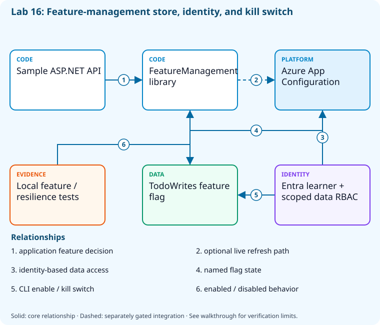

# Lab 16: Control feature exposure and deployment resilience

[Previous: Lab 15](../15-deployment-strategies/README.md) · [Catalog](../../docs/lab-catalog.md) · [Next: Lab 17](../17-bicep-infrastructure/README.md)

## Scenario, role, and outcome

The team wants a kill switch and progressive cohorts without rebuilding binaries. Test feature behavior, define exposure, and model bounded failure handling.

Learner role: **Resilience engineer**. Outcome: Control feature exposure and deployment resilience.

| Item | Value |
|---|---|
| Time | 120 minutes |
| Domain | pipelines |
| Platforms | local, azure |
| Cost | Developer store; explicit acknowledgement — review [current pricing and cleanup](../../docs/cost-and-cleanup.md) before cloud execution |
| Exam blueprint | July 27, 2026; sources reviewed October 16, 2026 |
| Verification status | offline-tested |
| Verification scope | All five checkpoint commands, final validators and named fault/repair passed in CourseReleaseSequences.Tests.ps1. Local .NET publishing/tests, EF SQL generation and Bicep compilation are real; GitHub, Azure and readiness HTTP responses are explicit fail-closed doubles. Live release, SQL authentication and traffic routing have not run. |

Completion requires all five checkpoints, the break/fix repair, successful
independent validation, and a passing residual-resource audit. An unavailable
external prerequisite is a visible gate; it does not become a passing result.

## Architecture and service topology



The sample FeatureManagement library controls application behavior, and local tests prove both enabled and disabled paths. The owned App Configuration store contains the same TodoWrites key, changed through Entra authentication with a data role scoped to that store. Wiring and observing live application refresh is an explicit additional integration; the core proves actual store writes/reads and the kill switch.

The editable [Mermaid source](diagrams/architecture.mmd) and accessible SVG
render the same authored components and relationships. Dashed connections show
separately gated integrations. Read every boundary before executing commands. Cloud changes
stay inside the exact disposable GitHub repository, Azure DevOps project, and
Azure resource group recorded for this run. Child objects inherit that cleanup
boundary. Account creation, external integrations, and privileged organization
settings belong to [one-time bootstrap](../../docs/account-bootstrap.md).

## Objectives and checkpoints

Coverage levels describe the intended learning evidence: **explained** means reasoned
understanding, **practiced** means an observable isolated skill, and **integrated**
means skills connected across a delivery boundary. These labels are curriculum
claims, not execution status. Verification above records what authors actually ran.

Official objective topic IDs: `D3.4.5`, `D3.4.6`

| Checkpoint | Measurable behavior |
|---|---|
| [CP1](#task-1) | Inspect the sample feature-management defaults |
| [CP2](#task-2) | Run the feature behavior tests |
| [CP3](#task-3) | Create an Entra-only store and scoped data role |
| [CP4](#task-4) | Create and enable TodoWrites through identity-based CLI |
| [CP5](#task-5) | Exercise the kill switch and bounded resilience decision |

The [objective map](../../docs/objective-map.md) traces every official topic to
labs. The [Microsoft study guide](https://learn.microsoft.com/en-us/credentials/certifications/resources/study-guides/az-400)
controls authoritative objective wording and domain weighting.

## Inputs, permissions, and read-only preflight

Use PowerShell 7.4+, .NET 10, Git, GitHub CLI, Azure CLI with the Azure DevOps
extension, and the pinned repository validation dependencies. Read the
[permissions matrix](../../docs/permissions-matrix.md) and [evidence policy](../../docs/evidence-handling.md).
Supply only the accounts needed by this lab. Never put a token, connection
string, or private key into a command log, committed YAML, or progress export.

The examples run from the repository root. Choose a fresh lowercase run ID;
`demo01` is an example, not a reusable shared sandbox. Set bootstrap environment
variables for the approved GitHub owner, DevOps organization, subscription, and
region. Do not run both guided and automated lanes with the same run ID.

```powershell
$lab = './labs/16-feature-flags-resilience/scripts/cli'
& "$lab/Preflight.ps1" -RunId 'demo01'
& "$lab/Setup.ps1" -RunId 'demo01' -ProvisionOnly
# After reviewing context, permissions, cost, and cleanup:
& "$lab/Setup.ps1" -RunId 'demo01' -ProvisionOnly -Execute -AcknowledgeCost -AcknowledgeTenantChange
. "$lab/Context.ps1" -RunId 'demo01'
```

Preflight performs reads only. Provisioning creates fresh run-owned top-level
sandboxes and records their exact IDs. Context establishes `$RepoRoot`,
`$LabRoot`, `$WorkRoot`, `$RunId`, `$GhRepo`, `$AdoOrganization`, `$AdoProject`,
`$SubscriptionId`, `$Location`, and `$ResourceGroup`. A missing prerequisite or
ownership mismatch must stop execution. Local build commands may restore
packages and write ignored build output.

## Concept primer and design decisions

Deployment and feature exposure are independent. Cohort policy needs ownership/expiry; circuit breakers reduce amplification while bounded retries address transient failures.

A deployed capability can remain disabled until the owner authorizes exposure. Feature flags need expiry, audit and a safe default; a kill switch should preserve essential read behavior while stopping the risky write path. Bounded retries and circuit breakers address different failure amplification patterns.

The sample tests demonstrate writes rejected when TodoWrites is disabled while reads remain healthy. Azure App Configuration separately exercises Entra-based CLI management of the actual run-owned flag. This does not imply the sample is automatically consuming that remote store: the local application test and cloud flag-control operation are distinct observations until configured together.

## Task 1 — Inspect the sample feature-management defaults

<a id="task-1"></a>

Checkpoint: `CP1`

Foundation/supporting task; no additional exam-objective coverage is claimed.

```powershell
$config=Get-Content (Join-Path $RepoRoot 'samples/DevOps.Api/appsettings.json') -Raw|ConvertFrom-Json
 $config|ConvertTo-Json -Depth 10|Set-Content (Join-Path $WorkRoot 'feature-defaults.json')
 Copy-Item (Join-Path $LabRoot 'artifacts/feature-flags.json') (Join-Path $WorkRoot 'feature-flags.json')
```

Expected state: Feature defaults are separated from deployment artifact identity.

Positive validation:

```powershell
$t=Get-Content (Join-Path $WorkRoot 'feature-defaults.json') -Raw
 if($t -notmatch 'FeatureManagement|feature_management'){throw 'Feature-management defaults absent.'}
```

Negative validation:

```powershell
$t=Get-Content (Join-Path $WorkRoot 'feature-defaults.json') -Raw
 if($t -match 'InstrumentationKey=[0-9a-f]{8}-'){throw 'Real telemetry credential in sample defaults.'}
```

Evidence to retain: Default flag names and configuration scope.

Common failure and safe retry: Keep flags in configuration; do not rebuild the application merely to alter exposure.

Cleanup dependency: retain this checkpoint's evidence until final validation; remove run-owned children before their recorded parent boundary.

## Task 2 — Run the feature behavior tests

<a id="task-2"></a>

Checkpoint: `CP2`

Foundation/supporting task; no additional exam-objective coverage is claimed.

```powershell
dotnet test (Join-Path $RepoRoot 'samples/DevOps.slnx') --configuration Release --filter 'FullyQualifiedName~DisabledFlagRejectsWritesWhileReadsRemainHealthy' --logger "trx;LogFileName=feature.trx" --results-directory (Join-Path $WorkRoot 'features')
 if($LASTEXITCODE -ne 0){throw 'Feature tests failed.'}
```

Expected state: Tests exercise enabled and disabled feature behavior.

Positive validation:

```powershell
$f=Get-ChildItem (Join-Path $WorkRoot 'features') -Filter '*.trx' -Recurse|Select-Object -First 1;$x=[xml](Get-Content $f.FullName -Raw)
 if([int]$x.TestRun.ResultSummary.Counters.passed -lt 1){throw 'Feature test filter selected no tests.'}
```

Negative validation:

```powershell
$f=Get-ChildItem (Join-Path $WorkRoot 'features') -Filter '*.trx' -Recurse|Select-Object -First 1;$x=[xml](Get-Content $f.FullName -Raw)
 if([int]$x.TestRun.ResultSummary.Counters.failed -gt 0){throw 'Feature behavior regression.'}
```

Evidence to retain: Feature test names and TRX counts.

Common failure and safe retry: Use the exact test names in the sample; zero tests is a failed gate.

Cleanup dependency: retain this checkpoint's evidence until final validation; remove run-owned children before their recorded parent boundary.

## Task 3 — Create an Entra-only store and scoped data role

<a id="task-3"></a>

Checkpoint: `CP3`

Foundation/supporting task; no additional exam-objective coverage is claimed.

```powershell
$name="flags-l16-$RunId"
 $store=az appconfig create --subscription $SubscriptionId --resource-group $ResourceGroup --location $Location --name $name --sku Developer --disable-local-auth true --retention-days 0 --enable-purge-protection false --tags "az400-run=$RunId" -o json|ConvertFrom-Json
 $store|ConvertTo-Json -Depth 8|Set-Content (Join-Path $WorkRoot 'appconfiguration-store.json')
 $learner=az ad signed-in-user show --query id -o tsv
 if(-not $learner){throw 'An interactive authorized Entra learner is required for the data lane.'}
 az role assignment create --subscription $SubscriptionId --assignee-object-id $learner --assignee-principal-type User --role 'App Configuration Data Owner' --scope $store.id -o json|Set-Content (Join-Path $WorkRoot 'appconfiguration-role.json')
```

Expected state: A Developer store uses Entra authentication, zero-day soft-delete retention, and a data role at the store scope.

Positive validation:

```powershell
$s=az appconfig show --subscription $SubscriptionId --resource-group $ResourceGroup --name "flags-l16-$RunId" -o json|ConvertFrom-Json
 if(-not $s.disableLocalAuth -or $s.tags.'az400-run' -ne $RunId){throw 'Store auth/ownership mismatch.'}
```

Negative validation:

```powershell
$r=Get-Content (Join-Path $WorkRoot 'appconfiguration-role.json') -Raw|ConvertFrom-Json
 $s=Get-Content (Join-Path $WorkRoot 'appconfiguration-store.json') -Raw|ConvertFrom-Json
 if($r.scope -ne $s.id){throw 'Data role assigned outside exact store scope.'}
```

Evidence to retain: Store SKU/auth/retention and exact data-role scope, with identifiers redacted.

Common failure and safe retry: Developer pricing and role-assignment permission are explicit gates; do not switch to key auth if RBAC propagation takes time.

Cleanup dependency: retain this checkpoint's evidence until final validation; remove run-owned children before their recorded parent boundary.

## Task 4 — Create and enable TodoWrites through identity-based CLI

<a id="task-4"></a>

Checkpoint: `CP4`

| Objective | Evidence level | Observation and limits |
|---|---|---|
| `D3.4.6` | practiced | Create, enable, query, and disable the run-owned Azure App Configuration feature flag. |

```powershell
$name="flags-l16-$RunId"
 az appconfig feature set --subscription $SubscriptionId --name $name --feature TodoWrites --auth-mode login --yes -o json
 az appconfig feature enable --subscription $SubscriptionId --name $name --feature TodoWrites --auth-mode login --yes -o json
 az appconfig feature show --subscription $SubscriptionId --name $name --feature TodoWrites --auth-mode login -o json|Set-Content (Join-Path $WorkRoot 'feature-enabled.json')
```

Expected state: The store contains the same TodoWrites flag used by the tested application; an enabled-state observation is retained.

Positive validation:

```powershell
$f=az appconfig feature show --subscription $SubscriptionId --name "flags-l16-$RunId" --feature TodoWrites --auth-mode login -o json|ConvertFrom-Json
 if($f.name -ne 'TodoWrites'){throw 'Expected feature absent.'}
```

Negative validation:

```powershell
$e=Get-Content (Join-Path $WorkRoot 'feature-enabled.json') -Raw|ConvertFrom-Json
 if($e.state -ne 'on'){throw 'Feature enable observation missing.'}
```

Evidence to retain: Feature key/state and identity-auth mode; no store access keys are retrieved.

Common failure and safe retry: Allow scoped data RBAC to propagate and retry the read; a management-plane Contributor role alone does not grant feature writes.

Cleanup dependency: retain this checkpoint's evidence until final validation; remove run-owned children before their recorded parent boundary.

## Task 5 — Exercise the kill switch and bounded resilience decision

<a id="task-5"></a>

Checkpoint: `CP5`

| Objective | Evidence level | Observation and limits |
|---|---|---|
| `D3.4.5` | practiced | Observe the sample feature-disabled test preserve reads while rejecting writes. |

```powershell
az appconfig feature disable --subscription $SubscriptionId --name "flags-l16-$RunId" --feature TodoWrites --auth-mode login --yes -o json
 $exposure=[ordered]@{flag='TodoWrites';rings=@(5,20,100);killSwitchEnabled=$true;owner='release-engineer';expiresAfterDays=14}
 $exposure|ConvertTo-Json -Depth 5|Set-Content (Join-Path $WorkRoot 'exposure.json')
 $responses=@(200,200,503,503,503)
 [ordered]@{window=5;failures=3;threshold=0.5;open=(@($responses|Where-Object {$_ -ge 500}).Count/5 -ge 0.5);retryBudget=2}|ConvertTo-Json|Set-Content (Join-Path $WorkRoot 'resilience.json')
```

Expected state: The real flag is off, and the synthetic60%failure window opens a breaker with a bounded retry budget.

Positive validation:

```powershell
$f=az appconfig feature show --subscription $SubscriptionId --name "flags-l16-$RunId" --feature TodoWrites --auth-mode login -o json|ConvertFrom-Json
 if($f.state -ne 'off'){throw 'Kill switch did not disable exposure.'}
```

Negative validation:

```powershell
$r=Get-Content (Join-Path $WorkRoot 'resilience.json') -Raw|ConvertFrom-Json
 if(-not $r.open -or $r.retryBudget -gt 3){throw 'Unbounded/incorrect resilience decision.'}
```

Evidence to retain: Before/after flag state, exposure owner/expiry, and breaker window.

Common failure and safe retry: A configured store flag does not prove application refresh; the optional challenge wires the tested app endpoint and proves both live states.

Cleanup dependency: retain this checkpoint's evidence until final validation; remove run-owned children before their recorded parent boundary.

## Deterministic break/fix

Run the journaled operation after all five checkpoints. It proves the healthy assertion, injects the named fault, requires its rejection, repairs it, and proves health again. Provider doubles used in author tests are not live enforcement evidence.

```powershell
& './labs/16-feature-flags-resilience/scripts/cli/BreakFix.ps1' -RunId 'demo01' -Execute
```

Expected rejection marker: `AZ400-L16-FAULT`. The assertion must catch the changed behavior, not merely an exception from an unavailable CLI.

Inspect the independent assertion:

```powershell
$f=az appconfig feature show --subscription $SubscriptionId --name "flags-l16-$RunId" --feature TodoWrites --auth-mode login -o json|ConvertFrom-Json
if($f.state -ne 'off'){throw 'AZ400-L16-FAULT'}
```

Fault trigger (executed by BreakFix):

```powershell
az appconfig feature enable --subscription $SubscriptionId --name "flags-l16-$RunId" --feature TodoWrites --auth-mode login --yes -o none
```

Diagnose the precise difference:

```powershell
az appconfig feature show --subscription $SubscriptionId --name "flags-l16-$RunId" --feature TodoWrites --auth-mode login --query state -o tsv
```

Repair (executed by BreakFix):

```powershell
az appconfig feature disable --subscription $SubscriptionId --name "flags-l16-$RunId" --feature TodoWrites --auth-mode login --yes -o none
```

## Optional job-style challenge

Connect an approved disposable App Configuration store, toggle one flag using Entra data authorization, and prove both feature states without republishing the binary.

## Final validation and result interpretation

```powershell
& './labs/16-feature-flags-resilience/scripts/cli/Validate.ps1' -RunId 'demo01'
```

A complete result requires five passing read-only checkpoint assertions, a journaled repaired fault, and any required integration evidence. Pending hosted runs, missing licensed features, and unexecuted integration lanes remain visible. Review `validation.json`; successful command exit alone does not establish the asserted behavior.

## Troubleshooting

- **401/403:** inspect the explicit account/project/repository scope and required role; do not broaden a token reflexively.
- **Resource or artifact missing:** confirm the exact run ID and prerequisite checkpoint; retry reads after eventual consistency.
- **Unsupported SKU/runtime/tool:** consult the specific current source, record the gate, and obtain approval before changing cost or architecture.
- **Validation mismatch:** inspect the positive and negative assertions separately, repair the named fault, and rerun validation.
- **Ownership refusal:** stop; never edit a manifest to claim an unrelated resource.

## Cleanup and residual checks

```powershell
& './labs/16-feature-flags-resilience/scripts/cli/Cleanup.ps1' -RunId 'demo01'
# Review the exact owned-object deletion plan first.
& './labs/16-feature-flags-resilience/scripts/cli/Cleanup.ps1' -RunId 'demo01' -Execute
```

Cleanup must verify ownership, delete only recorded sandbox objects in dependency order, and prove parent/child absence. Retain `run.json`, `validation.json`, and `cleanup.json` locally until the audit passes. Soft-deleted or deliberately retained items must remain reported. Never purge a shared vault or delete an account, organization, or pre-existing service connection to finish a lab.

## Exam debrief and assessment

Explain why each checkpoint's denied path matters, which scope authorizes it, what evidence proves it, and how it is reversed. Complete the [50-question assessment](QUESTIONS.md), then review [rationales](ANSWERS.md) and repeat weak checkpoints.

## Microsoft and platform sources

- [Primary source 1](https://learn.microsoft.com/en-us/azure/azure-app-configuration/feature-management-overview) — reviewed 2026-10-16.
- [Primary source 2](https://learn.microsoft.com/en-us/azure/azure-app-configuration/quickstart-feature-flag-aspnet-core) — reviewed 2026-10-16.
- [Primary source 3](https://learn.microsoft.com/en-us/azure/architecture/patterns/circuit-breaker) — reviewed 2026-10-16.

## Lifecycle scripts and worked solution

Use `scripts/cli/Preflight.ps1`, `Setup.ps1`, `BreakFix.ps1`, `Integration.ps1` (capstones), `Validate.ps1`, `Cleanup.ps1`, and `Context.ps1` from this lab folder. Setup and cleanup preview until `-Execute`; `-ProvisionOnly` creates only fresh ownership-tracked containers. The [worked solution](solution/README.md) lists expected results and repair reasoning.
