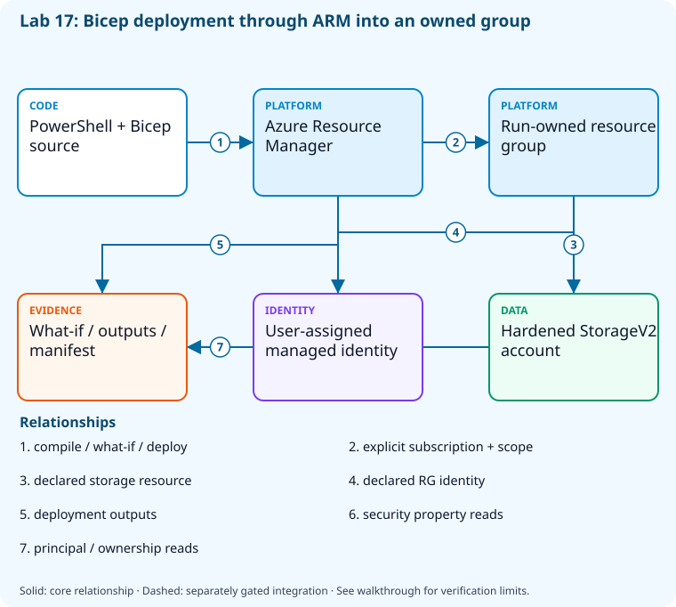

# Lab 17: Validate and deploy infrastructure with Bicep

[Previous: Lab 16](../16-feature-flags-resilience/README.md) · [Catalog](../../docs/lab-catalog.md) · [Next: Lab 18](../18-configuration-self-service/README.md)

## Scenario, role, and outcome

The team needs an infrastructure change that can be compiled, previewed, deployed, and independently checked in one owned resource group.

Learner role: **Infrastructure delivery engineer**. Outcome: Validate and deploy infrastructure with Bicep.

| Item | Value |
|---|---|
| Time | 120 minutes |
| Domain | pipelines |
| Platforms | local, azure |
| Cost | billable; explicit acknowledgement — review [current pricing and cleanup](../../docs/cost-and-cleanup.md) before cloud execution |
| Exam blueprint | July 27, 2026; sources reviewed October 16, 2026 |
| Verification | Authored and checked offline; no live Azure deployment is claimed |

Completion requires all five checkpoints, the break/fix repair, successful
independent validation, and a passing residual-resource audit. An unavailable
external prerequisite is a visible gate; it does not become a passing result.

## Architecture and service topology



PowerShell compiles Bicep and sends validate, what-if, and explicit deployment requests to ARM at the exact owned resource-group scope. The core creates a hardened StorageV2 account and user-assigned managed identity. Independent control-plane reads compare security properties and identity outputs with the local manifest; no public storage data access or SQL dependency is needed for this core.

The editable [Mermaid source](diagrams/architecture.mmd) and accessible SVG
render the same authored components and relationships. Dashed connections show
separately gated integrations. Read every boundary before executing commands. Cloud changes
stay inside the exact disposable GitHub repository, Azure DevOps project, and
Azure resource group recorded for this run. Child objects inherit that cleanup
boundary. Account creation, external integrations, and privileged organization
settings belong to [one-time bootstrap](../../docs/account-bootstrap.md).

## Objectives and checkpoints

Official objective topic IDs: `D3.5.3`, `D3.5.4`

| Checkpoint | Measurable behavior |
|---|---|
| [CP1](#task-1) | Compile the independent core infrastructure |
| [CP2](#task-2) | Validate and preview the exact owned-group changes |
| [CP3](#task-3) | Deploy the reviewed storage and identity core |
| [CP4](#task-4) | Assert the deployed security properties from service reads |
| [CP5](#task-5) | Check declared identity and capture post-deployment drift preview |

The [objective map](../../docs/objective-map.md) traces every official topic to
labs. The [Microsoft study guide](https://learn.microsoft.com/en-us/credentials/certifications/resources/study-guides/az-400)
controls authoritative objective wording and domain weighting.

## Inputs, permissions, and read-only preflight

Use PowerShell 7.4+, .NET 10, Git, GitHub CLI, Azure CLI with the Azure DevOps
extension, and the pinned repository validation dependencies. Read the
[permissions matrix](../../docs/permissions-matrix.md) and [evidence policy](../../docs/evidence-handling.md).
Supply only the accounts needed by this lab. Never put a token, connection
string, or private key into a command log, committed YAML, or progress export.

The examples run from the repository root. Choose a fresh lowercase run ID;
`demo01` is an example, not a reusable shared sandbox. Set bootstrap environment
variables for the approved GitHub owner, DevOps organization, subscription, and
region. Do not run both guided and automated lanes with the same run ID.

```powershell
$lab = './labs/17-bicep-infrastructure/scripts/cli'
& "$lab/Preflight.ps1" -RunId 'demo01'
& "$lab/Setup.ps1" -RunId 'demo01' -ProvisionOnly
# After reviewing context, permissions, cost, and cleanup:
& "$lab/Setup.ps1" -RunId 'demo01' -ProvisionOnly -Execute -AcknowledgeCost -AcknowledgeTenantChange
. "$lab/Context.ps1" -RunId 'demo01'
```

Preflight performs reads only. Provisioning creates fresh run-owned top-level
sandboxes and records their exact IDs. Context establishes `$RepoRoot`,
`$LabRoot`, `$WorkRoot`, `$RunId`, `$GhRepo`, `$AdoOrganization`, `$AdoProject`,
`$SubscriptionId`, `$Location`, and `$ResourceGroup`. A missing prerequisite or
ownership mismatch must stop execution. Local build commands may restore
packages and write ignored build output.

## Concept primer and design decisions

Bicep describes desired ARM state; what-if previews changes but does not grant approval. The core deploys isolated Storage and a managed identity; advanced main.bicep has separate SQL/network prerequisites.

## Task 1 — Compile the independent core infrastructure

<a id="task-1"></a>

Checkpoint: `CP1`

```powershell
$file=Join-Path $LabRoot 'artifacts/core.bicep';az bicep lint --file $file
 az bicep build --file $file --outfile (Join-Path $WorkRoot 'core.json')
 if($LASTEXITCODE -ne 0){throw 'Core Bicep compilation failed.'}
```

Expected state: The core template compiles to exactly a storage account and an RG-contained identity.

Positive validation:

```powershell
$t=Get-Content (Join-Path $WorkRoot 'core.json') -Raw|ConvertFrom-Json
 if(@($t.resources).Count -ne 2){throw 'Unexpected core resource count.'}
```

Negative validation:

```powershell
$t=Get-Content (Join-Path $WorkRoot 'core.json') -Raw|ConvertFrom-Json
 if('Microsoft.Sql/servers' -in $t.resources.type -or 'Microsoft.KeyVault/vaults' -in $t.resources.type){throw 'Core must not create database or soft-delete vault prerequisites.'}
```

Evidence to retain: Compiled template SHA and resource-type allowlist.

Common failure and safe retry: Use core.bicep for the independent lane; main.bicep is the advanced SQL-integrated workload.

Cleanup dependency: retain this checkpoint's evidence until final validation; remove run-owned children before their recorded parent boundary.

## Task 2 — Validate and preview the exact owned-group changes

<a id="task-2"></a>

Checkpoint: `CP2`

```powershell
$file=Join-Path $LabRoot 'artifacts/core.bicep'
 az deployment group validate --subscription $SubscriptionId --resource-group $ResourceGroup --template-file $file --parameters "labRunId=$RunId" -o json|Set-Content (Join-Path $WorkRoot 'template-validation.json')
 az deployment group what-if --subscription $SubscriptionId --resource-group $ResourceGroup --template-file $file --parameters "labRunId=$RunId" --result-format FullResourcePayloads -o json|Set-Content (Join-Path $WorkRoot 'what-if.json')
```

Expected state: ARM validates the core inputs and what-if lists only changes scoped to the run-owned group.

Positive validation:

```powershell
$w=Get-Content (Join-Path $WorkRoot 'what-if.json') -Raw|ConvertFrom-Json
 if($w.status -ne 'Succeeded'){throw 'What-if did not succeed.'}
```

Negative validation:

```powershell
$w=Get-Content (Join-Path $WorkRoot 'what-if.json') -Raw|ConvertFrom-Json
 $prefix="/subscriptions/$SubscriptionId/resourceGroups/$ResourceGroup/"
 if(@($w.changes|Where-Object { $_.resourceId -notlike "$prefix*" }).Count){throw 'What-if escaped owned scope.'}
```

Evidence to retain: What-if resource IDs/change types and validation outcome.

Common failure and safe retry: Stop on unexpected deletes, SKU changes, or scope. A successful what-if is a preview, not deployment authorization.

Cleanup dependency: retain this checkpoint's evidence until final validation; remove run-owned children before their recorded parent boundary.

## Task 3 — Deploy the reviewed storage and identity core

<a id="task-3"></a>

Checkpoint: `CP3`

```powershell
$file=Join-Path $LabRoot 'artifacts/core.bicep'
 az deployment group create --subscription $SubscriptionId --resource-group $ResourceGroup --name "core-$RunId" --mode Incremental --template-file $file --parameters "labRunId=$RunId" -o json|Set-Content (Join-Path $WorkRoot 'core-deployment.json')
 if($LASTEXITCODE -ne 0){throw 'Owned core deployment failed; retain partial-state manifest.'}
```

Expected state: The declared two-resource core reaches Succeeded inside the owned group.

Positive validation:

```powershell
$d=az deployment group show --subscription $SubscriptionId --resource-group $ResourceGroup --name "core-$RunId" -o json|ConvertFrom-Json
 if($d.properties.provisioningState -ne 'Succeeded'){throw 'Core deployment not successful.'}
```

Negative validation:

```powershell
$d=az deployment group show --subscription $SubscriptionId --resource-group $ResourceGroup --name "core-$RunId" -o json|ConvertFrom-Json
 if($d.properties.mode -ne 'Incremental'){throw 'Unexpected destructive complete-mode deployment.'}
```

Evidence to retain: Deployment ID, result, template digest, and explicit parameter/run identity.

Common failure and safe retry: Inspect deployment operations before retry; retain owned group so cleanup can recover partial resource creation.

Cleanup dependency: retain this checkpoint's evidence until final validation; remove run-owned children before their recorded parent boundary.

## Task 4 — Assert the deployed security properties from service reads

<a id="task-4"></a>

Checkpoint: `CP4`

```powershell
$d=Get-Content (Join-Path $WorkRoot 'core-deployment.json') -Raw|ConvertFrom-Json;$o=$d.properties.outputs
 az storage account show --subscription $SubscriptionId --ids $o.storageAccountId.value -o json|Set-Content (Join-Path $WorkRoot 'deployed-storage.json')
 az identity show --subscription $SubscriptionId --ids $o.identityId.value -o json|Set-Content (Join-Path $WorkRoot 'deployed-identity.json')
```

Expected state: Storage enforces HTTPS/TLS, disables shared keys/public networking, and matches the declared identity output.

Positive validation:

```powershell
$d=Get-Content (Join-Path $WorkRoot 'core-deployment.json') -Raw|ConvertFrom-Json
 $s=az storage account show --subscription $SubscriptionId --ids $d.properties.outputs.storageAccountId.value -o json|ConvertFrom-Json
 if(-not $s.enableHttpsTrafficOnly -or $s.minimumTlsVersion -ne 'TLS1_2' -or $s.tags.'az400-run' -ne $RunId){throw 'Storage hardening or ownership mismatch.'}
```

Negative validation:

```powershell
$d=Get-Content (Join-Path $WorkRoot 'core-deployment.json') -Raw|ConvertFrom-Json
 $s=az storage account show --subscription $SubscriptionId --ids $d.properties.outputs.storageAccountId.value -o json|ConvertFrom-Json
 if($s.allowSharedKeyAccess -or $s.publicNetworkAccess -ne 'Disabled'){throw 'Storage exposed a denied access path.'}
```

Evidence to retain: Queried storage settings and identity principal, with IDs redacted for sharing.

Common failure and safe retry: Control-plane assertions need no storage data access; public-network denial is intentional.

Cleanup dependency: retain this checkpoint's evidence until final validation; remove run-owned children before their recorded parent boundary.

## Task 5 — Check declared identity and capture post-deployment drift preview

<a id="task-5"></a>

Checkpoint: `CP5`

```powershell
$file=Join-Path $LabRoot 'artifacts/core.bicep'
 az deployment group what-if --subscription $SubscriptionId --resource-group $ResourceGroup --template-file $file --parameters "labRunId=$RunId" -o json|Set-Content (Join-Path $WorkRoot 'what-if-after.json')
 $d=Get-Content (Join-Path $WorkRoot 'core-deployment.json') -Raw|ConvertFrom-Json
 [ordered]@{deployment=$d.id;coreTemplateSha=(Get-FileHash (Join-Path $WorkRoot 'core.json')).Hash;advancedSqlLane='not executed; separate SQL/network prerequisites'}|ConvertTo-Json|Set-Content (Join-Path $WorkRoot 'iac-evidence.json')
```

Expected state: Independent identity reads agree with outputs, and post-deployment what-if is available for drift review.

Positive validation:

```powershell
$d=Get-Content (Join-Path $WorkRoot 'core-deployment.json') -Raw|ConvertFrom-Json
 $m=az identity show --subscription $SubscriptionId --ids $d.properties.outputs.identityId.value -o json|ConvertFrom-Json
 if($m.principalId -ne $d.properties.outputs.identityPrincipalId.value -or $m.tags.'az400-run' -ne $RunId){throw 'Identity output/ownership mismatch.'}
```

Negative validation:

```powershell
$w=Get-Content (Join-Path $WorkRoot 'what-if-after.json') -Raw|ConvertFrom-Json
 if(@($w.changes|Where-Object changeType -eq 'Delete').Count){throw 'Unexpected destructive post-deployment drift.'}
```

Evidence to retain: Before/after what-if, output assertions, and explicit advanced-lane status.

Common failure and safe retry: Investigate noisy provider defaults separately from real drift; never treat all Modify output as harmless.

Cleanup dependency: retain this checkpoint's evidence until final validation; remove run-owned children before their recorded parent boundary.

## Deterministic break/fix

Inject this fault only in the recorded sandbox or local run directory.

```powershell
$d=Get-Content (Join-Path $WorkRoot 'core-deployment.json') -Raw|ConvertFrom-Json
az tag update --subscription $SubscriptionId --resource-id $d.properties.outputs.storageAccountId.value --operation Merge --tags az400-run=wrong-run -o none
```

Diagnose the precise difference:

```powershell
$d=Get-Content (Join-Path $WorkRoot 'core-deployment.json') -Raw|ConvertFrom-Json
az storage account show --subscription $SubscriptionId --ids $d.properties.outputs.storageAccountId.value --query tags -o json
```

Repair, then repeat the affected checkpoint validation:

```powershell
az deployment group create --subscription $SubscriptionId --resource-group $ResourceGroup --name "repair-$RunId" --template-file (Join-Path $LabRoot 'artifacts/core.bicep') --parameters "labRunId=$RunId" -o none
```

## Optional job-style challenge

Execute advanced main.bicep only with separately approved Entra SQL/database users, network prerequisites, federation, pricing, and a vault soft-delete residual audit; no prerequisite means this advanced integration stays partial.

## Final validation and result interpretation

```powershell
& './labs/17-bicep-infrastructure/scripts/cli/Validate.ps1' -RunId 'demo01'
```

A complete result requires five passing read-only assertions. Pending hosted runs, missing licensed features, and unexecuted integration challenges remain visible. Review `validation.json`; a command exiting successfully is not enough if the asserted behavior is absent.

## Troubleshooting

- **401/403:** inspect the explicit account/project/repository scope and required role; do not broaden a token reflexively.
- **Resource or artifact missing:** confirm the exact run ID and prerequisite checkpoint; retry reads after eventual consistency.
- **Unsupported SKU/runtime/tool:** consult the specific current source, record the gate, and obtain approval before changing cost or architecture.
- **Validation mismatch:** inspect the positive and negative assertions separately, repair the named fault, and rerun validation.
- **Ownership refusal:** stop; never edit a manifest to claim an unrelated resource.

## Cleanup and residual checks

```powershell
& './labs/17-bicep-infrastructure/scripts/cli/Cleanup.ps1' -RunId 'demo01'
# Review the exact owned-object deletion plan first.
& './labs/17-bicep-infrastructure/scripts/cli/Cleanup.ps1' -RunId 'demo01' -Execute
```

Cleanup must verify ownership, delete only recorded sandbox objects in dependency order, and prove parent/child absence. Retain `run.json`, `validation.json`, and `cleanup.json` locally until the audit passes. Soft-deleted or deliberately retained items must remain reported. Never purge a shared vault or delete an account, organization, or pre-existing service connection to finish a lab.

## Exam debrief and assessment

Explain why each checkpoint's denied path matters, which scope authorizes it, what evidence proves it, and how it is reversed. Complete the [50-question assessment](QUESTIONS.md), then review [rationales](ANSWERS.md) and repeat weak checkpoints.

## Microsoft and platform sources

- [Primary source 1](https://learn.microsoft.com/en-us/azure/azure-resource-manager/bicep/overview) — reviewed 2026-10-16.
- [Primary source 2](https://learn.microsoft.com/en-us/azure/azure-resource-manager/bicep/deploy-what-if) — reviewed 2026-10-16.
- [Primary source 3](https://learn.microsoft.com/en-us/azure/storage/common/storage-require-secure-transfer) — reviewed 2026-10-16.

## Lifecycle scripts and worked solution

Use `scripts/cli/Preflight.ps1`, `Setup.ps1`, `Validate.ps1`, `Cleanup.ps1`, and `Context.ps1` from this lab folder. Setup and cleanup preview until `-Execute`; `-ProvisionOnly` creates only fresh ownership-tracked containers. The [worked solution](solution/README.md) lists expected results and repair reasoning.
