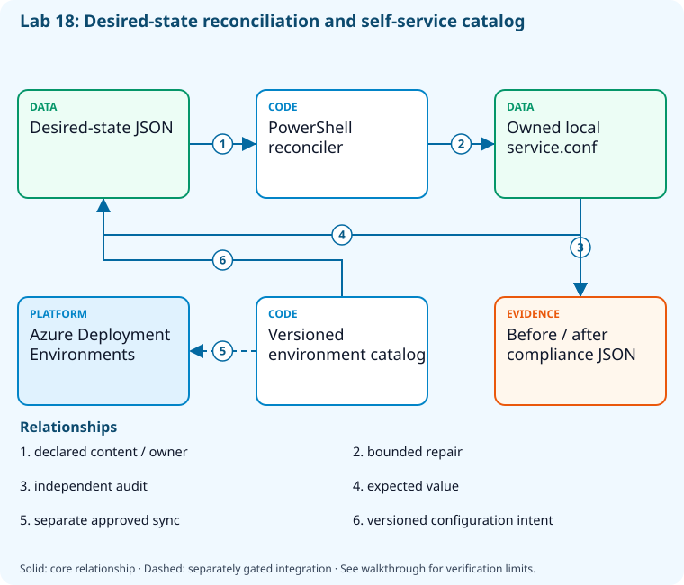

# Lab 18: Configure machines and on-demand environments

[Previous: Lab 17](../17-bicep-infrastructure/README.md) · [Catalog](../../docs/lab-catalog.md) · [Next: Lab 19](../19-pipeline-optimization/README.md)

## Scenario, role, and outcome

A service setting drifts after manual edits and teams request environments through tickets. Build an auditable reconciliation and a versioned self-service contract.

Learner role: **Configuration platform engineer**. Outcome: Configure machines and on-demand environments.

| Item | Value |
|---|---|
| Time | 120 minutes |
| Domain | pipelines |
| Platforms | local |
| Cost | none — review [current pricing and cleanup](../../docs/cost-and-cleanup.md) before cloud execution |
| Exam blueprint | July 27, 2026; sources reviewed October 16, 2026 |
| Verification | Authored and checked offline; no live Azure deployment is claimed |

Completion requires all five checkpoints, the break/fix repair, successful
independent validation, and a passing residual-resource audit. An unavailable
external prerequisite is a visible gate; it does not become a passing result.

## Architecture and service topology



The desired-state document gives a local reconciler an exact owned path and target value. Audit reports preserve both drift and repaired compliance. A separate versioned catalog describes the self-service environment contract; synchronizing it with Azure Deployment Environments requires the approved dev-center/project bootstrap and is not claimed by the local reconciliation exercise.

The editable [Mermaid source](diagrams/architecture.mmd) and accessible SVG
render the same authored components and relationships. Dashed connections show
separately gated integrations. Read every boundary before executing commands. Cloud changes
stay inside the exact disposable GitHub repository, Azure DevOps project, and
Azure resource group recorded for this run. Child objects inherit that cleanup
boundary. Account creation, external integrations, and privileged organization
settings belong to [one-time bootstrap](../../docs/account-bootstrap.md).

## Objectives and checkpoints

Official objective topic IDs: `D3.5.1`, `D3.5.2`, `D3.5.4`, `D3.5.5`

| Checkpoint | Measurable behavior |
|---|---|
| [CP1](#task-1) | Author a desired-state document for local configuration |
| [CP2](#task-2) | Audit configuration drift before repair |
| [CP3](#task-3) | Reconcile only the declared local resource |
| [CP4](#task-4) | Validate a self-service environment catalog contract |
| [CP5](#task-5) | Compare legacy and supported configuration paths |

The [objective map](../../docs/objective-map.md) traces every official topic to
labs. The [Microsoft study guide](https://learn.microsoft.com/en-us/credentials/certifications/resources/study-guides/az-400)
controls authoritative objective wording and domain weighting.

## Inputs, permissions, and read-only preflight

Use PowerShell 7.4+, .NET 10, Git, GitHub CLI, Azure CLI with the Azure DevOps
extension, and the pinned repository validation dependencies. Read the
[permissions matrix](../../docs/permissions-matrix.md) and [evidence policy](../../docs/evidence-handling.md).
Supply only the accounts needed by this lab. Never put a token, connection
string, or private key into a command log, committed YAML, or progress export.

The examples run from the repository root. Choose a fresh lowercase run ID;
`demo01` is an example, not a reusable shared sandbox. Set bootstrap environment
variables for the approved GitHub owner, DevOps organization, subscription, and
region. Do not run both guided and automated lanes with the same run ID.

```powershell
$lab = './labs/18-configuration-self-service/scripts/cli'
& "$lab/Preflight.ps1" -RunId 'demo01'
& "$lab/Setup.ps1" -RunId 'demo01' -ProvisionOnly
# After reviewing context, permissions, cost, and cleanup:
& "$lab/Setup.ps1" -RunId 'demo01' -ProvisionOnly -Execute -AcknowledgeCost -AcknowledgeTenantChange
. "$lab/Context.ps1" -RunId 'demo01'
```

Preflight performs reads only. Provisioning creates fresh run-owned top-level
sandboxes and records their exact IDs. Context establishes `$RepoRoot`,
`$LabRoot`, `$WorkRoot`, `$RunId`, `$GhRepo`, `$AdoOrganization`, `$AdoProject`,
`$SubscriptionId`, `$Location`, and `$ResourceGroup`. A missing prerequisite or
ownership mismatch must stop execution. Local build commands may restore
packages and write ignored build output.

## Concept primer and design decisions

Resource provisioning, guest configuration, and self-service orchestration are different control planes. Legacy Automation State Configuration remains dated syllabus context; use current Machine Configuration guidance.

## Task 1 — Author a desired-state document for local configuration

<a id="task-1"></a>

Checkpoint: `CP1`

```powershell
$desired=[ordered]@{schemaVersion='1.0';files=@(@{path='service.conf';content='mode=training'});compliance='audit-and-reconcile';owner=$RunId}
 $desired|ConvertTo-Json -Depth 5|Set-Content (Join-Path $WorkRoot 'desired-state.json')
 Copy-Item (Join-Path $LabRoot 'artifacts/configuration.catalog.yaml') (Join-Path $WorkRoot 'configuration.catalog.yaml')
```

Expected state: Desired state describes content and ownership independently of an imperative deployment script.

Positive validation:

```powershell
$d=Get-Content (Join-Path $WorkRoot 'desired-state.json') -Raw|ConvertFrom-Json
 if($d.owner -ne $RunId -or $d.files[0].content -ne 'mode=training'){throw 'Desired state contract invalid.'}
```

Negative validation:

```powershell
$d=Get-Content (Join-Path $WorkRoot 'desired-state.json') -Raw|ConvertFrom-Json
 if($d.files[0].path -match '\.\.|^[A-Za-z]:|^/'){throw 'Desired file escaped the local sandbox.'}
```

Evidence to retain: Desired-state document and resource ownership.

Common failure and safe retry: Choose Machine Configuration for Azure policy-backed auditing; use Bicep/ARM for resource state rather than conflating the layers.

Cleanup dependency: retain this checkpoint's evidence until final validation; remove run-owned children before their recorded parent boundary.

## Task 2 — Audit configuration drift before repair

<a id="task-2"></a>

Checkpoint: `CP2`

```powershell
$target=Join-Path $WorkRoot 'service.conf';'mode=incorrect'|Set-Content $target
 $d=Get-Content (Join-Path $WorkRoot 'desired-state.json') -Raw|ConvertFrom-Json
 [ordered]@{resource='service.conf';expected=$d.files[0].content;actual=(Get-Content $target);compliant=((Get-Content $target) -eq $d.files[0].content)}|ConvertTo-Json|Set-Content (Join-Path $WorkRoot 'drift-before.json')
```

Expected state: Audit identifies the deterministic wrong value without repairing it.

Positive validation:

```powershell
$r=Get-Content (Join-Path $WorkRoot 'drift-before.json') -Raw|ConvertFrom-Json
 if($r.compliant -or $r.actual -ne 'mode=incorrect'){throw 'Drift fixture not detected.'}
```

Negative validation:

```powershell
$r=Get-Content (Join-Path $WorkRoot 'drift-before.json') -Raw|ConvertFrom-Json
 if($r.actual -eq $r.expected){throw 'Noncompliance record lacks an actual difference.'}
```

Evidence to retain: Expected, actual, and compliance values.

Common failure and safe retry: Keep audit and modify responsibilities separate; do not repair before retaining evidence.

Cleanup dependency: retain this checkpoint's evidence until final validation; remove run-owned children before their recorded parent boundary.

## Task 3 — Reconcile only the declared local resource

<a id="task-3"></a>

Checkpoint: `CP3`

```powershell
$d=Get-Content (Join-Path $WorkRoot 'desired-state.json') -Raw|ConvertFrom-Json
 $target=Join-Path $WorkRoot $d.files[0].path
 $d.files[0].content|Set-Content $target
 [ordered]@{resource='service.conf';compliant=((Get-Content $target) -eq $d.files[0].content)}|ConvertTo-Json|Set-Content (Join-Path $WorkRoot 'drift-after.json')
```

Expected state: Reconciliation restores the declared content and proves compliance.

Positive validation:

```powershell
$r=Get-Content (Join-Path $WorkRoot 'drift-after.json') -Raw|ConvertFrom-Json
 if(-not $r.compliant){throw 'Configuration remains drifted.'}
```

Negative validation:

```powershell
if((Get-Content (Join-Path $WorkRoot 'service.conf')) -ne 'mode=training'){throw 'Unexpected reconciled setting.'}
```

Evidence to retain: Before/after reports and exact managed file.

Common failure and safe retry: Use the desired-state value and owned path; never recursively repair unrelated directories.

Cleanup dependency: retain this checkpoint's evidence until final validation; remove run-owned children before their recorded parent boundary.

## Task 4 — Validate a self-service environment catalog contract

<a id="task-4"></a>

Checkpoint: `CP4`

```powershell
$t=Get-Content (Join-Path $WorkRoot 'configuration.catalog.yaml') -Raw
 [ordered]@{catalogDigest=(Get-FileHash (Join-Path $WorkRoot 'configuration.catalog.yaml')).Hash;environment='disposable';subscription=$SubscriptionId;resourceGroup=$ResourceGroup;approvalRequired=$true;provisioned=$false}|ConvertTo-Json|Set-Content (Join-Path $WorkRoot 'self-service-contract.json')
```

Expected state: The catalog is versioned and constrained to an approved target boundary.

Positive validation:

```powershell
$c=Get-Content (Join-Path $WorkRoot 'self-service-contract.json') -Raw|ConvertFrom-Json
 if($c.resourceGroup -ne $ResourceGroup -or -not $c.approvalRequired){throw 'Self-service boundary/approval absent.'}
```

Negative validation:

```powershell
$c=Get-Content (Join-Path $WorkRoot 'self-service-contract.json') -Raw|ConvertFrom-Json
 if($c.provisioned){throw 'Catalog validation cannot claim an environment deployment.'}
```

Evidence to retain: Catalog digest, target scope, and separate platform prerequisites.

Common failure and safe retry: A real Deployment Environments exercise requires approved dev center/project, catalog synchronization, environment type, and deployment identity.

Cleanup dependency: retain this checkpoint's evidence until final validation; remove run-owned children before their recorded parent boundary.

## Task 5 — Compare legacy and supported configuration paths

<a id="task-5"></a>

Checkpoint: `CP5`

```powershell
$decision=[ordered]@{legacy='Azure Automation State Configuration';legacyStatus='Retirement announced; verify current lifecycle before use';modern='Azure Machine Configuration';resourcePlane='Bicep/ARM';selfService='Azure Deployment Environments';verified='2026-10-16';legacyDeploymentAllowed=$false}
 $decision|ConvertTo-Json|Set-Content (Join-Path $WorkRoot 'configuration-decision.json')
```

Expected state: The syllabus topic is preserved as dated context with a supported modernization route.

Positive validation:

```powershell
$d=Get-Content (Join-Path $WorkRoot 'configuration-decision.json') -Raw|ConvertFrom-Json
 if($d.modern -ne 'Azure Machine Configuration' -or $d.verified -ne '2026-10-16'){throw 'Modernization decision missing.'}
```

Negative validation:

```powershell
$d=Get-Content (Join-Path $WorkRoot 'configuration-decision.json') -Raw|ConvertFrom-Json
 if($d.legacyDeploymentAllowed){throw 'Legacy context must not silently enable retired infrastructure.'}
```

Evidence to retain: Dated source comparison and migration responsibilities.

Common failure and safe retry: Verify current lifecycle guidance before planning production configuration changes.

Cleanup dependency: retain this checkpoint's evidence until final validation; remove run-owned children before their recorded parent boundary.

## Deterministic break/fix

Inject this fault only in the recorded sandbox or local run directory.

```powershell
Set-Content (Join-Path $WorkRoot 'service.conf') 'mode=drifted'
```

Diagnose the precise difference:

```powershell
$d=Get-Content (Join-Path $WorkRoot 'desired-state.json') -Raw|ConvertFrom-Json;[pscustomobject]@{expected=$d.files[0].content;actual=(Get-Content (Join-Path $WorkRoot 'service.conf'))}
```

Repair, then repeat the affected checkpoint validation:

```powershell
$d=Get-Content (Join-Path $WorkRoot 'desired-state.json') -Raw|ConvertFrom-Json;$d.files[0].content|Set-Content (Join-Path $WorkRoot 'service.conf')
```

## Optional job-style challenge

Publish a versioned catalog into a separately approved disposable Deployment Environments project and prove resource ownership, deletion, and policy compliance.

## Final validation and result interpretation

```powershell
& './labs/18-configuration-self-service/scripts/cli/Validate.ps1' -RunId 'demo01'
```

A complete result requires five passing read-only assertions. Pending hosted runs, missing licensed features, and unexecuted integration challenges remain visible. Review `validation.json`; a command exiting successfully is not enough if the asserted behavior is absent.

## Troubleshooting

- **401/403:** inspect the explicit account/project/repository scope and required role; do not broaden a token reflexively.
- **Resource or artifact missing:** confirm the exact run ID and prerequisite checkpoint; retry reads after eventual consistency.
- **Unsupported SKU/runtime/tool:** consult the specific current source, record the gate, and obtain approval before changing cost or architecture.
- **Validation mismatch:** inspect the positive and negative assertions separately, repair the named fault, and rerun validation.
- **Ownership refusal:** stop; never edit a manifest to claim an unrelated resource.

## Cleanup and residual checks

```powershell
& './labs/18-configuration-self-service/scripts/cli/Cleanup.ps1' -RunId 'demo01'
# Review the exact owned-object deletion plan first.
& './labs/18-configuration-self-service/scripts/cli/Cleanup.ps1' -RunId 'demo01' -Execute
```

Cleanup must verify ownership, delete only recorded sandbox objects in dependency order, and prove parent/child absence. Retain `run.json`, `validation.json`, and `cleanup.json` locally until the audit passes. Soft-deleted or deliberately retained items must remain reported. Never purge a shared vault or delete an account, organization, or pre-existing service connection to finish a lab.

## Exam debrief and assessment

Explain why each checkpoint's denied path matters, which scope authorizes it, what evidence proves it, and how it is reversed. Complete the [50-question assessment](QUESTIONS.md), then review [rationales](ANSWERS.md) and repeat weak checkpoints.

## Microsoft and platform sources

- [Primary source 1](https://learn.microsoft.com/en-us/azure/governance/machine-configuration/overview) — reviewed 2026-10-16.
- [Primary source 2](https://learn.microsoft.com/en-us/azure/deployment-environments/overview-what-is-azure-deployment-environments) — reviewed 2026-10-16.
- [Primary source 3](https://learn.microsoft.com/en-us/azure/automation/automation-dsc-overview) — reviewed 2026-10-16.

## Lifecycle scripts and worked solution

Use `scripts/cli/Preflight.ps1`, `Setup.ps1`, `Validate.ps1`, `Cleanup.ps1`, and `Context.ps1` from this lab folder. Setup and cleanup preview until `-Execute`; `-ProvisionOnly` creates only fresh ownership-tracked containers. The [worked solution](solution/README.md) lists expected results and repair reasoning.
