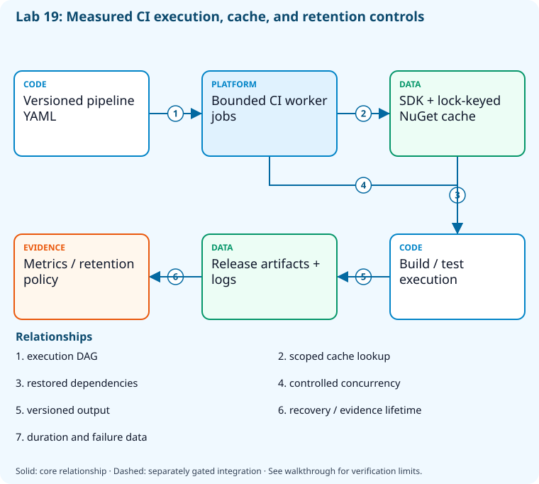

# Lab 19: Improve pipeline performance and retention

[Previous: Lab 18](../18-configuration-self-service/README.md) · [Catalog](../../docs/lab-catalog.md) · [Next: Lab 20](../20-identity-permissions/README.md)

## Scenario, role, and outcome

Build duration and retained artifacts are increasing without a measured explanation. Establish comparable observations and a bounded optimization/retention decision.

Learner role: **Pipeline operations engineer**. Outcome: Improve pipeline performance and retention.

| Item | Value |
|---|---|
| Time | 120 minutes |
| Domain | pipelines |
| Platforms | local |
| Cost | none — review [current pricing and cleanup](../../docs/cost-and-cleanup.md) before cloud execution |
| Exam blueprint | July 27, 2026; sources reviewed October 16, 2026 |
| Verification status | offline-tested |
| Verification scope | All five checkpoint commands, final validators and named retention fault/repair passed with real .NET builds, lockfile hashing, owned local retention and Python YAML conversion. Timing is a single local observation; the DAG duration model is synthetic. |

Completion requires all five checkpoints, the break/fix repair, successful
independent validation, and a passing residual-resource audit. An unavailable
external prerequisite is a visible gate; it does not become a passing result.

## Architecture and service topology



Pipeline YAML defines bounded job concurrency, while SDK/lock/OS-aware cache keys constrain dependency reuse. Real local build measurements feed the performance review, and artifacts/logs receive distinct retention decisions. The last compatible release and security evidence remain recoverable; the diagram represents the intended CI design rather than an unmeasured speedup guarantee.

The editable [Mermaid source](diagrams/architecture.mmd) and accessible SVG
render the same authored components and relationships. Dashed connections show
separately gated integrations. Read every boundary before executing commands. Cloud changes
stay inside the exact disposable GitHub repository, Azure DevOps project, and
Azure resource group recorded for this run. Child objects inherit that cleanup
boundary. Account creation, external integrations, and privileged organization
settings belong to [one-time bootstrap](../../docs/account-bootstrap.md).

## Objectives and checkpoints

Coverage levels describe the intended learning evidence: **explained** means reasoned
understanding, **practiced** means an observable isolated skill, and **integrated**
means skills connected across a delivery boundary. These labels are curriculum
claims, not execution status. Verification above records what authors actually ran.

Official objective topic IDs: `D1.2.6`, `D3.6.1`, `D3.6.2`, `D3.6.3`, `D3.6.4`, `D3.6.5`

| Checkpoint | Measurable behavior |
|---|---|
| [CP1](#task-1) | Measure a real build baseline |
| [CP2](#task-2) | Measure an incremental build without restoring again |
| [CP3](#task-3) | Measure dependency cache invalidation and critical path |
| [CP4](#task-4) | Enforce retention against owned artifact fixtures |
| [CP5](#task-5) | Convert a classic task fixture to YAML and prove parity |

The [objective map](../../docs/objective-map.md) traces every official topic to
labs. The [Microsoft study guide](https://learn.microsoft.com/en-us/credentials/certifications/resources/study-guides/az-400)
controls authoritative objective wording and domain weighting.

## Inputs, permissions, and read-only preflight

Use PowerShell 7.4+, .NET 10, Git, GitHub CLI, Azure CLI with the Azure DevOps
extension, and the pinned repository validation dependencies. Read the
[permissions matrix](../../docs/permissions-matrix.md) and [evidence policy](../../docs/evidence-handling.md).
Supply only the accounts needed by this lab. Never put a token, connection
string, or private key into a command log, committed YAML, or progress export.

The examples run from the repository root. Choose a fresh lowercase run ID;
`demo01` is an example, not a reusable shared sandbox. Set bootstrap environment
variables for the approved GitHub owner, DevOps organization, subscription, and
region. Do not run both guided and automated lanes with the same run ID.

```powershell
$lab = './labs/19-pipeline-optimization/scripts/cli'
& "$lab/Preflight.ps1" -RunId 'demo01'
& "$lab/Setup.ps1" -RunId 'demo01' -ProvisionOnly
# After reviewing context, permissions, cost, and cleanup:
& "$lab/Setup.ps1" -RunId 'demo01' -ProvisionOnly -Execute -AcknowledgeCost -AcknowledgeTenantChange
. "$lab/Context.ps1" -RunId 'demo01'
```

Preflight performs reads only. Provisioning creates fresh run-owned top-level
sandboxes and records their exact IDs. Context establishes `$RepoRoot`,
`$LabRoot`, `$WorkRoot`, `$RunId`, `$GhRepo`, `$AdoOrganization`, `$AdoProject`,
`$SubscriptionId`, `$Location`, and `$ResourceGroup`. A missing prerequisite or
ownership mismatch must stop execution. Local build commands may restore
packages and write ignored build output.

## Concept primer and design decisions

Critical-path time and total compute minutes differ. Cache keys must protect correctness; retention must preserve rollback artifacts and evidence, and YAML migration must retain external gates.

One timing observation can reveal a regression but cannot establish a reliable speedup. Compare repeated cold/warm builds under the same dependency inputs before optimizing. Categorize failures as infrastructure, dependency, test or deployment problems before adding retries; repeated test failures are not transient network errors.

Cache keys must change with dependencies, SDK and OS. Parallelism shortens a graph only where dependencies allow concurrent jobs; critical-path time differs from total compute consumption. The fixture calculates this distinction explicitly. Retention then deletes eligible local artifacts while preserving the current and last compatible release; never apply an unreviewed retention selector to published packages.

## Task 1 — Measure a real build baseline

<a id="task-1"></a>

Checkpoint: `CP1`

| Objective | Evidence level | Observation and limits |
|---|---|---|
| `D3.6.1` | explained | Review pipeline health/retry classification; synthetic reports do not configure a live alert. |

```powershell
$sw=[Diagnostics.Stopwatch]::StartNew();dotnet build (Join-Path $RepoRoot 'samples/DevOps.slnx') --configuration Release;$sw.Stop()
 if($LASTEXITCODE -ne 0){throw 'Baseline build failed.'}
 [ordered]@{elapsedMilliseconds=$sw.ElapsedMilliseconds;configuration='Release';success=$true}|ConvertTo-Json|Set-Content (Join-Path $WorkRoot 'baseline.json')
```

Expected state: A measured successful build establishes one local baseline.

Positive validation:

```powershell
$b=Get-Content (Join-Path $WorkRoot 'baseline.json') -Raw|ConvertFrom-Json
 if(-not $b.success -or $b.elapsedMilliseconds -le 0){throw 'Invalid baseline measurement.'}
```

Negative validation:

```powershell
$b=Get-Content (Join-Path $WorkRoot 'baseline.json') -Raw|ConvertFrom-Json
 if($b.configuration -ne 'Release'){throw 'Benchmark configuration mismatch.'}
```

Evidence to retain: Elapsed time and machine/tool context; one run is not a performance guarantee.

Common failure and safe retry: Fix failures before benchmarking and compare the same configuration and warm/cold conditions.

Cleanup dependency: retain this checkpoint's evidence until final validation; remove run-owned children before their recorded parent boundary.

## Task 2 — Measure an incremental build without restoring again

<a id="task-2"></a>

Checkpoint: `CP2`

Foundation/supporting task; no additional exam-objective coverage is claimed.

```powershell
$sw=[Diagnostics.Stopwatch]::StartNew();dotnet build (Join-Path $RepoRoot 'samples/DevOps.slnx') --configuration Release --no-restore;$sw.Stop()
 if($LASTEXITCODE -ne 0){throw 'Incremental build failed.'}
 [ordered]@{elapsedMilliseconds=$sw.ElapsedMilliseconds;restoreSkipped=$true;claim='single local observation'}|ConvertTo-Json|Set-Content (Join-Path $WorkRoot 'incremental.json')
```

Expected state: A second measurement isolates avoided restore work without promising a speedup.

Positive validation:

```powershell
$m=Get-Content (Join-Path $WorkRoot 'incremental.json') -Raw|ConvertFrom-Json
 if(-not $m.restoreSkipped -or $m.elapsedMilliseconds -le 0){throw 'Incremental measurement missing.'}
```

Negative validation:

```powershell
$m=Get-Content (Join-Path $WorkRoot 'incremental.json') -Raw|ConvertFrom-Json
 if($m.claim -match 'guaranteed faster'){throw 'Unsupported optimization claim.'}
```

Evidence to retain: Both observations and controlled differences.

Common failure and safe retry: Retain locked restore in a prior job and key caches by lock files, SDK, OS, and architecture.

Cleanup dependency: retain this checkpoint's evidence until final validation; remove run-owned children before their recorded parent boundary.

## Task 3 — Measure dependency cache invalidation and critical path

<a id="task-3"></a>

Checkpoint: `CP3`

| Objective | Evidence level | Observation and limits |
|---|---|---|
| `D1.2.6` | practiced | Compute the explicit synthetic DAG critical path and compare it with serial execution. |
| `D3.6.2` | practiced | Change a real lockfile fixture and prove the cache key changes while the original lockfile stays untouched. |
| `D3.6.3` | practiced | Calculate bounded two-way parallelism for the supplied dependency graph; no hosted timing benchmark is claimed. |

```powershell
$lock=Get-ChildItem (Join-Path $RepoRoot 'samples') -Filter packages.lock.json -Recurse|Where-Object FullName -NotMatch '[\/](bin|obj)[\/]'|Select-Object -First 1
$copy=Join-Path $WorkRoot 'cache-input.lock.json';Copy-Item $lock.FullName $copy
$sdk=dotnet --version;$before="$([Environment]::OSVersion.Platform)-$sdk-$((Get-FileHash $copy).Hash)"
Add-Content $copy ' '
$after="$([Environment]::OSVersion.Platform)-$sdk-$((Get-FileHash $copy).Hash)"
$jobs=@(@{name='build';seconds=40;needs=@()},@{name='test';seconds=30;needs=@('build')},@{name='lint';seconds=20;needs=@('build')})
[ordered]@{before=$before;after=$after;invalidated=($before -cne $after);serialSeconds=90;criticalPathSeconds=70;maximumParallel=2}|ConvertTo-Json|Set-Content (Join-Path $WorkRoot 'cache-analysis.json')
Copy-Item (Join-Path $LabRoot 'artifacts/optimized-ci.yml') (Join-Path $WorkRoot 'optimized-ci.yml')
```

Expected state: A changed copied lock file invalidates its SDK/OS/hash key; the explicit synthetic DAG has70seconds critical path versus90seconds serial work.

Positive validation:

```powershell
$r=Get-Content (Join-Path $WorkRoot 'cache-analysis.json') -Raw|ConvertFrom-Json
if(-not $r.invalidated -or $r.criticalPathSeconds -ne 70){throw 'Cache/critical-path analysis incorrect.'}
```

Negative validation:

```powershell
$r=Get-Content (Join-Path $WorkRoot 'cache-analysis.json') -Raw|ConvertFrom-Json
if($r.before -ceq $r.after -or $r.maximumParallel -gt 2){throw 'Invalid cache reuse or unbounded workers.'}
```

Evidence to retain: Changed input hashes, before/after cache keys and explicitly synthetic timing assumptions.

Common failure and safe retry: Never reuse a cache key after dependency inputs change. Distinguish elapsed critical-path time from total compute minutes.

Cleanup dependency: retain this checkpoint's evidence until final validation; remove run-owned children before their recorded parent boundary.

## Task 4 — Enforce retention against owned artifact fixtures

<a id="task-4"></a>

Checkpoint: `CP4`

| Objective | Evidence level | Observation and limits |
|---|---|---|
| `D3.6.4` | practiced | Apply retention selection to owned local fixture artifacts and prove baseline/current survival. |

```powershell
$retention=[ordered]@{prLogsDays=7;releaseArtifactsDays=30;securityEvidenceDays=90;keepLastGoodRelease=$true;deletePublishedPackagesAutomatically=$false}
$retention|ConvertTo-Json|Set-Content (Join-Path $WorkRoot 'retention.json')
$root=Join-Path $WorkRoot 'artifact-fixtures';New-Item -ItemType Directory -Force $root|Out-Null
$items=@(@{name='expired-pr.log';ageDays=20;kind='pr';keep=$false},@{name='last-good.zip';ageDays=60;kind='release';keep=$true},@{name='current.zip';ageDays=1;kind='release';keep=$false})
foreach($item in $items){Set-Content (Join-Path $root $item.name) "synthetic artifact $($item.name)"}
$deleted=@();foreach($item in $items){$limit=if($item.kind -eq 'pr'){$retention.prLogsDays}else{$retention.releaseArtifactsDays};if(-not $item.keep -and $item.ageDays -gt $limit){Remove-Item -LiteralPath (Join-Path $root $item.name);$deleted+=$item.name}}
[ordered]@{fixtureOnly=$true;deleted=$deleted;retained=@(Get-ChildItem $root -File|ForEach-Object Name)}|ConvertTo-Json|Set-Content (Join-Path $WorkRoot 'retention-result.json')
```

Expected state: Only the expired owned PR log is deleted; the last known-good and current release artifacts remain.

Positive validation:

```powershell
$r=Get-Content (Join-Path $WorkRoot 'retention-result.json') -Raw|ConvertFrom-Json
if('last-good.zip' -notin $r.retained -or -not (Test-Path (Join-Path $WorkRoot 'artifact-fixtures/current.zip'))){throw 'Recovery/current artifact lost.'}
```

Negative validation:

```powershell
if(Test-Path (Join-Path $WorkRoot 'artifact-fixtures/expired-pr.log')){throw 'Expired fixture survived retention.'}
$r=Get-Content (Join-Path $WorkRoot 'retention.json') -Raw|ConvertFrom-Json
if(-not $r.keepLastGoodRelease){throw 'Rollback retention guard disabled.'}
```

Evidence to retain: Fixture age/ownership inputs and retained/deleted inventory.

Common failure and safe retry: Real provider retention needs reviewed ownership and consumer dependencies. This fixture proves selection and last-good exclusion before remote deletion.

Cleanup dependency: retain this checkpoint's evidence until final validation; remove run-owned children before their recorded parent boundary.

## Task 5 — Convert a classic task fixture to YAML and prove parity

<a id="task-5"></a>

Checkpoint: `CP5`

| Objective | Evidence level | Observation and limits |
|---|---|---|
| `D3.6.5` | practiced | Convert a classic-task fixture into parsed YAML and compare executable command order. |

```powershell
$classic=[ordered]@{fixtureOnly=$true;tasks=@(@{name='restore';command='dotnet restore samples/DevOps.slnx --locked-mode'},@{name='test';command='dotnet test samples/DevOps.slnx --configuration Release --no-restore'},@{name='publish';command='dotnet publish samples/DevOps.Api/DevOps.Api.csproj --configuration Release'});externalChecks=@('environment approval','service-connection authorization')}
$classic|ConvertTo-Json -Depth 8|Set-Content (Join-Path $WorkRoot 'classic-pipeline.json')
@'
import json,sys,yaml
from pathlib import Path
r=Path(sys.argv[1]);old=json.loads((r/'classic-pipeline.json').read_text());new={'trigger':'none','pool':{'vmImage':'ubuntu-24.04'},'steps':[{'script':t['command'],'displayName':t['name']} for t in old['tasks']]}
(r/'migrated-pipeline.yml').write_text(yaml.safe_dump(new,sort_keys=False))
back=yaml.safe_load((r/'migrated-pipeline.yml').read_text())
assert [s['script'] for s in back['steps']]==[t['command'] for t in old['tasks']]
print(json.dumps({'taskOrder':[s['displayName'] for s in back['steps']],'parity':True,'externalChecksStillRequired':old['externalChecks']}))
'@|python - $WorkRoot|Set-Content (Join-Path $WorkRoot 'migration-result.json')
if($LASTEXITCODE -ne 0){throw 'Task migration parity failed.'}
```

Expected state: A real YAML file retains task commands/order and lists protected-resource checks that task conversion does not migrate.

Positive validation:

```powershell
$r=Get-Content (Join-Path $WorkRoot 'migration-result.json') -Raw|ConvertFrom-Json
if(-not $r.parity -or ($r.taskOrder -join ',') -ne 'restore,test,publish'){throw 'Migration changed task semantics.'}
```

Negative validation:

```powershell
$r=Get-Content (Join-Path $WorkRoot 'migration-result.json') -Raw|ConvertFrom-Json
if('environment approval' -notin $r.externalChecksStillRequired){throw 'Migration omitted resource approvals.'}
```

Evidence to retain: Classic fixture, generated YAML, task parity and remaining external checks.

Common failure and safe retry: This offline conversion does not authorize provider cutover. Compare nondeploying runs and preserve resource checks before disabling a classic trigger.

Cleanup dependency: retain this checkpoint's evidence until final validation; remove run-owned children before their recorded parent boundary.

## Deterministic break/fix

Run the journaled operation after all five checkpoints. It proves the healthy assertion, injects the named fault, requires its rejection, repairs it, and proves health again. Provider doubles used in author tests are not live enforcement evidence.

```powershell
& './labs/19-pipeline-optimization/scripts/cli/BreakFix.ps1' -RunId 'demo01' -Execute
```

Expected rejection marker: `AZ400-L19-FAULT`. The assertion must catch the changed behavior, not merely an exception from an unavailable CLI.

Inspect the independent assertion:

```powershell
$r=Get-Content (Join-Path $WorkRoot 'retention.json') -Raw|ConvertFrom-Json
if(-not $r.keepLastGoodRelease -or $r.releaseArtifactsDays -lt $r.prLogsDays){throw 'AZ400-L19-FAULT'}
```

Fault trigger (executed by BreakFix):

```powershell
$r=Get-Content (Join-Path $WorkRoot 'retention.json') -Raw|ConvertFrom-Json;$r.keepLastGoodRelease=$false;$r|ConvertTo-Json|Set-Content (Join-Path $WorkRoot 'retention.json')
```

Diagnose the precise difference:

```powershell
Get-Content (Join-Path $WorkRoot 'retention.json')
```

Repair (executed by BreakFix):

```powershell
$r=Get-Content (Join-Path $WorkRoot 'retention.json') -Raw|ConvertFrom-Json;$r.keepLastGoodRelease=$true;$r|ConvertTo-Json|Set-Content (Join-Path $WorkRoot 'retention.json')
```

## Optional job-style challenge

Collect ten comparable runs, investigate flaky tests separately from infrastructure errors, and justify one cache or concurrency change with measured results.

## Final validation and result interpretation

```powershell
& './labs/19-pipeline-optimization/scripts/cli/Validate.ps1' -RunId 'demo01'
```

A complete result requires five passing read-only checkpoint assertions, a journaled repaired fault, and any required integration evidence. Pending hosted runs, missing licensed features, and unexecuted integration lanes remain visible. Review `validation.json`; successful command exit alone does not establish the asserted behavior.

## Troubleshooting

- **401/403:** inspect the explicit account/project/repository scope and required role; do not broaden a token reflexively.
- **Resource or artifact missing:** confirm the exact run ID and prerequisite checkpoint; retry reads after eventual consistency.
- **Unsupported SKU/runtime/tool:** consult the specific current source, record the gate, and obtain approval before changing cost or architecture.
- **Validation mismatch:** inspect the positive and negative assertions separately, repair the named fault, and rerun validation.
- **Ownership refusal:** stop; never edit a manifest to claim an unrelated resource.

## Cleanup and residual checks

```powershell
& './labs/19-pipeline-optimization/scripts/cli/Cleanup.ps1' -RunId 'demo01'
# Review the exact owned-object deletion plan first.
& './labs/19-pipeline-optimization/scripts/cli/Cleanup.ps1' -RunId 'demo01' -Execute
```

Cleanup must verify ownership, delete only recorded sandbox objects in dependency order, and prove parent/child absence. Retain `run.json`, `validation.json`, and `cleanup.json` locally until the audit passes. Soft-deleted or deliberately retained items must remain reported. Never purge a shared vault or delete an account, organization, or pre-existing service connection to finish a lab.

## Exam debrief and assessment

Explain why each checkpoint's denied path matters, which scope authorizes it, what evidence proves it, and how it is reversed. Complete the [50-question assessment](QUESTIONS.md), then review [rationales](ANSWERS.md) and repeat weak checkpoints.

## Microsoft and platform sources

- [Primary source 1](https://learn.microsoft.com/en-us/azure/devops/pipelines/release/retention) — reviewed 2026-10-16.
- [Primary source 2](https://docs.github.com/en/actions/using-workflows/caching-dependencies-to-speed-up-workflows) — reviewed 2026-10-16.
- [Primary source 3](https://learn.microsoft.com/en-us/azure/devops/pipelines/migrate/from-classic-pipelines) — reviewed 2026-10-16.

## Lifecycle scripts and worked solution

Use `scripts/cli/Preflight.ps1`, `Setup.ps1`, `BreakFix.ps1`, `Integration.ps1` (capstones), `Validate.ps1`, `Cleanup.ps1`, and `Context.ps1` from this lab folder. Setup and cleanup preview until `-Execute`; `-ProvisionOnly` creates only fresh ownership-tracked containers. The [worked solution](solution/README.md) lists expected results and repair reasoning.
