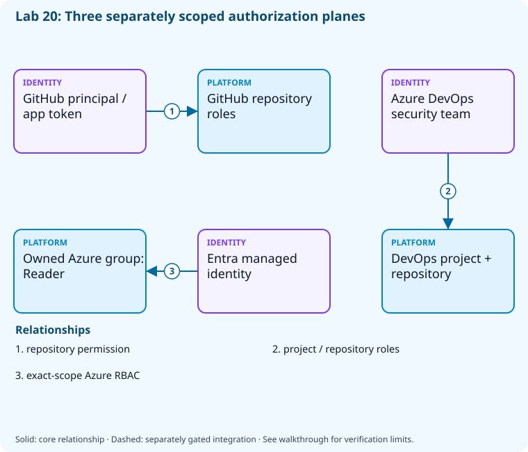

# Lab 20: Scope identities, teams, and permissions

[Previous: Lab 19](../19-pipeline-optimization/README.md) · [Catalog](../../docs/lab-catalog.md) · [Next: Lab 21](../21-secrets-federation/README.md)

## Scenario, role, and outcome

Build jobs and humans share broad permissions. Inventory access, create an RG-contained identity, and demonstrate a narrowly scoped read role.

Learner role: **Identity engineer**. Outcome: Scope identities, teams, and permissions.

| Item | Value |
|---|---|
| Time | 120 minutes |
| Domain | security |
| Platforms | local, github, azure-devops, azure |
| Cost | none or approved hosted-run allowance — review [current pricing and cleanup](../../docs/cost-and-cleanup.md) before cloud execution |
| Exam blueprint | July 27, 2026; sources reviewed October 16, 2026 |
| Verification status | offline-tested |
| Verification scope | All five checkpoint commands, final validators and named fault/repair executed in CourseSecurityTelemetry.Tests.ps1 with fail-closed provider doubles. Local calculations, permission/reference/secure-file fixtures and .NET trace behavior are real; live provider calls, federation and telemetry export have not run. |

Completion requires all five checkpoints, the break/fix repair, successful
independent validation, and a passing residual-resource audit. An unavailable
external prerequisite is a visible gate; it does not become a passing result.

## Architecture and service topology



GitHub permissions apply to a repository principal/token, Azure DevOps groups apply to project and repository resources, and Azure RBAC applies independently to the managed identity at the owned resource-group scope. Licensing/access levels do not replace these security permissions. The lab creates only the RG-contained identity and its read-only role assignment.

The editable [Mermaid source](diagrams/architecture.mmd) and accessible SVG
render the same authored components and relationships. Dashed connections show
separately gated integrations. Read every boundary before executing commands. Cloud changes
stay inside the exact disposable GitHub repository, Azure DevOps project, and
Azure resource group recorded for this run. Child objects inherit that cleanup
boundary. Account creation, external integrations, and privileged organization
settings belong to [one-time bootstrap](../../docs/account-bootstrap.md).

## Objectives and checkpoints

Coverage levels describe the intended learning evidence: **explained** means reasoned
understanding, **practiced** means an observable isolated skill, and **integrated**
means skills connected across a delivery boundary. These labels are curriculum
claims, not execution status. Verification above records what authors actually ran.

Official objective topic IDs: `D2.2.3`, `D4.1.1`, `D4.1.2`, `D4.1.3`, `D4.1.4`, `D4.1.5`, `D4.1.6`, `D4.1.7`

| Checkpoint | Measurable behavior |
|---|---|
| [CP1](#task-1) | Inspect GitHub effective access without expanding it |
| [CP2](#task-2) | Read Azure DevOps project teams |
| [CP3](#task-3) | Create an Azure managed identity inside the owned group |
| [CP4](#task-4) | Assign a read-only role only at the disposable group |
| [CP5](#task-5) | Compare token/service-connection access choices |

The [objective map](../../docs/objective-map.md) traces every official topic to
labs. The [Microsoft study guide](https://learn.microsoft.com/en-us/credentials/certifications/resources/study-guides/az-400)
controls authoritative objective wording and domain weighting.

## Inputs, permissions, and read-only preflight

Use PowerShell 7.4+, .NET 10, Git, GitHub CLI, Azure CLI with the Azure DevOps
extension, and the pinned repository validation dependencies. Read the
[permissions matrix](../../docs/permissions-matrix.md) and [evidence policy](../../docs/evidence-handling.md).
Supply only the accounts needed by this lab. Never put a token, connection
string, or private key into a command log, committed YAML, or progress export.

The examples run from the repository root. Choose a fresh lowercase run ID;
`demo01` is an example, not a reusable shared sandbox. Set bootstrap environment
variables for the approved GitHub owner, DevOps organization, subscription, and
region. Do not run both guided and automated lanes with the same run ID.

```powershell
$lab = './labs/20-identity-permissions/scripts/cli'
& "$lab/Preflight.ps1" -RunId 'demo01'
& "$lab/Setup.ps1" -RunId 'demo01' -ProvisionOnly
# After reviewing context, permissions, cost, and cleanup:
& "$lab/Setup.ps1" -RunId 'demo01' -ProvisionOnly -Execute -AcknowledgeCost -AcknowledgeTenantChange
. "$lab/Context.ps1" -RunId 'demo01'
```

Preflight performs reads only. Provisioning creates fresh run-owned top-level
sandboxes and records their exact IDs. Context establishes `$RepoRoot`,
`$LabRoot`, `$WorkRoot`, `$RunId`, `$GhRepo`, `$AdoOrganization`, `$AdoProject`,
`$SubscriptionId`, `$Location`, and `$ResourceGroup`. A missing prerequisite or
ownership mismatch must stop execution. Local build commands may restore
packages and write ignored build output.

## Concept primer and design decisions

Authentication identifies a caller; authorization applies at a resource scope. Managed identities remove client-secret maintenance while project access levels remain distinct from security permissions.

Identify the principal, permission and resource scope separately. A managed identity avoids a stored client secret but can still receive excessive authority. Prefer a narrow resource-group role and verify the exact scope after assignment. GitHub token permissions and repository roles are also distinct.

Azure DevOps groups determine permission inheritance, teams organize work, and access levels license capabilities. Reading a project team does not demonstrate creating a new team or changing organization membership. The comparison record explains these boundaries without escalating shared tenant permissions. A federated service connection still needs explicit pipeline authorization.

## Task 1 — Inspect GitHub effective access without expanding it

<a id="task-1"></a>

Checkpoint: `CP1`

| Objective | Evidence level | Observation and limits |
|---|---|---|
| `D2.2.3` | explained | Inspect a GitHub token permission matrix and map repository role responsibilities. |
| `D4.1.2` | explained | Inspect the current GitHub authentication context; no new PAT or GitHub App is created. |
| `D4.1.4` | explained | Map GitHub role and token permission boundaries in the matrix. |

```powershell
gh repo view $GhRepo --json nameWithOwner,viewerPermission,visibility|Set-Content (Join-Path $WorkRoot 'github-access.json')
 gh api "repos/$GhRepo/collaborators" --jq '[.[]|{login:.login,role:.role_name}]'|Set-Content (Join-Path $WorkRoot 'collaborators.json')
```

Expected state: Effective repository permission and collaborator roles are reviewable.

Positive validation:

```powershell
$a=Get-Content (Join-Path $WorkRoot 'github-access.json') -Raw|ConvertFrom-Json
 if($a.nameWithOwner -ne $GhRepo){throw 'Access review targeted wrong repository.'}
```

Negative validation:

```powershell
$a=Get-Content (Join-Path $WorkRoot 'github-access.json') -Raw|ConvertFrom-Json
 if($a.viewerPermission -eq 'NONE'){throw 'No repository access.'}
```

Evidence to retain: Role names with personal identities redacted.

Common failure and safe retry: Separate organization owners, repository maintainers, contributors, and outside collaborators; choose the smallest role.

Cleanup dependency: retain this checkpoint's evidence until final validation; remove run-owned children before their recorded parent boundary.

## Task 2 — Read Azure DevOps project teams

<a id="task-2"></a>

Checkpoint: `CP2`

| Objective | Evidence level | Observation and limits |
|---|---|---|
| `D4.1.5` | explained | Read Azure DevOps project identity/group context; changing collection-wide groups is outside this sandbox. |
| `D4.1.7` | explained | Inspect the disposable project team; creating membership or changing cross-project teams is not claimed. |

```powershell
az devops team list --organization $AdoOrganization --project $AdoProject --query 'value[].{id:id,name:name}' -o json|Set-Content (Join-Path $WorkRoot 'teams.json')
 az devops project show --organization $AdoOrganization --project $AdoProject --query '{id:id,name:name,visibility:visibility}' -o json|Set-Content (Join-Path $WorkRoot 'project-access.json')
```

Expected state: Project identity/visibility and teams are scoped to the disposable project.

Positive validation:

```powershell
$p=Get-Content (Join-Path $WorkRoot 'project-access.json') -Raw|ConvertFrom-Json
 if($p.name -ne $AdoProject){throw 'Project access review mismatch.'}
```

Negative validation:

```powershell
$p=Get-Content (Join-Path $WorkRoot 'project-access.json') -Raw|ConvertFrom-Json
 if($p.visibility -notin @('private','public')){throw 'Unknown project visibility.'}
```

Evidence to retain: Team names/count and project visibility; access levels remain distinct from security group permissions.

Common failure and safe retry: Stakeholder/Basic licensing does not replace explicit project/repository permissions.

Cleanup dependency: retain this checkpoint's evidence until final validation; remove run-owned children before their recorded parent boundary.

## Task 3 — Create an Azure managed identity inside the owned group

<a id="task-3"></a>

Checkpoint: `CP3`

| Objective | Evidence level | Observation and limits |
|---|---|---|
| `D4.1.1` | practiced | Create and query a user-assigned managed identity within the run-owned Azure resource group. |

```powershell
$name="identity-$RunId"
 $m=az identity create --subscription $SubscriptionId --resource-group $ResourceGroup --name $name --location $Location -o json|ConvertFrom-Json
 $m|ConvertTo-Json -Depth 8|Set-Content (Join-Path $WorkRoot 'managed-identity.json')
```

Expected state: A user-assigned identity exists entirely inside the disposable resource group.

Positive validation:

```powershell
$m=Get-Content (Join-Path $WorkRoot 'managed-identity.json') -Raw|ConvertFrom-Json
 $live=az identity show --subscription $SubscriptionId --resource-group $ResourceGroup --name "identity-$RunId" -o json|ConvertFrom-Json
 if($live.principalId -ne $m.principalId){throw 'Managed identity principal mismatch.'}
```

Negative validation:

```powershell
$m=Get-Content (Join-Path $WorkRoot 'managed-identity.json') -Raw|ConvertFrom-Json
 if($m.id -notlike "*/resourceGroups/$ResourceGroup/*"){throw 'Identity escaped resource-group boundary.'}
```

Evidence to retain: Identity resource ID/client ID/principal ID locally; redact before export.

Common failure and safe retry: Managed identities avoid an application secret; do not create an untracked Entra application as a substitute.

Cleanup dependency: retain this checkpoint's evidence until final validation; remove run-owned children before their recorded parent boundary.

## Task 4 — Assign a read-only role only at the disposable group

<a id="task-4"></a>

Checkpoint: `CP4`

Foundation/supporting task; no additional exam-objective coverage is claimed.

```powershell
$m=Get-Content (Join-Path $WorkRoot 'managed-identity.json') -Raw|ConvertFrom-Json
 $scope="/subscriptions/$SubscriptionId/resourceGroups/$ResourceGroup"
 az role assignment create --subscription $SubscriptionId --assignee-object-id $m.principalId --assignee-principal-type ServicePrincipal --role Reader --scope $scope -o json|Set-Content (Join-Path $WorkRoot 'role-assignment.json')
```

Expected state: The identity receives Reader on the exact lab group, not subscription-wide contributor access.

Positive validation:

```powershell
$m=Get-Content (Join-Path $WorkRoot 'managed-identity.json') -Raw|ConvertFrom-Json;$scope="/subscriptions/$SubscriptionId/resourceGroups/$ResourceGroup"
 $a=@(az role assignment list --subscription $SubscriptionId --assignee $m.principalId --scope $scope -o json|ConvertFrom-Json)
 if(@($a|Where-Object scope -eq $scope).Count -lt 1){throw 'Scoped role assignment absent.'}
```

Negative validation:

```powershell
$a=Get-Content (Join-Path $WorkRoot 'role-assignment.json') -Raw|ConvertFrom-Json
 if($a.scope -eq "/subscriptions/$SubscriptionId"){throw 'Subscription-wide assignment is outside this exercise.'}
```

Evidence to retain: Role definition and exact scope.

Common failure and safe retry: Role Assignment Contributor/User Access Administrator/Owner may be required for this scoped change; missing permission is a gate.

Cleanup dependency: retain this checkpoint's evidence until final validation; remove run-owned children before their recorded parent boundary.

## Task 5 — Compare token/service-connection access choices

<a id="task-5"></a>

Checkpoint: `CP5`

| Objective | Evidence level | Observation and limits |
|---|---|---|
| `D4.1.3` | explained | Review narrowly scoped workload-federated Azure DevOps connection design; no organization service connection is automatically created. |
| `D4.1.6` | explained | Distinguish DevOps access-level entitlement from permissions in the comparison record. |

```powershell
$matrix=[ordered]@{githubBuild='GITHUB_TOKEN contents:read';githubCrossRepo='GitHub App installation token';azureDeployment='federated managed identity';adoDeployment='workload identity service connection';pat='bootstrap-only narrowly scoped fallback';stakeholder='work tracking, subject to product restrictions'}
 $matrix|ConvertTo-Json|Set-Content (Join-Path $WorkRoot 'identity-matrix.json')
$definition=@(az role definition list --subscription $SubscriptionId --name Reader -o json|ConvertFrom-Json)
if($definition.Count -ne 1 -or $definition[0].name -ne 'acdd72a7-3385-48ef-bd42-f606fba81ae7'){throw 'Expected the built-in Reader role.'}
$definition[0]|ConvertTo-Json -Depth 12|Set-Content (Join-Path $WorkRoot 'reader-definition.json')
$scope="/subscriptions/$SubscriptionId/resourceGroups/$ResourceGroup"
$cases=@(@{action='Microsoft.Resources/subscriptions/resourceGroups/read';target=$scope;expected=$true},@{action='Microsoft.Compute/virtualMachines/write';target="$scope/providers/Microsoft.Compute/virtualMachines/example";expected=$false},@{action='Microsoft.Resources/subscriptions/resourceGroups/read';target="/subscriptions/$SubscriptionId/resourceGroups/another-group";expected=$false})
$decisions=foreach($case in $cases){
 $within=$case.target -ieq $scope -or $case.target.StartsWith("$scope/",[StringComparison]::OrdinalIgnoreCase)
 $allowed=$within -and $case.action.EndsWith('/read',[StringComparison]::OrdinalIgnoreCase)
 if($allowed -ne $case.expected){throw 'Reader fixture decision mismatch.'}
 @{action=$case.action;allowed=$allowed}
}
@{fixtureOnly=$true;decisions=@($decisions);effectiveAccessVerified=$false}|ConvertTo-Json -Depth 6|Set-Content (Join-Path $WorkRoot 'permission-decisions.json')
```

Expected state: The real Reader role definition is inspected; one local in-scope read is allowed, while a write and an outside-scope read are rejected. Effective token authorization remains a separate live check.

Positive validation:

```powershell
$m=Get-Content (Join-Path $WorkRoot 'identity-matrix.json') -Raw|ConvertFrom-Json
 if($m.azureDeployment -ne 'federated managed identity' -or $m.githubBuild -notmatch 'contents:read'){throw 'Identity selection violated.'}
$r=Get-Content (Join-Path $WorkRoot 'reader-definition.json') -Raw|ConvertFrom-Json
if($r.permissions[0].actions -notcontains '*/read' -or @($r.permissions[0].dataActions).Count){throw 'Reader management/data-plane distinction changed.'}
$d=Get-Content (Join-Path $WorkRoot 'permission-decisions.json') -Raw|ConvertFrom-Json
if(@($d.decisions).Count -ne 3 -or @($d.decisions|Where-Object allowed).Count -ne 1){throw 'Read/write/scope decisions failed.'}
```

Negative validation:

```powershell
$m=Get-Content (Join-Path $WorkRoot 'identity-matrix.json') -Raw|ConvertFrom-Json
 if($m.pat -match 'unrestricted|never expires'){throw 'Unsafe fallback-token policy.'}
if((Get-Content (Join-Path $WorkRoot 'permission-decisions.json') -Raw|ConvertFrom-Json).effectiveAccessVerified){throw 'A local policy model is not an effective-access probe.'}
```

Evidence to retain: Reader definition, three computed scope/action decisions, and the identity choice matrix; redact account identifiers.

Common failure and safe retry: Do not equate a service connection with blanket authorization to every pipeline.

Cleanup dependency: retain this checkpoint's evidence until final validation; remove run-owned children before their recorded parent boundary.

## Deterministic break/fix

Run the journaled operation after all five checkpoints. It proves the healthy assertion, injects the named fault, requires its rejection, repairs it, and proves health again. Provider doubles used in author tests are not live enforcement evidence.

```powershell
& './labs/20-identity-permissions/scripts/cli/BreakFix.ps1' -RunId 'demo01' -Execute
```

Expected rejection marker: `AZ400-L20-FAULT`. The assertion must catch the changed behavior, not merely an exception from an unavailable CLI.

Inspect the independent assertion:

```powershell
$m=Get-Content (Join-Path $WorkRoot 'identity-matrix.json') -Raw|ConvertFrom-Json
if($m.githubBuild -ne 'GITHUB_TOKEN contents:read'){throw 'AZ400-L20-FAULT'}
```

Fault trigger (executed by BreakFix):

```powershell
$m=Get-Content (Join-Path $WorkRoot 'identity-matrix.json') -Raw|ConvertFrom-Json;$m.githubBuild='GITHUB_TOKEN write-all';$m|ConvertTo-Json|Set-Content (Join-Path $WorkRoot 'identity-matrix.json')
```

Diagnose the precise difference:

```powershell
Get-Content (Join-Path $WorkRoot 'identity-matrix.json')
```

Repair (executed by BreakFix):

```powershell
$m=Get-Content (Join-Path $WorkRoot 'identity-matrix.json') -Raw|ConvertFrom-Json;$m.githubBuild='GITHUB_TOKEN contents:read';$m|ConvertTo-Json|Set-Content (Join-Path $WorkRoot 'identity-matrix.json')
```

## Optional job-style challenge

Prove a read-only federated identity can inspect the owned group and cannot create a resource; keep the attempted write harmless and explicitly bounded.

## Final validation and result interpretation

```powershell
& './labs/20-identity-permissions/scripts/cli/Validate.ps1' -RunId 'demo01'
```

A complete result requires five passing read-only checkpoint assertions, a journaled repaired fault, and any required integration evidence. Pending hosted runs, missing licensed features, and unexecuted integration lanes remain visible. Review `validation.json`; successful command exit alone does not establish the asserted behavior.

## Troubleshooting

- **401/403:** inspect the explicit account/project/repository scope and required role; do not broaden a token reflexively.
- **Resource or artifact missing:** confirm the exact run ID and prerequisite checkpoint; retry reads after eventual consistency.
- **Unsupported SKU/runtime/tool:** consult the specific current source, record the gate, and obtain approval before changing cost or architecture.
- **Validation mismatch:** inspect the positive and negative assertions separately, repair the named fault, and rerun validation.
- **Ownership refusal:** stop; never edit a manifest to claim an unrelated resource.

## Cleanup and residual checks

```powershell
& './labs/20-identity-permissions/scripts/cli/Cleanup.ps1' -RunId 'demo01'
# Review the exact owned-object deletion plan first.
& './labs/20-identity-permissions/scripts/cli/Cleanup.ps1' -RunId 'demo01' -Execute
```

Cleanup must verify ownership, delete only recorded sandbox objects in dependency order, and prove parent/child absence. Retain `run.json`, `validation.json`, and `cleanup.json` locally until the audit passes. Soft-deleted or deliberately retained items must remain reported. Never purge a shared vault or delete an account, organization, or pre-existing service connection to finish a lab.

## Exam debrief and assessment

Explain why each checkpoint's denied path matters, which scope authorizes it, what evidence proves it, and how it is reversed. Complete the [50-question assessment](QUESTIONS.md), then review [rationales](ANSWERS.md) and repeat weak checkpoints.

## Microsoft and platform sources

- [Primary source 1](https://learn.microsoft.com/en-us/entra/identity/managed-identities-azure-resources/overview) — reviewed 2026-10-16.
- [Primary source 2](https://learn.microsoft.com/en-us/azure/role-based-access-control/scope-overview) — reviewed 2026-10-16.
- [Primary source 3](https://docs.github.com/en/actions/security-for-github-actions/security-guides/automatic-token-authentication) — reviewed 2026-10-16.
- [Primary source 4](https://learn.microsoft.com/en-us/azure/devops/organizations/security/permissions) — reviewed 2026-10-16.

## Lifecycle scripts and worked solution

Use `scripts/cli/Preflight.ps1`, `Setup.ps1`, `BreakFix.ps1`, `Integration.ps1` (capstones), `Validate.ps1`, `Cleanup.ps1`, and `Context.ps1` from this lab folder. Setup and cleanup preview until `-Execute`; `-ProvisionOnly` creates only fresh ownership-tracked containers. The [worked solution](solution/README.md) lists expected results and repair reasoning.
