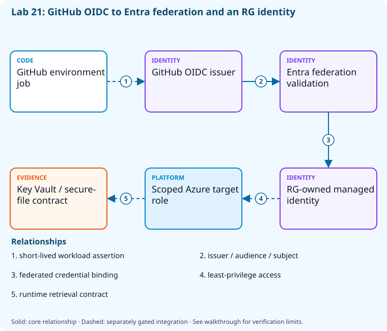

# Lab 21: Federate pipeline identity and protect secrets

[Previous: Lab 20](../20-identity-permissions/README.md) · [Catalog](../../docs/lab-catalog.md) · [Next: Lab 22](../22-security-scanning/README.md)

## Scenario, role, and outcome

A deployment uses a long-lived secret and logs too much configuration. Bind one exact federated subject and define safe secret/file handling.

Learner role: **Automation security engineer**. Outcome: Federate pipeline identity and protect secrets.

| Item | Value |
|---|---|
| Time | 120 minutes |
| Domain | security |
| Platforms | local, azure, github |
| Cost | none or approved hosted-run allowance — review [current pricing and cleanup](../../docs/cost-and-cleanup.md) before cloud execution |
| Exam blueprint | July 27, 2026; sources reviewed October 16, 2026 |
| Verification | Authored and checked offline; no live Azure deployment is claimed |

Completion requires all five checkpoints, the break/fix repair, successful
independent validation, and a passing residual-resource audit. An unavailable
external prerequisite is a visible gate; it does not become a passing result.

## Architecture and service topology



The actual federated-credential resource binds the exact GitHub repository/environment subject and token-exchange audience to an RG-owned managed identity. A running job would obtain a short-lived assertion from GitHub and exchange it through Entra for scoped target access. The core configures that binding; target-role use, Key Vault retrieval, and secure-file consumption require separately verified integration and never store token bytes in evidence.

The editable [Mermaid source](diagrams/architecture.mmd) and accessible SVG
render the same authored components and relationships. Dashed connections show
separately gated integrations. Read every boundary before executing commands. Cloud changes
stay inside the exact disposable GitHub repository, Azure DevOps project, and
Azure resource group recorded for this run. Child objects inherit that cleanup
boundary. Account creation, external integrations, and privileged organization
settings belong to [one-time bootstrap](../../docs/account-bootstrap.md).

## Objectives and checkpoints

Official objective topic IDs: `D4.1.2`, `D4.1.3`, `D4.2.1`, `D4.2.2`, `D4.2.3`, `D4.2.4`

| Checkpoint | Measurable behavior |
|---|---|
| [CP1](#task-1) | Create the run-owned federation identity |
| [CP2](#task-2) | Bind the exact GitHub environment subject |
| [CP3](#task-3) | Review Key Vault reference handling |
| [CP4](#task-4) | Model secure-file access and deletion after use |
| [CP5](#task-5) | Check evidence for a synthetic leakage marker |

The [objective map](../../docs/objective-map.md) traces every official topic to
labs. The [Microsoft study guide](https://learn.microsoft.com/en-us/credentials/certifications/resources/study-guides/az-400)
controls authoritative objective wording and domain weighting.

## Inputs, permissions, and read-only preflight

Use PowerShell 7.4+, .NET 10, Git, GitHub CLI, Azure CLI with the Azure DevOps
extension, and the pinned repository validation dependencies. Read the
[permissions matrix](../../docs/permissions-matrix.md) and [evidence policy](../../docs/evidence-handling.md).
Supply only the accounts needed by this lab. Never put a token, connection
string, or private key into a command log, committed YAML, or progress export.

The examples run from the repository root. Choose a fresh lowercase run ID;
`demo01` is an example, not a reusable shared sandbox. Set bootstrap environment
variables for the approved GitHub owner, DevOps organization, subscription, and
region. Do not run both guided and automated lanes with the same run ID.

```powershell
$lab = './labs/21-secrets-federation/scripts/cli'
& "$lab/Preflight.ps1" -RunId 'demo01'
& "$lab/Setup.ps1" -RunId 'demo01' -ProvisionOnly
# After reviewing context, permissions, cost, and cleanup:
& "$lab/Setup.ps1" -RunId 'demo01' -ProvisionOnly -Execute -AcknowledgeCost -AcknowledgeTenantChange
. "$lab/Context.ps1" -RunId 'demo01'
```

Preflight performs reads only. Provisioning creates fresh run-owned top-level
sandboxes and records their exact IDs. Context establishes `$RepoRoot`,
`$LabRoot`, `$WorkRoot`, `$RunId`, `$GhRepo`, `$AdoOrganization`, `$AdoProject`,
`$SubscriptionId`, `$Location`, and `$ResourceGroup`. A missing prerequisite or
ownership mismatch must stop execution. Local build commands may restore
packages and write ignored build output.

## Concept primer and design decisions

OIDC exchanges a constrained workload assertion for an Azure token. Issuer, audience, and subject must all match; masking is defense in depth rather than permission to log secrets.

## Task 1 — Create the run-owned federation identity

<a id="task-1"></a>

Checkpoint: `CP1`

```powershell
$m=az identity create --subscription $SubscriptionId --resource-group $ResourceGroup --location $Location --name "federated-$RunId" -o json|ConvertFrom-Json
 $m|ConvertTo-Json -Depth 8|Set-Content (Join-Path $WorkRoot 'federated-identity.json')
```

Expected state: A managed identity provides a federation target without creating a client secret.

Positive validation:

```powershell
$m=Get-Content (Join-Path $WorkRoot 'federated-identity.json') -Raw|ConvertFrom-Json
 if(-not $m.clientId -or -not $m.principalId){throw 'Federation identity IDs absent.'}
```

Negative validation:

```powershell
$m=Get-Content (Join-Path $WorkRoot 'federated-identity.json') -Raw|ConvertFrom-Json
 if($m.id -notlike "*/resourceGroups/$ResourceGroup/*"){throw 'Unowned federation target.'}
```

Evidence to retain: Managed identity ID and explicitly nonsecret client/tenant metadata.

Common failure and safe retry: Use an RG-contained managed identity and least-privilege role, never a copied application password.

Cleanup dependency: retain this checkpoint's evidence until final validation; remove run-owned children before their recorded parent boundary.

## Task 2 — Bind the exact GitHub environment subject

<a id="task-2"></a>

Checkpoint: `CP2`

```powershell
$subject="repo:${GhRepo}:environment:release-$RunId"
 az identity federated-credential create --subscription $SubscriptionId --resource-group $ResourceGroup --identity-name "federated-$RunId" --name github-release --issuer 'https://token.actions.githubusercontent.com' --subject $subject --audiences 'api://AzureADTokenExchange' -o json|Set-Content (Join-Path $WorkRoot 'federated-credential.json')
```

Expected state: Federation accepts one repository/environment subject and the Azure token-exchange audience.

Positive validation:

```powershell
$f=az identity federated-credential show --subscription $SubscriptionId --resource-group $ResourceGroup --identity-name "federated-$RunId" --name github-release -o json|ConvertFrom-Json
 if($f.subject -ne "repo:${GhRepo}:environment:release-$RunId"){throw 'Federation subject mismatch.'}
```

Negative validation:

```powershell
$f=Get-Content (Join-Path $WorkRoot 'federated-credential.json') -Raw|ConvertFrom-Json
 if($f.subject -match '\*' -or $f.issuer -ne 'https://token.actions.githubusercontent.com'){throw 'Untrusted or wildcard issuer/subject.'}
```

Evidence to retain: Issuer, subject, audience; no assertion JWT is retained.

Common failure and safe retry: Environment-bound and branch-bound subjects differ; copy the exact emitted subject and keep audience exact.

Cleanup dependency: retain this checkpoint's evidence until final validation; remove run-owned children before their recorded parent boundary.

## Task 3 — Review Key Vault reference handling

<a id="task-3"></a>

Checkpoint: `CP3`

```powershell
Copy-Item (Join-Path $LabRoot 'artifacts/keyvault-reference.json') (Join-Path $WorkRoot 'keyvault-reference.json')
 $policy=[ordered]@{fetch='at job runtime through federated identity';retainValue=$false;masking='defense in depth';rotation='new version with rollback plan';vaultProvisioned=$false}
 $policy|ConvertTo-Json|Set-Content (Join-Path $WorkRoot 'vault-policy.json')
```

Expected state: Vault references and runtime retrieval are distinct from storing secret values in Git.

Positive validation:

```powershell
$p=Get-Content (Join-Path $WorkRoot 'vault-policy.json') -Raw|ConvertFrom-Json
 if($p.fetch -notmatch 'federated identity' -or $p.rotation -notmatch 'new version'){throw 'Secret lifecycle policy incomplete.'}
```

Negative validation:

```powershell
$p=Get-Content (Join-Path $WorkRoot 'vault-policy.json') -Raw|ConvertFrom-Json
 if($p.retainValue -or $p.vaultProvisioned){throw 'Reference review cannot expose values or claim a vault deployment.'}
```

Evidence to retain: Reference shape and runtime identity requirements, without secret values.

Common failure and safe retry: Key Vault uses separate data-plane RBAC; RG Contributor alone cannot read secret values.

Cleanup dependency: retain this checkpoint's evidence until final validation; remove run-owned children before their recorded parent boundary.

## Task 4 — Model secure-file access and deletion after use

<a id="task-4"></a>

Checkpoint: `CP4`

```powershell
$secureFile=[ordered]@{name='synthetic-signing-input';content='NOT-A-REAL-KEY';authorizedPipeline='single-disposable-pipeline';deleteAfterJob=$true}
 $secureFile|ConvertTo-Json|Set-Content (Join-Path $WorkRoot 'secure-file-contract.json')
```

Expected state: A synthetic file contract narrows pipeline authorization and cleanup lifetime.

Positive validation:

```powershell
$s=Get-Content (Join-Path $WorkRoot 'secure-file-contract.json') -Raw|ConvertFrom-Json
 if(-not $s.deleteAfterJob -or $s.content -ne 'NOT-A-REAL-KEY'){throw 'Secure-file lifetime/fixture violated.'}
```

Negative validation:

```powershell
$s=Get-Content (Join-Path $WorkRoot 'secure-file-contract.json') -Raw|ConvertFrom-Json
 if($s.authorizedPipeline -eq 'all'){throw 'Secure files must not be broadly authorized.'}
```

Evidence to retain: Nonsecret file metadata and access decision.

Common failure and safe retry: Store real certificates only in approved protected secure-file/key facilities; never echo their bytes.

Cleanup dependency: retain this checkpoint's evidence until final validation; remove run-owned children before their recorded parent boundary.

## Task 5 — Check evidence for a synthetic leakage marker

<a id="task-5"></a>

Checkpoint: `CP5`

```powershell
$safe='status=complete; value=<redacted>';Set-Content (Join-Path $WorkRoot 'redacted-log.txt') $safe
 $marker='AZ400_SYNTHETIC_SECRET_DO_NOT_USE'
 $leaks=Select-String -Path (Join-Path $WorkRoot 'redacted-log.txt') -SimpleMatch $marker
 [ordered]@{markerFound=[bool]$leaks;redacted=$safe.Contains('<redacted>')}|ConvertTo-Json|Set-Content (Join-Path $WorkRoot 'leak-check.json')
```

Expected state: The evidence contains a redaction marker and no synthetic secret.

Positive validation:

```powershell
$r=Get-Content (Join-Path $WorkRoot 'leak-check.json') -Raw|ConvertFrom-Json
 if(-not $r.redacted){throw 'Expected redaction evidence absent.'}
```

Negative validation:

```powershell
if(Select-String -Path (Join-Path $WorkRoot 'redacted-log.txt') -SimpleMatch 'AZ400_SYNTHETIC_SECRET_DO_NOT_USE'){throw 'Synthetic secret leaked into log.'}
```

Evidence to retain: Pass/fail leakage check only; never include the real credential being checked.

Common failure and safe retry: Masking can miss transformed values; minimize secret exposure and avoid debug tracing around token exchange.

Cleanup dependency: retain this checkpoint's evidence until final validation; remove run-owned children before their recorded parent boundary.

## Deterministic break/fix

Inject this fault only in the recorded sandbox or local run directory.

```powershell
Add-Content (Join-Path $WorkRoot 'redacted-log.txt') 'AZ400_SYNTHETIC_SECRET_DO_NOT_USE'
```

Diagnose the precise difference:

```powershell
Select-String -Path (Join-Path $WorkRoot 'redacted-log.txt') -SimpleMatch 'AZ400_SYNTHETIC_SECRET_DO_NOT_USE'
```

Repair, then repeat the affected checkpoint validation:

```powershell
Set-Content (Join-Path $WorkRoot 'redacted-log.txt') 'status=complete; value=<redacted>'
```

## Optional job-style challenge

Configure a separately approved Azure DevOps workload-identity service connection to the RG-contained identity using the exact service-connection issuer/subject, then prove no client secret exists.

## Final validation and result interpretation

```powershell
& './labs/21-secrets-federation/scripts/cli/Validate.ps1' -RunId 'demo01'
```

A complete result requires five passing read-only assertions. Pending hosted runs, missing licensed features, and unexecuted integration challenges remain visible. Review `validation.json`; a command exiting successfully is not enough if the asserted behavior is absent.

## Troubleshooting

- **401/403:** inspect the explicit account/project/repository scope and required role; do not broaden a token reflexively.
- **Resource or artifact missing:** confirm the exact run ID and prerequisite checkpoint; retry reads after eventual consistency.
- **Unsupported SKU/runtime/tool:** consult the specific current source, record the gate, and obtain approval before changing cost or architecture.
- **Validation mismatch:** inspect the positive and negative assertions separately, repair the named fault, and rerun validation.
- **Ownership refusal:** stop; never edit a manifest to claim an unrelated resource.

## Cleanup and residual checks

```powershell
& './labs/21-secrets-federation/scripts/cli/Cleanup.ps1' -RunId 'demo01'
# Review the exact owned-object deletion plan first.
& './labs/21-secrets-federation/scripts/cli/Cleanup.ps1' -RunId 'demo01' -Execute
```

Cleanup must verify ownership, delete only recorded sandbox objects in dependency order, and prove parent/child absence. Retain `run.json`, `validation.json`, and `cleanup.json` locally until the audit passes. Soft-deleted or deliberately retained items must remain reported. Never purge a shared vault or delete an account, organization, or pre-existing service connection to finish a lab.

## Exam debrief and assessment

Explain why each checkpoint's denied path matters, which scope authorizes it, what evidence proves it, and how it is reversed. Complete the [50-question assessment](QUESTIONS.md), then review [rationales](ANSWERS.md) and repeat weak checkpoints.

## Microsoft and platform sources

- [Primary source 1](https://learn.microsoft.com/en-us/entra/workload-id/workload-identity-federation) — reviewed 2026-10-16.
- [Primary source 2](https://learn.microsoft.com/en-us/azure/devops/pipelines/release/configure-workload-identity) — reviewed 2026-10-16.
- [Primary source 3](https://docs.github.com/en/actions/security-for-github-actions/security-hardening-your-deployments/configuring-openid-connect-in-azure) — reviewed 2026-10-16.
- [Primary source 4](https://learn.microsoft.com/en-us/azure/devops/pipelines/library/secure-files) — reviewed 2026-10-16.

## Lifecycle scripts and worked solution

Use `scripts/cli/Preflight.ps1`, `Setup.ps1`, `Validate.ps1`, `Cleanup.ps1`, and `Context.ps1` from this lab folder. Setup and cleanup preview until `-Execute`; `-ProvisionOnly` creates only fresh ownership-tracked containers. The [worked solution](solution/README.md) lists expected results and repair reasoning.
