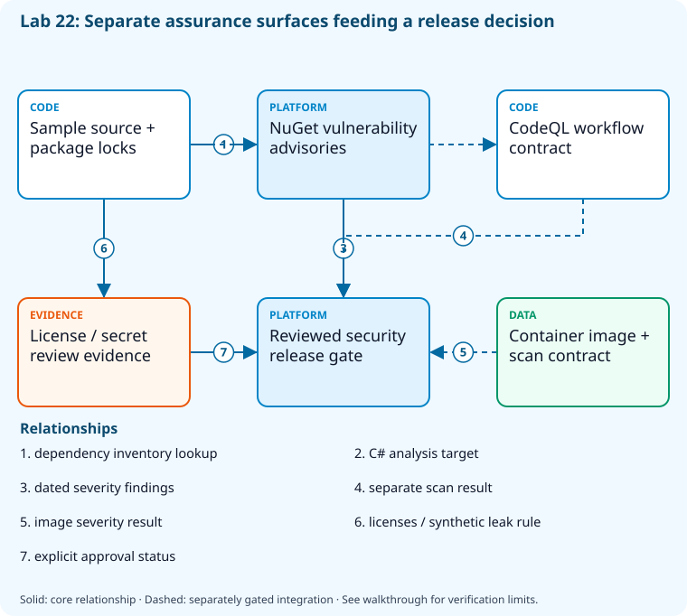

# Lab 22: Scan dependencies, code, containers, and licenses

[Previous: Lab 21](../21-secrets-federation/README.md) · [Catalog](../../docs/lab-catalog.md) · [Next: Lab 23](../23-advanced-security-defender/README.md)

## Scenario, role, and outcome

The team scans only direct packages and treats any green scan as compliance. Separate dependency, code, secret, container, and licensing evidence.

Learner role: **Product security engineer**. Outcome: Scan dependencies, code, containers, and licenses.

| Item | Value |
|---|---|
| Time | 120 minutes |
| Domain | security |
| Platforms | local |
| Cost | none — review [current pricing and cleanup](../../docs/cost-and-cleanup.md) before cloud execution |
| Exam blueprint | July 27, 2026; sources reviewed October 16, 2026 |
| Verification | Authored and checked offline; no live Azure deployment is claimed |

Completion requires all five checkpoints, the break/fix repair, successful
independent validation, and a passing residual-resource audit. An unavailable
external prerequisite is a visible gate; it does not become a passing result.

## Architecture and service topology



Direct/transitive package locks are checked against current vulnerability advisories, while source, container, secret, and licensing surfaces require distinct evidence. The core performs dependency queries, a synthetic leakage rule, and a license review queue; the CodeQL/container contracts remain separate live scanner integrations. Unknown licensing or an unexecuted scanner cannot become a green release decision.

The editable [Mermaid source](diagrams/architecture.mmd) and accessible SVG
render the same authored components and relationships. Dashed connections show
separately gated integrations. Read every boundary before executing commands. Cloud changes
stay inside the exact disposable GitHub repository, Azure DevOps project, and
Azure resource group recorded for this run. Child objects inherit that cleanup
boundary. Account creation, external integrations, and privileged organization
settings belong to [one-time bootstrap](../../docs/account-bootstrap.md).

## Objectives and checkpoints

Official objective topic IDs: `D1.2.5`, `D4.2.4`, `D4.3.1`, `D4.3.5`, `D4.3.6`

| Checkpoint | Measurable behavior |
|---|---|
| [CP1](#task-1) | Inventory direct and transitive dependencies |
| [CP2](#task-2) | Run the vulnerability advisory check |
| [CP3](#task-3) | Scan a synthetic source fixture for leakage |
| [CP4](#task-4) | Review container and CodeQL scan execution boundaries |
| [CP5](#task-5) | Create a dependency license review queue |

The [objective map](../../docs/objective-map.md) traces every official topic to
labs. The [Microsoft study guide](https://learn.microsoft.com/en-us/credentials/certifications/resources/study-guides/az-400)
controls authoritative objective wording and domain weighting.

## Inputs, permissions, and read-only preflight

Use PowerShell 7.4+, .NET 10, Git, GitHub CLI, Azure CLI with the Azure DevOps
extension, and the pinned repository validation dependencies. Read the
[permissions matrix](../../docs/permissions-matrix.md) and [evidence policy](../../docs/evidence-handling.md).
Supply only the accounts needed by this lab. Never put a token, connection
string, or private key into a command log, committed YAML, or progress export.

The examples run from the repository root. Choose a fresh lowercase run ID;
`demo01` is an example, not a reusable shared sandbox. Set bootstrap environment
variables for the approved GitHub owner, DevOps organization, subscription, and
region. Do not run both guided and automated lanes with the same run ID.

```powershell
$lab = './labs/22-security-scanning/scripts/cli'
& "$lab/Preflight.ps1" -RunId 'demo01'
& "$lab/Setup.ps1" -RunId 'demo01' -ProvisionOnly
# After reviewing context, permissions, cost, and cleanup:
& "$lab/Setup.ps1" -RunId 'demo01' -ProvisionOnly -Execute -AcknowledgeCost -AcknowledgeTenantChange
. "$lab/Context.ps1" -RunId 'demo01'
```

Preflight performs reads only. Provisioning creates fresh run-owned top-level
sandboxes and records their exact IDs. Context establishes `$RepoRoot`,
`$LabRoot`, `$WorkRoot`, `$RunId`, `$GhRepo`, `$AdoOrganization`, `$AdoProject`,
`$SubscriptionId`, `$Location`, and `$ResourceGroup`. A missing prerequisite or
ownership mismatch must stop execution. Local build commands may restore
packages and write ignored build output.

## Concept primer and design decisions

Scanners observe different surfaces and databases change over time. Findings need severity, reachability, ownership, and remediation; unknown license status cannot become automatic approval.

## Task 1 — Inventory direct and transitive dependencies

<a id="task-1"></a>

Checkpoint: `CP1`

```powershell
dotnet list (Join-Path $RepoRoot 'samples/DevOps.slnx') package --include-transitive --format json|Set-Content (Join-Path $WorkRoot 'dependencies.json')
 if($LASTEXITCODE -ne 0){throw 'Dependency inventory failed.'}
```

Expected state: Machine-readable dependency provenance includes transitive packages.

Positive validation:

```powershell
$d=Get-Content (Join-Path $WorkRoot 'dependencies.json') -Raw|ConvertFrom-Json
 if(@($d.projects).Count -lt 2){throw 'Dependency inventory omitted a project.'}
```

Negative validation:

```powershell
$d=Get-Content (Join-Path $WorkRoot 'dependencies.json') -Raw
 if($d -match 'password=|client_secret='){throw 'Sensitive restore configuration leaked.'}
```

Evidence to retain: Package IDs/versions and lock-file fingerprints.

Common failure and safe retry: Restore approved sources first and review transitive exposure, not just direct references.

Cleanup dependency: retain this checkpoint's evidence until final validation; remove run-owned children before their recorded parent boundary.

## Task 2 — Run the vulnerability advisory check

<a id="task-2"></a>

Checkpoint: `CP2`

```powershell
dotnet list (Join-Path $RepoRoot 'samples/DevOps.slnx') package --vulnerable --include-transitive --format json|Set-Content (Join-Path $WorkRoot 'vulnerabilities.json')
 if($LASTEXITCODE -ne 0){throw 'Vulnerability advisory query failed.'}
```

Expected state: The advisory result records known package findings at query time.

Positive validation:

```powershell
$v=Get-Content (Join-Path $WorkRoot 'vulnerabilities.json') -Raw|ConvertFrom-Json
 if(@($v.projects).Count -lt 1){throw 'Vulnerability report lacks project scope.'}
```

Negative validation:

```powershell
$v=Get-Content (Join-Path $WorkRoot 'vulnerabilities.json') -Raw
 if($v -match '"severity"\s*:\s*"(High|Critical)"'){throw 'High/critical dependency advisory requires remediation.'}
```

Evidence to retain: Advisory IDs/severity and UTC scan date; do not claim future vulnerability absence.

Common failure and safe retry: Update the smallest compatible dependency set, regenerate locks, rerun tests, and document accepted residual risk.

Cleanup dependency: retain this checkpoint's evidence until final validation; remove run-owned children before their recorded parent boundary.

## Task 3 — Scan a synthetic source fixture for leakage

<a id="task-3"></a>

Checkpoint: `CP3`

```powershell
$fixture=Join-Path $WorkRoot 'scan-fixture.txt';'public-setting=training'|Set-Content $fixture
 $findings=@(Select-String -Path $fixture -Pattern 'AZ400_SYNTHETIC_SECRET_DO_NOT_USE|BEGIN PRIVATE KEY')
 [ordered]@{tool='local demonstration rule';findings=$findings.Count;productionScannerRequired='gitleaks/secret-scanning'}|ConvertTo-Json|Set-Content (Join-Path $WorkRoot 'secret-scan.json')
```

Expected state: A deterministic demonstration rule finds no synthetic credential pattern.

Positive validation:

```powershell
$s=Get-Content (Join-Path $WorkRoot 'secret-scan.json') -Raw|ConvertFrom-Json
 if($s.findings -ne 0){throw 'Synthetic source scan found a leak.'}
```

Negative validation:

```powershell
if(Select-String -Path (Join-Path $WorkRoot 'scan-fixture.txt') -Pattern 'AZ400_SYNTHETIC_SECRET_DO_NOT_USE|BEGIN PRIVATE KEY'){throw 'Leakage boundary violated.'}
```

Evidence to retain: Counts and rule names only; production secret scanning remains a distinct control.

Common failure and safe retry: Revoke real exposed credentials before history cleanup; a regex demonstration cannot replace a mature scanner.

Cleanup dependency: retain this checkpoint's evidence until final validation; remove run-owned children before their recorded parent boundary.

## Task 4 — Review container and CodeQL scan execution boundaries

<a id="task-4"></a>

Checkpoint: `CP4`

```powershell
Copy-Item (Join-Path $LabRoot 'artifacts/security.yml') (Join-Path $WorkRoot 'security.yml')
 $policy=[ordered]@{containerFile='samples/Dockerfile';codeqlLanguage='csharp';severityGate=@('HIGH','CRITICAL');privilegedContainer=$false;scannerDatabaseMustBeCurrent=$true}
 $policy|ConvertTo-Json|Set-Content (Join-Path $WorkRoot 'container-scan-policy.json')
```

Expected state: Code and container scanning have explicit language, target, severity, and isolation.

Positive validation:

```powershell
$p=Get-Content (Join-Path $WorkRoot 'container-scan-policy.json') -Raw|ConvertFrom-Json
 if($p.codeqlLanguage -ne 'csharp' -or 'CRITICAL' -notin $p.severityGate){throw 'Scan target/gate missing.'}
```

Negative validation:

```powershell
$p=Get-Content (Join-Path $WorkRoot 'container-scan-policy.json') -Raw|ConvertFrom-Json
 if($p.privilegedContainer){throw 'Scanner must not require privileged Docker access.'}
```

Evidence to retain: Workflow digest and explicit scanner prerequisites.

Common failure and safe retry: For a live local challenge install approved Docker/Trivy tools; run docker build and trivy image on the disposable sample image.

Cleanup dependency: retain this checkpoint's evidence until final validation; remove run-owned children before their recorded parent boundary.

## Task 5 — Create a dependency license review queue

<a id="task-5"></a>

Checkpoint: `CP5`

```powershell
$d=Get-Content (Join-Path $WorkRoot 'dependencies.json') -Raw|ConvertFrom-Json
 $queue=@();foreach($project in $d.projects){foreach($framework in $project.frameworks){foreach($pkg in $framework.topLevelPackages){$queue+=[ordered]@{package=$pkg.id;version=$pkg.resolvedVersion;licenseReview='pending primary package metadata';approved=$false}}}}
 $queue|ConvertTo-Json -Depth 6|Set-Content (Join-Path $WorkRoot 'license-review.json')
```

Expected state: Direct dependencies enter an explicit review queue; unknown license status is not approval.

Positive validation:

```powershell
$q=@(Get-Content (Join-Path $WorkRoot 'license-review.json') -Raw|ConvertFrom-Json)
 if($q.Count -lt 1){throw 'License review queue empty.'}
```

Negative validation:

```powershell
$q=@(Get-Content (Join-Path $WorkRoot 'license-review.json') -Raw|ConvertFrom-Json)
 if(@($q|Where-Object approved -eq $true).Count){throw 'Unreviewed package license cannot be automatically approved.'}
```

Evidence to retain: Package/version, SPDX/expression lookup task, and review status.

Common failure and safe retry: Resolve license expressions and notices from package/project primary metadata under your organization policy.

Cleanup dependency: retain this checkpoint's evidence until final validation; remove run-owned children before their recorded parent boundary.

## Deterministic break/fix

Inject this fault only in the recorded sandbox or local run directory.

```powershell
Add-Content (Join-Path $WorkRoot 'scan-fixture.txt') 'AZ400_SYNTHETIC_SECRET_DO_NOT_USE'
```

Diagnose the precise difference:

```powershell
Select-String -Path (Join-Path $WorkRoot 'scan-fixture.txt') -SimpleMatch 'AZ400_SYNTHETIC_SECRET_DO_NOT_USE'
```

Repair, then repeat the affected checkpoint validation:

```powershell
Set-Content (Join-Path $WorkRoot 'scan-fixture.txt') 'public-setting=training'
```

## Optional job-style challenge

Run approved local secret, CodeQL, container, and license scanners; deliberately introduce a nonsecret fixture that fails one gate and retain remediation evidence.

## Final validation and result interpretation

```powershell
& './labs/22-security-scanning/scripts/cli/Validate.ps1' -RunId 'demo01'
```

A complete result requires five passing read-only assertions. Pending hosted runs, missing licensed features, and unexecuted integration challenges remain visible. Review `validation.json`; a command exiting successfully is not enough if the asserted behavior is absent.

## Troubleshooting

- **401/403:** inspect the explicit account/project/repository scope and required role; do not broaden a token reflexively.
- **Resource or artifact missing:** confirm the exact run ID and prerequisite checkpoint; retry reads after eventual consistency.
- **Unsupported SKU/runtime/tool:** consult the specific current source, record the gate, and obtain approval before changing cost or architecture.
- **Validation mismatch:** inspect the positive and negative assertions separately, repair the named fault, and rerun validation.
- **Ownership refusal:** stop; never edit a manifest to claim an unrelated resource.

## Cleanup and residual checks

```powershell
& './labs/22-security-scanning/scripts/cli/Cleanup.ps1' -RunId 'demo01'
# Review the exact owned-object deletion plan first.
& './labs/22-security-scanning/scripts/cli/Cleanup.ps1' -RunId 'demo01' -Execute
```

Cleanup must verify ownership, delete only recorded sandbox objects in dependency order, and prove parent/child absence. Retain `run.json`, `validation.json`, and `cleanup.json` locally until the audit passes. Soft-deleted or deliberately retained items must remain reported. Never purge a shared vault or delete an account, organization, or pre-existing service connection to finish a lab.

## Exam debrief and assessment

Explain why each checkpoint's denied path matters, which scope authorizes it, what evidence proves it, and how it is reversed. Complete the [50-question assessment](QUESTIONS.md), then review [rationales](ANSWERS.md) and repeat weak checkpoints.

## Microsoft and platform sources

- [Primary source 1](https://learn.microsoft.com/en-us/dotnet/core/tools/dotnet-package-list) — reviewed 2026-10-16.
- [Primary source 2](https://docs.github.com/en/code-security/code-scanning/introduction-to-code-scanning/about-code-scanning-with-codeql) — reviewed 2026-10-16.
- [Primary source 3](https://docs.github.com/en/code-security/dependabot/dependabot-alerts/about-dependabot-alerts) — reviewed 2026-10-16.

## Lifecycle scripts and worked solution

Use `scripts/cli/Preflight.ps1`, `Setup.ps1`, `Validate.ps1`, `Cleanup.ps1`, and `Context.ps1` from this lab folder. Setup and cleanup preview until `-Execute`; `-ProvisionOnly` creates only fresh ownership-tracked containers. The [worked solution](solution/README.md) lists expected results and repair reasoning.
