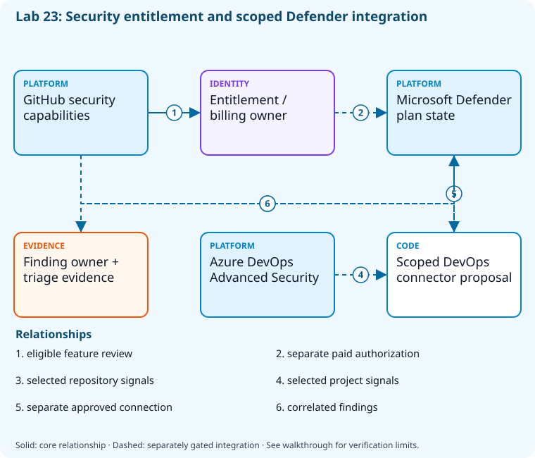

# Lab 23: Connect advanced security and Defender

[Previous: Lab 22](../22-security-scanning/README.md) · [Catalog](../../docs/lab-catalog.md) · [Next: Lab 24](../24-monitoring-alerts/README.md)

## Scenario, role, and outcome

Security products and Defender connectors are proposed without entitlement or scope review. Establish explicit license, billing, connector, and triage boundaries.

Learner role: **Security platform owner**. Outcome: Connect advanced security and Defender.

| Item | Value |
|---|---|
| Time | 120 minutes |
| Domain | security |
| Platforms | local, github, azure-devops, azure |
| Cost | paid features gated; core inspection only — review [current pricing and cleanup](../../docs/cost-and-cleanup.md) before cloud execution |
| Exam blueprint | July 27, 2026; sources reviewed October 16, 2026 |
| Verification | Authored and checked offline; no live Azure deployment is claimed |

Completion requires all five checkpoints, the break/fix repair, successful
independent validation, and a passing residual-resource audit. An unavailable
external prerequisite is a visible gate; it does not become a passing result.

## Architecture and service topology



GitHub capability metadata and subscription Defender plan reads inform an entitlement review; they do not enable a paid product. Connector proposals select only the owned repository/project and need a security/billing owner. A synthetic finding exercises triage ownership while real Advanced Security activation and Defender correlation remain explicitly gated integrations.

The editable [Mermaid source](diagrams/architecture.mmd) and accessible SVG
render the same authored components and relationships. Dashed connections show
separately gated integrations. Read every boundary before executing commands. Cloud changes
stay inside the exact disposable GitHub repository, Azure DevOps project, and
Azure resource group recorded for this run. Child objects inherit that cleanup
boundary. Account creation, external integrations, and privileged organization
settings belong to [one-time bootstrap](../../docs/account-bootstrap.md).

## Objectives and checkpoints

Official objective topic IDs: `D4.3.2`, `D4.3.3`, `D4.3.4`

| Checkpoint | Measurable behavior |
|---|---|
| [CP1](#task-1) | Inspect repository security capability metadata |
| [CP2](#task-2) | Prepare an explicit Advanced Security entitlement review |
| [CP3](#task-3) | Inspect Microsoft Defender pricing state without changing plans |
| [CP4](#task-4) | Map GitHub and Azure DevOps findings into Defender governance |
| [CP5](#task-5) | Triage a synthetic finding with an evidence-based decision |

The [objective map](../../docs/objective-map.md) traces every official topic to
labs. The [Microsoft study guide](https://learn.microsoft.com/en-us/credentials/certifications/resources/study-guides/az-400)
controls authoritative objective wording and domain weighting.

## Inputs, permissions, and read-only preflight

Use PowerShell 7.4+, .NET 10, Git, GitHub CLI, Azure CLI with the Azure DevOps
extension, and the pinned repository validation dependencies. Read the
[permissions matrix](../../docs/permissions-matrix.md) and [evidence policy](../../docs/evidence-handling.md).
Supply only the accounts needed by this lab. Never put a token, connection
string, or private key into a command log, committed YAML, or progress export.

The examples run from the repository root. Choose a fresh lowercase run ID;
`demo01` is an example, not a reusable shared sandbox. Set bootstrap environment
variables for the approved GitHub owner, DevOps organization, subscription, and
region. Do not run both guided and automated lanes with the same run ID.

```powershell
$lab = './labs/23-advanced-security-defender/scripts/cli'
& "$lab/Preflight.ps1" -RunId 'demo01'
& "$lab/Setup.ps1" -RunId 'demo01' -ProvisionOnly
# After reviewing context, permissions, cost, and cleanup:
& "$lab/Setup.ps1" -RunId 'demo01' -ProvisionOnly -Execute -AcknowledgeCost -AcknowledgeTenantChange
. "$lab/Context.ps1" -RunId 'demo01'
```

Preflight performs reads only. Provisioning creates fresh run-owned top-level
sandboxes and records their exact IDs. Context establishes `$RepoRoot`,
`$LabRoot`, `$WorkRoot`, `$RunId`, `$GhRepo`, `$AdoOrganization`, `$AdoProject`,
`$SubscriptionId`, `$Location`, and `$ResourceGroup`. A missing prerequisite or
ownership mismatch must stop execution. Local build commands may restore
packages and write ignored build output.

## Concept primer and design decisions

Advanced security capabilities vary with visibility and entitlement. Defender integration does not justify organization-wide collection or subscription billing changes from a repository lab.

## Task 1 — Inspect repository security capability metadata

<a id="task-1"></a>

Checkpoint: `CP1`

```powershell
gh api "repos/$GhRepo" --jq '{name:.full_name,visibility:.visibility,security:.security_and_analysis}'|Set-Content (Join-Path $WorkRoot 'security-capabilities.json')
```

Expected state: Repository visibility and exposed security feature capabilities are recorded.

Positive validation:

```powershell
$r=Get-Content (Join-Path $WorkRoot 'security-capabilities.json') -Raw|ConvertFrom-Json
 if($r.name -ne $GhRepo){throw 'Security review targeted another repository.'}
```

Negative validation:

```powershell
$r=Get-Content (Join-Path $WorkRoot 'security-capabilities.json') -Raw|ConvertFrom-Json
 if($r.visibility -notin @('public','private','internal')){throw 'Unknown capability/visibility context.'}
```

Evidence to retain: Feature metadata and plan/license constraints.

Common failure and safe retry: Capabilities depend on repository ownership/visibility and account licensing; unavailable access is a gate.

Cleanup dependency: retain this checkpoint's evidence until final validation; remove run-owned children before their recorded parent boundary.

## Task 2 — Prepare an explicit Advanced Security entitlement review

<a id="task-2"></a>

Checkpoint: `CP2`

```powershell
$entitlement=[ordered]@{github='public-repository supported features; verify current licensing';azureDevOps='GitHub Advanced Security for Azure DevOps requires eligible paid entitlement';approvedPaidActivation=$false;billingOwnerApprovalRequired=$true}
 $entitlement|ConvertTo-Json|Set-Content (Join-Path $WorkRoot 'entitlements.json')
```

Expected state: Paid activation remains blocked until an authorized billing owner approves it.

Positive validation:

```powershell
$e=Get-Content (Join-Path $WorkRoot 'entitlements.json') -Raw|ConvertFrom-Json
 if(-not $e.billingOwnerApprovalRequired){throw 'Paid entitlement approval absent.'}
```

Negative validation:

```powershell
$e=Get-Content (Join-Path $WorkRoot 'entitlements.json') -Raw|ConvertFrom-Json
 if($e.approvedPaidActivation){throw 'This offline review grants no paid entitlement.'}
```

Evidence to retain: Product feature/entitlement matrix dated to the current review.

Common failure and safe retry: Check current product names, pricing, and eligible repositories before enabling billable scanning.

Cleanup dependency: retain this checkpoint's evidence until final validation; remove run-owned children before their recorded parent boundary.

## Task 3 — Inspect Microsoft Defender pricing state without changing plans

<a id="task-3"></a>

Checkpoint: `CP3`

```powershell
az security pricing list --subscription $SubscriptionId --query 'value[].{name:name,tier:pricingTier,subPlan:subPlan}' -o json|Set-Content (Join-Path $WorkRoot 'defender-plans.json')
```

Expected state: Current subscription plan state is read; no Defender plan is enabled.

Positive validation:

```powershell
$p=@(Get-Content (Join-Path $WorkRoot 'defender-plans.json') -Raw|ConvertFrom-Json)
 if($p.Count -lt 1){throw 'No readable Defender pricing inventory.'}
```

Negative validation:

```powershell
$p=@(Get-Content (Join-Path $WorkRoot 'defender-plans.json') -Raw|ConvertFrom-Json)
 if(@($p|Where-Object { $_.tier -notin @('Free','Standard') }).Count){throw 'Unknown Defender plan tier requires review.'}
```

Evidence to retain: Plan names/tier, with subscription identity redacted.

Common failure and safe retry: Security Reader permission may be needed. Never call pricing create/update to bypass a missing entitlement.

Cleanup dependency: retain this checkpoint's evidence until final validation; remove run-owned children before their recorded parent boundary.

## Task 4 — Map GitHub and Azure DevOps findings into Defender governance

<a id="task-4"></a>

Checkpoint: `CP4`

```powershell
$mapping=@([ordered]@{source='GitHub';signal='code/dependency/secret';connectorOwner='security-admin';scope=$GhRepo},[ordered]@{source='Azure DevOps';signal='advanced-security';connectorOwner='security-admin';scope=$AdoProject})
 $mapping|ConvertTo-Json|Set-Content (Join-Path $WorkRoot 'connector-review.json')
```

Expected state: Connector ownership and selected repository/project scope are explicit; no organization connector is created.

Positive validation:

```powershell
$m=@(Get-Content (Join-Path $WorkRoot 'connector-review.json') -Raw|ConvertFrom-Json)
 if($m.Count -ne 2 -or @($m|Where-Object connectorOwner -ne 'security-admin').Count){throw 'Security connector governance incomplete.'}
```

Negative validation:

```powershell
$m=@(Get-Content (Join-Path $WorkRoot 'connector-review.json') -Raw|ConvertFrom-Json)
 if('*' -in $m.scope){throw 'Connector scope must not select every organization repository.'}
```

Evidence to retain: Connector design with explicit authorization and billing boundaries.

Common failure and safe retry: Use separate one-time privileged bootstrap for connectors; repository ownership does not authorize organization-wide collection.

Cleanup dependency: retain this checkpoint's evidence until final validation; remove run-owned children before their recorded parent boundary.

## Task 5 — Triage a synthetic finding with an evidence-based decision

<a id="task-5"></a>

Checkpoint: `CP5`

```powershell
$finding=[ordered]@{id='training-codeql-001';severity='high';reachable=$true;owner='sample-maintainer';action='fix before release';dismissed=$false;evidence='request input reaches unsafe sink in synthetic example';falsePositive=$false}
 $finding|ConvertTo-Json|Set-Content (Join-Path $WorkRoot 'triage.json')
```

Expected state: A reachable high finding blocks release and has a named remediation owner.

Positive validation:

```powershell
$f=Get-Content (Join-Path $WorkRoot 'triage.json') -Raw|ConvertFrom-Json
 if($f.action -ne 'fix before release' -or -not $f.reachable){throw 'Triage decision inconsistent with evidence.'}
```

Negative validation:

```powershell
$f=Get-Content (Join-Path $WorkRoot 'triage.json') -Raw|ConvertFrom-Json
 if($f.dismissed -or $f.falsePositive){throw 'Synthetic reachable finding cannot be dismissed without contrary evidence.'}
```

Evidence to retain: Finding ID, owner, reachability rationale, and remediation criteria.

Common failure and safe retry: Record concrete false-positive evidence before dismissal; severity changes require traceable review.

Cleanup dependency: retain this checkpoint's evidence until final validation; remove run-owned children before their recorded parent boundary.

## Deterministic break/fix

Inject this fault only in the recorded sandbox or local run directory.

```powershell
$f=Get-Content (Join-Path $WorkRoot 'triage.json') -Raw|ConvertFrom-Json;$f.dismissed=$true;$f|ConvertTo-Json|Set-Content (Join-Path $WorkRoot 'triage.json')
```

Diagnose the precise difference:

```powershell
Get-Content (Join-Path $WorkRoot 'triage.json')
```

Repair, then repeat the affected checkpoint validation:

```powershell
$f=Get-Content (Join-Path $WorkRoot 'triage.json') -Raw|ConvertFrom-Json;$f.dismissed=$false;$f|ConvertTo-Json|Set-Content (Join-Path $WorkRoot 'triage.json')
```

## Optional job-style challenge

In a separately authorized licensed sandbox, enable the eligible security product, generate a harmless test alert, correlate it in Defender, and document connector removal and billing cleanup.

## Final validation and result interpretation

```powershell
& './labs/23-advanced-security-defender/scripts/cli/Validate.ps1' -RunId 'demo01'
```

A complete result requires five passing read-only assertions. Pending hosted runs, missing licensed features, and unexecuted integration challenges remain visible. Review `validation.json`; a command exiting successfully is not enough if the asserted behavior is absent.

## Troubleshooting

- **401/403:** inspect the explicit account/project/repository scope and required role; do not broaden a token reflexively.
- **Resource or artifact missing:** confirm the exact run ID and prerequisite checkpoint; retry reads after eventual consistency.
- **Unsupported SKU/runtime/tool:** consult the specific current source, record the gate, and obtain approval before changing cost or architecture.
- **Validation mismatch:** inspect the positive and negative assertions separately, repair the named fault, and rerun validation.
- **Ownership refusal:** stop; never edit a manifest to claim an unrelated resource.

## Cleanup and residual checks

```powershell
& './labs/23-advanced-security-defender/scripts/cli/Cleanup.ps1' -RunId 'demo01'
# Review the exact owned-object deletion plan first.
& './labs/23-advanced-security-defender/scripts/cli/Cleanup.ps1' -RunId 'demo01' -Execute
```

Cleanup must verify ownership, delete only recorded sandbox objects in dependency order, and prove parent/child absence. Retain `run.json`, `validation.json`, and `cleanup.json` locally until the audit passes. Soft-deleted or deliberately retained items must remain reported. Never purge a shared vault or delete an account, organization, or pre-existing service connection to finish a lab.

## Exam debrief and assessment

Explain why each checkpoint's denied path matters, which scope authorizes it, what evidence proves it, and how it is reversed. Complete the [50-question assessment](QUESTIONS.md), then review [rationales](ANSWERS.md) and repeat weak checkpoints.

## Microsoft and platform sources

- [Primary source 1](https://learn.microsoft.com/en-us/azure/defender-for-cloud/defender-for-devops-introduction) — reviewed 2026-10-16.
- [Primary source 2](https://learn.microsoft.com/en-us/azure/devops/repos/security/github-advanced-security) — reviewed 2026-10-16.
- [Primary source 3](https://docs.github.com/en/code-security/getting-started/github-security-features) — reviewed 2026-10-16.

## Lifecycle scripts and worked solution

Use `scripts/cli/Preflight.ps1`, `Setup.ps1`, `Validate.ps1`, `Cleanup.ps1`, and `Context.ps1` from this lab folder. Setup and cleanup preview until `-Execute`; `-ProvisionOnly` creates only fresh ownership-tracked containers. The [worked solution](solution/README.md) lists expected results and repair reasoning.
