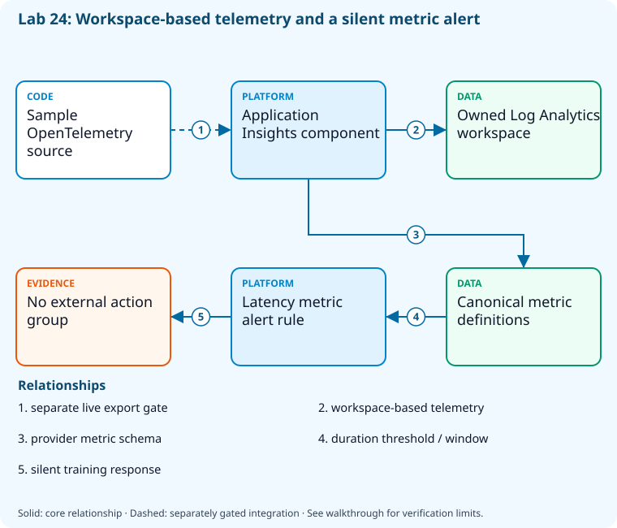

# Lab 24: Collect telemetry and configure actionable alerts

[Previous: Lab 23](../23-advanced-security-defender/README.md) · [Catalog](../../docs/lab-catalog.md) · [Next: Lab 25](../25-kql-distributed-tracing/README.md)

## Scenario, role, and outcome

The team can deploy an app but has no owned telemetry store or actionable latency rule. Connect workspace-based telemetry and create a silent training alert.

Learner role: **Observability engineer**. Outcome: Collect telemetry and configure actionable alerts.

| Item | Value |
|---|---|
| Time | 120 minutes |
| Domain | instrumentation |
| Platforms | local, azure |
| Cost | billable; explicit acknowledgement — review [current pricing and cleanup](../../docs/cost-and-cleanup.md) before cloud execution |
| Exam blueprint | July 27, 2026; sources reviewed October 16, 2026 |
| Verification | Authored and checked offline; no live Azure deployment is claimed |

Completion requires all five checkpoints, the break/fix repair, successful
independent validation, and a passing residual-resource audit. An unavailable
external prerequisite is a visible gate; it does not become a passing result.

## Architecture and service topology



The Application Insights component is actually linked to the owned Log Analytics workspace. Provider metric definitions supply the latency name/unit before the alert rule is created. The rule has no external action group and sends no messages. Emitting sample telemetry and proving a firing transition are separate integration gates; configured resources alone do not establish live ingestion.

The editable [Mermaid source](diagrams/architecture.mmd) and accessible SVG
render the same authored components and relationships. Dashed connections show
separately gated integrations. Read every boundary before executing commands. Cloud changes
stay inside the exact disposable GitHub repository, Azure DevOps project, and
Azure resource group recorded for this run. Child objects inherit that cleanup
boundary. Account creation, external integrations, and privileged organization
settings belong to [one-time bootstrap](../../docs/account-bootstrap.md).

## Objectives and checkpoints

Official objective topic IDs: `D1.2.7`, `D5.1.1`, `D5.1.2`, `D5.1.3`, `D5.1.4`

| Checkpoint | Measurable behavior |
|---|---|
| [CP1](#task-1) | Create the owned Log Analytics workspace |
| [CP2](#task-2) | Connect a workspace-based Application Insights component |
| [CP3](#task-3) | Inspect supported metric names before selecting alerts |
| [CP4](#task-4) | Create a silent sandbox response-time alert |
| [CP5](#task-5) | Map pipeline and platform telemetry to owned response actions |

The [objective map](../../docs/objective-map.md) traces every official topic to
labs. The [Microsoft study guide](https://learn.microsoft.com/en-us/credentials/certifications/resources/study-guides/az-400)
controls authoritative objective wording and domain weighting.

## Inputs, permissions, and read-only preflight

Use PowerShell 7.4+, .NET 10, Git, GitHub CLI, Azure CLI with the Azure DevOps
extension, and the pinned repository validation dependencies. Read the
[permissions matrix](../../docs/permissions-matrix.md) and [evidence policy](../../docs/evidence-handling.md).
Supply only the accounts needed by this lab. Never put a token, connection
string, or private key into a command log, committed YAML, or progress export.

The examples run from the repository root. Choose a fresh lowercase run ID;
`demo01` is an example, not a reusable shared sandbox. Set bootstrap environment
variables for the approved GitHub owner, DevOps organization, subscription, and
region. Do not run both guided and automated lanes with the same run ID.

```powershell
$lab = './labs/24-monitoring-alerts/scripts/cli'
& "$lab/Preflight.ps1" -RunId 'demo01'
& "$lab/Setup.ps1" -RunId 'demo01' -ProvisionOnly
# After reviewing context, permissions, cost, and cleanup:
& "$lab/Setup.ps1" -RunId 'demo01' -ProvisionOnly -Execute -AcknowledgeCost -AcknowledgeTenantChange
. "$lab/Context.ps1" -RunId 'demo01'
```

Preflight performs reads only. Provisioning creates fresh run-owned top-level
sandboxes and records their exact IDs. Context establishes `$RepoRoot`,
`$LabRoot`, `$WorkRoot`, `$RunId`, `$GhRepo`, `$AdoOrganization`, `$AdoProject`,
`$SubscriptionId`, `$Location`, and `$ResourceGroup`. A missing prerequisite or
ownership mismatch must stop execution. Local build commands may restore
packages and write ignored build output.

## Concept primer and design decisions

A workspace, instrumentation, ingestion, query, and alert action are separate links. A configured rule without telemetry proves configuration only; no external notifications are sent here.

## Task 1 — Create the owned Log Analytics workspace

<a id="task-1"></a>

Checkpoint: `CP1`

```powershell
$name="logs-$RunId"
 $w=az monitor log-analytics workspace create --subscription $SubscriptionId --resource-group $ResourceGroup --workspace-name $name --location $Location --retention-time 30 --sku PerGB2018 -o json|ConvertFrom-Json
 $w|ConvertTo-Json -Depth 8|Set-Content (Join-Path $WorkRoot 'workspace.json')
```

Expected state: A30-day workspace exists in the owned group; ingestion pricing still applies.

Positive validation:

```powershell
$w=az monitor log-analytics workspace show --subscription $SubscriptionId --resource-group $ResourceGroup --workspace-name "logs-$RunId" -o json|ConvertFrom-Json
 if($w.retentionInDays -ne 30){throw 'Workspace retention mismatch.'}
```

Negative validation:

```powershell
$w=Get-Content (Join-Path $WorkRoot 'workspace.json') -Raw|ConvertFrom-Json
 if($w.id -notlike "*/resourceGroups/$ResourceGroup/*"){throw 'Workspace escaped owned group.'}
```

Evidence to retain: Workspace ID locally, retention, pricing tier, and ingestion budget.

Common failure and safe retry: Review current workspace billing and approved region; avoid ingesting production/private payloads.

Cleanup dependency: retain this checkpoint's evidence until final validation; remove run-owned children before their recorded parent boundary.

## Task 2 — Connect a workspace-based Application Insights component

<a id="task-2"></a>

Checkpoint: `CP2`

```powershell
$w=Get-Content (Join-Path $WorkRoot 'workspace.json') -Raw|ConvertFrom-Json
 az monitor app-insights component create --subscription $SubscriptionId --resource-group $ResourceGroup --app "insights-$RunId" --location $Location --workspace $w.id --kind web --application-type web -o json|Set-Content (Join-Path $WorkRoot 'insights.json')
```

Expected state: Application Insights is explicitly connected to the owned workspace.

Positive validation:

```powershell
$i=az monitor app-insights component show --subscription $SubscriptionId --resource-group $ResourceGroup --app "insights-$RunId" -o json|ConvertFrom-Json
 $w=Get-Content (Join-Path $WorkRoot 'workspace.json') -Raw|ConvertFrom-Json
 if($i.workspaceResourceId -ne $w.id){throw 'Insights workspace linkage mismatch.'}
```

Negative validation:

```powershell
$i=Get-Content (Join-Path $WorkRoot 'insights.json') -Raw|ConvertFrom-Json
 if($i.id -notlike "*/resourceGroups/$ResourceGroup/*"){throw 'Insights escaped owned group.'}
```

Evidence to retain: Component/workspace linkage; redact instrumentation/connection values.

Common failure and safe retry: Install the pinned application-insights extension during bootstrap; do not auto-install inside read-only preflight.

Cleanup dependency: retain this checkpoint's evidence until final validation; remove run-owned children before their recorded parent boundary.

## Task 3 — Inspect supported metric names before selecting alerts

<a id="task-3"></a>

Checkpoint: `CP3`

```powershell
$i=Get-Content (Join-Path $WorkRoot 'insights.json') -Raw|ConvertFrom-Json
 az monitor metrics list-definitions --subscription $SubscriptionId --resource $i.id --query '[].{name:name.value,unit:unit,aggregation:primaryAggregationType}' -o json|Set-Content (Join-Path $WorkRoot 'metric-definitions.json')
```

Expected state: The resource provider defines actual available metric names and units.

Positive validation:

```powershell
$m=@(Get-Content (Join-Path $WorkRoot 'metric-definitions.json') -Raw|ConvertFrom-Json)
 if('requests/duration' -notin $m.name){throw 'Expected request-duration metric unavailable; stop before creating alert.'}
```

Negative validation:

```powershell
$m=@(Get-Content (Join-Path $WorkRoot 'metric-definitions.json') -Raw|ConvertFrom-Json)
 if(@($m|Where-Object { -not $_.name }).Count){throw 'Metric definition missing canonical name.'}
```

Evidence to retain: Metric name/unit/aggregation; no inference of live application traffic.

Common failure and safe retry: Use the metric definition unit; avoid applying a millisecond threshold to a count or percent.

Cleanup dependency: retain this checkpoint's evidence until final validation; remove run-owned children before their recorded parent boundary.

## Task 4 — Create a silent sandbox response-time alert

<a id="task-4"></a>

Checkpoint: `CP4`

```powershell
$i=Get-Content (Join-Path $WorkRoot 'insights.json') -Raw|ConvertFrom-Json
 az monitor metrics alert create --subscription $SubscriptionId --resource-group $ResourceGroup --name "slow-requests-$RunId" --scopes $i.id --condition 'avg requests/duration > 1000' --window-size 5m --evaluation-frequency 1m --severity 3 --description "Run $RunId training alert; no external notification action" -o json|Set-Content (Join-Path $WorkRoot 'alert.json')
```

Expected state: A5-minute latency rule exists without action groups or messages to external recipients.

Positive validation:

```powershell
$a=az monitor metrics alert show --subscription $SubscriptionId --resource-group $ResourceGroup --name "slow-requests-$RunId" -o json|ConvertFrom-Json
 if(-not $a.enabled -or $a.windowSize -ne 'PT5M'){throw 'Latency alert disabled or wrong window.'}
```

Negative validation:

```powershell
$a=Get-Content (Join-Path $WorkRoot 'alert.json') -Raw|ConvertFrom-Json
 if(@($a.actions).Count -gt 0){throw 'This training alert must not notify external recipients.'}
```

Evidence to retain: Alert condition/window/severity and empty action list.

Common failure and safe retry: No telemetry means no proof of firing behavior; use an approved synthetic workload for the optional integration test.

Cleanup dependency: retain this checkpoint's evidence until final validation; remove run-owned children before their recorded parent boundary.

## Task 5 — Map pipeline and platform telemetry to owned response actions

<a id="task-5"></a>

Checkpoint: `CP5`

```powershell
$map=[ordered]@{application='request duration/error rate';infrastructure=@('CPU','memory','disk','network');github='workflow_run completion and repository insights';azurePipelines='build/release result';notificationMode='reviewed owner only';externalMessagesSent=0;liveTrafficVerified=$false}
 $map|ConvertTo-Json|Set-Content (Join-Path $WorkRoot 'telemetry-response-map.json')
```

Expected state: Application, infrastructure, and delivery signals have distinct response paths.

Positive validation:

```powershell
$m=Get-Content (Join-Path $WorkRoot 'telemetry-response-map.json') -Raw|ConvertFrom-Json
 if($m.infrastructure.Count -ne 4 -or $m.github -notmatch 'workflow_run'){throw 'Telemetry signal map incomplete.'}
```

Negative validation:

```powershell
$m=Get-Content (Join-Path $WorkRoot 'telemetry-response-map.json') -Raw|ConvertFrom-Json
 if($m.externalMessagesSent -ne 0 -or $m.liveTrafficVerified){throw 'Design review cannot claim traffic/notification verification.'}
```

Evidence to retain: Signal-to-owner/action matrix and unverified integration gates.

Common failure and safe retry: Configure VM/Container/Storage/Network Insights only for approved owned resources; avoid collecting credentials or personal request bodies.

Cleanup dependency: retain this checkpoint's evidence until final validation; remove run-owned children before their recorded parent boundary.

## Deterministic break/fix

Inject this fault only in the recorded sandbox or local run directory.

```powershell
az monitor metrics alert update --subscription $SubscriptionId --resource-group $ResourceGroup --name "slow-requests-$RunId" --enabled false -o none
```

Diagnose the precise difference:

```powershell
az monitor metrics alert show --subscription $SubscriptionId --resource-group $ResourceGroup --name "slow-requests-$RunId" --query '{enabled:enabled,window:windowSize}' -o json
```

Repair, then repeat the affected checkpoint validation:

```powershell
az monitor metrics alert update --subscription $SubscriptionId --resource-group $ResourceGroup --name "slow-requests-$RunId" --enabled true -o none
```

## Optional job-style challenge

Emit an approved synthetic trace/request through the sample and demonstrate the alert changing state without sending unsolicited Teams/email notifications.

## Final validation and result interpretation

```powershell
& './labs/24-monitoring-alerts/scripts/cli/Validate.ps1' -RunId 'demo01'
```

A complete result requires five passing read-only assertions. Pending hosted runs, missing licensed features, and unexecuted integration challenges remain visible. Review `validation.json`; a command exiting successfully is not enough if the asserted behavior is absent.

## Troubleshooting

- **401/403:** inspect the explicit account/project/repository scope and required role; do not broaden a token reflexively.
- **Resource or artifact missing:** confirm the exact run ID and prerequisite checkpoint; retry reads after eventual consistency.
- **Unsupported SKU/runtime/tool:** consult the specific current source, record the gate, and obtain approval before changing cost or architecture.
- **Validation mismatch:** inspect the positive and negative assertions separately, repair the named fault, and rerun validation.
- **Ownership refusal:** stop; never edit a manifest to claim an unrelated resource.

## Cleanup and residual checks

```powershell
& './labs/24-monitoring-alerts/scripts/cli/Cleanup.ps1' -RunId 'demo01'
# Review the exact owned-object deletion plan first.
& './labs/24-monitoring-alerts/scripts/cli/Cleanup.ps1' -RunId 'demo01' -Execute
```

Cleanup must verify ownership, delete only recorded sandbox objects in dependency order, and prove parent/child absence. Retain `run.json`, `validation.json`, and `cleanup.json` locally until the audit passes. Soft-deleted or deliberately retained items must remain reported. Never purge a shared vault or delete an account, organization, or pre-existing service connection to finish a lab.

## Exam debrief and assessment

Explain why each checkpoint's denied path matters, which scope authorizes it, what evidence proves it, and how it is reversed. Complete the [50-question assessment](QUESTIONS.md), then review [rationales](ANSWERS.md) and repeat weak checkpoints.

## Microsoft and platform sources

- [Primary source 1](https://learn.microsoft.com/en-us/azure/azure-monitor/app/app-insights-overview) — reviewed 2026-10-16.
- [Primary source 2](https://learn.microsoft.com/en-us/azure/azure-monitor/alerts/alerts-metric-overview) — reviewed 2026-10-16.
- [Primary source 3](https://learn.microsoft.com/en-us/cli/azure/monitor/metrics/alert) — reviewed 2026-10-16.

## Lifecycle scripts and worked solution

Use `scripts/cli/Preflight.ps1`, `Setup.ps1`, `Validate.ps1`, `Cleanup.ps1`, and `Context.ps1` from this lab folder. Setup and cleanup preview until `-Execute`; `-ProvisionOnly` creates only fresh ownership-tracked containers. The [worked solution](solution/README.md) lists expected results and repair reasoning.
