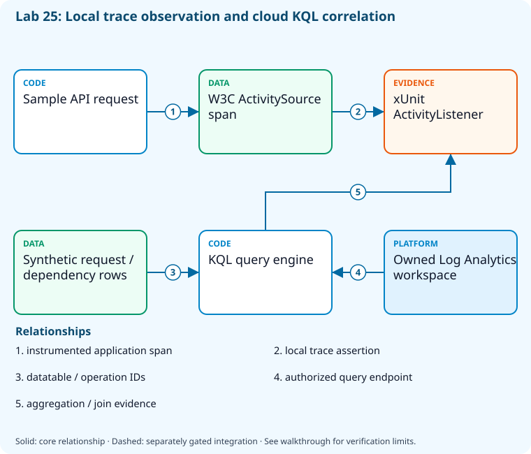

# Lab 25: Query logs and correlate distributed traces

[Previous: Lab 24](../24-monitoring-alerts/README.md) · [Catalog](../../docs/lab-catalog.md) · [Next: Lab 26](../26-capstone-github/README.md)

## Scenario, role, and outcome

Operators see a slow request but lack correlated evidence. Use explicit KQL datatables and trace tests to practise aggregation, joins, and instrumentation boundaries.

Learner role: **Site reliability engineer**. Outcome: Query logs and correlate distributed traces.

| Item | Value |
|---|---|
| Time | 120 minutes |
| Domain | instrumentation |
| Platforms | local, azure |
| Cost | billable; explicit acknowledgement — review [current pricing and cleanup](../../docs/cost-and-cleanup.md) before cloud execution |
| Exam blueprint | July 27, 2026; sources reviewed October 16, 2026 |
| Verification status | offline-tested |
| Verification scope | All five checkpoint commands, final validators and named fault/repair executed in CourseSecurityTelemetry.Tests.ps1 with fail-closed provider doubles. Local calculations, permission/reference/secure-file fixtures and .NET trace behavior are real; live provider calls, federation and telemetry export have not run. |

Completion requires all five checkpoints, the break/fix repair, successful
independent validation, and a passing residual-resource audit. An unavailable
external prerequisite is a visible gate; it does not become a passing result.

## Architecture and service topology



A local ActivityListener proves that the sample emits the expected application span. Separately, an owned Log Analytics workspace evaluates explicit synthetic KQL datatables for latency and request/dependency correlation. These two evidence lanes do not imply that a live Azure exporter has ingested traces; real-table schema and export verification belong to the additional integration challenge.

The editable [Mermaid source](diagrams/architecture.mmd) and accessible SVG
render the same authored components and relationships. Dashed connections show
separately gated integrations. Read every boundary before executing commands. Cloud changes
stay inside the exact disposable GitHub repository, Azure DevOps project, and
Azure resource group recorded for this run. Child objects inherit that cleanup
boundary. Account creation, external integrations, and privileged organization
settings belong to [one-time bootstrap](../../docs/account-bootstrap.md).

## Objectives and checkpoints

Coverage levels describe the intended learning evidence: **explained** means reasoned
understanding, **practiced** means an observable isolated skill, and **integrated**
means skills connected across a delivery boundary. These labels are curriculum
claims, not execution status. Verification above records what authors actually ran.

Official objective topic IDs: `D5.1.2`, `D5.2.1`, `D5.2.2`, `D5.2.3`, `D5.2.4`

| Checkpoint | Measurable behavior |
|---|---|
| [CP1](#task-1) | Create an isolated workspace for KQL evaluation |
| [CP2](#task-2) | Calculate latency and failure rate with KQL |
| [CP3](#task-3) | Prove the sample emits a distributed trace span |
| [CP4](#task-4) | Join synthetic requests and dependencies by operation identity |
| [CP5](#task-5) | Analyze numeric infrastructure and request evidence |

The [objective map](../../docs/objective-map.md) traces every official topic to
labs. The [Microsoft study guide](https://learn.microsoft.com/en-us/credentials/certifications/resources/study-guides/az-400)
controls authoritative objective wording and domain weighting.

## Inputs, permissions, and read-only preflight

Use PowerShell 7.4+, .NET 10, Git, GitHub CLI, Azure CLI with the Azure DevOps
extension, and the pinned repository validation dependencies. Read the
[permissions matrix](../../docs/permissions-matrix.md) and [evidence policy](../../docs/evidence-handling.md).
Supply only the accounts needed by this lab. Never put a token, connection
string, or private key into a command log, committed YAML, or progress export.

The examples run from the repository root. Choose a fresh lowercase run ID;
`demo01` is an example, not a reusable shared sandbox. Set bootstrap environment
variables for the approved GitHub owner, DevOps organization, subscription, and
region. Do not run both guided and automated lanes with the same run ID.

```powershell
$lab = './labs/25-kql-distributed-tracing/scripts/cli'
& "$lab/Preflight.ps1" -RunId 'demo01'
& "$lab/Setup.ps1" -RunId 'demo01' -ProvisionOnly
# After reviewing context, permissions, cost, and cleanup:
& "$lab/Setup.ps1" -RunId 'demo01' -ProvisionOnly -Execute -AcknowledgeCost -AcknowledgeTenantChange
. "$lab/Context.ps1" -RunId 'demo01'
```

Preflight performs reads only. Provisioning creates fresh run-owned top-level
sandboxes and records their exact IDs. Context establishes `$RepoRoot`,
`$LabRoot`, `$WorkRoot`, `$RunId`, `$GhRepo`, `$AdoOrganization`, `$AdoProject`,
`$SubscriptionId`, `$Location`, and `$ResourceGroup`. A missing prerequisite or
ownership mismatch must stop execution. Local build commands may restore
packages and write ignored build output.

## Concept primer and design decisions

Trace identity correlates a request with dependencies; timestamp proximity does not. Sampling and unmatched rows affect joins; units and observed windows matter when interpreting infrastructure signals.

Request and dependency spans correlate through a shared operation identity, not merely similar timestamps. A leftouter join retains a request with no dependency, while an inner join silently removes it. Sampling and missing telemetry should influence the interpretation rather than be hidden.

The KQL datatable tasks execute deterministic aggregates in an actual selected workspace; the local ActivityListener test proves span creation without proving export. A separate Python reference calculation reads raw CPU, memory, disk and network samples and must state that it is not a KQL engine. Compare units, windows and exact numeric expectations before accepting an operational hypothesis.

## Task 1 — Create an isolated workspace for KQL evaluation

<a id="task-1"></a>

Checkpoint: `CP1`

Foundation/supporting task; no additional exam-objective coverage is claimed.

```powershell
$w=az monitor log-analytics workspace create --subscription $SubscriptionId --resource-group $ResourceGroup --workspace-name "query-$RunId" --location $Location --retention-time 30 --sku PerGB2018 -o json|ConvertFrom-Json
 $w.customerId|Set-Content (Join-Path $WorkRoot 'workspace-customer-id.txt')
 $w|ConvertTo-Json -Depth 8|Set-Content (Join-Path $WorkRoot 'query-workspace.json')
```

Expected state: A dedicated workspace provides a query endpoint; sample datatables require no application-data ingestion.

Positive validation:

```powershell
$w=az monitor log-analytics workspace show --subscription $SubscriptionId --resource-group $ResourceGroup --workspace-name "query-$RunId" -o json|ConvertFrom-Json
 if($w.customerId -ne (Get-Content (Join-Path $WorkRoot 'workspace-customer-id.txt'))){throw 'Query workspace identity mismatch.'}
```

Negative validation:

```powershell
$w=Get-Content (Join-Path $WorkRoot 'query-workspace.json') -Raw|ConvertFrom-Json
 if($w.id -notlike "*/resourceGroups/$ResourceGroup/*"){throw 'Query workspace escaped run boundary.'}
```

Evidence to retain: Workspace ID locally and declared synthetic-data scope.

Common failure and safe retry: Wait for workspace query availability and confirm Log Analytics Reader/query permission before retrying.

Cleanup dependency: retain this checkpoint's evidence until final validation; remove run-owned children before their recorded parent boundary.

## Task 2 — Calculate latency and failure rate with KQL

<a id="task-2"></a>

Checkpoint: `CP2`

| Objective | Evidence level | Observation and limits |
|---|---|---|
| `D5.2.2` | practiced | Run a KQL datatable aggregation in the selected workspace and compare exact requests/failures/p95 outputs. |
| `D5.2.4` | practiced | Execute and assert Kusto aggregation results; Python fixture output is only a reference calculation. |

```powershell
$q='datatable(operation:string,durationMs:real,success:bool)["read",10.0,true,"read",30.0,true,"write",100.0,false] | summarize requests=count(), failures=countif(success == false), p95Ms=percentile(durationMs,95)'
 $q|Set-Content (Join-Path $WorkRoot 'latency.kql')
 $id=Get-Content (Join-Path $WorkRoot 'workspace-customer-id.txt')
 az monitor log-analytics query --subscription $SubscriptionId --workspace $id --analytics-query $q -o json|Set-Content (Join-Path $WorkRoot 'latency-results.json')
```

Expected state: Three synthetic operations produce one failure and a measured latency percentile.

Positive validation:

```powershell
$r=@(Get-Content (Join-Path $WorkRoot 'latency-results.json') -Raw|ConvertFrom-Json)
 if($r.Count -ne 1 -or [int]$r[0].requests -ne 3 -or [int]$r[0].failures -ne 1){throw 'KQL aggregation mismatch.'}
```

Negative validation:

```powershell
$r=@(Get-Content (Join-Path $WorkRoot 'latency-results.json') -Raw|ConvertFrom-Json)
 if([double]$r[0].p95Ms -lt 30){throw 'Percentile lost the slow operation.'}
```

Evidence to retain: Query text, synthetic row count, and result; real small-sample percentiles need caution.

Common failure and safe retry: Use countif on a Boolean comparison and retain units in metric names.

Cleanup dependency: retain this checkpoint's evidence until final validation; remove run-owned children before their recorded parent boundary.

## Task 3 — Prove the sample emits a distributed trace span

<a id="task-3"></a>

Checkpoint: `CP3`

| Objective | Evidence level | Observation and limits |
|---|---|---|
| `D5.1.2` | practiced | Execute the local ActivityListener trace test and distinguish local span creation from exporter ingestion. |

```powershell
dotnet test (Join-Path $RepoRoot 'samples/DevOps.slnx') --configuration Release --filter 'FullyQualifiedName~CreatesTraceSpanForTodoWrite' --logger "trx;LogFileName=trace.trx" --results-directory (Join-Path $WorkRoot 'trace-tests')
 if($LASTEXITCODE -ne 0){throw 'Trace instrumentation test failed.'}
```

Expected state: An ActivityListener observes the sample application span without requiring an Azure exporter.

Positive validation:

```powershell
$f=Get-ChildItem (Join-Path $WorkRoot 'trace-tests') -Filter '*.trx' -Recurse|Select-Object -First 1;$x=[xml](Get-Content $f.FullName -Raw)
 if([int]$x.TestRun.ResultSummary.Counters.passed -lt 1){throw 'No trace test selected.'}
```

Negative validation:

```powershell
$f=Get-ChildItem (Join-Path $WorkRoot 'trace-tests') -Filter '*.trx' -Recurse|Select-Object -First 1;$x=[xml](Get-Content $f.FullName -Raw)
 if([int]$x.TestRun.ResultSummary.Counters.failed -gt 0){throw 'Trace propagation regression.'}
```

Evidence to retain: Span test name/result; test instrumentation is distinct from a live Azure export.

Common failure and safe retry: Ensure ActivitySource names match listeners/exporters and propagate W3C trace context across services.

Cleanup dependency: retain this checkpoint's evidence until final validation; remove run-owned children before their recorded parent boundary.

## Task 4 — Join synthetic requests and dependencies by operation identity

<a id="task-4"></a>

Checkpoint: `CP4`

| Objective | Evidence level | Observation and limits |
|---|---|---|
| `D5.2.3` | practiced | Use a leftouter KQL join to retain requests with no dependency span; local span test is separate evidence. |

```powershell
$q='let requests=datatable(operation_Id:string,name:string)["op1","POST /todos","op2","GET /todos"]; let dependencies=datatable(operation_Id:string,target:string,durationMs:real)["op1","sqlite",12.0]; requests | join kind=leftouter dependencies on operation_Id | project operation_Id,name,target,durationMs'
 $q|Set-Content (Join-Path $WorkRoot 'correlation.kql')
 az monitor log-analytics query --subscription $SubscriptionId --workspace (Get-Content (Join-Path $WorkRoot 'workspace-customer-id.txt')) --analytics-query $q -o json|Set-Content (Join-Path $WorkRoot 'correlation-results.json')
```

Expected state: Left-outer correlation retains the request that has no dependency row.

Positive validation:

```powershell
$r=@(Get-Content (Join-Path $WorkRoot 'correlation-results.json') -Raw|ConvertFrom-Json)
 if($r.Count -ne 2 -or @($r|Where-Object target -eq 'sqlite').Count -ne 1){throw 'Trace correlation mismatch.'}
```

Negative validation:

```powershell
$r=@(Get-Content (Join-Path $WorkRoot 'correlation-results.json') -Raw|ConvertFrom-Json)
 if('op2' -notin $r.operation_Id){throw 'An inner join incorrectly dropped an unlinked request.'}
```

Evidence to retain: Operation IDs, join kind, and retained unmatched request count.

Common failure and safe retry: Use trace/operation identity rather than timestamp coincidence; account for sampling and missing instrumentation.

Cleanup dependency: retain this checkpoint's evidence until final validation; remove run-owned children before their recorded parent boundary.

## Task 5 — Analyze numeric infrastructure and request evidence

<a id="task-5"></a>

Checkpoint: `CP5`

| Objective | Evidence level | Observation and limits |
|---|---|---|
| `D5.2.1` | practiced | Calculate CPU, memory, disk, and network maxima from raw local telemetry measurements. |

```powershell
python (Join-Path $LabRoot 'artifacts/query_fixtures.py') --input (Join-Path $LabRoot 'artifacts/telemetry-fixtures.json') --output (Join-Path $WorkRoot 'query-results.json')
if($LASTEXITCODE -ne 0){throw 'Reference telemetry calculations failed.'}
$r=Get-Content (Join-Path $WorkRoot 'query-results.json') -Raw|ConvertFrom-Json
$hypothesis=if($r.resourceMaxima.cpuPercent -ge 70 -and $r.resourceMaxima.diskLatencyMs -ge 10){'Investigate CPU and disk contention during the request window; correlation is not causation.'}else{'No threshold exceeded in this fixture; retain the raw window.'}
@{fixtureOnly=$true;hypothesis=$hypothesis;requests=$r.counts.requests;failures=$r.counts.failures;liveExporterVerified=$false}|ConvertTo-Json|Set-Content (Join-Path $WorkRoot 'signal-interpretation.json')
Copy-Item (Join-Path $LabRoot 'artifacts/operations.kql') (Join-Path $WorkRoot 'operations.kql')
```

Expected state: Reference calculations produce3requests,1failure, p95=100ms and resource maxima supporting a bounded contention hypothesis.

Positive validation:

```powershell
$r=Get-Content (Join-Path $WorkRoot 'query-results.json') -Raw|ConvertFrom-Json
if($r.counts.requests -ne 3 -or $r.counts.failures -ne 1 -or $r.counts.p95Ms -ne 100 -or $r.resourceMaxima.cpuPercent -ne 75){throw 'Telemetry calculation mismatch.'}
```

Negative validation:

```powershell
$r=Get-Content (Join-Path $WorkRoot 'query-results.json') -Raw|ConvertFrom-Json
$s=Get-Content (Join-Path $WorkRoot 'signal-interpretation.json') -Raw|ConvertFrom-Json
if(@($r.correlations).Count -ne 3 -or $s.liveExporterVerified -or $r.resourceMaxima.networkErrorRate -gt 1){throw 'Correlation/unit/verification boundary violated.'}
```

Evidence to retain: Raw synthetic observation window, calculations, units and hypothesis. Python reference results are distinct from actual KQL-engine results inCP2/CP4.

Common failure and safe retry: Compare the same operation IDs and time window. CPU/memory/disk/network saturation can support a hypothesis; it does not prove causation or live exporter operation.

Cleanup dependency: retain this checkpoint's evidence until final validation; remove run-owned children before their recorded parent boundary.

## Deterministic break/fix

Run the journaled operation after all five checkpoints. It proves the healthy assertion, injects the named fault, requires its rejection, repairs it, and proves health again. Provider doubles used in author tests are not live enforcement evidence.

```powershell
& './labs/25-kql-distributed-tracing/scripts/cli/BreakFix.ps1' -RunId 'demo01' -Execute
```

Expected rejection marker: `AZ400-L25-FAULT`. The assertion must catch the changed behavior, not merely an exception from an unavailable CLI.

Inspect the independent assertion:

```powershell
$q=Get-Content (Join-Path $WorkRoot 'correlation.kql') -Raw;$id=Get-Content (Join-Path $WorkRoot 'workspace-customer-id.txt')
$r=@(az monitor log-analytics query --subscription $SubscriptionId --workspace $id --analytics-query $q -o json|ConvertFrom-Json)
if($r.Count -ne 2 -or 'op2' -notin $r.operation_Id){throw 'AZ400-L25-FAULT'}
```

Fault trigger (executed by BreakFix):

```powershell
$q=Get-Content (Join-Path $WorkRoot 'correlation.kql') -Raw;$q.Replace('leftouter','inner')|Set-Content (Join-Path $WorkRoot 'correlation.kql')
```

Diagnose the precise difference:

```powershell
$id=Get-Content (Join-Path $WorkRoot 'workspace-customer-id.txt');az monitor log-analytics query --subscription $SubscriptionId --workspace $id --analytics-query (Get-Content (Join-Path $WorkRoot 'correlation.kql') -Raw) -o json
```

Repair (executed by BreakFix):

```powershell
$q=Get-Content (Join-Path $WorkRoot 'correlation.kql') -Raw;$q.Replace('kind=inner','kind=leftouter')|Set-Content (Join-Path $WorkRoot 'correlation.kql')
```

## Optional job-style challenge

With approved real telemetry, find one slow request, follow its dependency span, relate infrastructure saturation, and write a hypothesis supported by exact query results.

## Final validation and result interpretation

```powershell
& './labs/25-kql-distributed-tracing/scripts/cli/Validate.ps1' -RunId 'demo01'
```

A complete result requires five passing read-only checkpoint assertions, a journaled repaired fault, and any required integration evidence. Pending hosted runs, missing licensed features, and unexecuted integration lanes remain visible. Review `validation.json`; successful command exit alone does not establish the asserted behavior.

## Troubleshooting

- **401/403:** inspect the explicit account/project/repository scope and required role; do not broaden a token reflexively.
- **Resource or artifact missing:** confirm the exact run ID and prerequisite checkpoint; retry reads after eventual consistency.
- **Unsupported SKU/runtime/tool:** consult the specific current source, record the gate, and obtain approval before changing cost or architecture.
- **Validation mismatch:** inspect the positive and negative assertions separately, repair the named fault, and rerun validation.
- **Ownership refusal:** stop; never edit a manifest to claim an unrelated resource.

## Cleanup and residual checks

```powershell
& './labs/25-kql-distributed-tracing/scripts/cli/Cleanup.ps1' -RunId 'demo01'
# Review the exact owned-object deletion plan first.
& './labs/25-kql-distributed-tracing/scripts/cli/Cleanup.ps1' -RunId 'demo01' -Execute
```

Cleanup must verify ownership, delete only recorded sandbox objects in dependency order, and prove parent/child absence. Retain `run.json`, `validation.json`, and `cleanup.json` locally until the audit passes. Soft-deleted or deliberately retained items must remain reported. Never purge a shared vault or delete an account, organization, or pre-existing service connection to finish a lab.

## Exam debrief and assessment

Explain why each checkpoint's denied path matters, which scope authorizes it, what evidence proves it, and how it is reversed. Complete the [50-question assessment](QUESTIONS.md), then review [rationales](ANSWERS.md) and repeat weak checkpoints.

## Microsoft and platform sources

- [Primary source 1](https://learn.microsoft.com/en-us/azure/azure-monitor/logs/log-query-overview) — reviewed 2026-10-16.
- [Primary source 2](https://learn.microsoft.com/en-us/azure/azure-monitor/app/distributed-trace-data) — reviewed 2026-10-16.
- [Primary source 3](https://learn.microsoft.com/en-us/kusto/query/join-leftouter) — reviewed 2026-10-16.

## Lifecycle scripts and worked solution

Use `scripts/cli/Preflight.ps1`, `Setup.ps1`, `BreakFix.ps1`, `Integration.ps1` (capstones), `Validate.ps1`, `Cleanup.ps1`, and `Context.ps1` from this lab folder. Setup and cleanup preview until `-Execute`; `-ProvisionOnly` creates only fresh ownership-tracked containers. The [worked solution](solution/README.md) lists expected results and repair reasoning.
