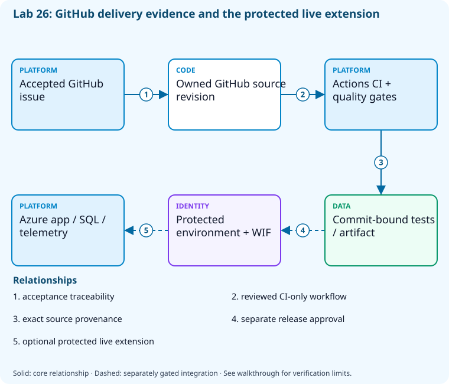

# Lab 26: Capstone: deliver securely through GitHub

[Previous: Lab 25](../25-kql-distributed-tracing/README.md) · [Catalog](../../docs/lab-catalog.md) · [Next: Lab 27](../27-capstone-azure-devops/README.md)

## Scenario, role, and outcome

Deliver the sample through a fresh GitHub repository with accepted work, local gates, hosted provenance, reviewed deployment controls, and a recovery dossier.

Learner role: **GitHub delivery owner**. Outcome: Capstone: deliver securely through GitHub.

| Item | Value |
|---|---|
| Time | 240 minutes |
| Domain | capstone |
| Platforms | local, github, azure |
| Cost | approved hosted CI allowance plus explicitly acknowledged B1 App Service and telemetry; external SQL prerequisite billed separately — review [current pricing and cleanup](../../docs/cost-and-cleanup.md) before cloud execution |
| Exam blueprint | July 27, 2026; sources reviewed October 16, 2026 |
| Verification status | not-run |
| Verification scope | All checkpoint/fault scripts parse; the named fault lifecycle is independently tested with explicit provider doubles. Full normal provider execution and live cloud delivery have not run. |

Completion requires all five checkpoints, the break/fix repair, successful
independent validation, and a passing residual-resource audit. An unavailable
external prerequisite is a visible gate; it does not become a passing result.

## Architecture and service topology



The core connects accepted GitHub work to the exact sandbox source revision, passing hosted CI, and retained quality/artifact provenance. The protected environment and workload federation form the boundary for the separate required integration lane for full completion. App deployment, protected SQL migration, measured telemetry, and compatible binary rollback need their explicit prerequisites and evidence; the core dossier reports cloudDeployed=false.

The editable [Mermaid source](diagrams/architecture.mmd) and accessible SVG
render the same authored components and relationships. Dashed connections show
separately gated integrations. Read every boundary before executing commands. Cloud changes
stay inside the exact disposable GitHub repository, Azure DevOps project, and
Azure resource group recorded for this run. Child objects inherit that cleanup
boundary. Account creation, external integrations, and privileged organization
settings belong to [one-time bootstrap](../../docs/account-bootstrap.md).

## Objectives and checkpoints

Coverage levels describe the intended learning evidence: **explained** means reasoned
understanding, **practiced** means an observable isolated skill, and **integrated**
means skills connected across a delivery boundary. These labels are curriculum
claims, not execution status. Verification above records what authors actually ran.

Official objective topic IDs: `D1.1.3`, `D1.1.4`, `D3.1.4`, `D3.2.3`, `D3.3.5`, `D3.3.9`, `D3.4.2`, `D3.4.8`, `D4.2.2`, `D5.1.1`, `D5.2.3`

| Checkpoint | Measurable behavior |
|---|---|
| [CP1](#task-1) | Establish GitHub source and accepted work traceability |
| [CP2](#task-2) | Pass the local quality and coverage gates |
| [CP3](#task-3) | Publish CI while preserving the dormant deployment gate |
| [CP4](#task-4) | Verify hosted CI provenance and successful completion |
| [CP5](#task-5) | Produce the operational release and recovery dossier |

The [objective map](../../docs/objective-map.md) traces every official topic to
labs. The [Microsoft study guide](https://learn.microsoft.com/en-us/credentials/certifications/resources/study-guides/az-400)
controls authoritative objective wording and domain weighting.

## Inputs, permissions, and read-only preflight

Use PowerShell 7.4+, .NET 10, Git, GitHub CLI, Azure CLI with the Azure DevOps
extension, and the pinned repository validation dependencies. Read the
[permissions matrix](../../docs/permissions-matrix.md) and [evidence policy](../../docs/evidence-handling.md).
Supply only the accounts needed by this lab. Never put a token, connection
string, or private key into a command log, committed YAML, or progress export.

The examples run from the repository root. Choose a fresh lowercase run ID;
`demo01` is an example, not a reusable shared sandbox. Set bootstrap environment
variables for the approved GitHub owner, DevOps organization, subscription, and
region. Do not run both guided and automated lanes with the same run ID.

```powershell
$lab = './labs/26-capstone-github/scripts/cli'
& "$lab/Preflight.ps1" -RunId 'demo01'
& "$lab/Setup.ps1" -RunId 'demo01' -ProvisionOnly
# After reviewing context, permissions, cost, and cleanup:
& "$lab/Setup.ps1" -RunId 'demo01' -ProvisionOnly -Execute -AcknowledgeCost -AcknowledgeTenantChange
. "$lab/Context.ps1" -RunId 'demo01'
```

Preflight performs reads only. Provisioning creates fresh run-owned top-level
sandboxes and records their exact IDs. Context establishes `$RepoRoot`,
`$LabRoot`, `$WorkRoot`, `$RunId`, `$GhRepo`, `$AdoOrganization`, `$AdoProject`,
`$SubscriptionId`, `$Location`, and `$ResourceGroup`. A missing prerequisite or
ownership mismatch must stop execution. Local build commands may restore
packages and write ignored build output.

## Concept primer and design decisions

End-to-end evidence links accepted work, exact source, immutable artifacts, execution identity, environment authorization, telemetry, and cleanup. The five checkpoints prove CI; complete delivery additionally requires the explicit protected Integration operation.

A CI milestone proves tests, measured coverage and artifact construction for one exact source revision. It leaves deployment identity, protected approvals, SQL migration, application delivery, telemetry and rollback unproven. The five checkpoints preserve this partial result explicitly.

Completion requires the separate Integration operation. Prepare the owned Bicep workload, private ephemeral runner, compatible baseline, narrow SQL grants, exact environment federation and provider approvals first. Activate the self-contained release only after reviewing its diff. Promote an immutable CI artifact, verify actual assembly revision and tagged telemetry, then redeploy a retained compatible baseline without reversing schema. Both release runs and their measured evidence must pass.

## Task 1 — Establish GitHub source and accepted work traceability

<a id="task-1"></a>

Checkpoint: `CP1`

| Objective | Evidence level | Observation and limits |
|---|---|---|
| `D1.1.3` | practiced | Record the run-owned issue and exact source acceptance context. |

```powershell
$p=Join-Path $WorkRoot 'capstone'
if(Test-Path (Join-Path $p '.git')){
 $origin=git -C $p remote get-url origin
 $expected='^(https://github\.com/|git@github\.com:)'+[regex]::Escape($GhRepo)+'(?:\.git)?$'
 if($origin -notmatch $expected){throw 'Existing working copy points to a different GitHub repository; refusing to reuse it.'}
}else{gh repo clone $GhRepo $p}
git -C $p config user.name 'AZ400 Learner';git -C $p config user.email 'learner@example.invalid'
python (Join-Path $RepoRoot 'tools/package_capstone.py') --platform github --destination $p
if($LASTEXITCODE -ne 0){throw 'Self-contained capstone packaging failed.'}
@('**/bin/','**/obj/','.state/')|Set-Content (Join-Path $p '.gitignore')
 $issueTitle="[$RunId] Ship observable todo API"
$existing=@(gh issue list --repo $GhRepo --state all --limit 100 --json number,title,url|ConvertFrom-Json|Where-Object title -eq $issueTitle)
if($existing.Count -gt 1){throw 'Duplicate run-owned issue titles; inspect before retrying.'}
$issueUrl=if($existing.Count -eq 1){$existing[0].url}else{gh issue create --repo $GhRepo --title $issueTitle --body 'Acceptance: locked dependencies, passing API tests, measured coverage, successful CI for exact commit, reviewed gated deployment contract, rollback and cleanup evidence.'}
$issueUrl|Set-Content (Join-Path $WorkRoot 'capstone-issue.txt')
```

Expected state: The disposable GitHub repository has source and a measurable work item. The package includes all deployment templates, scripts and inactive release definitions; CI alone is active.

Positive validation:

```powershell
$url=Get-Content (Join-Path $WorkRoot 'capstone-issue.txt');$i=gh issue view $url --repo $GhRepo --json body,state|ConvertFrom-Json
 if($i.state -ne 'OPEN' -or $i.body -notmatch 'exact commit'){throw 'Capstone acceptance/issue absent.'}
```

Negative validation:

```powershell
$p=Join-Path $WorkRoot 'capstone'
 if((git -C $p remote get-url origin) -notmatch [regex]::Escape($GhRepo)){throw 'Capstone source escaped sandbox repository.'}
```

Evidence to retain: Issue, repository boundary, and copied source allowlist.

Common failure and safe retry: Use a new sandbox; integrate work tracking before delivery evidence is produced.

Cleanup dependency: retain this checkpoint's evidence until final validation; remove run-owned children before their recorded parent boundary.

## Task 2 — Pass the local quality and coverage gates

<a id="task-2"></a>

Checkpoint: `CP2`

| Objective | Evidence level | Observation and limits |
|---|---|---|
| `D3.2.3` | practiced | Execute local test/coverage gates before hosted CI. |

```powershell
$p=Join-Path $WorkRoot 'capstone';dotnet restore (Join-Path $p 'samples/DevOps.slnx') --locked-mode
 dotnet test (Join-Path $p 'samples/DevOps.slnx') --configuration Release --settings (Join-Path $p 'samples/coverage.runsettings') --collect 'XPlat Code Coverage' --logger "trx;LogFileName=capstone.trx" --results-directory (Join-Path $WorkRoot 'quality')
 if($LASTEXITCODE -ne 0){throw 'Capstone quality gate failed.'}
 $coverage=Get-ChildItem (Join-Path $WorkRoot 'quality') -Filter coverage.cobertura.xml -Recurse|Select-Object -First 1
 & (Join-Path $p 'samples/Test-Coverage.ps1') -CoverageFile $coverage.FullName
```

Expected state: The sample passes tests and the shared 65% coverage gate.

Positive validation:

```powershell
$f=Get-ChildItem (Join-Path $WorkRoot 'quality') -Filter coverage.cobertura.xml -Recurse|Select-Object -First 1;$x=[xml](Get-Content $f.FullName -Raw)
 if([double]$x.coverage.'line-rate' -lt 0.65){throw 'Capstone coverage insufficient.'}
```

Negative validation:

```powershell
$f=Get-ChildItem (Join-Path $WorkRoot 'quality') -Filter '*.trx' -Recurse|Select-Object -First 1;$x=[xml](Get-Content $f.FullName -Raw)
 if([int]$x.TestRun.ResultSummary.Counters.failed -gt 0 -or [int]$x.TestRun.ResultSummary.Counters.passed -lt 1){throw 'Capstone tests not passing.'}
```

Evidence to retain: TRX counts, coverage, lock hashes, and SDK.

Common failure and safe retry: Repair failures without suppressing tests or weakening coverage; check the code under test is in the measured scope.

Cleanup dependency: retain this checkpoint's evidence until final validation; remove run-owned children before their recorded parent boundary.

## Task 3 — Publish CI while preserving the dormant deployment gate

<a id="task-3"></a>

Checkpoint: `CP3`

| Objective | Evidence level | Observation and limits |
|---|---|---|
| `D3.3.5` | practiced | Publish CI plus a dependency-complete dormant deployment bundle. |

```powershell
$p=Join-Path $WorkRoot 'capstone'
python (Join-Path $RepoRoot 'tools/package_capstone.py') --platform github --destination $p
if($LASTEXITCODE -ne 0){throw 'Self-contained capstone packaging failed.'}
 git -C $p add .;$staged=@(git -C $p diff --cached --name-only)
if($staged.Count -gt 0){git -C $p commit -m "[$RunId] Deliver tested observable API and gated deployment review"}else{Write-Output 'Reviewed files already committed; reusing the current source revision.'};git -C $p branch -M main;git -C $p push -u origin main
 (git -C $p rev-parse HEAD)|Set-Content (Join-Path $WorkRoot 'capstone-sha.txt')

$coreSha=(Get-Content (Join-Path $WorkRoot 'capstone-sha.txt')).Trim()
$coreCi=Join-Path $p '.github/workflows/ci.yml'
$coreManifest=git -C $p show "${coreSha}:deployment/package-manifest.json"|ConvertFrom-Json
if($coreManifest.releaseActivated){throw 'The initial core source must keep release activation dormant.'}
@{sourceRevision=$coreSha;ciPath='.github/workflows/ci.yml';ciSha256=(Get-FileHash -LiteralPath $coreCi -Algorithm SHA256).Hash;ciBlob=(git -C $p rev-parse "${coreSha}:.github/workflows/ci.yml").Trim();releaseActivated=$false}|ConvertTo-Json|Set-Content (Join-Path $WorkRoot 'core-publication.json')
```

Expected state: A reviewed commit enables CI; cloud deployment remains outside the active workflow directory. Historical CI-only source revision and CI file hashes remain independently inspectable after the separate protected release activation.

Positive validation:

```powershell
$t=Get-Content (Join-Path $WorkRoot 'capstone/.github/workflows/ci.yml') -Raw
 if($t -notmatch 'dotnet' -or $t -notmatch 'contents: read'){throw 'Capstone CI lacks build/read permission contract.'}
$m=Get-Content (Join-Path $WorkRoot 'capstone/deployment/package-manifest.json') -Raw|ConvertFrom-Json
if($m.releaseActivated -or -not (Test-Path (Join-Path $WorkRoot 'capstone/deployment/scripts/Verify-Release.ps1'))){throw 'Default package must be complete and keep release activation explicit.'}
```

Negative validation:

```powershell
$t=Get-Content (Join-Path $WorkRoot 'capstone/.github/workflows/ci.yml') -Raw
 if($t -match 'azure/login|az deployment|pull_request_target'){throw 'Publishing capstone CI must not start cloud deployment.'}
```

Evidence to retain: Exact commit SHA and active-versus-dormant file locations. core-publication.json links the baseline commit, exact CI path, SHA256 and Git blob; current protected release evidence is separate.

Common failure and safe retry: Activate a separately reviewed deployment only after federation, SQL/network prerequisites, environment approval, and costs are authorized.

Cleanup dependency: retain this checkpoint's evidence until final validation; remove run-owned children before their recorded parent boundary.

## Task 4 — Verify hosted CI provenance and successful completion

<a id="task-4"></a>

Checkpoint: `CP4`

| Objective | Evidence level | Observation and limits |
|---|---|---|
| `D3.1.4` | integrated | Select the successful exact-revision CI artifact and retain its run identity. |

```powershell
$sha=Get-Content (Join-Path $WorkRoot 'capstone-sha.txt')
 $r=@(gh run list --repo $GhRepo --commit $sha --json databaseId,status,conclusion|ConvertFrom-Json)|Select-Object -First 1
 if(-not $r){throw 'Run not visible yet; retry this read-only checkpoint.'}
 gh run watch $r.databaseId --repo $GhRepo --exit-status
 if($LASTEXITCODE -ne 0){throw 'Capstone hosted CI failed.'}
 $r.databaseId|Set-Content (Join-Path $WorkRoot 'capstone-run-id.txt')
```

Expected state: A successful hosted run proves the exact published source revision.

Positive validation:

```powershell
$id=Get-Content (Join-Path $WorkRoot 'capstone-run-id.txt');$r=gh run view $id --repo $GhRepo --json conclusion,headSha|ConvertFrom-Json
 if($r.conclusion -ne 'success' -or $r.headSha -ne (Get-Content (Join-Path $WorkRoot 'capstone-sha.txt'))){throw 'Capstone provenance gate failed.'}
```

Negative validation:

```powershell
$id=Get-Content (Join-Path $WorkRoot 'capstone-run-id.txt');$r=gh run view $id --repo $GhRepo --json status|ConvertFrom-Json
 if($r.status -ne 'completed'){throw 'In-flight capstone cannot pass.'}
```

Evidence to retain: Run URL, commit SHA, test artifact, and final result.

Common failure and safe retry: Check runner availability, permissions, and task failure; canceled/skipped runs are not completion.

Cleanup dependency: retain this checkpoint's evidence until final validation; remove run-owned children before their recorded parent boundary.

## Task 5 — Produce the operational release and recovery dossier

<a id="task-5"></a>

Checkpoint: `CP5`

| Objective | Evidence level | Observation and limits |
|---|---|---|
| `D1.1.4` | integrated | Join issue, CI revision/artifact, measured protected release, compatible rollback and cleanup records; integration is required. |
| `D3.3.9` | integrated | Integration requires provider-configured database/application environment approvals and observed protected release runs. |
| `D3.4.2` | integrated | Integration executes verified artifact → protected migration → application → revision/telemetry gate. |
| `D3.4.8` | integrated | Integration executes the already-built SQL migration bundle with a separate federated identity. |
| `D4.2.2` | integrated | Integration exchanges GitHub environment OIDC for narrowly scoped Azure identities. |
| `D5.1.1` | integrated | Integration joins the owned app with its Application Insights workspace and measures tagged release requests. |
| `D5.2.3` | integrated | Integration checks the assembly revision and observed release telemetry, then repeats verification for the retained baseline. |

```powershell
$sha=Get-Content (Join-Path $WorkRoot 'capstone-sha.txt')
 $d=[ordered]@{issue=(Get-Content (Join-Path $WorkRoot 'capstone-issue.txt'));commit=$sha;run=(Get-Content (Join-Path $WorkRoot 'capstone-run-id.txt'));deploymentTemplateSha=(Get-FileHash (Join-Path $LabRoot 'artifacts/capstone-github.yml')).Hash;rollback='redeploy last compatible immutable artifact';telemetry='trace spans and health endpoints tested locally';cloudDeployed=$false;cleanupRequired=$true}
 $d|ConvertTo-Json|Set-Content (Join-Path $WorkRoot 'release-dossier.json')
```

Expected state: A provenance dossier records the CI milestone. Full completion remains partial until the separate protected Integration operation records both measured deployment and rollback.

Positive validation:

```powershell
$d=Get-Content (Join-Path $WorkRoot 'release-dossier.json') -Raw|ConvertFrom-Json;$sha=(Get-Content (Join-Path $WorkRoot 'capstone-sha.txt')).Trim()
if($d.commit -cne $sha -or $d.commit -notmatch '^[0-9a-f]{40}$'){throw 'AZ400-L26-FAULT'}
```

Negative validation:

```powershell
$d=Get-Content (Join-Path $WorkRoot 'release-dossier.json') -Raw|ConvertFrom-Json
if(-not $d.cleanupRequired){throw 'Cleanup obligation missing.'}
if($d.cloudDeployed -and -not (Test-Path (Join-Path $WorkRoot 'integration-evidence.json'))){throw 'Live deployment claim lacks separate integration evidence.'}
```

Evidence to retain: release-dossier.json, recovery reasoning, and final cleanup audit.

Common failure and safe retry: State verified and pending integration behavior separately; preserve evidence until sandbox deletion is proven.

Cleanup dependency: retain this checkpoint's evidence until final validation; remove run-owned children before their recorded parent boundary.

## Deterministic break/fix

Run the journaled operation after all five checkpoints. It proves the healthy assertion, injects the named fault, requires its rejection, repairs it, and proves health again. Provider doubles used in author tests are not live enforcement evidence.

```powershell
& './labs/26-capstone-github/scripts/cli/BreakFix.ps1' -RunId 'demo01' -Execute
```

Expected rejection marker: `AZ400-L26-FAULT`. The assertion must catch the changed behavior, not merely an exception from an unavailable CLI.

Inspect the independent assertion:

```powershell
$d=Get-Content (Join-Path $WorkRoot 'release-dossier.json') -Raw|ConvertFrom-Json;$sha=(Get-Content (Join-Path $WorkRoot 'capstone-sha.txt')).Trim()
if($d.commit -cne $sha -or $d.commit -notmatch '^[0-9a-f]{40}$'){throw 'AZ400-L26-FAULT'}
```

Fault trigger (executed by BreakFix):

```powershell
$d=Get-Content (Join-Path $WorkRoot 'release-dossier.json') -Raw|ConvertFrom-Json;$d.commit='0'*40;$d|ConvertTo-Json|Set-Content (Join-Path $WorkRoot 'release-dossier.json')
```

Diagnose the precise difference:

```powershell
$d=Get-Content (Join-Path $WorkRoot 'release-dossier.json') -Raw|ConvertFrom-Json;$id=$d.run;gh run view $id --repo $GhRepo --json headSha,conclusion;Get-Content (Join-Path $WorkRoot 'release-dossier.json')
```

Repair (executed by BreakFix):

```powershell
$d=Get-Content (Join-Path $WorkRoot 'release-dossier.json') -Raw|ConvertFrom-Json;$d.commit=Get-Content (Join-Path $WorkRoot 'capstone-sha.txt');$d|ConvertTo-Json|Set-Content (Join-Path $WorkRoot 'release-dossier.json')
```

## Optional job-style challenge

Complete the dormant GitHub deployment with approved WIF, protected environment, SQL identity/network prerequisites, an observed canary, trace correlation, rollback, and complete residual audit. Each unavailable gate remains partial.

## Required protected integration lane

The five CI checkpoints are a **partial milestone**. Full capstone completion also requires this operation; repository CI has not executed the cloud lane. Review every prerequisite before activation.

1. Initial Setup must include the Azure subscription and create the journal-owned resource group. CI checkpoints and the named BreakFix operation must pass first.
2. Review deployment/README.md in the staged sandbox. Explicitly accept B1 compute/telemetry cost; use an existing owner-approved Entra SQL database with reviewed private DNS/routing and compatible expand-only schema. That external database is never adopted or deleted by cleanup.
3. Run the preparation commands below inside the owned resource group. The database owner must grant the template appPrincipalId the documented runtime SELECT/INSERT/UPDATE permissions and grant a distinct migration identity reviewed DDL permissions. Do not use SQL passwords.
4. Prepare an ephemeral Linux x64 private runner/agent with SQL routing, the pinned SDK/CLI dependencies and log-analytics extension. Deny untrusted fork jobs. Registration, pool authorization and eventual deregistration remain separately owner-approved account prerequisites.
5. Configure production-database and production protected environments with independent reviewers, main-branch restrictions and exclusive release concurrency. Verify paid/private-repository entitlement before enabling required reviewers. Keep the author unable to self-approve.
6. Create separate migration/application workload-federated identities or service connections. Scope application deployment to this run-owned app/resource group and Log Analytics Reader to this exact workspace; authorize only the release workflow/pipeline.
7. Set AZ400_SQL_MIGRATION_CONNECTION in the current shell using an approved secret-loading method; it must use Entra authentication and match the template database. Never transcript this operation. The lane transfers it to provider secret storage without echoing its value.
8. The original core CI artifact is the retained compatible baseline. Activation creates a distinct source revision and CI artifact with the same database model. The lane deploys that new revision, then proves application rollback to the baseline without issuing SQL Down migrations.

Prepare only the owned workload after reviewing its preview, then stop for the separately authorized SQL/account prerequisites:

```powershell
$p=Join-Path $WorkRoot 'capstone'
if(-not $env:AZ400_SQL_SERVER_FQDN){throw 'Set the separately approved Entra SQL FQDN before workload preparation.'}
$parameters=@('labId=26',"labRunId=$RunId","sqlServerFqdn=$env:AZ400_SQL_SERVER_FQDN",'sku=B1')
az deployment group what-if --subscription $SubscriptionId --resource-group $ResourceGroup --template-file (Join-Path $p 'deployment/templates/main.bicep') --parameters @parameters
# Execute only after reviewing the owned-scope preview and accepting cost.
az deployment group create --subscription $SubscriptionId --resource-group $ResourceGroup --name capstone-workload --template-file (Join-Path $p 'deployment/templates/main.bicep') --parameters @parameters
$outputs=az deployment group show --subscription $SubscriptionId --resource-group $ResourceGroup --name capstone-workload --query properties.outputs -o json|ConvertFrom-Json
$prefix="/subscriptions/$SubscriptionId/resourceGroups/$ResourceGroup/"
if(-not $outputs.appResourceId.value.StartsWith($prefix,[StringComparison]::OrdinalIgnoreCase)){throw 'Workload escaped the run-owned resource group.'}
$outputs|ConvertTo-Json -Depth 8|Set-Content (Join-Path $WorkRoot 'workload-outputs.json')
# Stop here until the database owner grants the returned runtime identity and
# account owners complete federation, environment checks and private-worker setup.
```

Run the lifecycle operation after reviewing the exact integration commands below:

```powershell
& './labs/26-capstone-github/scripts/cli/Integration.ps1' -RunId 'demo01' -Execute -AcknowledgeCost -AcknowledgeTenantChange
```

The operation executes this reviewed lane:

```powershell
$p=Join-Path $WorkRoot 'capstone'
if(-not $env:AZ400_SQL_MIGRATION_CONNECTION){throw 'Load the reviewed Entra SQL connection through approved secret handling first.'}
$ownerToken=(Get-Content (Join-Path $WorkRoot 'run.json') -Raw|ConvertFrom-Json).ownerToken
if($ownerToken -notmatch '^[a-f0-9]{32}$'){throw 'Exact run ownership marker is missing.'}
$o=Get-Content (Join-Path $WorkRoot 'workload-outputs.json') -Raw|ConvertFrom-Json
$prefix="/subscriptions/$SubscriptionId/resourceGroups/$ResourceGroup/"
if(-not $o.appResourceId.value.StartsWith($prefix,[StringComparison]::OrdinalIgnoreCase)){throw 'Application ID is outside the journal-owned group.'}
$appName=$o.appName.value;$appUrl=$o.appUrl.value;$workspace=$o.workspaceCustomerId.value
& (Join-Path $p 'deployment/scripts/Assert-OwnedWorkload.ps1') -SubscriptionId $SubscriptionId -ResourceGroup $ResourceGroup -RunId $RunId -OwnerToken $ownerToken -AppName $appName -WorkspaceId $workspace
$baselineSha=(Get-Content (Join-Path $WorkRoot 'capstone-sha.txt')).Trim()
if($baselineSha -notmatch '^[a-f0-9]{40}$' -or $baselineSha -match '^0{40}$'){throw 'Baseline revision is invalid.'}
$baselineRun=(Get-Content (Join-Path $WorkRoot 'capstone-run-id.txt')).Trim()
foreach($name in @('production-database','production')){
 $e=gh api "repos/$GhRepo/environments/$name"|ConvertFrom-Json
 $review=@($e.protection_rules|Where-Object type -eq 'required_reviewers')
 if($review.Count -ne 1 -or -not $review[0].prevent_self_review -or @($review[0].reviewers).Count -lt 1){throw "Protected independent reviewers missing from $name."}
}
foreach($name in @('AZ400_MIGRATION_CLIENT_ID','AZ400_DEPLOYMENT_CLIENT_ID','AZ400_TENANT_ID')){
 if(-not [Environment]::GetEnvironmentVariable($name)){throw "Bootstrap input $name is missing."}
}
foreach($scope in @('production-database','production')){
 $values=@{AZURE_TENANT_ID=$env:AZ400_TENANT_ID;AZURE_SUBSCRIPTION_ID=$SubscriptionId;AZURE_RESOURCE_GROUP=$ResourceGroup;LAB_RUN_ID=$RunId;LAB_OWNERSHIP_MARKER=$ownerToken;AZURE_WEBAPP_NAME=$appName;LOG_ANALYTICS_WORKSPACE_ID=$workspace}
 if($scope -eq 'production-database'){$values.AZURE_MIGRATION_CLIENT_ID=$env:AZ400_MIGRATION_CLIENT_ID}else{$values.AZURE_CLIENT_ID=$env:AZ400_DEPLOYMENT_CLIENT_ID}
 foreach($key in $values.Keys){gh variable set $key --repo $GhRepo --env $scope --body $values[$key]}
}
$env:AZ400_SQL_MIGRATION_CONNECTION|gh secret set SQL_MIGRATION_CONNECTION --repo $GhRepo --env production-database
python (Join-Path $RepoRoot 'tools/package_capstone.py') --platform github --destination $p --activate-release
if($LASTEXITCODE -ne 0){throw 'Release package activation failed.'}
git -C $p add .github/workflows/release.yml deployment/package-manifest.json
if(@(git -C $p diff --cached --name-only).Count -gt 0){git -C $p commit -m "[$RunId] Activate reviewed protected immutable release"}
git -C $p push origin main
$currentSha=(git -C $p rev-parse HEAD).Trim()
if($currentSha -eq $baselineSha){throw 'Activation must produce a distinct artifact revision for rollback practice.'}
$current=$null
for($attempt=0;$attempt -lt 60 -and -not $current;$attempt++){
 $current=@(gh run list --repo $GhRepo --workflow ci.yml --commit $currentSha --event push --json databaseId,status,conclusion|ConvertFrom-Json)|Select-Object -First 1
 if(-not $current){Start-Sleep -Seconds 5}
}
if(-not $current){throw 'Activation CI run was not observed within five minutes.'}
gh run watch $current.databaseId --repo $GhRepo --exit-status
if($LASTEXITCODE -ne 0){throw 'Activation CI must pass before artifact promotion.'}
$releases=@()
foreach($action in @('deploy','rollback')){
 $seen=@(gh run list --repo $GhRepo --workflow release.yml --event workflow_dispatch --json databaseId|ConvertFrom-Json|ForEach-Object databaseId)
 gh workflow run release.yml --repo $GhRepo --ref main -f "action=$action" -f "artifactRunId=$($current.databaseId)" -f "expectedRevision=$currentSha" -f "baselineArtifactRunId=$baselineRun" -f "baselineRevision=$baselineSha"
 $run=$null
 for($attempt=0;$attempt -lt 60 -and -not $run;$attempt++){
  $fresh=@(gh run list --repo $GhRepo --workflow release.yml --event workflow_dispatch --commit $currentSha --json databaseId,headSha|ConvertFrom-Json|Where-Object databaseId -NotIn $seen)
  if($fresh.Count -gt 1){throw 'Ambiguous concurrent release dispatch; inspect exact run IDs.'}
  $run=$fresh|Select-Object -First 1
  if(-not $run){Start-Sleep -Seconds 5}
 }
 if(-not $run){throw "Protected $action run was not observed."}
 gh run watch $run.databaseId --repo $GhRepo --exit-status
 if($LASTEXITCODE -ne 0){throw "$action failed. Preserve logs/evidence; use the documented protected rollback dispatch to recover, then retry integration."}
 $directory=Join-Path $WorkRoot "integration-$action"
 if(Test-Path $directory){throw 'Release evidence directory exists; preserve it and use a reviewed fresh evidence destination before retrying.'}
 gh run download $run.databaseId --repo $GhRepo --name release-evidence --dir $directory
 $file=@(Get-ChildItem $directory -Filter release-evidence.json -Recurse)
 if($file.Count -ne 1){throw 'Expected exactly one measured release-evidence.json.'}
 $report=Get-Content $file[0].FullName -Raw|ConvertFrom-Json
 $revision=if($action -eq 'deploy'){$currentSha}else{$baselineSha}
 if($report.status -ne 'passed' -or $report.revision -cne $revision -or -not $report.healthPassed -or -not $report.telemetryPassed){throw 'Release evidence does not prove the selected revision/health/telemetry.'}
 $releases+=@{action=$action;runId=$run.databaseId;revision=$revision;evidencePath=$file[0].FullName}
}
@{platform='github';currentRevision=$currentSha;baselineRevision=$baselineSha;currentArtifactRun=$current.databaseId;baselineArtifactRun=$baselineRun;releases=$releases}|ConvertTo-Json -Depth 8|Set-Content (Join-Path $WorkRoot 'integration-evidence.json')
```

Independent integration validation:

```powershell
$i=Get-Content (Join-Path $WorkRoot 'integration-evidence.json') -Raw|ConvertFrom-Json
if($i.currentRevision -eq $i.baselineRevision -or @($i.releases).Count -ne 2){throw 'Both distinct current and baseline evidence are required.'}
foreach($action in @('deploy','rollback')){
 $row=@($i.releases|Where-Object action -eq $action)
 if($row.Count -ne 1){throw 'Missing or duplicate release action evidence.'}
 $expected=if($action -eq 'deploy'){$i.currentRevision}else{$i.baselineRevision}
 $e=Get-Content $row[0].evidencePath -Raw|ConvertFrom-Json
 if($row[0].revision -cne $expected -or $e.revision -cne $expected -or $e.status -ne 'passed' -or -not $e.healthPassed -or -not $e.telemetryPassed){throw 'Release/rollback evidence is unverified.'}
 if($e.telemetry.requests -lt 10 -or $e.telemetry.failureRate -gt 0.02 -or $e.telemetry.p95Ms -gt 1000){throw 'Observed release telemetry violates the training gate.'}
$run=gh run view $row[0].runId --repo $GhRepo --json conclusion,headSha,workflowName|ConvertFrom-Json
 if($run.conclusion -ne 'success' -or $run.headSha -cne $i.currentRevision -or $run.workflowName -ne 'Protected immutable release'){throw 'Provider release result/source identity differs from local evidence.'}
}
```

Expected state: Two successful protected runs promote the selected current immutable artifact and the compatible baseline. Each has exact revision, observed health, at least ten tagged requests, failure rate <=2%, and p95 <=1000 ms. Missing approvals, networking, entitlement, SQL or telemetry leaves the capstone partial.

## Final validation and result interpretation

```powershell
& './labs/26-capstone-github/scripts/cli/Validate.ps1' -RunId 'demo01'
```

A complete result requires five passing read-only checkpoint assertions, a journaled repaired fault, and any required integration evidence. Pending hosted runs, missing licensed features, and unexecuted integration lanes remain visible. Review `validation.json`; successful command exit alone does not establish the asserted behavior.

## Troubleshooting

- **401/403:** inspect the explicit account/project/repository scope and required role; do not broaden a token reflexively.
- **Resource or artifact missing:** confirm the exact run ID and prerequisite checkpoint; retry reads after eventual consistency.
- **Unsupported SKU/runtime/tool:** consult the specific current source, record the gate, and obtain approval before changing cost or architecture.
- **Validation mismatch:** inspect the positive and negative assertions separately, repair the named fault, and rerun validation.
- **Ownership refusal:** stop; never edit a manifest to claim an unrelated resource.

## Cleanup and residual checks

```powershell
& './labs/26-capstone-github/scripts/cli/Cleanup.ps1' -RunId 'demo01'
# Review the exact owned-object deletion plan first.
& './labs/26-capstone-github/scripts/cli/Cleanup.ps1' -RunId 'demo01' -Execute
```

Cleanup must verify ownership, delete only recorded sandbox objects in dependency order, and prove parent/child absence. Retain `run.json`, `validation.json`, and `cleanup.json` locally until the audit passes. Soft-deleted or deliberately retained items must remain reported. Never purge a shared vault or delete an account, organization, or pre-existing service connection to finish a lab.

## Exam debrief and assessment

Explain why each checkpoint's denied path matters, which scope authorizes it, what evidence proves it, and how it is reversed. This foundation/capstone is hands-on only; use its validation and recovery evidence for assessment.

## Microsoft and platform sources

- [Primary source 1](https://docs.github.com/en/actions/automating-builds-and-tests/building-and-testing-net) — reviewed 2026-10-16.
- [Primary source 2](https://docs.github.com/en/actions/security-for-github-actions/security-hardening-your-deployments/configuring-openid-connect-in-azure) — reviewed 2026-10-16.
- [Primary source 3](https://learn.microsoft.com/en-us/azure/well-architected/operational-excellence/safe-deployments) — reviewed 2026-10-16.

## Lifecycle scripts and worked solution

Use `scripts/cli/Preflight.ps1`, `Setup.ps1`, `BreakFix.ps1`, `Integration.ps1` (capstones), `Validate.ps1`, `Cleanup.ps1`, and `Context.ps1` from this lab folder. Setup and cleanup preview until `-Execute`; `-ProvisionOnly` creates only fresh ownership-tracked containers. The [worked solution](solution/README.md) lists expected results and repair reasoning.
