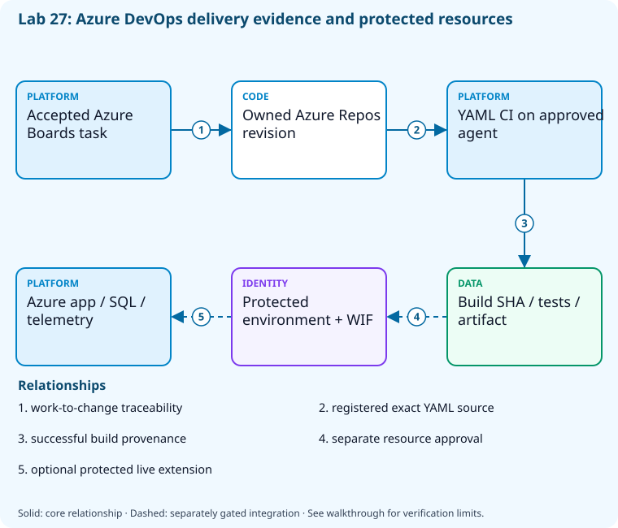

# Lab 27: Capstone: deliver securely through Azure DevOps

[Previous: Lab 26](../26-capstone-github/README.md) · [Catalog](../../docs/lab-catalog.md)

## Scenario, role, and outcome

Deliver the sample through a fresh Azure DevOps project with work tracking, YAML CI, exact build provenance, protected release review, and recovery evidence.

Learner role: **Azure DevOps delivery owner**. Outcome: Capstone: deliver securely through Azure DevOps.

| Item | Value |
|---|---|
| Time | 240 minutes |
| Domain | capstone |
| Platforms | local, azure-devops, azure |
| Cost | approved hosted CI allowance plus explicitly acknowledged B1 App Service and telemetry; external SQL prerequisite billed separately — review [current pricing and cleanup](../../docs/cost-and-cleanup.md) before cloud execution |
| Exam blueprint | July 27, 2026; sources reviewed October 16, 2026 |
| Verification status | not-run |
| Verification scope | All checkpoint/fault scripts parse; the named fault lifecycle is independently tested with explicit provider doubles. Full normal provider execution and live cloud delivery have not run. |

Completion requires all five checkpoints, the break/fix repair, successful
independent validation, and a passing residual-resource audit. An unavailable
external prerequisite is a visible gate; it does not become a passing result.

## Architecture and service topology



The core ties the accepted Boards task to an exact Azure Repos revision and successful YAML CI on an available approved agent. Build results and artifact evidence enter the recovery dossier. A protected environment, workload-identity service connection, database/network prerequisites, and observed telemetry are separate requirements for the separate required protected integration lane for full completion; CI success is not reported as a completed cloud deployment.

The editable [Mermaid source](diagrams/architecture.mmd) and accessible SVG
render the same authored components and relationships. Dashed connections show
separately gated integrations. Read every boundary before executing commands. Cloud changes
stay inside the exact disposable GitHub repository, Azure DevOps project, and
Azure resource group recorded for this run. Child objects inherit that cleanup
boundary. Account creation, external integrations, and privileged organization
settings belong to [one-time bootstrap](../../docs/account-bootstrap.md).

## Objectives and checkpoints

Coverage levels describe the intended learning evidence: **explained** means reasoned
understanding, **practiced** means an observable isolated skill, and **integrated**
means skills connected across a delivery boundary. These labels are curriculum
claims, not execution status. Verification above records what authors actually ran.

Official objective topic IDs: `D1.1.3`, `D1.1.4`, `D3.1.4`, `D3.2.3`, `D3.3.5`, `D3.3.9`, `D3.4.2`, `D3.4.8`, `D4.1.3`, `D4.2.2`, `D5.1.1`, `D5.2.3`

| Checkpoint | Measurable behavior |
|---|---|
| [CP1](#task-1) | Establish Azure DevOps source and accepted work |
| [CP2](#task-2) | Run local build, tests, and measured coverage |
| [CP3](#task-3) | Publish a CI pipeline and dormant deployment contract |
| [CP4](#task-4) | Register and queue the exact project CI definition |
| [CP5](#task-5) | Verify successful delivery provenance and recovery evidence |

The [objective map](../../docs/objective-map.md) traces every official topic to
labs. The [Microsoft study guide](https://learn.microsoft.com/en-us/credentials/certifications/resources/study-guides/az-400)
controls authoritative objective wording and domain weighting.

## Inputs, permissions, and read-only preflight

Use PowerShell 7.4+, .NET 10, Git, GitHub CLI, Azure CLI with the Azure DevOps
extension, and the pinned repository validation dependencies. Read the
[permissions matrix](../../docs/permissions-matrix.md) and [evidence policy](../../docs/evidence-handling.md).
Supply only the accounts needed by this lab. Never put a token, connection
string, or private key into a command log, committed YAML, or progress export.

The examples run from the repository root. Choose a fresh lowercase run ID;
`demo01` is an example, not a reusable shared sandbox. Set bootstrap environment
variables for the approved GitHub owner, DevOps organization, subscription, and
region. Do not run both guided and automated lanes with the same run ID.

```powershell
$lab = './labs/27-capstone-azure-devops/scripts/cli'
& "$lab/Preflight.ps1" -RunId 'demo01'
& "$lab/Setup.ps1" -RunId 'demo01' -ProvisionOnly
# After reviewing context, permissions, cost, and cleanup:
& "$lab/Setup.ps1" -RunId 'demo01' -ProvisionOnly -Execute -AcknowledgeCost -AcknowledgeTenantChange
. "$lab/Context.ps1" -RunId 'demo01'
```

Preflight performs reads only. Provisioning creates fresh run-owned top-level
sandboxes and records their exact IDs. Context establishes `$RepoRoot`,
`$LabRoot`, `$WorkRoot`, `$RunId`, `$GhRepo`, `$AdoOrganization`, `$AdoProject`,
`$SubscriptionId`, `$Location`, and `$ResourceGroup`. A missing prerequisite or
ownership mismatch must stop execution. Local build commands may restore
packages and write ignored build output.

## Concept primer and design decisions

A release owner must preserve source-to-build traceability and distinguish successful CI from approved deployment. Service connections, environment checks, database compatibility, and agent capacity have separate owners.

Azure Repos, Boards, Pipelines and Azure resource authorization have separate IDs and owners. Correlate the work item with the precise build sourceVersion and artifact; a queued pipeline is not a delivered release. The default packaged definition activates CI only.

Completion requires the separate protected Integration lane using two narrowly authorized WIF connections and independent database/application environment checks. The self-contained bundle supplies immutable artifact verification, a prebuilt SQL migration, app deployment and a measured telemetry gate. Use a retained compatible baseline for rollback and skip database reversal. Missing SQL networking, entitlement, approval or telemetry remains a visible incomplete integration.

## Task 1 — Establish Azure DevOps source and accepted work

<a id="task-1"></a>

Checkpoint: `CP1`

| Objective | Evidence level | Observation and limits |
|---|---|---|
| `D1.1.3` | practiced | Record the run-owned Boards work item and Azure Repos source acceptance context. |

```powershell
$r=@(az repos list --organization $AdoOrganization --project $AdoProject -o json|ConvertFrom-Json)|Select-Object -First 1
 $r|ConvertTo-Json -Depth 8|Set-Content (Join-Path $WorkRoot 'capstone-repo.json')
 $p=Join-Path $WorkRoot 'capstone'
if(Test-Path (Join-Path $p '.git')){
 $origin=git -C $p remote get-url origin
 if($origin.TrimEnd('/') -cne ([string]$r.remoteUrl).TrimEnd('/')){throw 'Existing working copy points to a different Azure Repos repository; refusing to reuse it.'}
}else{git clone $r.remoteUrl $p}
git -C $p config user.name 'AZ400 Learner';git -C $p config user.email 'learner@example.invalid'
python (Join-Path $RepoRoot 'tools/package_capstone.py') --platform azure-devops --destination $p
if($LASTEXITCODE -ne 0){throw 'Self-contained capstone packaging failed.'}
@('**/bin/','**/obj/','.state/')|Set-Content (Join-Path $p '.gitignore')
 $w=az boards work-item create --organization $AdoOrganization --project $AdoProject --type Task --title "[$RunId] Deliver observable API" --description 'Acceptance: locked build, passing tests/coverage, successful exact-revision pipeline, protected deployment review, rollback and cleanup evidence.' -o json|ConvertFrom-Json
 $w.id|Set-Content (Join-Path $WorkRoot 'capstone-work-item.txt')
```

Expected state: Source and acceptance criteria exist only in the disposable project. The package includes all deployment templates, scripts and inactive release definitions; CI alone is active.

Positive validation:

```powershell
$r=Get-Content (Join-Path $WorkRoot 'capstone-repo.json') -Raw|ConvertFrom-Json
 if($r.project.name -ne $AdoProject){throw 'Capstone repository/project mismatch.'}
```

Negative validation:

```powershell
$id=Get-Content (Join-Path $WorkRoot 'capstone-work-item.txt');$w=az boards work-item show --organization $AdoOrganization --id $id -o json|ConvertFrom-Json
 if($w.fields.'System.TeamProject' -ne $AdoProject){throw 'Capstone work item escaped project.'}
```

Evidence to retain: Task, repository ID, and project identity.

Common failure and safe retry: Complete Git authentication bootstrap without writing a PAT into a remote URL.

Cleanup dependency: retain this checkpoint's evidence until final validation; remove run-owned children before their recorded parent boundary.

## Task 2 — Run local build, tests, and measured coverage

<a id="task-2"></a>

Checkpoint: `CP2`

| Objective | Evidence level | Observation and limits |
|---|---|---|
| `D3.2.3` | practiced | Execute local test/coverage gates before hosted CI. |

```powershell
$p=Join-Path $WorkRoot 'capstone';dotnet restore (Join-Path $p 'samples/DevOps.slnx') --locked-mode
 dotnet test (Join-Path $p 'samples/DevOps.slnx') --configuration Release --settings (Join-Path $p 'samples/coverage.runsettings') --collect 'XPlat Code Coverage' --logger "trx;LogFileName=capstone.trx" --results-directory (Join-Path $WorkRoot 'quality')
 if($LASTEXITCODE -ne 0){throw 'Local capstone quality failed.'}
 $coverage=Get-ChildItem (Join-Path $WorkRoot 'quality') -Filter coverage.cobertura.xml -Recurse|Select-Object -First 1
 & (Join-Path $p 'samples/Test-Coverage.ps1') -CoverageFile $coverage.FullName
```

Expected state: The shared sample passes a 65% minimum measured coverage gate.

Positive validation:

```powershell
$f=Get-ChildItem (Join-Path $WorkRoot 'quality') -Filter coverage.cobertura.xml -Recurse|Select-Object -First 1;$x=[xml](Get-Content $f.FullName -Raw)
 if([double]$x.coverage.'line-rate' -lt 0.65){throw 'Coverage gate failed.'}
```

Negative validation:

```powershell
$f=Get-ChildItem (Join-Path $WorkRoot 'quality') -Filter '*.trx' -Recurse|Select-Object -First 1;$x=[xml](Get-Content $f.FullName -Raw)
 if([int]$x.TestRun.ResultSummary.Counters.failed -gt 0 -or [int]$x.TestRun.ResultSummary.Counters.passed -lt 1){throw 'No passing capstone test baseline.'}
```

Evidence to retain: TRX, coverage report, and dependency locks.

Common failure and safe retry: Repair behavior rather than suppressing tests or disabling collectors.

Cleanup dependency: retain this checkpoint's evidence until final validation; remove run-owned children before their recorded parent boundary.

## Task 3 — Publish a CI pipeline and dormant deployment contract

<a id="task-3"></a>

Checkpoint: `CP3`

| Objective | Evidence level | Observation and limits |
|---|---|---|
| `D3.3.5` | practiced | Publish CI plus the dependency-complete dormant deployment bundle. |

```powershell
$p=Join-Path $WorkRoot 'capstone'
python (Join-Path $RepoRoot 'tools/package_capstone.py') --platform azure-devops --destination $p
if($LASTEXITCODE -ne 0){throw 'Self-contained capstone packaging failed.'}
 git -C $p add .;$staged=@(git -C $p diff --cached --name-only)
if($staged.Count -gt 0){git -C $p commit -m "[$RunId] Capstone CI and deployment review"}else{Write-Output 'Reviewed files already committed; reusing the current source revision.'};git -C $p branch -M main;git -C $p push -u origin main
 (git -C $p rev-parse HEAD)|Set-Content (Join-Path $WorkRoot 'capstone-sha.txt')
```

Expected state: The reviewed revision contains CI and an unregistered cloud deployment template.

Positive validation:

```powershell
$t=Get-Content (Join-Path $WorkRoot 'capstone/azure-pipelines.yml') -Raw
 if($t -notmatch 'dotnet|DotNetCoreCLI'){throw 'Capstone build tasks absent.'}
$m=Get-Content (Join-Path $WorkRoot 'capstone/deployment/package-manifest.json') -Raw|ConvertFrom-Json
if($m.releaseActivated -or -not (Test-Path (Join-Path $WorkRoot 'capstone/deployment/scripts/Verify-Release.ps1'))){throw 'Default package must be complete and keep release activation explicit.'}
```

Negative validation:

```powershell
$t=Get-Content (Join-Path $WorkRoot 'capstone/azure-pipelines.yml') -Raw
 if($t -match 'AzureCLI@|az deployment|azureSubscription:'){throw 'CI publication must not activate cloud deployment.'}
```

Evidence to retain: Committed SHA and CI-versus-dormant template review.

Common failure and safe retry: Keep deployment registration separate until service connection, environment checks, SQL/network prerequisites, and costs are approved.

Cleanup dependency: retain this checkpoint's evidence until final validation; remove run-owned children before their recorded parent boundary.

## Task 4 — Register and queue the exact project CI definition

<a id="task-4"></a>

Checkpoint: `CP4`

Foundation/supporting task; no additional exam-objective coverage is claimed.

```powershell
$r=Get-Content (Join-Path $WorkRoot 'capstone-repo.json') -Raw|ConvertFrom-Json
$pipelineName="capstone-$RunId";$idPath=Join-Path $WorkRoot 'capstone-pipeline-id.txt'
if(Test-Path $idPath){
 $savedId=(Get-Content $idPath -Raw).Trim()
 if($savedId -notmatch '^\d+$'){throw 'Saved pipeline ID is invalid.'}
 $p=az pipelines show --organization $AdoOrganization --project $AdoProject --id $savedId -o json|ConvertFrom-Json
}else{
 $candidates=@(az pipelines list --organization $AdoOrganization --project $AdoProject --name $pipelineName --repository $r.id --repository-type tfsgit -o json|ConvertFrom-Json|Where-Object name -eq $pipelineName)
 $matchingPipelines=@(foreach($candidate in $candidates){
  $definition=az pipelines show --organization $AdoOrganization --project $AdoProject --id $candidate.id -o json|ConvertFrom-Json
  if($definition.name -eq $pipelineName -and $definition.repository.id -eq $r.id){$definition}
 })
 if($matchingPipelines.Count -gt 1){throw 'Multiple matching pipelines; resolve the ambiguous owned boundary before retrying.'}
 if($matchingPipelines.Count -eq 1){$p=$matchingPipelines[0]}else{
  $p=az pipelines create --organization $AdoOrganization --project $AdoProject --name $pipelineName --repository $r.id --repository-type tfsgit --branch main --yml-path azure-pipelines.yml --skip-first-run true -o json|ConvertFrom-Json
 }
}
if($p.name -ne $pipelineName -or $p.repository.id -ne $r.id -or $p.project.name -ne $AdoProject -or $p.process.yamlFilename -ne 'azure-pipelines.yml'){throw 'Existing pipeline identity/source differs from this run; refusing to reuse it.'}
$p.id|Set-Content $idPath

$b=az pipelines run --organization $AdoOrganization --project $AdoProject --id $p.id --branch main -o json|ConvertFrom-Json
$b.id|Set-Content (Join-Path $WorkRoot 'capstone-build-id.txt')
```

Expected state: One sandbox pipeline is queued against the reviewed main revision.

Positive validation:

```powershell
$id=Get-Content (Join-Path $WorkRoot 'capstone-pipeline-id.txt');$p=az pipelines show --organization $AdoOrganization --project $AdoProject --id $id -o json|ConvertFrom-Json
 if($p.process.yamlFilename -ne 'azure-pipelines.yml'){throw 'Wrong capstone YAML definition.'}
```

Negative validation:

```powershell
$id=Get-Content (Join-Path $WorkRoot 'capstone-pipeline-id.txt');$p=az pipelines show --organization $AdoOrganization --project $AdoProject --id $id -o json|ConvertFrom-Json
 if($p.project.name -ne $AdoProject){throw 'Pipeline escaped project ownership.'}
```

Evidence to retain: Pipeline/build IDs and queued source branch.

Common failure and safe retry: Obtain hosted parallelism or approved isolated agents; waiting for capacity is an external gate.

Cleanup dependency: retain this checkpoint's evidence until final validation; remove run-owned children before their recorded parent boundary.

## Task 5 — Verify successful delivery provenance and recovery evidence

<a id="task-5"></a>

Checkpoint: `CP5`

| Objective | Evidence level | Observation and limits |
|---|---|---|
| `D1.1.4` | integrated | Join work item, CI revision/artifact, measured protected release, compatible rollback and cleanup records; integration is required. |
| `D3.1.4` | integrated | Select the successful exact-revision CI artifact and retain the build identity. |
| `D3.3.9` | integrated | Integration requires provider-configured deployment environment approvals and independently observed protected release runs. |
| `D3.4.2` | integrated | Integration executes verified artifact → protected migration → application → revision/telemetry gate. |
| `D3.4.8` | integrated | Integration executes the already-built SQL migration bundle with a separate WIF connection. |
| `D4.1.3` | integrated | Integration uses separately authorized migration/application Azure DevOps WIF connections. |
| `D4.2.2` | integrated | Integration exchanges provider federation for narrowly scoped Azure identities. |
| `D5.1.1` | integrated | Integration joins the owned app with its telemetry workspace and measures tagged release requests. |
| `D5.2.3` | integrated | Integration checks exact revision and observed request metrics for both deployment and compatible rollback. |

```powershell
$id=Get-Content (Join-Path $WorkRoot 'capstone-build-id.txt')
 $b=az pipelines runs show --organization $AdoOrganization --project $AdoProject --id $id -o json|ConvertFrom-Json
 if($b.status -ne 'completed' -or $b.result -ne 'succeeded'){throw 'Capstone build incomplete/failed; retry after examining logs.'}
 [ordered]@{workItem=(Get-Content (Join-Path $WorkRoot 'capstone-work-item.txt'));commit=$b.sourceVersion;build=$id;result=$b.result;rollback='last compatible immutable artifact';cloudDeployed=$false;cleanupRequired=$true}|ConvertTo-Json|Set-Content (Join-Path $WorkRoot 'release-dossier.json')
```

Expected state: A provenance dossier records the CI milestone. Full completion remains partial until the separate protected Integration operation records both measured deployment and rollback.

Positive validation:

```powershell
$d=Get-Content (Join-Path $WorkRoot 'release-dossier.json') -Raw|ConvertFrom-Json
 if($d.result -ne 'succeeded' -or $d.commit -ne (Get-Content (Join-Path $WorkRoot 'capstone-sha.txt'))){throw 'Capstone delivery provenance mismatch.'}
```

Negative validation:

```powershell
$d=Get-Content (Join-Path $WorkRoot 'release-dossier.json') -Raw|ConvertFrom-Json
if(-not $d.cleanupRequired){throw 'Cleanup obligation missing.'}
if($d.cloudDeployed -and -not (Test-Path (Join-Path $WorkRoot 'integration-evidence.json'))){throw 'Live deployment claim lacks separate integration evidence.'}
```

Evidence to retain: Release dossier, successful test artifact references, recovery plan, and final cleanup audit.

Common failure and safe retry: Retrieve final test/artifact evidence before deleting the disposable project; do not report a queued run as delivered.

Cleanup dependency: retain this checkpoint's evidence until final validation; remove run-owned children before their recorded parent boundary.

## Deterministic break/fix

Run the journaled operation after all five checkpoints. It proves the healthy assertion, injects the named fault, requires its rejection, repairs it, and proves health again. Provider doubles used in author tests are not live enforcement evidence.

```powershell
& './labs/27-capstone-azure-devops/scripts/cli/BreakFix.ps1' -RunId 'demo01' -Execute
```

Expected rejection marker: `AZ400-L27-FAULT`. The assertion must catch the changed behavior, not merely an exception from an unavailable CLI.

Inspect the independent assertion:

```powershell
$d=Get-Content (Join-Path $WorkRoot 'release-dossier.json') -Raw|ConvertFrom-Json;$sha=(Get-Content (Join-Path $WorkRoot 'capstone-sha.txt')).Trim()
if($d.result -ne 'succeeded' -or $d.commit -cne $sha){throw 'AZ400-L27-FAULT'}
```

Fault trigger (executed by BreakFix):

```powershell
$d=Get-Content (Join-Path $WorkRoot 'release-dossier.json') -Raw|ConvertFrom-Json;$d.result='partiallySucceeded';$d|ConvertTo-Json|Set-Content (Join-Path $WorkRoot 'release-dossier.json')
```

Diagnose the precise difference:

```powershell
Get-Content (Join-Path $WorkRoot 'release-dossier.json');az pipelines runs show --organization $AdoOrganization --project $AdoProject --id (Get-Content (Join-Path $WorkRoot 'capstone-build-id.txt')) --query '{status:status,result:result,commit:sourceVersion}' -o json
```

Repair (executed by BreakFix):

```powershell
$d=Get-Content (Join-Path $WorkRoot 'release-dossier.json') -Raw|ConvertFrom-Json;$d.result='succeeded';$d|ConvertTo-Json|Set-Content (Join-Path $WorkRoot 'release-dossier.json')
```

## Optional job-style challenge

Complete the protected Azure Pipelines release with WIF service connection, protected resource approvals, ordered database deployment, staged exposure, telemetry evidence, rollback, and residual audit. Preserve every unavailable external gate as partial.

## Required protected integration lane

The five CI checkpoints are a **partial milestone**. Full capstone completion also requires this operation; repository CI has not executed the cloud lane. Review every prerequisite before activation.

1. Initial Setup must include the Azure subscription and create the journal-owned resource group. CI checkpoints and the named BreakFix operation must pass first.
2. Review deployment/README.md in the staged sandbox. Explicitly accept B1 compute/telemetry cost; use an existing owner-approved Entra SQL database with reviewed private DNS/routing and compatible expand-only schema. That external database is never adopted or deleted by cleanup.
3. Run the preparation commands below inside the owned resource group. The database owner must grant the template appPrincipalId the documented runtime SELECT/INSERT/UPDATE permissions and grant a distinct migration identity reviewed DDL permissions. Do not use SQL passwords.
4. Prepare an ephemeral Linux x64 private runner/agent with SQL routing, the pinned SDK/CLI dependencies and log-analytics extension. Deny untrusted fork jobs. Registration, pool authorization and eventual deregistration remain separately owner-approved account prerequisites.
5. Configure production-database and production protected environments with independent reviewers, main-branch restrictions and exclusive release concurrency. Verify paid/private-repository entitlement before enabling required reviewers. Keep the author unable to self-approve.
6. Create separate migration/application workload-federated identities or service connections. Scope application deployment to this run-owned app/resource group and Log Analytics Reader to this exact workspace; authorize only the release workflow/pipeline.
7. Set AZ400_SQL_MIGRATION_CONNECTION in the current shell using an approved secret-loading method; it must use Entra authentication and match the template database. Never transcript this operation. The lane transfers it to provider secret storage without echoing its value.
8. The original core CI artifact is the retained compatible baseline. Activation creates a distinct source revision and CI artifact with the same database model. The lane deploys that new revision, then proves application rollback to the baseline without issuing SQL Down migrations.

Prepare only the owned workload after reviewing its preview, then stop for the separately authorized SQL/account prerequisites:

```powershell
$p=Join-Path $WorkRoot 'capstone'
if(-not $env:AZ400_SQL_SERVER_FQDN){throw 'Set the separately approved Entra SQL FQDN before workload preparation.'}
$parameters=@('labId=27',"labRunId=$RunId","sqlServerFqdn=$env:AZ400_SQL_SERVER_FQDN",'sku=B1')
az deployment group what-if --subscription $SubscriptionId --resource-group $ResourceGroup --template-file (Join-Path $p 'deployment/templates/main.bicep') --parameters @parameters
# Execute only after reviewing the owned-scope preview and accepting cost.
az deployment group create --subscription $SubscriptionId --resource-group $ResourceGroup --name capstone-workload --template-file (Join-Path $p 'deployment/templates/main.bicep') --parameters @parameters
$outputs=az deployment group show --subscription $SubscriptionId --resource-group $ResourceGroup --name capstone-workload --query properties.outputs -o json|ConvertFrom-Json
$prefix="/subscriptions/$SubscriptionId/resourceGroups/$ResourceGroup/"
if(-not $outputs.appResourceId.value.StartsWith($prefix,[StringComparison]::OrdinalIgnoreCase)){throw 'Workload escaped the run-owned resource group.'}
$outputs|ConvertTo-Json -Depth 8|Set-Content (Join-Path $WorkRoot 'workload-outputs.json')
# Stop here until the database owner grants the returned runtime identity and
# account owners complete federation, environment checks and private-worker setup.
```

Run the lifecycle operation after reviewing the exact integration commands below:

```powershell
& './labs/27-capstone-azure-devops/scripts/cli/Integration.ps1' -RunId 'demo01' -Execute -AcknowledgeCost -AcknowledgeTenantChange
```

The operation executes this reviewed lane:

```powershell
$p=Join-Path $WorkRoot 'capstone'
if(-not $env:AZ400_SQL_MIGRATION_CONNECTION){throw 'Load the reviewed Entra SQL connection through approved secret handling first.'}
$o=Get-Content (Join-Path $WorkRoot 'workload-outputs.json') -Raw|ConvertFrom-Json
$prefix="/subscriptions/$SubscriptionId/resourceGroups/$ResourceGroup/"
if(-not $o.appResourceId.value.StartsWith($prefix,[StringComparison]::OrdinalIgnoreCase)){throw 'Application ID is outside the journal-owned group.'}
$appName=$o.appName.value;$appUrl=$o.appUrl.value;$workspace=$o.workspaceCustomerId.value
& (Join-Path $p 'deployment/scripts/Assert-OwnedWorkload.ps1') -SubscriptionId $SubscriptionId -ResourceGroup $ResourceGroup -RunId $RunId -AppName $appName -WorkspaceId $workspace
$baselineSha=(Get-Content (Join-Path $WorkRoot 'capstone-sha.txt')).Trim()
if($baselineSha -notmatch '^[a-f0-9]{40}$' -or $baselineSha -match '^0{40}$'){throw 'Baseline revision is invalid.'}
$baselineRun=(Get-Content (Join-Path $WorkRoot 'capstone-build-id.txt')).Trim()
$ciId=(Get-Content (Join-Path $WorkRoot 'capstone-pipeline-id.txt')).Trim()
$r=Get-Content (Join-Path $WorkRoot 'capstone-repo.json') -Raw|ConvertFrom-Json
python (Join-Path $RepoRoot 'tools/package_capstone.py') --platform azure-devops --destination $p --activate-release
if($LASTEXITCODE -ne 0){throw 'Release package activation failed.'}
git -C $p add azure-pipelines-release.yml deployment/package-manifest.json
if(@(git -C $p diff --cached --name-only).Count -gt 0){git -C $p commit -m "[$RunId] Activate reviewed protected immutable release"}
git -C $p push origin main
$currentSha=(git -C $p rev-parse HEAD).Trim()
if($currentSha -eq $baselineSha){throw 'Activation must create a distinct artifact revision for rollback practice.'}
$current=az pipelines run --organization $AdoOrganization --project $AdoProject --id $ciId --branch main -o json|ConvertFrom-Json
for($attempt=0;$attempt -lt 120;$attempt++){
 $b=az pipelines runs show --organization $AdoOrganization --project $AdoProject --id $current.id -o json|ConvertFrom-Json
 if($b.status -eq 'completed'){break};Start-Sleep -Seconds 15
}
if($b.status -ne 'completed' -or $b.result -ne 'succeeded' -or $b.sourceVersion -cne $currentSha){throw 'Activation CI is incomplete, failed or built a different revision.'}
$name="protected-release-$RunId"
$defs=@(az pipelines list --organization $AdoOrganization --project $AdoProject --name $name --repository $r.id --repository-type tfsgit -o json|ConvertFrom-Json|Where-Object name -eq $name)
if($defs.Count -gt 1){throw 'Ambiguous run-owned release definitions.'}
if($defs.Count -eq 1){$release=az pipelines show --organization $AdoOrganization --project $AdoProject --id $defs[0].id -o json|ConvertFrom-Json}else{
 $release=az pipelines create --organization $AdoOrganization --project $AdoProject --name $name --repository $r.id --repository-type tfsgit --branch main --yml-path azure-pipelines-release.yml --skip-first-run true -o json|ConvertFrom-Json
}
if($release.repository.id -ne $r.id -or $release.project.name -ne $AdoProject -or $release.process.yamlFilename -ne 'azure-pipelines-release.yml'){throw 'Release definition escaped its repository/project/YAML boundary.'}
$values=@{AppUrl=$appUrl;LogAnalyticsWorkspaceId=$workspace;CiDefinitionId=$ciId;AzureSubscriptionId=$SubscriptionId;AzureResourceGroup=$ResourceGroup;LabRunId=$RunId}
$existing=az pipelines variable list --organization $AdoOrganization --project $AdoProject --pipeline-id $release.id -o json|ConvertFrom-Json
foreach($key in $values.Keys){
 $verb=if($existing.PSObject.Properties.Name -contains $key){'update'}else{'create'}
 az pipelines variable $verb --organization $AdoOrganization --project $AdoProject --pipeline-id $release.id --name $key --allow-override false --value $values[$key] -o none
}
$env:AZURE_DEVOPS_EXT_PIPELINE_VAR_SqlMigrationConnection=$env:AZ400_SQL_MIGRATION_CONNECTION
try{
 if($existing.PSObject.Properties.Name -contains 'SqlMigrationConnection'){
  az pipelines variable update --organization $AdoOrganization --project $AdoProject --pipeline-id $release.id --name SqlMigrationConnection --secret true --prompt-value true --allow-override false -o none
 }else{
  az pipelines variable create --organization $AdoOrganization --project $AdoProject --pipeline-id $release.id --name SqlMigrationConnection --secret true --allow-override false -o none
 }
}finally{Remove-Item Env:AZURE_DEVOPS_EXT_PIPELINE_VAR_SqlMigrationConnection -ErrorAction SilentlyContinue}
# Connections az400-migration-wif / az400-app-wif, private pool and protected
# environment approvals must already authorize this exact owned release definition.
$releases=@()
foreach($action in @('deploy','rollback')){
 $queued=az pipelines run --organization $AdoOrganization --project $AdoProject --id $release.id --branch main --parameters "action=$action" "artifactRunId=$($current.id)" "expectedRevision=$currentSha" "baselineArtifactRunId=$baselineRun" "baselineRevision=$baselineSha" "appName=$appName" -o json|ConvertFrom-Json
 for($attempt=0;$attempt -lt 120;$attempt++){
  $run=az pipelines runs show --organization $AdoOrganization --project $AdoProject --id $queued.id -o json|ConvertFrom-Json
  if($run.status -eq 'completed'){break};Start-Sleep -Seconds 15
 }
 if($run.status -ne 'completed' -or $run.result -ne 'succeeded'){throw "Protected $action is incomplete/failed. Inspect approval, federation and telemetry; preserve logs and use the protected rollback lane when needed."}
 $directory=Join-Path $WorkRoot "integration-$action"
 if(Test-Path $directory){throw 'Release evidence exists; preserve it and use a reviewed fresh destination before retrying.'}
 az pipelines runs artifact download --organization $AdoOrganization --project $AdoProject --run-id $run.id --artifact-name release-evidence --path $directory
 $file=@(Get-ChildItem $directory -Filter release-evidence.json -Recurse)
 if($file.Count -ne 1){throw 'Expected exactly one measured release-evidence.json.'}
 $report=Get-Content $file[0].FullName -Raw|ConvertFrom-Json
 $revision=if($action -eq 'deploy'){$currentSha}else{$baselineSha}
 if($report.status -ne 'passed' -or $report.revision -cne $revision -or -not $report.healthPassed -or -not $report.telemetryPassed){throw 'Measured revision/health/telemetry evidence failed.'}
 $releases+=@{action=$action;runId=$run.id;revision=$revision;evidencePath=$file[0].FullName}
}
@{platform='azure-devops';definitionId=$release.id;currentRevision=$currentSha;baselineRevision=$baselineSha;currentArtifactRun=$current.id;baselineArtifactRun=$baselineRun;releases=$releases}|ConvertTo-Json -Depth 8|Set-Content (Join-Path $WorkRoot 'integration-evidence.json')
```

Independent integration validation:

```powershell
$i=Get-Content (Join-Path $WorkRoot 'integration-evidence.json') -Raw|ConvertFrom-Json
if($i.currentRevision -eq $i.baselineRevision -or @($i.releases).Count -ne 2){throw 'Both distinct current and baseline evidence are required.'}
foreach($action in @('deploy','rollback')){
 $row=@($i.releases|Where-Object action -eq $action)
 if($row.Count -ne 1){throw 'Missing or duplicate release action evidence.'}
 $expected=if($action -eq 'deploy'){$i.currentRevision}else{$i.baselineRevision}
 $e=Get-Content $row[0].evidencePath -Raw|ConvertFrom-Json
 if($row[0].revision -cne $expected -or $e.revision -cne $expected -or $e.status -ne 'passed' -or -not $e.healthPassed -or -not $e.telemetryPassed){throw 'Release/rollback evidence is unverified.'}
 if($e.telemetry.requests -lt 10 -or $e.telemetry.failureRate -gt 0.02 -or $e.telemetry.p95Ms -gt 1000){throw 'Observed release telemetry violates the training gate.'}
$run=az pipelines runs show --organization $AdoOrganization --project $AdoProject --id $row[0].runId -o json|ConvertFrom-Json
 if($run.result -ne 'succeeded' -or $run.status -ne 'completed' -or $run.definition.id -ne $i.definitionId -or $run.sourceVersion -cne $i.currentRevision){throw 'Provider release result/definition/source differs from evidence.'}
}
```

Expected state: Two successful protected runs promote the selected current immutable artifact and the compatible baseline. Each has exact revision, observed health, at least ten tagged requests, failure rate <=2%, and p95 <=1000 ms. Missing approvals, networking, entitlement, SQL or telemetry leaves the capstone partial.

## Final validation and result interpretation

```powershell
& './labs/27-capstone-azure-devops/scripts/cli/Validate.ps1' -RunId 'demo01'
```

A complete result requires five passing read-only checkpoint assertions, a journaled repaired fault, and any required integration evidence. Pending hosted runs, missing licensed features, and unexecuted integration lanes remain visible. Review `validation.json`; successful command exit alone does not establish the asserted behavior.

## Troubleshooting

- **401/403:** inspect the explicit account/project/repository scope and required role; do not broaden a token reflexively.
- **Resource or artifact missing:** confirm the exact run ID and prerequisite checkpoint; retry reads after eventual consistency.
- **Unsupported SKU/runtime/tool:** consult the specific current source, record the gate, and obtain approval before changing cost or architecture.
- **Validation mismatch:** inspect the positive and negative assertions separately, repair the named fault, and rerun validation.
- **Ownership refusal:** stop; never edit a manifest to claim an unrelated resource.

## Cleanup and residual checks

```powershell
& './labs/27-capstone-azure-devops/scripts/cli/Cleanup.ps1' -RunId 'demo01'
# Review the exact owned-object deletion plan first.
& './labs/27-capstone-azure-devops/scripts/cli/Cleanup.ps1' -RunId 'demo01' -Execute
```

Cleanup must verify ownership, delete only recorded sandbox objects in dependency order, and prove parent/child absence. Retain `run.json`, `validation.json`, and `cleanup.json` locally until the audit passes. Soft-deleted or deliberately retained items must remain reported. Never purge a shared vault or delete an account, organization, or pre-existing service connection to finish a lab.

## Exam debrief and assessment

Explain why each checkpoint's denied path matters, which scope authorizes it, what evidence proves it, and how it is reversed. This foundation/capstone is hands-on only; use its validation and recovery evidence for assessment.

## Microsoft and platform sources

- [Primary source 1](https://learn.microsoft.com/en-us/azure/devops/pipelines/ecosystems/dotnet-core) — reviewed 2026-10-16.
- [Primary source 2](https://learn.microsoft.com/en-us/azure/devops/pipelines/release/configure-workload-identity) — reviewed 2026-10-16.
- [Primary source 3](https://learn.microsoft.com/en-us/azure/devops/pipelines/process/approvals) — reviewed 2026-10-16.
- [Primary source 4](https://learn.microsoft.com/en-us/cli/azure/pipelines/variable?view=azure-cli-latest) — reviewed 2026-10-16.

## Lifecycle scripts and worked solution

Use `scripts/cli/Preflight.ps1`, `Setup.ps1`, `BreakFix.ps1`, `Integration.ps1` (capstones), `Validate.ps1`, `Cleanup.ps1`, and `Context.ps1` from this lab folder. Setup and cleanup preview until `-Execute`; `-ProvisionOnly` creates only fresh ownership-tracked containers. The [worked solution](solution/README.md) lists expected results and repair reasoning.
